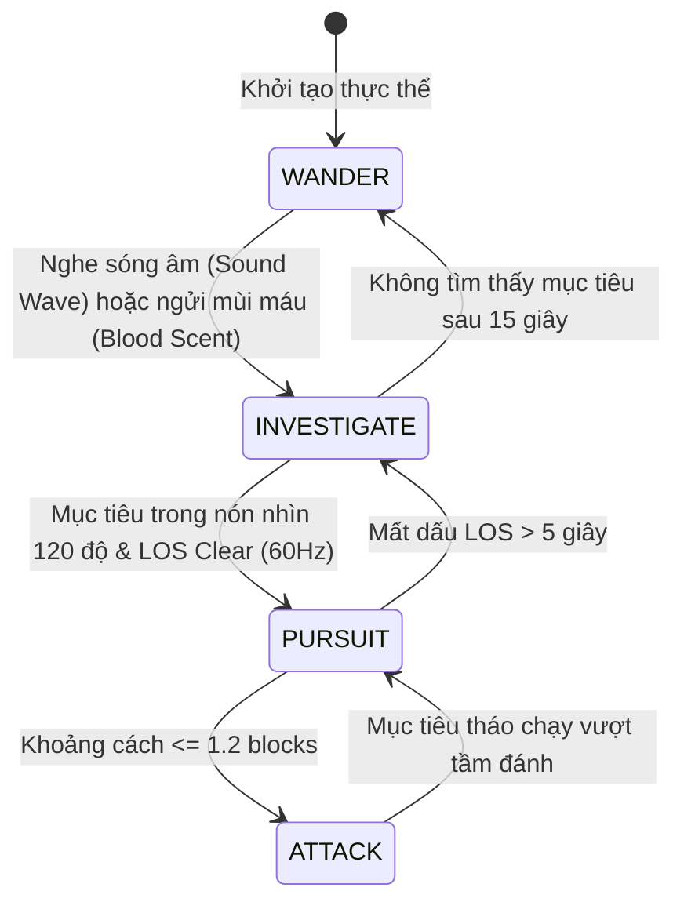
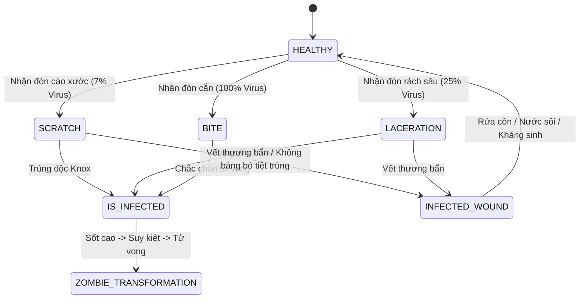
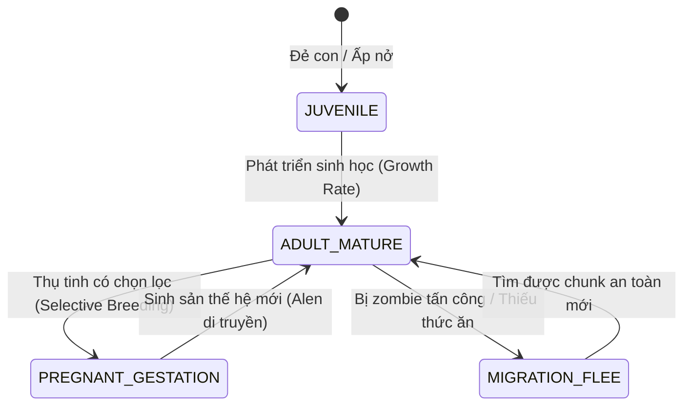
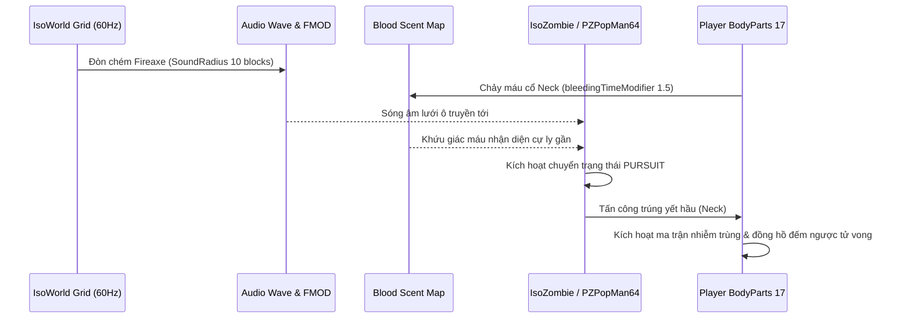

# ## PHẦN C: SƠ ĐỒ MÁY TRẠNG THÁI & LUỒNG DỮ LIỆU (STATE_MACHINE_AND_TICK_PIPELINE)

### 1. Máy Trạng Thái Cốt Lõi (Core State Machines)

#### 1.1. Máy Trạng Thái AI Xác Sống 3 Giác Quan (`IsoZombie_FSM`)

#### 1.2. Máy Trạng Thái Bệnh Lý 3 Cấp Độ (`Pathology_FSM`)

#### 1.3. Máy Trạng Thái Sinh Sản & Di Cư Động Vật (`Animal_Husbandry_FSM`)

### 2. Luồng Dữ Liệu Tick Lưới Ô 60 Hz & Mạng UDP

---
