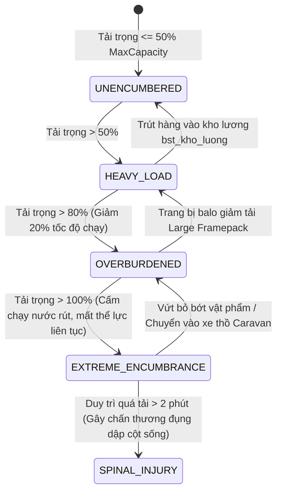
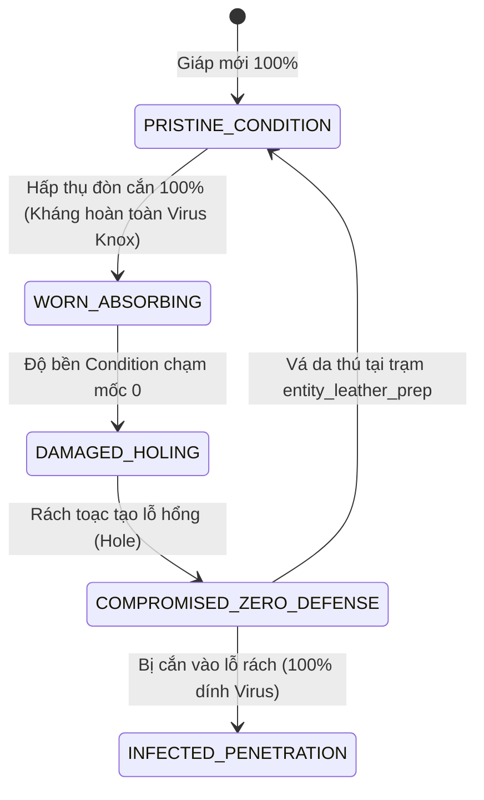
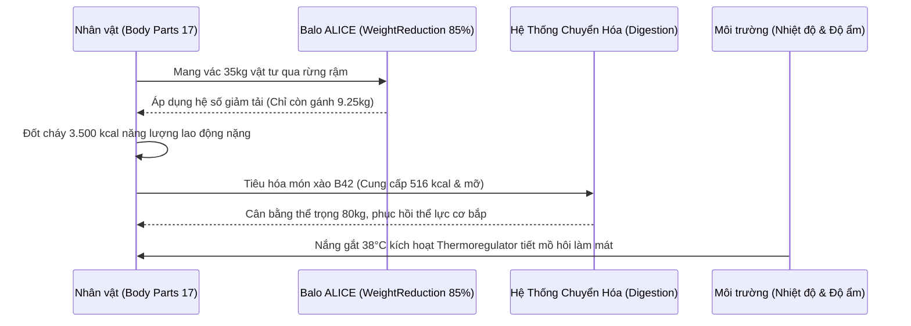

# ## PHẦN C: SƠ ĐỒ MÁY TRẠNG THÁI & LUỒNG DỮ LIỆU (STATE_MACHINE_AND_TICK_PIPELINE)

### 1. Máy Trạng Thái Cốt Lõi (Core State Machines)

#### 2.1. Máy Trạng Thái Tải Trọng & Quản Lý Thùng Chứa Balo (`Encumbrance_Container_FSM`)

#### 2.2. Máy Trạng Thái Suy Hao Giáp Trụ Khi Hấp Thụ Đòn Cắn (`Armor_Degradation_FSM`)

### 2. Luồng Xử Lý Trao Đổi Nhiệt & Dinh Dưỡng Tick Pipeline

---
