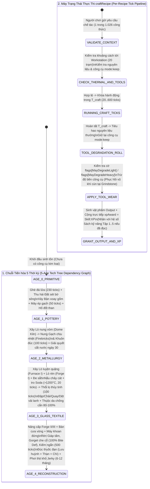

# ## PHẦN C: SƠ ĐỒ MÁY TRẠNG THÁI & LUỒNG DỮ LIỆU (STATE_MACHINE_AND_TICK_PIPELINE)

### 1. Luồng Thực Thi Công Thức Chế Tác & Tiến Hóa 5 Thời Kỳ (Workstation CraftRecipe & 5-Age Progression Pipeline)

---
