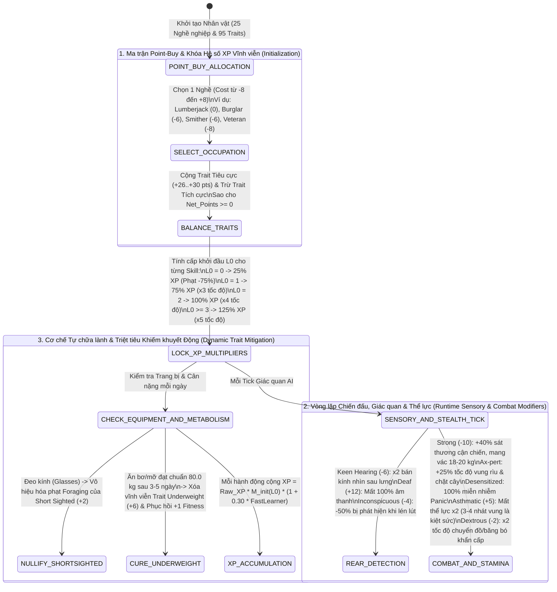

## PHẦN C: SƠ ĐỒ MÁY TRẠNG THÁI & LUỒNG DỮ LIỆU (STATE_MACHINE_AND_TICK_PIPELINE)

### 1. Luồng Khởi Tạo Point-Buy, Nhân Kinh Nghiệm Vĩnh Viễn & Xóa Bỏ Động Khiếm Khuyết (Character Creation & Trait Lifecycle Pipeline)

---

---

### Mối Quan Hệ Đồ Thị Vault (Knowledge Graph Links)
- Trung tâm điều hướng: [[00_Master_MOC]]
- Nhân lực & Y học Nam Dược: [[04_Character_And_Med]]
- Quy tắc gốc AD&D & 5E: [[doc_phb_01_origins]]
- Phương trình toán học đi kèm: [[sys_math_doc04]]
