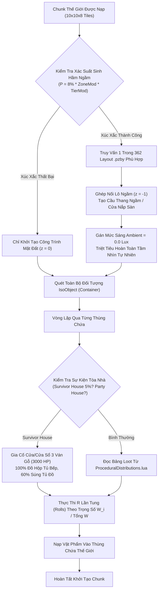
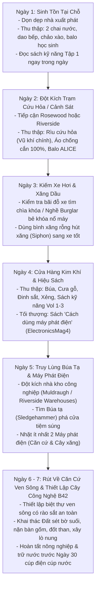

## PHẦN C: SƠ ĐỒ MÁY TRẠNG THÁI & LUỒNG DỮ LIỆU (STATE_MACHINE_AND_TICK_PIPELINE)

### 1. Luồng Khởi Tạo Thùng Chứa Thế Giới, Tính Trọng Số Loot & Sinh Tầng Hầm Ngầm (`World Map & Procedural Basement Tick Pipeline`)

---

### 2. Sơ Đồ Pipeline Lộ Trình 7 Ngày Đầu Tiên Tối Ưu (`Day 1 - Day 7 Survival Route Execution`)

---

---

### Mối Quan Hệ Đồ Thị Vault (Knowledge Graph Links)
- Trung tâm điều hướng: [[00_Master_MOC]]
- Thế giới, Địa lý & Điển tích: [[01_World_And_Factions]]
- Công trình & Căn cứ: [[03_Arsenal_And_Bastions]]
- Phương trình toán học đi kèm: [[sys_math_doc05]]
