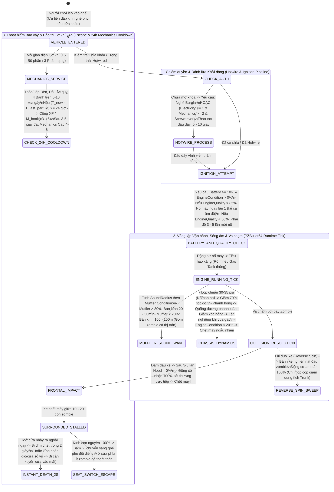

## PHẦN C: SƠ ĐỒ MÁY TRẠNG THÁI & LUỒNG DỮ LIỆU (STATE_MACHINE_AND_TICK_PIPELINE)

### 1. Luồng Khởi Động, Vật Lý Va Chạm, Phát Tán Âm Thanh Ống Xả & Bảo Trì 15 Bộ Phận (`Vehicle Physics & Mechanics Tick Pipeline`)

---

---

### Mối Quan Hệ Đồ Thị Vault (Knowledge Graph Links)
- Trung tâm điều hướng: [[00_Master_MOC]]
- Quân giới, Khí tài & Công trình: [[03_Arsenal_And_Bastions]]
- Đoàn xe thồ bọc sắt Đại Việt: [[crv_xe_tho_boc_sat_15_parts]]
- Phương trình toán học đi kèm: [[sys_math_doc06]]
