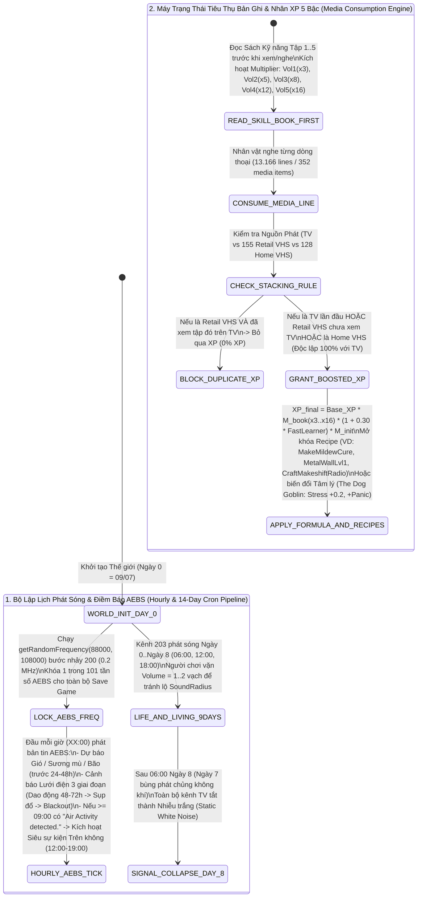

## PHẦN C: SƠ ĐỒ MÁY TRẠNG THÁI & LUỒNG DỮ LIỆU (STATE_MACHINE_AND_TICK_PIPELINE)

### 1. Luồng Phát Sóng 14 Ngày, Dự Báo AEBS Mỗi Giờ & Xử Lý Chồng XP Bản Ghi (`Media, AEBS Oracle & Skill Leveling Pipeline`)

---
