## PHẦN C: SƠ ĐỒ MÁY TRẠNG THÁI & LUỒNG DỮ LIỆU (STATE_MACHINE_AND_TICK_PIPELINE)

### 1. Luồng Điều Phối Máy Chủ Sandbox, Tiến Hóa Quần Thể Voronoi & Nhân Hệ Số Toàn Cục (`Sandbox Director & Runtime Hot-Reload Pipeline`)

```mermaid
stateDiagram-v2
    [*] --> LOAD_SANDBOX_VARS : Khởi tạo Server / Đọc <ServerName>_SandboxVars.lua (Version = 6)

    state "1. Khởi tạo Tham số Thế giới & 5 Preset (World Rules Initialization)" as InitRules {
        LOAD_SANDBOX_VARS --> APPLY_TIME_AND_UTILITIES : Thiết lập DayLength (Def: 1h | Opt: 2h)\nKhóa mốc WaterShut & ElecShut (Def: 0-30 ngày, TB 14 ngày | SixMonthsLater: -1)\nGeneratorFuelConsumption = 0.1 L/h (Opt: 0.05 L/h chạy 10-14 ngày)
        APPLY_TIME_AND_UTILITIES --> APPLY_ZOMBIE_LORE : Thiết lập Speed (1:Sprinters, 2:FastShamblers, 3:Shamblers)\nTransmission (1:Blood+Saliva 7/25/100% | 2:Saliva Only 0/0/100%)\nCognition (1:Biết mở cửa), ActiveTime (2:Night Only), Mortality (6: 2-3 ngày)
    }

    state "2. Động cơ Tiến hóa Quần thể Voronoi & Hồi sinh 72h (Population Director Tick)" as PopDirector {
        APPLY_ZOMBIE_LORE --> DAILY_POP_CURVE : Mỗi ngày cập nhật M_day(d) từ Start(1.0x) -> Peak(1.5x) tại PeakDay(28)\nPhân bổ cụm theo ZombieVoronoiNoise = true & UrbanFocused = 1
        DAILY_POP_CURVE --> REDISTRIBUTE_12H : Mỗi 12.0 giờ (RedistributeHours): Dàn đều các bầy (RallyGroupSize = 20,\nTravel = 20 ô) lấp khoảng trống & Truy âm thanh FollowSoundDistance (100..1000 ô)
        REDISTRIBUTE_12H --> RESPAWN_72H_CHECK : Mỗi 72.0 giờ (RespawnHours): Kiểm tra ô bản đồ\nNếu HoursUnseenByPlayers >= 16.0 giờ -> Hồi sinh 10% (RespawnMultiplier = 0.1)\n(Nếu RespawnHours = 0 -> Khu vực được dọn sạch vĩnh viễn)
    }

    state "3. Bộ Nhân 21 Kênh Loot, 35 Kỹ Năng & Lệnh Admin Nóng (Economy & Hot-Reload)" as EconomyAdmin {
        LOAD_SANDBOX_VARS --> LOOT_21_MODIFIER : Khi mở thùng đồ (Doc 05) -> Nhân xác suất với 1 trong 21 biến Loot\n(Insane 0.05 | Extreme 0.2 | Rare 0.6 | Normal 1.0 | Common 2.0 | Abundant 3.0)
        LOAD_SANDBOX_VARS --> XP_35_MODIFIER : Khi nhận XP (Doc 03/04/07) -> Nhân với XPMultiplier * MultiplierConfig[Skill]\n(Strength/Fitness x5.0 để giảm thời gian cày 1 năm; Blacksmith/Pottery/FlintKnapping x3.0)
        XP_35_MODIFIER --> ADMIN_HOT_RELOAD : Admin gõ lệnh /reloadoptions hoặc /createhorde, /startrain\n-> Cập nhật nóng SandboxVars ngay trong Runtime không cần tắt Server
    }

```

---

---

### Mối Quan Hệ Đồ Thị Vault (Knowledge Graph Links)
- Trung tâm điều hướng: [[00_Master_MOC]]
- Động lực học & Hộp công cụ luật: [[00_System_Engines]], [[doc_dmg_01_survival_box]]
- Phương trình toán học đi kèm: [[sys_math_doc10]]
