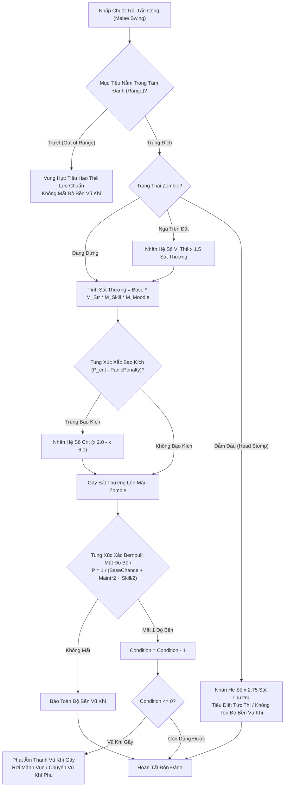
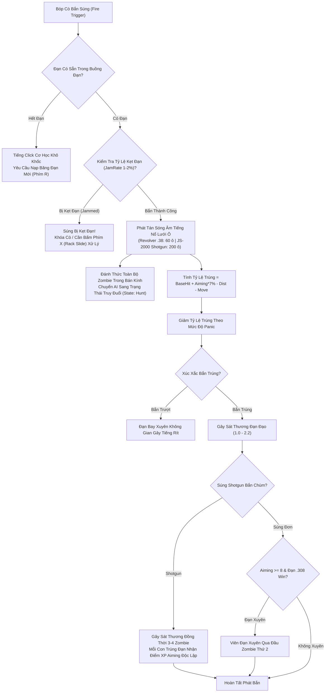

## PHẦN C: SƠ ĐỒ MÁY TRẠNG THÁI & LUỒNG DỮ LIỆU (STATE_MACHINE_AND_TICK_PIPELINE)

### 1. Luồng Máy Trạng Thái Tác Chiến Cận Chiến, Suy Giảm Độ Bền & Đòn Kết Liễu Dẫm Đầu (`Melee Combat & Durability Tick Pipeline`)

---

### 2. Luồng Xử Lý Đạn Đạo Súng Đạn, Kẹt Đạn & Phát Tán Sóng Âm 200 Ô (`Firearms Ballistics, Jamming & Acoustic Event Pipeline`)

---

---

### Mối Quan Hệ Đồ Thị Vault (Knowledge Graph Links)
- Trung tâm điều hướng: [[00_Master_MOC]]
- Quân giới & Khí tài chiến đấu: [[03_Arsenal_And_Bastions]]
- Quy tắc giao tranh AD&D / D&D 5E: [[doc_adnd_06_combat_injury]], [[doc_srd_02_equipment_mastery_craft]]
- Phương trình toán học đi kèm: [[sys_math_doc11]]
