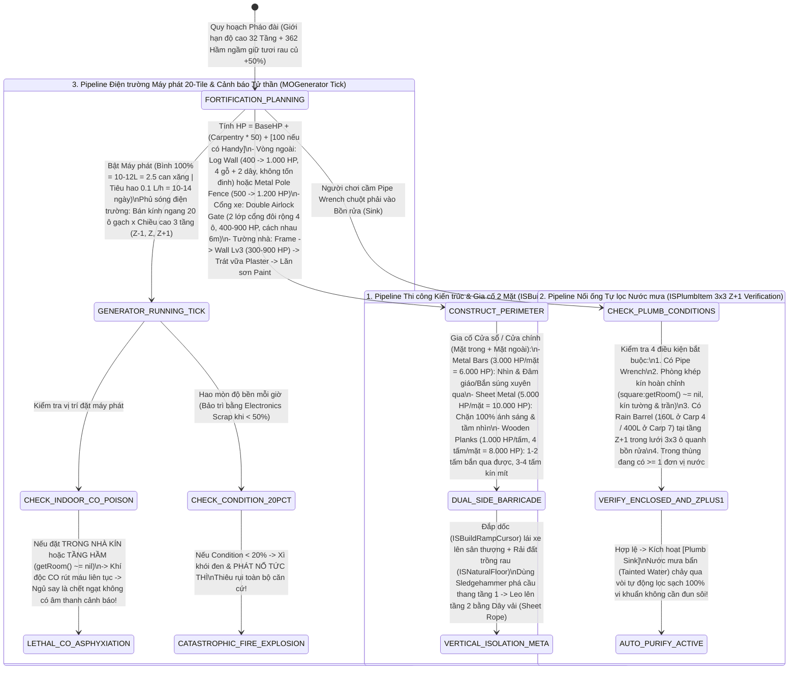

## PHẦN C: SƠ ĐỒ MÁY TRẠNG THÁI & LUỒNG DỮ LIỆU (STATE_MACHINE_AND_TICK_PIPELINE)

### 1. Luồng Xây Dựng 32 Tầng, Gia Cố 2 Mặt, Lọc Nước $3\times 3$ ($Z+1$) & Giám Sát An Toàn Máy Phát (`Architecture, Plumbing & Generator Grid Pipeline`)

---

---

### Mối Quan Hệ Đồ Thị Vault (Knowledge Graph Links)
- Trung tâm điều hướng: [[00_Master_MOC]]
- Căn cứ, Pháo đài & Công trình Bastion: [[03_Arsenal_And_Bastions]], [[doc_dmg_04_bastions]]
- Phương trình toán học đi kèm: [[sys_math_doc12]]
