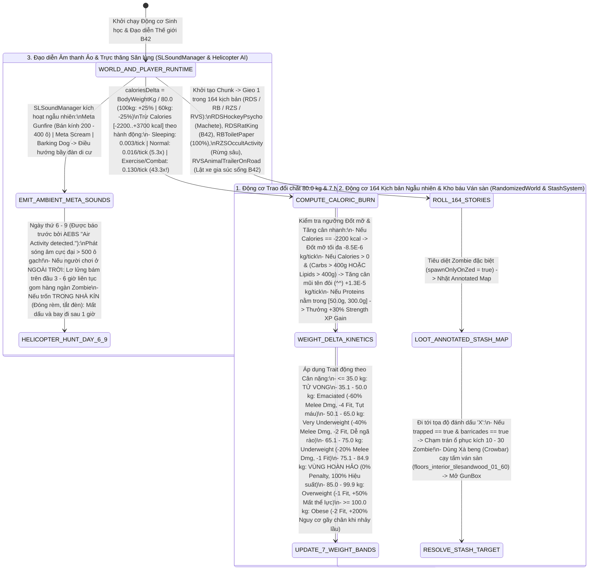

## PHẦN C: SƠ ĐỒ MÁY TRẠNG THÁI & LUỒNG DỮ LIỆU (STATE_MACHINE_AND_TICK_PIPELINE)

### 1. Luồng Trao Đổi Chất 80.0 kg, Cạy Ván Sàn Kho Báu & Đạo Diễn Vô Hình 164 Kịch Bản (`Metabolism 80kg, StashSystem & Meta Director Pipeline`)

---

---

### Mối Quan Hệ Đồ Thị Vault (Knowledge Graph Links)
- Trung tâm điều hướng: [[00_Master_MOC]]
- Động lực học & Chuyển hóa calo cốt lõi: [[00_System_Engines]], [[sys_metabolism_calories]]
- Cột mốc & Kể chuyện nổi sinh RPG: [[doc_prp_01_goals_milestones]]
- Phương trình toán học đi kèm: [[sys_math_doc14]]
