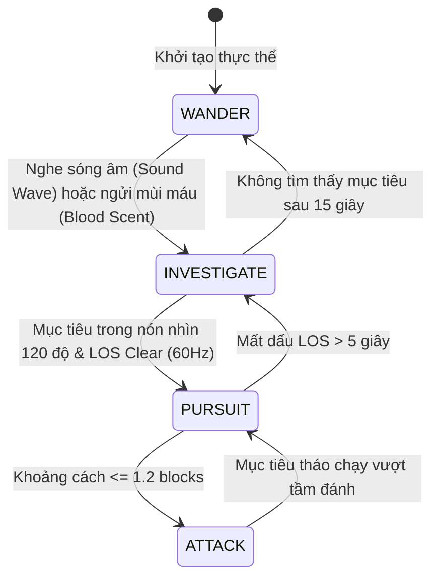
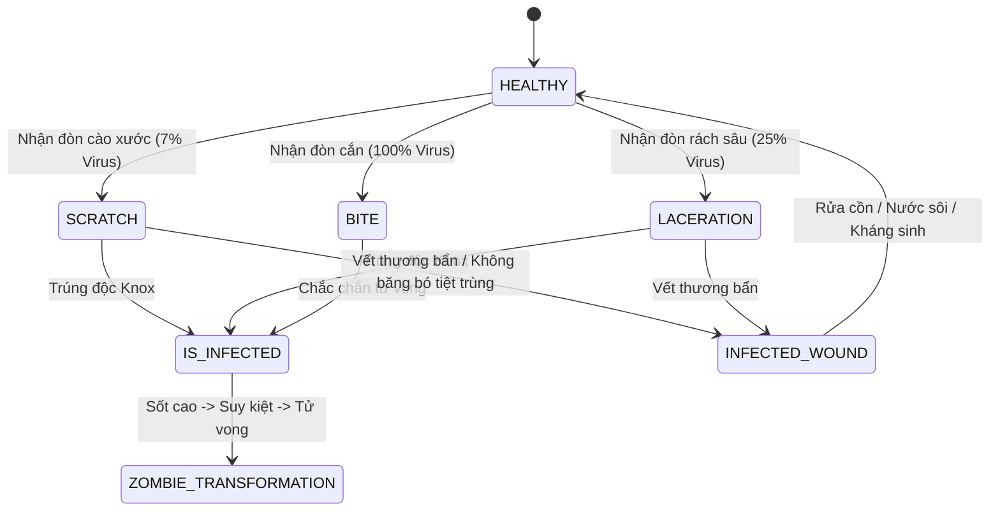
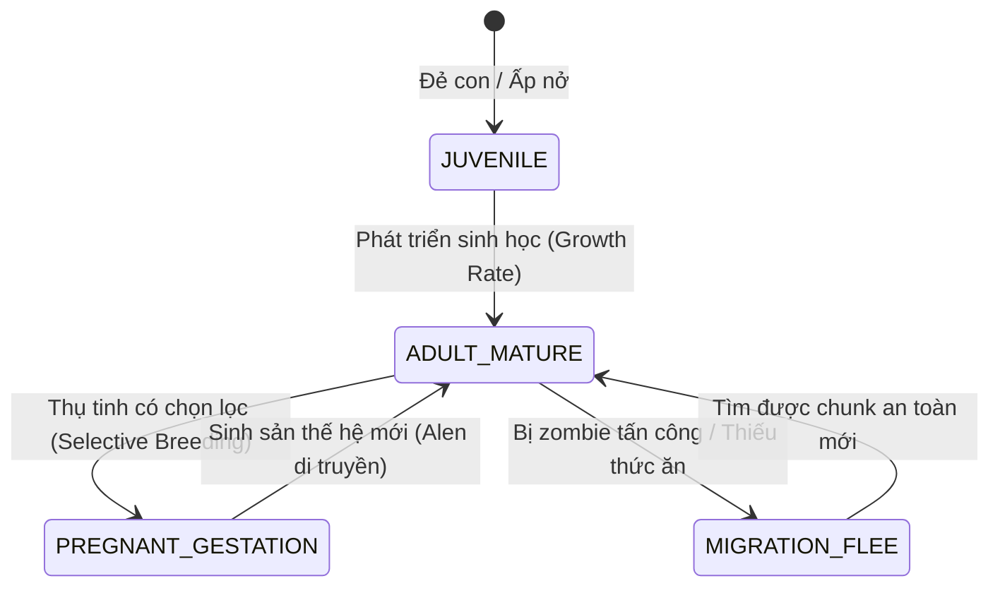
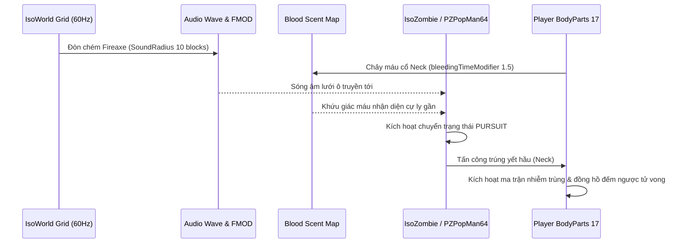

## PHẦN A: BẢNG HẰNG SỐ & PHƯƠNG TRÌNH TOÁN HỌC CỐT LÕI (MATHEMATICAL_FORMULAS_AND_CONSTANTS)

### 1. Phương Trình Toán Học & Mã Giả Thuật Toán (LaTeX & Deterministic Pseudocode)

#### 1.1. Phương trình Hình nón Thị giác & Lan truyền Sóng Âm (AI Sensory Perception)

Một thực thể AI tại tọa độ $\vec{P}_{mob}$ với vector hướng nhìn đơn vị $\vec{F}_{mob}$ phát hiện mục tiêu tại $\vec{P}_{target}$ thông qua kết hợp kiểm tra góc nhìn (FOV Cone $\approx 120^\circ$), Raycast ánh sáng lưới ô (60 Hz từ `Lighting64.dll`) và khoảng cách lan truyền sóng âm ($R_{sound}$):

$$\theta = \arccos\left( \frac{(\vec{P}_{target} - \vec{P}_{mob}) \cdot \vec{F}_{mob}}{\Vert{}\vec{P}_{target} - \vec{P}_{mob}\Vert{}} \right) \le \frac{\text{FOV}}{2} = 60^\circ$$

$$D_{grid} = \Vert{}\vec{P}_{target} - \vec{P}_{mob}\Vert{}_2 \le R_{sound}(\text{Action})$$

```text
FUNCTION Evaluate_AI_Sensory_Trigger(mob, target, action_sound_radius, has_open_bleeding):
    distance = EuclideanDistance(mob.position, target.position)
    
    // 1. Kiểm tra Sóng âm (Hearing & Grid Wave Propagation qua fmod & Grid)
    IF distance <= action_sound_radius THEN
        mob.SetState(INVESTIGATE, target.last_sound_position)
        RETURN TRUE
    END IF

    // 2. Kiểm tra Khứu giác Máu (Blood Sense - Build 42)
    IF has_open_bleeding == TRUE AND target.is_bandaged == FALSE THEN
        IF distance <= mob.blood_scent_detection_range THEN
            mob.SetState(INVESTIGATE, target.position)
            RETURN TRUE
        END IF
    END IF

    // 3. Kiểm tra Hình nón Thị giác (Vision Cone ~120 deg) & Raycast LOS 60Hz
    direction_to_target = Normalize(target.position - mob.position)
    angle_deg = RadiansToDegrees(Acos(DotProduct(mob.facing_vector, direction_to_target)))
    
    IF angle_deg <= (120.0 / 2.0) THEN
        visibility_score = CalculateVisibility(DayNightCycle, WeatherFogRain, target.Camouflage, target.IsCrouching, target.IsSneaking)
        IF Raycast_Grid_LOS(mob.position, target.position) == CLEAR AND distance <= visibility_score THEN
            mob.SetState(PURSUE_TARGET, target)
            RETURN TRUE
        END IF
    END IF
    
    RETURN FALSE
END FUNCTION
```

#### 1.2. Phương trình Tốc độ Chảy máu Tử huyệt & Xác suất Truyền Nhiễm Tuyệt đối (Pathogen Transmission Matrix)

Khi một bộ phận cơ thể $bp \in \text{BODY\_PARTS\_17}$ nhận vết thương loại $w \in \{\text{SCRATCH}, \text{LACERATION}, \text{INFECTED\_BITE}\}$, hệ số thời gian chảy máu và xác suất nhiễm mầm bệnh tử vong (`isInfected`) được xác định bởi:

$$P(\text{Lethal\_Pathogen} \mid w) = \begin{cases} 0.07 & \text{nếu } w = \text{SCRATCH} \\ 0.25 & \text{nếu } w = \text{LACERATION} \\ 1.00 & \text{nếu } w = \text{INFECTED\_BITE} \end{cases}$$

$$T_{\text{bleed\_death}}(\text{NECK}) \in [10.0, 20.0]\text{ giây} \quad (\text{với } M_{\text{bleed\_time}}(\text{NECK}) = 1.5)$$

```text
FUNCTION Process_Wound_And_Infection(player, body_part, attack_type, is_sterile_bandaged):
    // 1. Xác định nguy cơ tử vong do xuất huyết tại tử huyệt
    IF body_part == BODY_PART_NECK THEN
        bleed_rate = BASE_NECK_BLEED_RATE * 1.5
        player.BleedingTimeRemaining = RandomRange(10.0, 20.0) // giây tử vong nếu không cầm máu
    ELSE
        bleed_rate = GetPartBleedRate(body_part)
    END IF

    // 2. Phân định 3 cấp độ lây nhiễm
    roll = RandomFloat(0.0, 1.0)
    IF attack_type == BITE THEN
        player.isInfected = TRUE // 100% Chắc chắn chuyển hóa thành zombie
    ELSE IF attack_type == LACERATION AND roll <= 0.25 THEN
        player.isInfected = TRUE
    ELSE IF attack_type == SCRATCH AND roll <= 0.07 THEN
        player.isInfected = TRUE
    END IF

    // 3. Phân định nhiễm trùng thông thường do vết thương bẩn
    IF is_sterile_bandaged == FALSE AND RandomFloat(0.0, 1.0) <= DIRTY_WOUND_CHANCE THEN
        player.infectedWound = TRUE // Có thể chữa bằng cồn/kháng sinh
    END IF
END FUNCTION
```

#### 1.3. Phương trình Suy giảm Độ bền Vũ khí theo Phân phối Bernoulli (Weapon Durability Decay)

Mỗi đòn đánh trúng mục tiêu kích hoạt phép thử Bernoulli với xác suất hao mòn $P = \frac{1}{\text{ConditionLowerChanceOneIn}}$:

$$P(\Delta C = -1) = \frac{1}{\text{ConditionLowerChanceOneIn}}$$

$$E[\text{Strikes Until Break}] = C_{\max} \times \text{ConditionLowerChanceOneIn}$$

```text
FUNCTION Evaluate_Weapon_Wear(weapon):
    chance_one_in = weapon.ConditionLowerChanceOneIn
    roll = RandomInteger(1, chance_one_in)
    
    IF roll == 1 THEN
        weapon.Condition = Max(0, weapon.Condition - 1)
        IF weapon.Condition == 0 THEN
            weapon.IsBroken = TRUE
            TriggerSoundEvent("Weapon_Snap_Break", weapon.UserPosition)
        END IF
    END IF
END FUNCTION
```

#### 1.4. Phương trình Cân bằng Kinh tế Nội tại 4 Thành phần (Internal Economic Balance)

Một chu trình tài nguyên hoàn chỉnh tuân theo định luật bảo toàn dòng chảy $S \rightarrow P \rightarrow C \rightarrow D$:

$$\frac{d(\text{Pool})}{dt} = \sum \text{Source\_Rate} - \sum \text{Drain\_Rate} \pm \text{Converter\_Rate}$$

```text
FUNCTION Update_Economy_Cycle(delta_time):
    // Sources: Tái tạo tài nguyên tự nhiên (thu hoạch mùa vụ, quặng tái sinh)
    inflow = Agriculture_Source.Generate(delta_time) + Ore_Deposit.Mine(delta_time)
    
    // Drains: Tiêu hao sinh học và vận hành căn cứ
    outflow = Settlement_Hunger.Consume(delta_time) + Bastion_Maintenance.Burn(delta_time)
    
    // Converter: Biến đổi nguyên liệu thô thành thành phẩm
    converted = Smithy_Station.Convert(Iron_Ore, Refined_Steel, delta_time)
    
    Storage_Pool.Amount = Clamp(Storage_Pool.Amount + inflow - outflow, 0, Storage_Pool.MaxCapacity)
END FUNCTION
```

#### 1.5. Phương trình Điều hòa Thân nhiệt Đa tầng (`Thermoregulator`) & Cân bằng Nhiệt Sinh học

Thân nhiệt vùng lõi ($T_{\text{core}}$, chuẩn $37.0^\circ\text{C}$) được cân bằng thông qua trao đổi nhiệt đa tầng giữa 17 vùng cơ thể, các lớp vải/giáp bảo hộ ($L_i$) và môi trường:

$$\frac{dT_{\text{core}}}{dt} = \frac{1}{C_{\text{body}}} \left[ Q_{\text{metabolic}}(\text{Activity}) - Q_{\text{evaporative}}(\text{Sweat}) - \sum_{bp=1}^{17} \frac{A_{bp} (T_{\text{skin}, bp} - T_{\text{ambient}})}{R_{\text{insulation}}(bp) + R_{\text{wetness}}(bp)} \right]$$

- Khi $T_{\text{core}} < 35.0^\circ\text{C}$: Kích hoạt **Trúng hàn (Hypothermia)**, rung cơ giật, ho tiếng vang thu hút AI trong bán kính 15 blocks.
- Khi $T_{\text{core}} > 39.0^\circ\text{C}$: Kích hoạt **Trúng thử (Hyperthermia)**, tụt thể lực, hoa mắt, mất nước tăng gấp $2.5\times$.

```text
FUNCTION Update_Thermoregulation(player, ambient_temp, is_raining, wind_speed, delta_time):
    total_heat_loss = 0.0
    FOR EACH part IN player.BodyParts17:
        insulation = Sum(part.ClothingLayers.Insulation)
        wetness_penalty = part.ClothingWetness * 0.75 // Quần áo ướt giảm 75% độ cách nhiệt
        effective_r = Max(0.1, insulation - wetness_penalty)
        
        part_flux = (part.SkinTemp - ambient_temp) / effective_r
        total_heat_loss += part_flux * part.SurfaceAreaRatio
    ENDFOR

    metabolic_heat = player.CurrentMetabolicRate // Nghỉ ngơi 75W, lao động/chiến đấu 600-900W
    net_heat = (metabolic_heat - total_heat_loss) * delta_time
    player.CoreTemperature += net_heat / player.ThermalMass

    IF player.CoreTemperature < 35.0 THEN
        player.ApplyAffliction("HYPOTHERMIA")
    ELSE IF player.CoreTemperature > 39.0 THEN
        player.ApplyAffliction("HYPERTHERMIA")
    END IF
END FUNCTION
```

#### 1.6. Phương trình Động học Chuyển hóa 4 Thành phần Dinh dưỡng (`Nutrition`) & Thể trọng

Cân nặng nhân vật ($W$, mốc chuẩn $80.0\text{ kg}$) biến thiên theo tích lũy thặng dư hoặc thâm hụt năng lượng từ 4 nhóm dinh dưỡng (`Calories`, `Carbohydrates`, `Proteins`, `Lipids`):

$$\Delta E_{\text{net}} = E_{\text{ingested}}(\text{Calories}) - \left[ BMR + E_{\text{activity}}(\text{Work}) \right]$$

$$\frac{dW}{dt} = \frac{\Delta E_{\text{net}}}{7700.0\text{ kcal/kg}}$$

- Khi $W < 65.0\text{ kg}$ (Thiếu cân nặng): Giảm $35\%$ sức mang vác, giảm $25\%$ sát thương cận chiến.
- Khi $W > 95.0\text{ kg}$ (Thừa cân): Tăng tiêu hao thể lực gấp $1.4\times$, giảm $15\%$ tốc độ chạy nước rút.

```text
FUNCTION Update_Nutrition_And_Weight(player, delta_time_hours):
    bmr = 1800.0 // Nhu cầu năng lượng nền hàng ngày (kcal/ngày)
    activity_burn = player.CalorieBurnRatePerHour * delta_time_hours
    total_burn = (bmr / 24.0) * delta_time_hours + activity_burn
    
    net_calories = player.DigestedCalories - total_burn
    player.BodyWeightKg += net_calories / 7700.0 // 7700 kcal thặng dư = 1 kg thể trọng
    
    // Ảnh hưởng của Protein lên phục hồi cơ bắp & mệt mỏi
    IF player.Nutrients.Proteins < MIN_PROTEIN_THRESHOLD THEN
        player.MuscleFatigueRecoveryMultiplier = 0.5
    ELSE
        player.MuscleFatigueRecoveryMultiplier = 1.0
    END IF
END FUNCTION
```

#### 1.7. Phương trình Suy giảm Xác suất Sửa chữa Lũy tiến (`fixing.txt`)

Mỗi lần sửa chữa một trang bị hoặc vũ khí sử dụng phụ liệu (keo dán, dây buộc, đinh chốt), xác suất thành công giảm dần theo số lần sửa trước đó ($k = \text{RepairsCount}$):

$$P_{\text{success}}(k) = \max\left(0.10, P_{\text{base}} \times (1.0 - k \times 0.20)\right)$$

$$P_{\text{break\_fail}}(k) = 1.0 - P_{\text{success}}(k)$$

```text
FUNCTION Attempt_Item_Fix(item, repair_material, player_skill):
    repairs_count = item.RepairsCount
    base_chance = 0.80 + (player_skill * 0.05)
    success_chance = Max(0.10, base_chance - (repairs_count * 0.20))
    
    roll = RandomFloat(0.0, 1.0)
    IF roll <= success_chance THEN
        item.Condition = Min(item.ConditionMax, item.Condition + CalculateRepairGain(item, repair_material))
        item.RepairsCount += 1
        RETURN SUCCESS
    ELSE
        // Nguy cơ gãy hoàn toàn khi sửa thất bại
        IF RandomFloat(0.0, 1.0) <= 0.30 THEN
            item.IsPermanentlyBroken = TRUE
            RETURN PERMANENT_BREAK
        END IF
        RETURN FAIL
    END IF
END FUNCTION
```

#### 1.8. Phương trình Di truyền Men-đen Động vật (`AnimalGene` & `AnimalAllele`)

Bộ gene của thế hệ con cái ($G_{\text{offspring}}$) được kế thừa từ Alen cha mẹ ($A_{\text{sire}}, A_{\text{dam}}$) trên 5 tính trạng then chốt: Kích thước (`SIZE`), Sản lượng sữa (`MILK`), Sản lượng trứng/con (`FECUNDITY`), Tốc độ sinh trưởng (`GROWTH`), và Tính khí thuần dưỡng (`TAMENESS`):

$$G_{\text{trait}} = \frac{1}{2}(A_{\text{sire}} + A_{\text{dam}}) + \epsilon_{\text{mutation}}, \quad \epsilon_{\text{mutation}} \sim \mathcal{N}(0, \sigma^2)$$

```text
FUNCTION Breed_Animals(sire, dam):
    offspring_genome = New Genome()
    FOR EACH trait IN [SIZE, MILK, FECUNDITY, GROWTH, TAMENESS]:
        inherited_value = (sire.GetAllele(trait) + dam.GetAllele(trait)) / 2.0
        // Xác suất đột biến tự nhiên 5%
        mutation = 0.0
        IF RandomFloat(0.0, 1.0) <= 0.05 THEN
            mutation = RandomGaussian(0.0, 0.15)
        END IF
        offspring_genome.SetTrait(trait, Clamp(inherited_value + mutation, 0.1, 2.5))
    ENDFOR
    RETURN offspring_genome
END FUNCTION
```

#### 1.9. Mô hình Động học Mạng Native UDP & Dự đoán Phía Client (RakNet & Client Prediction)

Để đồng bộ hàng chục ngàn zombie và động vật mà không nghẽn băng thông, server duy trì chu kỳ tick cố định 20 Hz (50ms) trong khi client nội suy ở 60 Hz:

$$\vec{P}_{\text{client}}(t) = \vec{P}_{\text{server}}(t_0) + \int_{t_0}^{t} \vec{V}_{\text{predicted}}(\tau) d\tau + \mathbf{K}_{\text{reconciliation}} (\vec{P}_{\text{server}} - \vec{P}_{\text{client}})$$

---

## PHẦN B: KHỐI JSON KHUÔN MẪU KỸ THUẬT & NGỮ NGHĨA (SEMANTIC_MATH_BLUEPRINTS_JSON)

```json
[
  {
    "blueprint_id": "tpl_wpn:heavy_breaching_axe_01",
    "source_pz_reference": "Base.Fireaxe (Doc 01 - Section 6: Script Architecture)",
    "dnd_ontology_hooks": {
      "system_category": "MARTIAL_MELEE",
      "damage_type": "SLASHING",
      "weapon_mastery": "CLEAVE",
      "adnd_speed_factor": 7,
      "two_handed_property": true,
      "armor_type_modifiers": {
        "UNARMORED": 2,
        "PADDED_CLOTH": 1,
        "LEATHER_HIDE": 1,
        "STUDDED_BRIGANDINE": 0,
        "CHAIN_SCALE": -1,
        "HEAVY_PLATE": -2
      }
    },
    "pz_math_engine": {
      "weight_kg": 3.0,
      "min_damage": 1.2,
      "max_damage": 2.7,
      "max_range_blocks": 1.5,
      "condition_max": 15,
      "condition_lower_chance_one_in": 35,
      "sound_radius_blocks": 10,
      "door_damage": 35,
      "tree_damage": 35,
      "sub_category": "Swinging",
      "two_hand_weapon": true
    },
    "semantic_descriptors": {
      "physical_form_hint": "Vũ khí cán dài cầm 2 tay nặng 3.0 kg, đầu lưỡi rìu bản rộng bằng thép đúc dày, trọng tâm dồn mạnh về phía đầu búa/lưỡi để tối đa hóa động năng bổ dọc và chém ngang.",
      "tactical_behavior_hint": "Vũ khí công phá hạng nặng có tầm với xa (1.5 blocks), cực kỳ uy lực khi dùng để phá cửa gỗ/công trình (DoorDamage 35) hoặc đốn cây (TreeDamage 35). Tuy nhiên mỗi cú bổ tạo ra tiếng vang lớn trong bán kính 10 blocks, dễ thu hút kẻ địch xung quanh.",
      "crafting_maintenance_hint": "Độ bền cơ học rất cao (15 điểm, xác suất hao mòn chỉ 1/35 mỗi đòn trúng). Khi hỏng có thể gia cố lại bằng keo, dây buộc hoặc đinh chốt nhưng hiệu suất sửa chữa sẽ suy giảm lũy tiến qua từng lần gia cố."
    },
    "cross_module_foreign_keys": {
      "inflicts_wound_types": ["LACERATION", "DEEP_WOUND", "FRACTURE"],
      "requires_skill_id": "skill:axe",
      "repair_material_tag": "mat_tag:wood_adhesive_or_fastener"
    }
  },
  {
    "blueprint_id": "tpl_mob:sensory_horde_undead_01",
    "source_pz_reference": "IsoZombie / PZPathFind64 / PZPopMan64 (Doc 01 - Section 2 & Section 4: Horde Dynamics)",
    "dnd_ontology_hooks": {
      "creature_type": "UNDEAD",
      "behavior_alignment": "UNALIGNED_PREDATORY",
      "sensory_capabilities": ["VISION_CONE_120", "GRID_WAVE_HEARING", "OLFACTORY_BLOOD_SENSE"]
    },
    "pz_math_engine": {
      "vision_fov_degrees": 120.0,
      "lighting_los_raycast_hz": 60,
      "hearing_sound_threshold_blocks": {
        "footstep_walk": 4,
        "footstep_sprint": 12,
        "window_smash": 18,
        "gunshot_shotgun": 150
      },
      "blood_scent_detection_radius": 25.0,
      "attack_transmission_probabilities": {
        "scratch": 0.07,
        "laceration": 0.25,
        "bite": 1.00
      }
    },
    "semantic_descriptors": {
      "physical_form_hint": "Thực thể xác chết biết đi mang dấu hiệu hoại tử, cơ hàm biến dạng và móng tay sắc nhọn dính máu đông.",
      "tactical_behavior_hint": "Vận hành theo máy trạng thái kích thích giác quan: chuyển từ Lang Thang (WANDER) sang Điều Tra (INVESTIGATE) khi bắt được sóng âm hoặc mùi máu; chuyển sang Truy Đuổi (PURSUIT) khi mục tiêu nằm trong nón nhìn 120 độ có đường ngắm quang học rõ ràng.",
      "crafting_maintenance_hint": "Khi tiêu diệt có thể phân giải xác chết để lấy quần áo cũ, mảnh vải rách hoặc mẫu máu nhiễm bệnh."
    },
    "cross_module_foreign_keys": {
      "inflicts_affliction_id": "tpl_aff:lethal_necrotic_pathogen_01",
      "native_pathfinder_module": "PZPathFind64.dll",
      "virtual_population_manager": "PZPopMan64.dll"
    }
  },
  {
    "blueprint_id": "tpl_aff:lethal_necrotic_pathogen_01",
    "source_pz_reference": "BodyDamage / BodyPartType (Doc 01 - Section 5: Human Physiology)",
    "dnd_ontology_hooks": {
      "system_category": "PATHOLOGY_AFFLICTION",
      "virulence_severity": "TERMINAL_LETHAL",
      "incubation_period_hours": 72.0
    },
    "pz_math_engine": {
      "transmission_matrix": {
        "SCRATCH": 0.07,
        "LACERATION": 0.25,
        "BITE": 1.00
      },
      "vital_neck_bleed_multiplier": 1.5,
      "neck_bleed_death_seconds": [10.0, 20.0],
      "pathology_flags": {
        "is_infected": "Vô phương cứu chữa trong vanilla; tiến triển qua Sốt, Lo âu, Suy kiệt và Chết biến thành zombie",
        "is_fake_infected": "Hội chứng giả nhiễm do sợ hãi/Hypochondriac; sốt buồn nôn nhưng tự khỏi sau 48-72h",
        "infected_wound": "Nhiễm khuẩn thông thường do vết thương bẩn; chữa khỏi bằng cồn, nước sôi, kháng sinh"
      }
    },
    "semantic_descriptors": {
      "physical_form_hint": "Mầm bệnh ký sinh trong máu làm suy đồi tế bào sống, đẩy thân nhiệt lên cao và phá hủy hệ miễn dịch.",
      "tactical_behavior_hint": "Khi bị cắn tại vùng cổ (Neck), tốc độ xuất huyết nhân 1.5x khiến người chơi tử vong trong 10-20 giây nếu không có băng gạc vô trùng sẵn trên tay.",
      "crafting_maintenance_hint": "Vết thương nhiễm khuẩn (infectedWound) đòi hỏi cồn y tế hoặc nước sôi khử trùng để ngăn ngừa hoại tử mô mềm."
    },
    "cross_module_foreign_keys": {
      "targeted_body_parts": ["HEAD", "NECK", "TORSO_UPPER", "TORSO_LOWER", "GROIN", "UPPER_ARM_L", "UPPER_ARM_R", "FOREARM_L", "FOREARM_R", "HAND_L", "HAND_R", "UPPER_LEG_L", "UPPER_LEG_R", "LOWER_LEG_L", "LOWER_LEG_R", "FOOT_L", "FOOT_R"],
      "curative_item_tag": "item_tag:disinfectant_alcohol"
    }
  },
  {
    "blueprint_id": "tpl_bas:husbandry_processing_stations_01",
    "source_pz_reference": "media/scripts/entities/animals/workstations (Doc 01 - Section 3: Animal Systems)",
    "dnd_ontology_hooks": {
      "system_category": "BASTION_FACILITY",
      "facility_tier": "FARMING_HUSBANDRY",
      "required_settlement_level": 2
    },
    "pz_math_engine": {
      "station_work_efficiency_multiplier": 1.25,
      "registered_sub_stations": [
        "entity_butcher_hook",
        "entity_leather_prep",
        "entity_butter_churn",
        "entity_chickenhutch",
        "entity_feedingtrough",
        "entity_spinning_wheel"
      ],
      "processing_outputs": {
        "butcher_hook": ["Carcase_Meat", "Animal_Fat", "Raw_Hide"],
        "leather_prep": ["Tanned_Leather", "Cured_Pelt"],
        "butter_churn": ["Fresh_Butter", "Buttermilk"],
        "chickenhutch": ["Fresh_Eggs", "Fertile_Hatch_Egg"],
        "feedingtrough": ["Animal_Satiation_Buffer"],
        "spinning_wheel": ["Yarn_Wool_Spool"]
      }
    },
    "semantic_descriptors": {
      "physical_form_hint": "Tổ hợp các trạm chế biến nông trại và gia súc được đóng từ gỗ xẻ, móc sắt rèn và đá mài.",
      "tactical_behavior_hint": "Biến đổi chuỗi chăn nuôi gia súc thành thực phẩm dự trữ giàu Calo/Protein và nguyên liệu thuộc da may áo giáp ấm chống rét mùa đông.",
      "crafting_maintenance_hint": "Cần bảo dưỡng định kỳ máng ăn và khử trùng móc treo thịt để tránh ô nhiễm vi sinh vật thu hút ruồi bọ và zombie."
    },
    "cross_module_foreign_keys": {
      "consumes_livestock_id": "tpl_mob:animal_livestock_bovine_01",
      "requires_bastion_component": "bst_lo_ren_than_da"
    }
  },
  {
    "blueprint_id": "tpl_evt:aerial_acoustic_lure_01",
    "source_pz_reference": "MetaEvents / HelicopterEvent (Doc 01 - Section 4: Metagame Events)",
    "dnd_ontology_hooks": {
      "system_category": "WORLD_META_EVENT",
      "threat_level": "EXTREME_MIGRATION",
      "event_frequency_days": [6, 12]
    },
    "pz_math_engine": {
      "event_sound_radius_blocks": 250.0,
      "hover_duration_game_minutes": [60, 180],
      "virtual_zombie_pull_velocity": 0.85,
      "event_flight_pattern": "ORBITING_OVER_TARGET"
    },
    "semantic_descriptors": {
      "physical_form_hint": "Hiện tượng âm thanh di động cực lớn trên không trung (máy bay trực thăng hoặc đại phong lôi chấn động).",
      "tactical_behavior_hint": "Âm thanh vang dội 250 blocks kích hoạt toàn bộ thực thể Undead trên hàng chục chunk rừng và đô thị chuyển sang trạng thái di cư ồ ạt, phá vỡ hoàn toàn sự an toàn của các căn cứ định cư.",
      "crafting_maintenance_hint": "Chỉ có thể phòng tránh bằng cách trú ẩn sâu trong nhà kín trước khi sự kiện bắt đầu, che rèm cửa và tắt toàn bộ nguồn sáng."
    },
    "cross_module_foreign_keys": {
      "affects_entity_id": "tpl_mob:sensory_horde_undead_01",
      "monitored_by_system": "sys_ai_sensory"
    }
  },
  {
    "blueprint_id": "tpl_mob:animal_wildlife_cervidae_01",
    "source_pz_reference": "zombie.characters.animals (Doc 01 - Section 3: Animal Systems - Cervidae & Wild Game)",
    "dnd_ontology_hooks": {
      "creature_type": "BEAST",
      "behavior_alignment": "UNALIGNED_HERBIVORE",
      "sensory_capabilities": ["VISION_CONE_300", "ACUTE_HEARING", "UPWIND_OLFACTORY"]
    },
    "pz_math_engine": {
      "catalog_species": ["Buck", "Doe", "Fawn", "Boar", "Rabbit", "Raccoon"],
      "vision_fov_degrees": 300.0,
      "hearing_detection_radius": 35.0,
      "flee_speed_multiplier": 1.75,
      "migration_group_size": [3, 8],
      "tracking_footprint_decay_hours": 12.0
    },
    "semantic_descriptors": {
      "physical_form_hint": "Thú rừng hoang dã (hươu sao, nai sừng tấm, lợn rừng) có khứu giác và thính giác cực kỳ nhạy bén, tầm nhìn ngoại vi mở rộng đến 300 độ.",
      "tactical_behavior_hint": "Di chuyển theo bầy đàn (MigrationGroup). Luôn tháo chạy khi phát hiện tiếng chân người hoặc zombie trong bán kính 35 blocks; để lại dấu vết chân cỏ dập (AnimalTracks) cho thợ săn lần theo.",
      "crafting_maintenance_hint": "Khi săn bắn thành công mang lại thịt tươi nguyên tảng giàu protein và da thú thô (Raw_Hide) để thuộc da tại trạm entity_leather_prep."
    },
    "cross_module_foreign_keys": {
      "harvested_at_station": "tpl_bas:husbandry_processing_stations_01",
      "tracks_system_id": "AnimalTracks"
    }
  },
  {
    "blueprint_id": "tpl_mob:animal_livestock_bovine_01",
    "source_pz_reference": "zombie.characters.animals (Doc 01 - Section 3: Animal Systems - Bovines & Ovines)",
    "dnd_ontology_hooks": {
      "creature_type": "BEAST_DOMESTIC",
      "behavior_alignment": "UNALIGNED_PASSIVE",
      "husbandry_tier": "SELECTIVE_BREEDING"
    },
    "pz_math_engine": {
      "catalog_species": ["Bull", "Cow", "Calf", "Sheep", "Lamb", "Sow", "Piglet"],
      "gestation_period_game_days": 28.0,
      "milk_yield_liters_per_day": [4.0, 12.0],
      "wool_yield_kg_per_shear": [2.5, 5.0],
      "genetic_traits": ["SIZE", "MILK_YIELD", "GROWTH_RATE", "TAMENESS"]
    },
    "semantic_descriptors": {
      "physical_form_hint": "Gia súc chăn nuôi thuần dưỡng (bò sữa, bò mộng, cừu, heo) sở hữu bộ gene di truyền qua các thế hệ phối giống có chọn lọc.",
      "tactical_behavior_hint": "Cần được bảo vệ trong chuồng trại kiên cố; phát ra tiếng kêu khi đói hoặc bị zombie đe dọa, có nguy cơ thu hút bầy zombie nếu đồn trại bị hở tường rào.",
      "crafting_maintenance_hint": "Cung cấp nguồn sữa tươi ổn định để làm bơ (Butter) tại entity_butter_churn và lông cừu để kéo sợi tại entity_spinning_wheel."
    },
    "cross_module_foreign_keys": {
      "requires_workstation_hook": "tpl_bas:husbandry_processing_stations_01",
      "uses_genetics_engine": "AnimalGenomeDefinitions"
    }
  },
  {
    "blueprint_id": "tpl_sys:native_subsystem_polyglot_01",
    "source_pz_reference": "Native C++ DLLs (Doc 01 - Section 2: Tri-layer Architecture)",
    "dnd_ontology_hooks": {
      "system_category": "CORE_NATIVE_ENGINE",
      "execution_layer": "NATIVE_X86_64_JVM_JNI",
      "gc_impact": "ZERO_STOP_THE_WORLD_GC"
    },
    "pz_math_engine": {
      "registered_native_modules": {
        "PZPathFind64.dll": "Tính toán A* cho 10.000 zombie mà không phân bổ object trên RAM Java",
        "Lighting64.dll": "Raycasting và ma trận bitmask ánh sáng 60 Hz",
        "PZPopMan64.dll": "Quản lý quần thể zombie ảo (Virtual Zombies) ngoài vùng hiển thị",
        "PZBullet64.dll": "Vật lý va chạm xe, ma sát lốp và trọng tâm",
        "RakNet64.dll": "Giao thức UDP tốc độ cao chống rớt gói và Client Prediction",
        "fmod.dll": "Âm thanh không gian 3D, cản âm qua tường và cảnh báo nhịp tim hoảng loạn"
      }
    },
    "semantic_descriptors": {
      "physical_form_hint": "Hệ thống module mã máy C++ nhị phân liên kết với Java qua JNI, chịu trách nhiệm cho các phép toán nặng hàng triệu chu kỳ mỗi giây.",
      "tactical_behavior_hint": "Bảo đảm game chạy mượt mà ở mức 60 FPS ngay cả khi có bầy xác sống hàng ngàn con vây hãm căn cứ.",
      "crafting_maintenance_hint": "Là nền tảng kiến trúc bắt buộc phải được duy trì khi thiết kế các hệ thống mở rộng hoặc modding quy mô lớn."
    },
    "cross_module_foreign_keys": {
      "supports_entity_id": "tpl_mob:sensory_horde_undead_01",
      "network_engine_id": "RakNet"
    }
  },
  {
    "blueprint_id": "tpl_item:medical_disinfection_dressing_01",
    "source_pz_reference": "zombie.characters.BodyDamage (Doc 01 - Section 5: Medical Care)",
    "dnd_ontology_hooks": {
      "system_category": "MEDICAL_SUPPLY",
      "sterility_level": "HOSPITAL_GRADE"
    },
    "pz_math_engine": {
      "infection_cure_probability": 0.95,
      "disinfection_potency": {
        "alcohol_rub": 1.0,
        "boiled_water": 0.75,
        "antibiotics_course": 1.0
      },
      "bandage_durability_hours": 18.0
    },
    "semantic_descriptors": {
      "physical_form_hint": "Băng vải tiệt trùng, cồn y tế hoặc nước sôi khử khuẩn dùng để điều trị các vết thương bị nhiễm trùng vi khuẩn (infectedWound).",
      "tactical_behavior_hint": "Cứu sống nhân vật khỏi cái chết do nhiễm độc máu thông thường; tuy nhiên hoàn toàn bất lực trước virus Knox tử thần (isInfected).",
      "crafting_maintenance_hint": "Có thể chế tạo băng gạc tiệt trùng bằng cách đun sôi vải rách trong nồi nước sôi trên bếp lửa."
    },
    "cross_module_foreign_keys": {
      "treats_condition_id": "tpl_aff:lethal_necrotic_pathogen_01",
      "requires_item_tag": "item_tag:disinfectant_alcohol"
    }
  },
  {
    "blueprint_id": "tpl_item:nutrition_macronutrient_ration_01",
    "source_pz_reference": "zombie.characters.Nutrition (Doc 01 - Section 5: Nutrition Systems)",
    "dnd_ontology_hooks": {
      "system_category": "SURVIVAL_RATION",
      "nutritional_density": "BALANCED_MACRO"
    },
    "pz_math_engine": {
      "calories_kcal": 650.0,
      "carbohydrates_g": 75.0,
      "proteins_g": 35.0,
      "lipids_g": 20.0,
      "weight_kg": 0.6
    },
    "semantic_descriptors": {
      "physical_form_hint": "Khẩu phần lương khô dinh dưỡng cao kết hợp ngũ cốc, thịt sấy và mỡ động vật.",
      "tactical_behavior_hint": "Cung cấp năng lượng tức thì để duy trì thể trọng 80 kg, ngăn chặn teo cơ bắp và giảm mỏi mệt khi phải lao động nặng hoặc kéo xe thồ hàng.",
      "crafting_maintenance_hint": "Được chế biến từ sản phẩm của trạm chăn nuôi entity_butcher_hook và entity_butter_churn."
    },
    "cross_module_foreign_keys": {
      "produced_by_station": "tpl_bas:husbandry_processing_stations_01",
      "regulates_system": "sys_metabolism_calories"
    }
  }
]
```

---

## PHẦN C: SƠ ĐỒ MÁY TRẠNG THÁI & LUỒNG DỮ LIỆU (STATE_MACHINE_AND_TICK_PIPELINE)

### 1. Máy Trạng Thái Cốt Lõi (Core State Machines)

#### 1.1. Máy Trạng Thái AI Xác Sống 3 Giác Quan (`IsoZombie_FSM`)



#### 1.2. Máy Trạng Thái Bệnh Lý 3 Cấp Độ (`Pathology_FSM`)



#### 1.3. Máy Trạng Thái Sinh Sản & Di Cư Động Vật (`Animal_Husbandry_FSM`)



### 2. Luồng Dữ Liệu Tick Lưới Ô 60 Hz & Mạng UDP



---

## PHẦN D: BẢNG KIỂM TRA KHÓA NGOẠI (FOREIGN_KEY_DEPENDENCY_CHECK)

### 1. Danh mục Khóa Ngoại & Khuôn Mẫu Đã Định Nghĩa Tại Document 01 (`DEFINED_IDS`)

* `sys_math:ai_sensory_perception_cone_and_sound_wave` (Phương trình nón thị giác $120^\circ$, Raycast $60	ext{ Hz}$, sóng âm $3	ext{--}200	ext{ blocks}$ và khứu giác máu).
* `sys_math:anatomy_17parts_bleed_and_infection_matrix` (Phương trình tử huyệt cổ `bleedingTimeModifier = 1.5`, chết sau $10	ext{--}20	ext{s}$, và ma trận lây nhiễm $7\% / 25\% / 100\%$).
* `sys_math:weapon_durability_bernoulli_decay` (Phương trình suy giảm độ bền $P = 1 / 	ext{ConditionLowerChanceOneIn}$).
* `sys_math:internal_economy_balance_4elements` (Phương trình bảo toàn 4 thành phần Source, Drain, Pool, Converter).
* `sys_math:thermoregulation_multilayer_core_equilibrium` (Phương trình thân nhiệt đa tầng lõi $37^\circ	ext{C}$ và sốc nhiệt).
* `sys_math:macronutrient_nutrition_weight_dynamics` (Phương trình dinh dưỡng 4 chất và thể trọng $80	ext{ kg}$).
* `sys_math:fixing_progressive_repair_degradation` (Phương trình suy giảm xác suất sửa đồ trong `fixing.txt`).
* `sys_math:animal_genetics_mendelian_inheritance` (Phương trình kế thừa alen di truyền 5 tính trạng động vật).
* `sys_math:native_polyglot_network_client_prediction` (Mô hình tính toán UDP RakNet & bù trễ 60 Hz).
* `tpl_wpn:heavy_breaching_axe_01` (Khuôn mẫu chuẩn hóa từ `Base.Fireaxe`).
* `tpl_mob:sensory_horde_undead_01` (Khuôn mẫu AI bầy đàn xác sống 3 giác quan).
* `tpl_aff:lethal_necrotic_pathogen_01` (Khuôn mẫu 3 tầng bệnh lý: `isInfected`, `isFakeInfected`, `infectedWound`).
* `tpl_bas:husbandry_processing_stations_01` (Tổ hợp 6 trạm làm việc chăn nuôi/sơ chế Build 42).
* `tpl_evt:aerial_acoustic_lure_01` (Khuôn mẫu siêu sự kiện âm thanh di động trên không & tiếng động xa xăm).
* `tpl_mob:animal_wildlife_cervidae_01` (Khuôn mẫu thú hoang hoang dã, di cư đàn và dấu vết `AnimalTracks`).
* `tpl_mob:animal_livestock_bovine_01` (Khuôn mẫu gia súc thuần dưỡng, di truyền học và sản lượng).
* `tpl_sys:native_subsystem_polyglot_01` (Đặc tả 6 module C++ Native: PZPathFind64, Lighting64, PZPopMan64, PZBullet64, RakNet64, FMOD).
* `tpl_item:medical_disinfection_dressing_01` (Khuôn mẫu vật phẩm tiệt trùng cứu chữa `infectedWound`).
* `tpl_item:nutrition_macronutrient_ration_01` (Khuôn mẫu khẩu phần dinh dưỡng đa vi lượng duy trì thể trọng).

### 2. Danh mục Khóa Ngoại Đang Chờ Các Tài Liệu Tiếp Theo Định Nghĩa (`PENDING_EXTERNAL_IDS`)

* **Đang chờ Doc 02 (`Item Encyclopedia`):**
  * Toàn bộ catalog vật phẩm chi tiết, thông số cách nhiệt từng lớp trang phục trên 17 bộ phận cơ thể.
* **Đang chờ Doc 03 (`Crafting Tech Tree Guide`):**
  * Công thức chi tiết của các công cụ thợ mộc, rèn đúc và vật liệu kết dính `mat_tag:wood_adhesive_or_fastener`.
* **Đang chờ Doc 04 (`Professions & Traits Bible`):**
  * Bảng thuộc tính chi tiết của trait `tpl_trait:hypochondriac` và cây kỹ năng rìu `skill:axe`.
