## PHẦN A: BẢNG HẰNG SỐ & PHƯƠNG TRÌNH TOÁN HỌC CỐT LÕI (MATHEMATICAL_FORMULAS_AND_CONSTANTS)

### 1. Phương Trình Toán Học & Mã Giả Thuật Toán (LaTeX & Deterministic Pseudocode)

#### 1.1. Phương trình Tiến hóa Mật độ Quần thể Thực thể theo Ngày & Hồi sinh Ô Bản đồ (`PopulationMultiplier` & Cell Respawn Curve)


Tại ngày sinh tồn thứ $d \ge 0$, mật độ quần thể mục tiêu $P_{\text{target}}(d)$ trong một ô bản đồ (Cell) có mật độ gốc $P_{\text{base}}(\text{Cell}, \text{VoronoiNoise})$ được nội suy tuyến tính từ Hệ số Ngày đầu ($M_{\text{start}} = 1.0$) đến Hệ số Đỉnh điểm ($M_{\text{peak}} = 1.5$) tại Ngày Đỉnh điểm ($D_{\text{peak}} = 28$), nhân với Hệ số Quần thể Toàn cục ($M_{\text{pop}} = 1.0$):

$$M_{\text{day}}(d) = \begin{cases} M_{\text{start}} + \left(\frac{d}{D_{\text{peak}}}\right) \times (M_{\text{peak}} - M_{\text{start}}) & \text{nếu } 0 \le d < D_{\text{peak}} \\ M_{\text{peak}} & \text{nếu } d \ge D_{\text{peak}} \end{cases}$$

$$P_{\text{target}}(\text{Cell}, d) = P_{\text{base}}(\text{Cell}) \times M_{\text{pop}} \times M_{\text{day}}(d)$$

Khi số lượng thực thể hiện tại $P_{\text{current}}(\text{Cell}) < P_{\text{target}}(\text{Cell}, d)$, lượng thực thể hồi sinh $\Delta P_{\text{respawn}}$ sau mỗi chu kỳ $T_{\text{respawn}} = 72.0\text{ giờ}$ chỉ được kích hoạt nếu thời gian ô gạch không bị người chơi nhìn thấy hoặc đi qua ($T_{\text{unseen}}$) thỏa mãn $T_{\text{unseen}} \ge 16.0\text{ giờ}$:

$$\Delta P_{\text{respawn}}(\text{Cell}) = \begin{cases} \min\Big( P_{\text{target}} - P_{\text{current}}, \, P_{\text{target}} \times M_{\text{respawn}} \Big) & \text{nếu } \Delta t \ge T_{\text{respawn}} \land T_{\text{unseen}} \ge 16.0\text{h} \\ 0 & \text{trường hợp khác} \end{cases}$$

(Trong đó mặc định $M_{\text{respawn}} = 0.10$ tương đương $10\%$ quần thể mục tiêu mỗi $72.0\text{ giờ}$, và cứ mỗi $T_{\text{redist}} = 12.0\text{ giờ}$ các thực thể sẽ tự động di cư lấp vào khoảng trống; tụ thành bầy `RallyGroupSize` $= 20$ con với bán kính bám đàn `RallyTravelDistance` $= 20$ ô và truy vết âm thanh `FollowSoundDistance` $= 100$ ô [tối đa $1000$ ô]).

```text
FUNCTION Update_Cell_Population_And_Respawn(cell, current_day, elapsed_hours):
    // 1. Tính hệ số tiến hóa quần thể theo ngày (Peak Day = 28)
    IF current_day < SandboxVars.PopulationPeakDay THEN
        progress = current_day / SandboxVars.PopulationPeakDay
        day_mult = SandboxVars.PopulationStartMultiplier + progress * (SandboxVars.PopulationPeakMultiplier - SandboxVars.PopulationStartMultiplier)
    ELSE
        day_mult = SandboxVars.PopulationPeakMultiplier
    END IF

    target_pop = cell.BaseVoronoiPop * SandboxVars.PopulationMultiplier * day_mult

    // 2. Kiểm tra điều kiện Hồi sinh (RespawnHours = 72.0, RespawnUnseenHours = 16.0)
    IF SandboxVars.RespawnHours > 0.0 AND cell.HoursSinceLastRespawn >= SandboxVars.RespawnHours THEN
        IF cell.HoursUnseenByPlayers >= SandboxVars.RespawnUnseenHours THEN
            spawn_quota = target_pop * SandboxVars.RespawnMultiplier // Mặc định 0.1 (10%)
            actual_spawn = Min(target_pop - cell.CurrentPop, spawn_quota)
            IF actual_spawn > 0 THEN
                SpawnVirtualEntitiesInCell(cell, actual_spawn)
            END IF
            cell.HoursSinceLastRespawn = 0.0
        END IF
    END IF

    // 3. Tái phân bổ lấp khoảng trống mỗi 12.0 giờ (RedistributeHours)
    IF cell.HoursSinceLastRedistribute >= SandboxVars.RedistributeHours THEN
        RedistributeEntitiesToEmptyChunks(cell, SandboxVars.RallyGroupSize, SandboxVars.RallyTravelDistance)
        cell.HoursSinceLastRedistribute = 0.0
    END IF
END FUNCTION

```

#### 1.2. Phương trình Điều biến Xác suất Rơi Đồ 21 Danh mục (`21-Category Granular Loot Factor`)


Kết hợp với phương trình `ProceduralDistributions` (từ Doc 05), xác suất rơi thực tế của một vật phẩm $i_k$ thuộc danh mục chiến lợi phẩm $C_m \in \text{LootCategories}_{21}$ được nhân trực tiếp với Hệ số Độ hiếm Sandbox $F_{\text{loot}}(C_m) \in \{0.05, 0.2, 0.6, 1.0, 2.0, 3.0\}$:

$$P_{\text{final}}(i_k \mid T_{\text{table}}, C_m) = \text{rolls}(T_{\text{table}}) \times \left( \frac{W(i_k)}{\sum_{j} W(i_j)} \right) \times F_{\text{loot}}(C_m)$$

#### 1.3. Phương trình Tổng hợp Kinh nghiệm Đa kênh 35 Kỹ năng (`MultiplierConfig` & `XPMultiplier`)


Mở rộng phương trình kinh nghiệm từ Doc 04 và Doc 07, lượng XP cuối cùng $\Delta \text{XP}_{\text{total}}(k)$ của kỹ năng $k \in \text{Skills}_{35}$ là tích của 5 thành phần độc lập:

$$\Delta \text{XP}_{\text{total}}(k) = \Delta \text{XP}_{\text{raw}}(k) \times M_{\text{init}}(L_0(k)) \times M_{\text{book}}(L(k)) \times \left(1 + 0.30 \cdot \mathbb{I}_{\text{FastLearner}}\right) \times \text{XPMultiplier}_{\text{global}} \times \text{MultiplierConfig}(k)$$

---

### 2. Bảng Hằng Số Tham Số Máy Chủ Toàn Cục & Preset Sandbox (System Constants Table)

| Nhóm Hệ Thống | Tên Hằng Số / Biến Số Gốc | Giá Trị Chính Xác | Đơn Vị Đo | Ý Nghĩa Vật Lý & Cơ Học Hệ Thống |
| --- | --- | --- | --- | --- |
| **Sandbox Schema** | `SandboxVars_Version` | `6` | `version_id` | Phiên bản cấu trúc tệp `SandboxVars.lua` của Build 42.

 |
| **Sandbox Schema** | `Granular_Loot_Categories` | `21` | `categories` | 21 biến số độ hiếm chiến lợi phẩm tách biệt độc lập trong Build 42.

 |
| **Sandbox Schema** | `Individual_XP_Config_Skills` | `35` | `skills` | Tổng số kỹ năng có thể cấu hình hệ số nhân XP riêng trong `MultiplierConfig`.

 |
| **Loot Factors** | `Insane_To_Abundant_Factors` | `0.05 | 0.2 | 0.6 | 1.0 | 2.0 | 3.0` | `float_mult` | 6 bậc hệ số rơi đồ: Insane ($5\%$), Extreme ($20\%$), Rare ($60\%$), Normal ($100\%$), Common ($200\%$), Abundant ($300\%$).

 |
| **Preset Matrix** | `Apocalypse_Preset_Core` | `Zombies:4 | MultiHit:OFF | SkillBook:0.6 | Ranged/Ammo: 1.2/0.6` | `preset_config` | Cấu hình chuẩn Hardcore: không đánh lan, sách kỹ năng hiếm ($0.6$), cắt điện nước $0\text{--}30\text{ ngày}$ (TB $14\text{ ngày}$).

 |
| **Preset Matrix** | `Extinction_Preset_Core` | `Zombies:3 | Respawn:2 | SkillBook:0.4 | Ranged/Ammo: 0.6/0.2` | `preset_config` | Cấu hình Tuyệt chủng: mật độ rất cao, hồi sinh rất nhanh, đạn dược gần như bằng không ($0.2$).

 |
| **Preset Matrix** | `SixMonthsLater_Preset_Core` | `Zombies:1(Insane, 4x) | Month:12 | Shutoff:-1 | Erosion:MAX` | `preset_config` | Khởi đầu tháng 12 mùa đông, điện nước đã cắt từ trước (`-1`), mật độ gấp $4\times$, bào mòn đạt cực đại.

 |
| **Population Curve** | `Pop_Multipliers_Default` | `Base: 1.0 | Start: 1.0 | Peak: 1.5 | PeakDay: 28` | `mult / day` | Đường cong tăng trưởng quần thể từ $1.0\times$ (Ngày 1) lên $1.5\times$ tại Ngày thứ 28.

 |
| **Respawn Cycle** | `Respawn_Timers_And_Quota` | `Hours: 72.0 | Unseen: 16.0 | Mult: 0.1 (10%)` | `hours / ratio` | Hồi sinh $10\%$ lượng thiếu hụt sau mỗi $72\text{ giờ}$ nếu ô không có người nhìn thấy trong $16\text{ giờ}$.

 |
| **Horde Dynamics** | `Redistribute_And_Rally` | `Redist: 12.0h | FollowSound: 100 (Max 1000) | Group: 20 | Travel: 20` | `hours / tiles / count` | Chu kỳ dàn đều $12\text{h}$, tầm truy âm $100\text{ ô}$ (tối đa $1000$), cỡ bầy $20\text{ con}$, cự ly bám đàn $20\text{ ô}$.

 |
| **Zombie Lore** | `Speed_And_Transmission_Enums` | `Speed: 1..4 (Def 2) | Trans: 1..4 (Def 1)` | `enum_index` | Tốc độ (`1`=Sprinters, `2`=Fast Shamblers, `3`=Shamblers, `4`=Random) và Lây nhiễm (`1`=Máu+Nước bọt, `2`=Chỉ Nước bọt).

 |
| **Zombie Lore** | `InfectionMortality_8_Tiers` | `1:Instant | 2:0-30s | 3:1-2m | 4:1-2h | 5:12-24h | 6:2-3d(Def) | 7:1-2w | 8:Never` | `duration` | 8 bậc thời gian ủ bệnh tử vong từ lúc nhiễm virus đến khi hóa xác sống.

 |
| **Time & Utility** | `DayLength_And_Shutoff_Mod` | `DayLength: 3(1h Def), 5(2h Opt) | ShutMod: 14d (Range 0-30d)` | `enum / days` | Độ dài 1 ngày trong game (`1`=15m, `2`=30m, `3`=1h, `4`=1.5h, `5`=2h... `14`=24h) và mốc cắt điện nước trung bình $14\text{ ngày}$.

 |
| **Generator Math** | `GeneratorFuelConsumption_Def` | `0.1` (Range `0.0 - 10.0`, Opt `0.05` = `10-14d`) | `Liters/hour` | Tốc độ tiêu thụ nhiên liệu máy phát điện mặc định $0.1\text{ L/giờ}$.

 |
| **Vehicle Rules** | `ZombieAttractionMultiplier` | `1.0` (Range `0.0 - 10.0`, at `2.0` $\rightarrow$ `100m` radius) | `multiplier` | Hệ số nhân độ ồn động cơ và ống xả phương tiện thu hút thực thể.

 |
| **Stat Grind Time** | `Vanilla_Strength_5_To_10_Time` | `~1` (`MultiplierConfig` Range `1x - 100x`, Opt `5.0x`) | `in-game year` | Thời gian tập thể dục liên tục để nâng Strength từ Cấp 5 lên Cấp 10 ở hệ số $1.0\times$ gốc.

 |

---

## PHẦN B: KHỐI JSON KHUÔN MẪU KỸ THUẬT & NGỮ NGHĨA (SEMANTIC_MATH_BLUEPRINTS_JSON)

```json
[
  {
    "blueprint_id": "tpl_evt:sandbox_5_presets_and_population_director_01",
    "source_pz_reference": "SandboxOptions.lua, Apocalypse.lua, Outbreak.lua, Extinction.lua, Rising.lua, SixMonthsLater.lua (Doc 10 - Section 1, 2 & 3.1)",
    "dnd_ontology_hooks": {
      "system_category": "CAMPAIGN_DIFFICULTY_DIRECTOR_AND_SPAWN_ENGINE",
      "spatial_distribution_algorithm": "VORONOI_CELL_CLUSTER_NOISE"
    },
    "pz_math_engine": {
      "sandbox_version": 6,
      "official_presets_5": {
        "APOCALYPSE": { "zombies_enum": 4, "respawn_enum": 4, "multi_hit": false, "start_date": "July_9", "shutoff_days_range": [0, 30], "shutoff_avg_days": 14, "skill_book_loot": 0.6, "ranged_loot": 1.2, "ammo_loot": 0.6, "erosion_start_day": 0 },
        "OUTBREAK": { "zombies_enum": 4, "respawn_enum": 4, "multi_hit": true, "start_date": "July_9", "shutoff_months_range": [2, 6], "skill_book_loot": 1.0, "ranged_loot": 1.2, "ammo_loot": 0.6, "erosion_start_day": 0 },
        "EXTINCTION": { "zombies_enum": 3, "respawn_enum": 2, "multi_hit": false, "start_date": "July_9", "shutoff_days_range": [0, 30], "skill_book_loot": 0.4, "ranged_loot": 0.6, "ammo_loot": 0.2, "erosion_start_day": 0 },
        "RISING": { "zombies_enum": 5, "respawn_enum": 3, "multi_hit": true, "start_date": "July_9", "shutoff_months_range": [2, 6], "skill_book_loot": 0.4, "ranged_loot": 0.4, "ammo_loot": 0.4, "erosion_start_day": 0 },
        "SIX_MONTHS_LATER": { "zombies_enum": 1, "insane_pop_multiplier": 4.0, "multi_hit": false, "start_month": 12, "shutoff_pre_cut_flag": -1, "erosion_at_max": true }
      },
      "voronoi_and_population_evolution": {
        "zombie_distribution_urban_focused": 1,
        "zombie_distribution_uniform": 2,
        "zombie_voronoi_noise_enabled": true,
        "population_multiplier_default": 1.0,
        "population_start_multiplier_default": 1.0,
        "population_peak_multiplier_default": 1.5,
        "population_peak_day_default": 28,
        "respawn_hours_default": 72.0,
        "respawn_unseen_hours_default": 16.0,
        "respawn_multiplier_default": 0.1,
        "redistribute_hours_default": 12.0,
        "follow_sound_distance_default_tiles": 100,
        "follow_sound_distance_max_tiles": 1000,
        "rally_group_size_default": 20,
        "rally_travel_distance_tiles": 20
      }
    },
    "semantic_descriptors": {
      "physical_form_hint": "Bộ điều phối quần thể vĩ mô sử dụng nhiễu tế bào Voronoi (ZombieVoronoiNoise) để kết tụ các thực thể thù địch thành từng bầy đàn tự nhiên (20 cá thể/bầy, bán kính di chuyển 20 ô) tập trung quanh các giao lộ đô thị thay vì rải đều vô hồn.",
      "tactical_behavior_hint": "Mật độ kẻ địch không đứng yên mà leo thang tuyến tính từ hệ số 1.0x ở Ngày 1 lên đỉnh 1.5x ở Ngày thứ 28. Cơ chế hồi sinh (10% mỗi 72 giờ) bị khóa cứng bởi quy tắc 'Tầm nhìn 16 giờ': chỉ những khu vực người chơi không đặt chân tới hoặc không nhìn thấy trong suốt 16 giờ liên tục mới được phép sinh thêm kẻ địch; nếu tắt RespawnHours = 0, người chơi có thể quét sạch vĩnh viễn từng khu phố.",
      "crafting_maintenance_hint": "Cung cấp 5 cấu hình thế giới chuẩn mực, khắc nghiệt nhất là kịch bản '6 Tháng Sau' (Six Months Later): bắt đầu ngay giữa tháng 12 băng giá, mật độ kẻ địch gấp 4 lần (Insane), hạ tầng năng lượng/nước đã sụp đổ hoàn toàn (-1) và cây cối đã mọc xuyên lòng đường."
    },
    "cross_module_foreign_keys": {
      "drives_virtual_pop_manager_doc01": "tpl_mob:sensory_horde_undead_01",
      "controls_erosion_state_doc09": "tpl_evt:world_erosion_100day_reclamation_01"
    }
  },
  {
    "blueprint_id": "tpl_mob:zombie_lore_pathogen_and_cognition_matrix_01",
    "source_pz_reference": "SandboxVars.ZombieLore (Doc 10 - Section 3.2 & Section 4)",
    "dnd_ontology_hooks": {
      "creature_type": "UNDEAD_CUSTOMIZABLE_VARIANT",
      "locomotion_modes": ["SHAMBLER", "FAST_SHAMBLER", "SPRINTER_APEX_PREDATOR"],
      "intelligence_tiers": ["MINDLESS_BASIC", "PATHFIND_NAVIGATE", "DOOR_OPENING_COGNITION"]
    },
    "pz_math_engine": {
      "speed_tiers_4": {
        "1_SPRINTERS": "ATHLETE_SPRINT_VELOCITY_OUTRUNS_ENCUMBERED_PLAYERS",
        "2_FAST_SHAMBLERS_DEFAULT": "STANDARD_BRISK_WALK",
        "3_SHAMBLERS": "SLOW_LIMPING_GAIT",
        "4_RANDOM": "MIXED_VELOCITY_HORDE"
      },
      "transmission_modes_4": {
        "1_BLOOD_AND_SALIVA_DEFAULT": { "SCRATCH": 7.0, "LACERATION": 25.0, "INFECTED_BITE": 100.0 },
        "2_SALIVA_ONLY_REALISTIC": { "SCRATCH": 0.0, "LACERATION": 0.0, "INFECTED_BITE": 100.0 },
        "3_NONE": { "SCRATCH": 0.0, "LACERATION": 0.0, "INFECTED_BITE": 0.0 },
        "4_EVERYONES_INFECTED": { "ANY_DEATH_CAUSES_REANIMATION": true }
      },
      "infection_mortality_8_tiers": {
        "1": "INSTANT_0_SEC",
        "2": "0_TO_30_SECONDS",
        "3": "1_TO_2_MINUTES",
        "4": "1_TO_2_HOURS",
        "5": "12_TO_24_HOURS",
        "6_DEFAULT": "2_TO_3_DAYS",
        "7": "1_TO_2_WEEKS",
        "8": "NEVER_NON_LETHAL_FEVER"
      },
      "cognition_and_behavior_flags": {
        "cognition_1_navigate_and_open_doors": 1,
        "cognition_2_navigate_only": 2,
        "cognition_3_basic": 3,
        "active_time_1_both": 1,
        "active_time_2_night_only_i_am_legend": 2,
        "active_time_3_day_only": 3,
        "crawl_under_vehicle_default_sometimes": 3,
        "trigger_house_alarm_on_window_break": true
      }
    },
    "semantic_descriptors": {
      "physical_form_hint": "Bộ gen hành vi và độc lực của thực thể xác sống, cho phép biến đổi từ những xác chết chậm chạp vô tri thành những kẻ săn mồi chạy nước rút (Sprinters) biết vặn tay nắm mở cửa và bò luồn qua gầm xe.",
      "tactical_behavior_hint": "Ở chế độ Sprinters (Speed = 1), chỉ 1 cá thể cũng đuổi kịp người chơi đang mang vác nặng và 3 cá thể đồng nghĩa với cái chết chắc chắn; khi kết hợp với ActiveTime = 2 (Night Only),Cognition = 1 (Biết mở cửa) và NightDarkness = 1 (Đen kịt), ban đêm trở thành cơn ác mộng tuyệt đối nơi kẻ địch tự mở cửa không khóa xông vào nhà. Chuyển Transmission sang mức 2 (Saliva Only) giúp loại bỏ xác suất chết oan 7% của vết cào và 25% của vết rách, chỉ giữ lại án tử 100% cho vết cắn.",
      "crafting_maintenance_hint": "Khi bật TriggerHouseAlarm = true, chính xác sống đập vỡ cửa sổ nhà dân cũng sẽ kích hoạt chuông báo động chống trộm, tạo ra chuỗi phản ứng dây chuyền gom toàn bộ bầy đàn trong vùng."
    },
    "cross_module_foreign_keys": {
      "overrides_pathogen_matrix_doc01": "tpl_aff:lethal_necrotic_pathogen_01",
      "interacts_with_vehicle_undercarriage_doc06": "tpl_veh:heavy_caravan_transport_52models_01"
    }
  },
  {
    "blueprint_id": "tpl_evt:sandbox_21loot_35xp_and_world_rules_01",
    "source_pz_reference": "SandboxVars.lua / 21 Loot Categories, 35 Skill Multipliers & Utilities (Doc 10 - Section 3.3, 3.4, 3.5, 3.6 & 3.7)",
    "dnd_ontology_hooks": {
      "system_category": "WORLD_ECONOMY_TIME_DILATION_AND_XP_SCALING_RULES",
      "admin_runtime_hook": "HOT_RELOADABLE_SERVER_CONFIG"
    },
    "pz_math_engine": {
      "time_and_utility_parameters": {
        "day_length_enum_1_to_14": { "1": "15_MIN", "2": "30_MIN", "3_DEFAULT": "1_HOUR", "4": "1.5_HOURS", "5_OPTIMAL": "2_HOURS", "6": "3_HOURS", "14": "24_HOURS_REALTIME" },
        "water_and_elec_shutoff_default_range_days": [0, 30],
        "water_and_elec_shutoff_modifier_avg_days": 14,
        "generator_fuel_consumption_default_l_per_hr": 0.1,
        "generator_fuel_consumption_range": [0.0, 10.0],
        "generator_fuel_consumption_optimal_10_to_14_days": 0.05,
        "vehicle_zombie_attraction_multiplier_default": 1.0,
        "vehicle_zombie_attraction_multiplier_range": [0.0, 10.0]
      },
      "loot_rarity_6_tiers_float": {
        "InsaneLootFactor": 0.05,
        "ExtremeLootFactor": 0.2,
        "RareLootFactor_ApocalypseDefault": 0.6,
        "NormalLootFactor": 1.0,
        "CommonLootFactor": 2.0,
        "AbundantLootFactor": 3.0
      },
      "granular_21_loot_variables": [
        "FoodLootNew", "CannedFoodLootNew", "CookwareLootNew", "LiteratureLootNew",
        "SkillBookLoot", "RecipeResourceLoot", "MedicalLootNew", "SurvivalGearsLootNew",
        "WeaponLootNew", "RangedWeaponLootNew", "AmmoLootNew", "MechanicsLootNew",
        "FarmingLootNew", "ToolLootNew", "MaterialLootNew", "MediaLootNew",
        "KeyLootNew", "ClothingLootNew", "ContainerLootNew", "MementoLootNew", "OtherLootNew"
      ],
      "xp_multiplier_config_35_skills": {
        "global_xp_multiplier_range": [1.0, 100.0],
        "vanilla_strength_lv5_to_lv10_grind_years": 1.0,
        "recommended_b42_skill_multipliers": {
          "Aiming": 2.0,
          "Reloading": 2.0,
          "Woodwork": 1.0,
          "Blacksmith": 3.0,
          "FlintKnapping": 3.0,
          "Husbandry": 2.5,
          "Pottery": 3.0,
          "Masonry": 2.0,
          "Glassmaking": 2.0,
          "Butchering": 2.0,
          "Fitness": 5.0,
          "Strength": 5.0
        }
      }
    },
    "semantic_descriptors": {
      "physical_form_hint": "Bộ biến số điều khiển nhịp đập thời gian (từ 15 phút đến 24 giờ thực cho mỗi ngày đêm), định mức tiêu hao nhiên liệu máy phát (0.1 L/giờ), 21 kênh phân phối tài nguyên độc lập (từ 5% đến 300%) và ma trận tốc độ lĩnh hội cho toàn bộ 35 kỹ năng.",
      "tactical_behavior_hint": "Cho phép thiết kế các kịch bản kinh tế khắc nghiệt có chọn lọc: ép độ hiếm Vũ khí, Đạn dược và Đồ hộp xuống mức 0.2 - 0.4 (20% - 40%) nhưng đẩy Tài nguyên thiên nhiên (Đá lửa, Cành cây, Đất sét) lên mức Dồi dào và nhân x2.0 - x3.0 tốc độ học Rèn sắt, Đẽo đá, Làm gốm, Chăn nuôi để buộc người chơi phải tự rèn kiếm và trồng trọt. Đặc biệt, việc nâng hệ số Fitness và Strength lên 5.0x giúp rút ngắn quá trình rèn luyện thể chất từ 1 năm ròng rã xuống mức hợp lý cho máy chủ nhiều người chơi.",
      "crafting_maintenance_hint": "Quản trị viên máy chủ có thể chỉnh sửa trực tiếp tệp <ServerName>_SandboxVars.lua và gọi lệnh /reloadoptions ngay trong lúc máy chủ đang chạy để cập nhật tức thì mọi hệ số mà không cần khởi động lại."
    },
    "cross_module_foreign_keys": {
      "scales_loot_tables_doc05": "sys_math:procedural_loot_weighted_random_roll",
      "scales_crafting_xp_doc03_doc04": "sys_math:starting_skill_permanent_xp_multiplier",
      "modifies_vehicle_noise_doc06": "sys_math:muffler_degradation_acoustic_amplification"
    }
  }
]

```

---

## PHẦN C: SƠ ĐỒ MÁY TRẠNG THÁI & LUỒNG DỮ LIỆU (STATE_MACHINE_AND_TICK_PIPELINE)

### 1. Luồng Điều Phối Máy Chủ Sandbox, Tiến Hóa Quần Thể Voronoi & Nhân Hệ Số Toàn Cục (`Sandbox Director & Runtime Hot-Reload Pipeline`)

```mermaid
stateDiagram-v2
    [*] --> LOAD_SANDBOX_VARS : Khởi tạo Server / Đọc <ServerName>_SandboxVars.lua (Version = 6)

    state "1. Khởi tạo Tham số Thế giới & 5 Preset (World Rules Initialization)" as InitRules {
        LOAD_SANDBOX_VARS --> APPLY_TIME_AND_UTILITIES : Thiết lập DayLength (Def: 1h | Opt: 2h)\nKhóa mốc WaterShut & ElecShut (Def: 0-30 ngày, TB 14 ngày | SixMonthsLater: -1)\nGeneratorFuelConsumption = 0.1 L/h (Opt: 0.05 L/h chạy 10-14 ngày)
        APPLY_TIME_AND_UTILITIES --> APPLY_ZOMBIE_LORE : Thiết lập Speed (1:Sprinters, 2:FastShamblers, 3:Shamblers)\nTransmission (1:Blood+Saliva 7/25/100% | 2:Saliva Only 0/0/100%)\nCognition (1:Biết mở cửa), ActiveTime (2:Night Only), Mortality (6: 2-3 ngày)
    }

    state "2. Động cơ Tiến hóa Quần thể Voronoi & Hồi sinh 72h (Population Director Tick)" as PopDirector {
        APPLY_ZOMBIE_LORE --> DAILY_POP_CURVE : Mỗi ngày cập nhật M_day(d) từ Start(1.0x) -> Peak(1.5x) tại PeakDay(28)\nPhân bổ cụm theo ZombieVoronoiNoise = true & UrbanFocused = 1
        DAILY_POP_CURVE --> REDISTRIBUTE_12H : Mỗi 12.0 giờ (RedistributeHours): Dàn đều các bầy (RallyGroupSize = 20,\nTravel = 20 ô) lấp khoảng trống & Truy âm thanh FollowSoundDistance (100..1000 ô)
        REDISTRIBUTE_12H --> RESPAWN_72H_CHECK : Mỗi 72.0 giờ (RespawnHours): Kiểm tra ô bản đồ\nNếu HoursUnseenByPlayers >= 16.0 giờ -> Hồi sinh 10% (RespawnMultiplier = 0.1)\n(Nếu RespawnHours = 0 -> Khu vực được dọn sạch vĩnh viễn)
    }

    state "3. Bộ Nhân 21 Kênh Loot, 35 Kỹ Năng & Lệnh Admin Nóng (Economy & Hot-Reload)" as EconomyAdmin {
        LOAD_SANDBOX_VARS --> LOOT_21_MODIFIER : Khi mở thùng đồ (Doc 05) -> Nhân xác suất với 1 trong 21 biến Loot\n(Insane 0.05 | Extreme 0.2 | Rare 0.6 | Normal 1.0 | Common 2.0 | Abundant 3.0)
        LOAD_SANDBOX_VARS --> XP_35_MODIFIER : Khi nhận XP (Doc 03/04/07) -> Nhân với XPMultiplier * MultiplierConfig[Skill]\n(Strength/Fitness x5.0 để giảm thời gian cày 1 năm; Blacksmith/Pottery/FlintKnapping x3.0)
        XP_35_MODIFIER --> ADMIN_HOT_RELOAD : Admin gõ lệnh /reloadoptions hoặc /createhorde, /startrain\n-> Cập nhật nóng SandboxVars ngay trong Runtime không cần tắt Server
    }

```



---

## PHẦN D: BẢNG KIỂM TRA KHÓA NGOẠI (FOREIGN_KEY_DEPENDENCY_CHECK)

### 1. Danh mục Khóa Ngoại & Khuôn Mẫu Đã Định Nghĩa Tại Document 10 (`DEFINED_IDS`)

* `sys_math:sandbox_population_peak_and_unseen_respawn_curve` (Phương trình tăng trưởng quần thể từ `StartMultiplier` $1.0\times$ lên `PeakMultiplier` $1.5\times$ tại `PeakDay` $28$, hồi sinh $10\%$ mỗi $72.0\text{ giờ}$ với điều kiện `RespawnUnseenHours` $\ge 16.0\text{ giờ}$, và tái phân bổ mỗi $12.0\text{ giờ}$).


* `sys_math:granular_21_loot_category_scaling` (Phương trình điều biến xác suất rơi đồ qua 6 bậc hệ số `0.05` đến `3.0` trên 21 danh mục vật phẩm độc lập của Build 42).


* `sys_math:per_skill_35_xp_multiplier_pipeline` (Phương trình nhân kinh nghiệm riêng biệt cho 35 kỹ năng trong `MultiplierConfig`, giải quyết bài toán cày `Strength`/`Fitness` từ Cấp 5 lên Cấp 10 tốn 1 năm trong game).


* `tpl_evt:sandbox_5_presets_and_population_director_01` (Ma trận thông số của 5 Preset chính thức: `Apocalypse`, `Outbreak`, `Extinction`, `Rising`, `Six Months Later` và thuật toán cụm `ZombieVoronoiNoise`).


* `tpl_mob:zombie_lore_pathogen_and_cognition_matrix_01` (Ma trận tùy biến sinh học xác sống: 4 mức tốc độ `Sprinters`/`Fast Shamblers`/`Shamblers`, 4 cơ chế lây nhiễm `Blood+Saliva` vs `Saliva Only`, 8 bậc `InfectionMortality`, trí tuệ mở cửa `Cognition = 1`, bò dưới gầm xe và kích hoạt chuông báo động nhà).


* `tpl_evt:sandbox_21loot_35xp_and_world_rules_01` (Khuôn mẫu toàn bộ 21 biến số chiến lợi phẩm, cấu hình `MultiplierConfig` cho kỹ năng B42 mới, tốc độ tiêu thụ xăng máy phát `0.1 L/h`, hệ số thu hút của xe `ZombieAttractionMultiplier`, và tập lệnh Admin `/reloadoptions`).


### 2. Danh mục Khóa Ngoại Đang Chờ Các Tài Liệu Tiếp Theo Định Nghĩa (`PENDING_EXTERNAL_IDS`)

* **Đang chờ Doc 11 (`Combat, Ballistics & Stealth`):**
* Cơ chế toán học chi tiết của đòn đánh cận chiến đa mục tiêu khi bật `MultiHit = true` (chém trúng 3 mục tiêu cùng lúc) so với `MultiHit = false` (chỉ 1 mục tiêu), và cơ chế chiến đấu chống lại zombie chạy nước rút (`Sprinters`) hoặc zombie bò dưới gầm xe (`CrawlUnderVehicle`).


* **Đang chờ Doc 12 (`Base Building & Fortifications`):**
* Cơ chế khóa cửa/chốt cửa sổ chống lại zombie có trí tuệ mở cửa (`Cognition = 1: Navigate + Use Doors`) và cách đấu nối máy phát điện (`GeneratorFuelConsumption = 0.1 L/h`) cấp điện cho tủ lạnh (`FridgeFactor`).


* **Đang chờ Doc 13 (`Medical, Surgery & Health`):**
* Diễn biến triệu chứng lâm sàng qua từng giai đoạn của 8 bậc thời gian tử vong (`InfectionMortality`: từ `0-30 giây` đến `2-3 ngày` hoặc `1-2 tuần`) và cơ chế chấn thương khi va chạm xe (`PlayerDamageFromCrash` mức 4 gãy cổ chết ngay).


* **Đang chờ Doc 14 (`Meta Secrets & World Mysteries`):**
* Cơ chế kích hoạt và bán kính âm thanh của Chuông báo động nhà dân (`TriggerHouseAlarm`) và Sự kiện tấn công khi đang ngủ (`SleepingEvent`).


---

**[READY FOR DOCUMENT #11]** — Vui lòng gửi lên **`Document 11: project_zomboid_v42_combat_ballistics_and_stealth_bible.md`** (và `pz_b42_combat_database.json` hoặc tài liệu D&D đi kèm nếu có).