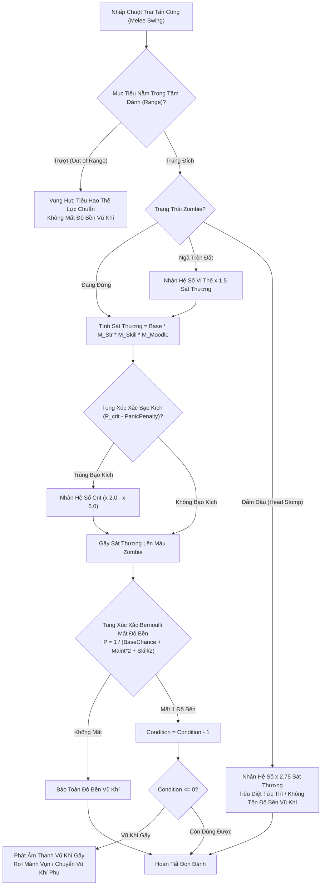
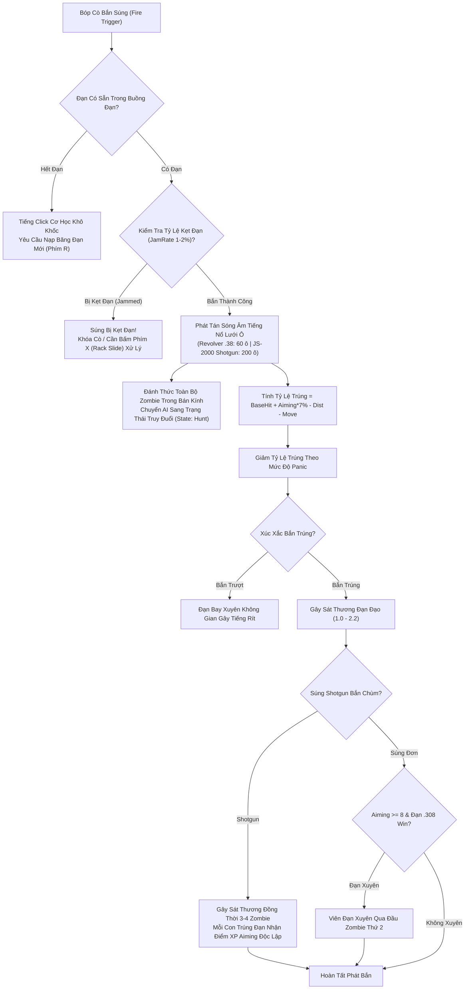

## PHẦN A: BẢNG HẰNG SỐ & PHƯƠNG TRÌNH TOÁN HỌC CỐT LÕI (MATHEMATICAL_FORMULAS_AND_CONSTANTS)

### 1. Phương Trình Toán Học & Mã Giả Thuật Toán (LaTeX & Deterministic Pseudocode)

#### 1.1. Phương trình Sát thương Cận chiến Thực tế & Sự Sụp đổ do Moodle (Melee Final Damage & Moodle Collapse)

Trong kiến trúc Bullet Physics C++ và runtime Java của Project Zomboid Build 42, sát thương gây ra lên một cá thể xác sống khi trúng đòn cận chiến được xác định theo phương trình tích đa nhân tử:

$$	ext{Damage}_{	ext{Final}} = 	ext{BaseDamage} 	imes M_{	ext{Strength}} 	imes M_{	ext{Skill}} 	imes M_{	ext{Moodle}} 	imes M_{	ext{Position}} 	imes M_{	ext{Crit}}$$

Trong đó:
1. **$	ext{BaseDamage}$**: Biến ngẫu nhiên đều phân bố trong khoảng $[	ext{MinDamage}, 	ext{MaxDamage}]$ của vũ khí.
2. **$M_{	ext{Strength}}$ (Hệ số Sức mạnh Thể chất)**:
   $$M_{	ext{Strength}} = egin{cases} 0.60 + (	ext{Strength} 	imes 0.075) & 	ext{nếu } 	ext{Strength} \in [0, 4] \quad (	ext{Phạt } -40\% 	ext{ đến } -10\%) \ 1.00 & 	ext{nếu } 	ext{Strength} = 5 \quad (	ext{Mức bình thường}) \ 1.10 + ((	ext{Strength} - 6) 	imes 0.10) & 	ext{nếu } 	ext{Strength} \in [6, 8] \quad (+10\% 	ext{ đến } +30\%) \ 1.40 + ((	ext{Strength} - 9) 	imes 0.20) & 	ext{nếu } 	ext{Strength} \in [9, 10] \quad (	ext{Stout / Strong: } +40\% 	ext{ đến } +60\%) \end{cases}$$
3. **$M_{	ext{Skill}}$ (Hệ số Kỹ năng Chuyên môn Vũ khí: Axe, Long Blade, Blunt, Spear, Short Blade)**:
   $$M_{	ext{Skill}} = 1.0 + (	ext{SkillLevel} 	imes 0.10) \quad (	ext{Cấp 10 mang lại } +100\% 	ext{ sát thương})$$
4. **$M_{	ext{Position}}$ (Vị thế Không gian Mục tiêu)**:
   $$M_{	ext{Position}} = egin{cases} 1.0 & 	ext{khi Zombie đứng thẳng} \ 1.5 & 	ext{khi Zombie ngã bò trên mặt đất} \ 2.5	ext{--}3.0 & 	ext{khi Dẫm chân lên đầu (Head Stomp - Tiêu diệt tức thì)} \end{cases}$$
5. **$M_{	ext{Crit}}$ (Hệ số Bạo kích Chí mạng)**:
   $$M_{	ext{Crit}} = egin{cases} 	ext{CritDmgMultiplier} \in [2.0, 6.0] & 	ext{với xác suất } P_{	ext{crit}} \ 1.0 & 	ext{với xác suất } 1 - P_{	ext{crit}} \end{cases}$$
6. **$M_{	ext{Moodle}}$ (Ma trận Trừng phạt Trạng thái Cơ thể - Kẻ Sát Nhân Thể Lực)**:
   $$M_{	ext{Moodle}} = M_{	ext{Exhaustion}} 	imes M_{	ext{Drowsiness}} 	imes M_{	ext{Pain}}$$
   - **Mệt mỏi (Exhaustion)**: Cấp 1 (Moderate) phạt $-50\%$, Cấp 2 (High) phạt $-80\%$, Cấp 3 (Excessive) phạt $-90\%$, Cấp 4 (Total Exhaustion) phạt $-95\%$ (Sát thương tụt dưới $0.1$).
   - **Buồn ngủ (Drowsiness)**: Phạt lũy tiến từ $-50\%$ đến $-95\%$ sát thương.
   - **Hoảng sợ (Panic)**: Tuyệt đối **KHÔNG GIẢM SÁT THƯƠNG CẬN CHIẾN**, chỉ giảm xác suất bạo kích $P_{	ext{crit}}$ từ $-10\%$ đến $-30\%$.

```text
FUNCTION Calculate_Melee_Damage(player, weapon, target_zombie, is_head_stomp):
    // 1. Roll sát thương gốc
    base_dmg = RandomFloat(weapon.minDamage, weapon.maxDamage)
    
    // 2. Hệ số Strength và Weapon Skill
    str_level = player.GetPerkLevel(Perks.Strength)
    skill_level = player.GetPerkLevel(weapon.perkType)
    m_str = Calculate_Strength_Multiplier(str_level)
    m_skill = 1.0 + (skill_level * 0.10)
    
    // 3. Hệ số Moodle (Exhaustion là chí tử)
    m_exhaust = Lookup_Exhaustion_Penalty(player.GetMoodleLevel(Moodles.Endurance))
    m_drowsy = Lookup_Drowsiness_Penalty(player.GetMoodleLevel(Moodles.Tired))
    m_moodle = m_exhaust * m_drowsy

    // 4. Vị thế mục tiêu
    IF is_head_stomp THEN
        m_pos = 2.75
    ELSE IF target_zombie.IsProne() THEN
        m_pos = 1.5
    ELSE
        m_pos = 1.0
    END IF

    // 5. Kiểm tra bạo kích
    panic_penalty = player.GetMoodleLevel(Moodles.Panic) * 0.075
    effective_crit_chance = Max(0.0, weapon.critChance - panic_penalty)
    IF RandomFloat(0.0, 1.0) <= effective_crit_chance THEN
        m_crit = weapon.critMultiplier
    ELSE
        m_crit = 1.0
    END IF

    final_dmg = base_dmg * m_str * m_skill * m_moodle * m_pos * m_crit
    RETURN final_dmg
```

---

#### 1.2. Công thức Độ bền Vũ khí theo Phân phối Bernoulli & Kỹ năng Bảo trì (`Maintenance`)

Mỗi cú đánh trúng đích, xác suất mất 1 điểm độ bền ($P_{	ext{decay}}$) được xác định bằng phân phối Bernoulli độc lập:

$$P_{	ext{decay}} = rac{1}{	ext{ConditionLowerChanceOneIn} + (	ext{MaintenanceLevel} 	imes 2) + \lfloorrac{	ext{WeaponSkillLevel}}{2}
floor}$$

Số lần đánh trung bình trước khi vũ khí hỏng hoàn toàn từ độ bền tối đa $C_{	ext{max}}$:

$$E[	ext{Hits}] = C_{	ext{max}} 	imes \left( 	ext{ConditionLowerChanceOneIn} + (	ext{MaintenanceLevel} 	imes 2) + \lfloorrac{	ext{WeaponSkillLevel}}{2}
floor 
ight)$$

---

#### 1.3. Phương trình Vật lý Đạn đạo Súng Đạn & Độ Chính Xác Aiming 0 $
ightarrow$ 10

Xác suất bắn trúng thực tế của viên đạn ($	ext{HitChance}_{	ext{Actual}}$) phụ thuộc vào cấp độ ngắm bắn `Aiming`, cự ly bắn $d$, trạng thái di chuyển và mức độ hoảng sợ:

$$	ext{HitChance}_{	ext{Actual}} = \left( 	ext{BaseHitChance} + (	ext{AimingLevel} 	imes 0.07) - 	ext{Penalty}_{	ext{dist}}(d) - 	ext{Penalty}_{	ext{move}} 
ight) 	imes M_{	ext{Panic}}$$

Trong đó:
- **Aiming Cấp 0–2**: Súng ngắn/súng trường phạt $-70\%	ext{ đến }-80\%$ trúng đích khi $d > 5	ext{ m}$. Chỉ có **Shotgun** (JS-2000, Double Barrel) mới đảm bảo trúng $65\%	ext{--}70\%$ vì cơ chế bắn chùm đạn ghém (*Pellets* trúng cùng lúc 3–4 mục tiêu), cấp trọn vẹn điểm XP cho từng con trúng đạn.
- **Aiming Cấp 8–10**: Mở khóa cơ chế **Đạn Xuyên Mục Tiêu (Bullet Piercing)**: 1 viên đạn súng trường cỡ `.308 Win` xuyên qua 2 mục tiêu đứng thẳng hàng.
- **Bán kính phát tán âm thanh súng đạn ($R_{	ext{sound}}$)**: Lan truyền sóng âm từ $60	ext{ ô}$ (Revolver .38 Special) đến $200	ext{ ô gạch}$ (Shotgun JS-2000).

---

#### 1.4. Động lực học Ẩn nấp: Bán kính Tiếng bước chân, Nón Tầm nhìn Zombie & Đòn Ám sát Một Hit Tức Tử (`Jaw Stab`)

Bán kính vòng tròn tiếng ồn bước chân phát ra ($R_{	ext{footstep}}$) phụ thuộc vào tốc độ di chuyển, loại giày và kỹ năng `Lightfoot`:

$$R_{	ext{footstep}} = R_{	ext{base}}(	ext{Stance}, 	ext{Footwear}) 	imes (1.0 - 	ext{LightfootLevel} 	imes 0.05)$$

Cấu trúc 3 vùng giác quan của Zombie:
1. **Nón Tầm nhìn Chính diện ($120^\circ$)**: Tầm xa phát hiện $15	ext{--}20	ext{ ô gạch}$ ban ngày, nhận diện mục tiêu đứng thẳng sau $0.5	ext{s}$.
2. **Tầm nhìn Ngoại vi ($180^\circ$)**: Nhận diện chuyển động nhanh; nếu ngồi rón rén (`Crouch`), tỷ lệ phát hiện giảm $70\%$.
3. **Điểm Mù Sau Lưng ($180^\circ$ Bán cầu sau)**: Zombie hoàn toàn **MÙ** ở nửa bán cầu phía sau lưng.

**Đòn Ám Sát Một Hit Tức Tử (Jaw Stab / Stealth Kill)**:
Khi tiếp cận zombie từ phía sau trong điểm mù ở cự ly $\le 0.5	ext{ ô gạch}$ bằng dao ngắn (`Small Blade`):
- Nhân vật tự động đặt tay trái tì lên vai zombie.
- Nhấp chuột tấn công $
ightarrow$ Kích hoạt đòn **Đâm Xuyên Cằm (Jaw Stab)**:
  - **Tử vong tức thì $100\%$ (Instant Kill)** mọi loại zombie.
  - Hoàn toàn im lặng ($R_{	ext{sound}} = 0	ext{ ô}$).
  - **Bảo toàn nguyên vẹn $100\%$ trang phục** (không rách, không vấy máu áo giáp Kevlar / quân phục).

---

### 2. Bảng Hằng Số Vật Lý Chiến Đấu, Súng Đạn & Độ Bền (System Constants Table)

#### Bảng Xếp Hạng Độ Bền Thực Tế & Tỷ Lệ Mất Độ Bền Cận Chiến

| Tên Vũ Khí | Danh Mục Hệ Vũ Khí | Độ Bền Tối Đa ($C_{	ext{max}}$) | Tỷ Lệ Gốc (`1 in X`) | Tỷ Lệ Tại Maintenance 5 | Số Zombie Hạ Gục Ước Tính |
| :--- | :---: | :---: | :---: | :---: | :---: |
| **Xà beng (Crowbar)** | Long Blunt | **15** | **1 in 70** | **1 in 80–85** | **> 1.000 zombie** (Bền nhất game, cày Maintenance tối ưu). |
| **Rìu cứu hỏa (Fire Axe)** | Axe | **15** | **1 in 35** | **1 in 45–50** | **400–600 zombie** (Sát thương cực lớn, phá cửa). |
| **Gậy bóng chày đinh (Spiked Bat)** | Long Blunt | **15** | **1 in 25** | **1 in 35** | **350–450 zombie** (Dễ chế tạo, tầm đánh an toàn). |
| **Thanh kiếm Katana Nhật** | Long Blade | **10** | **1 in 15** | **1 in 25** | **150–250 zombie** (Sát thương 8.0-8.0 đỉnh cao, chém 3 con). |
| **Giáo gỗ tự chế (Crafted Spear)** | Spear | **5** | **1 in 2** | **1 in 12** | **10–60 zombie** (Crit 1-hit tầm xa, rất nhanh gãy). |
| **Búa thợ mộc (Hammer)** | Small Blunt | **10** | **1 in 30** | **1 in 40** | **250–350 zombie** (Dắt thắt lưng, kiêm công cụ xây dựng). |
| **Dao săn (Hunting Knife)** | Small Blade | **10** | **1 in 25** | **1 in 35** | **Ám sát Jaw Stab vô hạn** (Tốn cực ít thể lực). |

---

#### Bảng Thông Số Đạn Đạo 22 Khẩu Súng Build 42

| Tên Khẩu Súng (ID Script) | Cỡ Đạn (Caliber) | Hộp Tiếp Đạn | Sát Thương | Tầm Bắn | Bán Kính Âm Thanh | Độ Chính Xác Gốc | Độ Giật | Tỷ Lệ Kẹt Đạn |
| :--- | :--- | :---: | :---: | :---: | :---: | :---: | :---: | :---: |
| `Base.AssaultRifle` (M16) | `5.56mm` | 30 viên | $1.0	ext{--}1.6$ | $30	ext{ ô}$ | **$150	ext{ ô gạch}$** | $50\%$ | 15 | $1\%$ |
| `Base.AssaultRifle2` (M14) | `.308 Win` | 20 viên | $1.2	ext{--}2.0$ | **$40	ext{ ô}$** | **$170	ext{ ô gạch}$** | $50\%$ | 20 | $1\%$ |
| `Base.Shotgun` (JS-2000) | `Shotgun Shells` | 6 viên | **$1.5	ext{--}2.2$** | $12	ext{ ô}$ | **$200	ext{ ô gạch}$** | **$65\%$ (Bắn chùm)** | 30 | $2\%$ |
| `Base.ShotgunSawnoff` (Cưa nòng) | `Shotgun Shells` | 6 viên | $1.3	ext{--}2.0$ | $10	ext{ ô}$ | **$200	ext{ ô gạch}$** | **$70\%$** | 30 | $2\%$ |
| `Base.DoubleBarrelShotgun` | `Shotgun Shells` | 2 viên | **$1.5	ext{--}2.2$** | $15	ext{ ô}$ | **$200	ext{ ô gạch}$** | **$65\%$** | 30 | $0\%$ (Không kẹt) |
| `Base.DoubleBarrelSawnoff` | `Shotgun Shells` | 2 viên | $1.2	ext{--}1.8$ | $8	ext{ ô}$ | **$200	ext{ ô gạch}$** | **$70\%$ (Góc rộng)** | 34 | $0\%$ (Không kẹt) |
| `Base.JS3T_Shotgun` (B42 Mới) | `Shotgun Shells` | 8 viên | $1.5	ext{--}2.2$ | $12	ext{ ô}$ | **$200	ext{ ô gạch}$** | $65\%$ | 28 | $2\%$ |
| `Base.HuntingRifle` (MSR700) | `.308 Win` | 3 viên nạp tay | $1.2	ext{--}2.0$ | **$40	ext{ ô}$** | **$170	ext{ ô gạch}$** | $50\%$ | 23 | $1\%$ |
| `Base.MSR7T_Rifle` (B42 Mới) | `.308 Win` | 5 viên | $1.2	ext{--}2.0$ | **$40	ext{ ô}$** | **$170	ext{ ô gạch}$** | $50\%$ | 21 | $1\%$ |
| `Base.VarmintRifle` (MSR788) | `5.56mm` | 3 viên | $1.0	ext{--}1.6$ | $30	ext{ ô}$ | $150	ext{ ô gạch}$ | $50\%$ | 17 | $1\%$ |
| `Base.JS14_Rifle` (B42 Mới) | `5.56mm` | 20 viên | $1.0	ext{--}1.6$ | $30	ext{ ô}$ | $150	ext{ ô gạch}$ | $45\%$ | 15 | $2\%$ |
| `Base.L94_Rifle` (B42 Đòn bẩy) | `.30-30 Win` | 6 viên | $1.2	ext{--}2.0$ | $30	ext{ ô}$ | $160	ext{ ô gạch}$ | $50\%$ | 20 | $1\%$ |
| `Base.L92_Carbine` (B42 Đòn bẩy)| `.357 Mag` | 8 viên | $1.0	ext{--}1.6$ | $24	ext{ ô}$ | $120	ext{ ô gạch}$ | $50\%$ | 12 | $1\%$ |
| `Base.TrapperCarbine` (B42 Mới) | `.45 Auto` | 10 viên | $1.0	ext{--}1.4$ | $20	ext{ ô}$ | **$70	ext{ ô gạch}$ (Rất êm)**| $50\%$ | 12 | $2\%$ |
| `Base.Pistol` (Beretta M9) | `9mm` | 15 viên | $0.6	ext{--}1.0$ | $15	ext{ ô}$ | $100	ext{ ô gạch}$ | $50\%$ | 12 | $1\%$ |
| `Base.Pistol2` (Colt M1911) | `.45 Auto` | 7 viên | $0.9	ext{--}1.2$ | $12	ext{ ô}$ | **$70	ext{ ô gạch}$ (Trầm)** | $50\%$ | 15 | $1\%$ |
| `Base.Pistol3` (Desert Eagle) | `.44 Mag` | 8 viên | $1.0	ext{--}1.6$ | $17	ext{ ô}$ | $120	ext{ ô gạch}$ | $50\%$ | 17 | $1\%$ |
| `Base.Revolver` (Magnum .357) | `.357 Mag` | 6 viên ổ xoay | $0.95	ext{--}1.4$| $12	ext{ ô}$ | $100	ext{ ô gạch}$ | $50\%$ | 16 | $0\%$ (Không kẹt) |
| `Base.Revolver_Long` (.44) | `.44 Mag` | 6 viên ổ xoay | $1.0	ext{--}1.6$ | $18	ext{ ô}$ | $120	ext{ ô gạch}$ | $50\%$ | 17 | $0\%$ (Không kẹt) |
| `Base.Revolver_Short` (.38) | `.38 Special` | 6 viên ổ xoay | $0.5	ext{--}0.8$ | $8	ext{ ô}$ | **$60	ext{ ô gạch}$ (Êm nhất)**| $50\%$ | 11 | $0\%$ (Không kẹt) |

---

#### Bảng Bán Kính Tiếng Bước Chân Theo Tư Thế & Giày Dép

| Trạng Thái Di Chuyển | Đi Chân Trần (`Barefoot`) | Mang Giày Thể Thao (`Sneakers`) | Mang Ủng Quân Đội (`Military Boots`) |
| :--- | :---: | :---: | :---: |
| **Ngồi rón rén (Sneak Walk)** | **$1	ext{ ô gạch}$** | $2	ext{ ô gạch}$ | $3	ext{ ô gạch}$ |
| **Đi bộ bình thường (Normal Walk)**| $4	ext{ ô gạch}$ | $6	ext{ ô gạch}$ | $8	ext{ ô gạch}$ |
| **Chạy nước rút (Sprinting)** | $10	ext{ ô gạch}$ | $14	ext{ ô gạch}$ | **$20	ext{ ô gạch}$** |

---

## PHẦN B: KHỐI JSON KHUÔN MẪU KỸ THUẬT & NGỮ NGHĨA (SEMANTIC_MATH_BLUEPRINTS_JSON)

```json
[
  {
    "blueprint_id": "tpl_wpn:melee_6classes_and_maintenance_matrix_01",
    "source_pz_reference": "weapon.txt & ISMeleeWeapon.lua (Doc 11 - Section 2)",
    "dnd_ontology_hooks": {
      "system_category": "MELEE_WEAPONS_AND_PHYSICAL_COMBAT_ENGINE",
      "damage_classes": ["SLASHING", "PIERCING", "BLUDGEONING"],
      "stomp_lethality_multiplier": 2.75
    },
    "pz_math_engine": {
      "weapon_classes": ["Axe", "LongBlade", "SmallBlade", "LongBlunt", "SmallBlunt", "Spear"],
      "featured_weapons": [
        { "id": "Base.Crowbar", "class": "LongBlunt", "base_decay_chance": 70, "max_condition": 15, "crit_chance": 0.20, "tactical_role": "Endurance durability king" },
        { "id": "Base.Axe", "class": "Axe", "base_decay_chance": 35, "max_condition": 15, "crit_chance": 0.25, "tactical_role": "High damage door breaker" },
        { "id": "Base.Katana", "class": "LongBlade", "base_decay_chance": 15, "max_condition": 10, "crit_chance": 0.35, "tactical_role": "Multi-target 3-zombie cleaver" },
        { "id": "Base.SpearCrafted", "class": "Spear", "base_decay_chance": 2, "max_condition": 5, "crit_chance": 0.30, "tactical_role": "Long-range instant critical" },
        { "id": "Base.HuntingKnife", "class": "SmallBlade", "base_decay_chance": 25, "max_condition": 10, "crit_chance": 0.50, "tactical_role": "Low endurance Jaw Stab assassin" }
      ],
      "moodle_damage_debuffs": {
        "exhaustion_level_1": 0.50,
        "exhaustion_level_2": 0.20,
        "exhaustion_level_3": 0.10,
        "exhaustion_level_4": 0.05
      }
    },
    "semantic_descriptors": {
      "vietnamese_translation": "Khuôn mẫu 6 hệ vũ khí cận chiến, ma trận độ bền Bernoulli và sự sụp đổ sát thương do thể lực",
      "dnd_roleplay_anchor": "Quy tắc tấn công cận chiến, độ bền vũ khí và đòn dẫm đầu chí mạng"
    }
  },
  {
    "blueprint_id": "tpl_wpn:firearms_22guns_and_ballistics_engine_01",
    "source_pz_reference": "weapon.txt & ISReloadWeaponAction.lua (Doc 11 - Section 3)",
    "dnd_ontology_hooks": {
      "system_category": "BALLISTIC_FIREARMS_AND_PROJECTILE_ACOUSTICS",
      "bullet_calibers": ["9mm", ".45 Auto", ".44 Mag", ".357 Mag", ".38 Special", "5.56mm", ".308 Win", ".30-30 Win", "Shotgun Shells"]
    },
    "pz_math_engine": {
      "total_guns_catalogued": 22,
      "featured_firearms": [
        { "id": "Base.AssaultRifle", "name": "M16", "caliber": "5.56mm", "sound_radius": 150, "mag_size": 30, "range": 30, "jam_rate": 0.01 },
        { "id": "Base.AssaultRifle2", "name": "M14", "caliber": ".308 Win", "sound_radius": 170, "mag_size": 20, "range": 40, "jam_rate": 0.01 },
        { "id": "Base.Shotgun", "name": "JS-2000", "caliber": "Shotgun Shells", "sound_radius": 200, "mag_size": 6, "range": 12, "jam_rate": 0.02 },
        { "id": "Base.DoubleBarrelShotgun", "name": "Double Barrel", "caliber": "Shotgun Shells", "sound_radius": 200, "mag_size": 2, "range": 15, "jam_rate": 0.00 },
        { "id": "Base.Pistol", "name": "Beretta M9", "caliber": "9mm", "sound_radius": 100, "mag_size": 15, "range": 15, "jam_rate": 0.01 },
        { "id": "Base.Pistol2", "name": "Colt M1911", "caliber": ".45 Auto", "sound_radius": 70, "mag_size": 7, "range": 12, "jam_rate": 0.01 },
        { "id": "Base.Revolver_Short", "name": "Revolver .38", "caliber": ".38 Special", "sound_radius": 60, "mag_size": 6, "range": 8, "jam_rate": 0.00 }
      ],
      "aiming_progression": {
        "level_0_to_2": "Shotgun only (pellet spread 3-4 zombies, hit chance 65-70%)",
        "level_5_to_7": "Pistols viable (85-90% hit chance on move)",
        "level_8_to_10": "Piercing bullets unlocked (.308 Win pierces 2 zombies in line)"
      }
    },
    "semantic_descriptors": {
      "vietnamese_translation": "Khuôn mẫu đạn đạo 22 khẩu súng, bán kính âm thanh nổ súng và cơ chế đạn xuyên mục tiêu",
      "dnd_roleplay_anchor": "Hệ thống vũ khí hỏa mai, súng trường và đạn đạo chiến trường"
    }
  },
  {
    "blueprint_id": "tpl_item:weapon_11attachments_and_recoil_01",
    "source_pz_reference": "weaponpart.txt & ISRackFirearm.lua (Doc 11 - Section 3.3 & 3.4)",
    "dnd_ontology_hooks": {
      "system_category": "WEAPON_MODIFICATIONS_AND_JAM_CLEARING"
    },
    "pz_math_engine": {
      "attachments_count": 11,
      "featured_parts": [
        { "id": "Base.ChokeTubeFull", "part_type": "Canon", "effect": "Tightens shotgun pellet spread for long range" },
        { "id": "Base.ChokeTubeImproved", "part_type": "Canon", "effect": "Widens pellet spread for 4-target close blast" },
        { "id": "Base.RedDot", "part_type": "Scope", "effect": "Reduces aiming time by 20%" },
        { "id": "Base.Laser", "part_type": "CanonMod", "effect": "Direct hit chance bonus & moving recoil stabilization" },
        { "id": "Base.GunLight", "part_type": "CanonMod", "effect": "Illuminates night cone of vision hands-free" },
        { "id": "Base.x2Scope", "part_type": "Scope", "effect": "+4 tiles effective range" },
        { "id": "Base.x4Scope", "part_type": "Scope", "effect": "+8 tiles effective range" },
        { "id": "Base.x8Scope", "part_type": "Scope", "effect": "+12 tiles sniper range" },
        { "id": "Base.AmmoStraps", "part_type": "Sling", "effect": "Doubles reloading speed" },
        { "id": "Base.Sling", "part_type": "Sling", "effect": "-30% equipped weapon weight" },
        { "id": "Base.RecoilPad", "part_type": "Stock", "effect": "-20% recoil kickback" }
      ],
      "jam_unloading_key": "Phím X (Rack slide to clear round)"
    },
    "semantic_descriptors": {
      "vietnamese_translation": "Chuẩn hóa 11 phụ kiện súng đạn nâng cấp và quy trình gạt khóa nòng xử lý kẹt đạn",
      "dnd_roleplay_anchor": "Phụ kiện gia cố binh khí và cơ chế bảo dưỡng súng đạn"
    }
  },
  {
    "blueprint_id": "tpl_mob:stealth_senses_and_jawstab_execution_01",
    "source_pz_reference": "ZombieVision & ISOPlayer.lua (Doc 11 - Section 4)",
    "dnd_ontology_hooks": {
      "system_category": "STEALTH_OPTICAL_ACOUSTIC_SENSORY_AND_ASSASSINATION",
      "vision_cones": {
        "FOCUS_VISION": "120 degrees, 15-20 tiles daytime",
        "PERIPHERAL_VISION": "180 degrees, motion sensitive (-70% detection when crouching)",
        "BLIND_SPOT": "180 degrees rear hemisphere (Absolute blindness)"
      }
    },
    "pz_math_engine": {
      "footstep_noise_matrix": {
        "sneak_barefoot": 1,
        "sneak_sneakers": 2,
        "sneak_boots": 3,
        "walk_sneakers": 6,
        "sprint_boots": 20
      },
      "jaw_stab_mechanics": {
        "required_weapon_type": "SmallBlade",
        "approach_vector": "Rear blind spot",
        "trigger_distance_tiles": 0.5,
        "lethality_rate": 1.00,
        "sound_radius_tiles": 0,
        "clothing_damage_rate": 0.00
      }
    },
    "semantic_descriptors": {
      "vietnamese_translation": "Cơ chế thị giác 3 vùng của xác sống, bán kính tiếng bước chân và đòn ám sát đâm xuyên cằm 1-hit không vấy máu áo giáp",
      "dnd_roleplay_anchor": "Kỹ năng đạo tặc đâm lén (Backstab / Sneak Attack) và di chuyển không tiếng động"
    }
  }
]
```

---

## PHẦN C: SƠ ĐỒ MÁY TRẠNG THÁI & LUỒNG DỮ LIỆU (STATE_MACHINE_AND_TICK_PIPELINE)

### 1. Luồng Máy Trạng Thái Tác Chiến Cận Chiến, Suy Giảm Độ Bền & Đòn Kết Liễu Dẫm Đầu (`Melee Combat & Durability Tick Pipeline`)



---

### 2. Luồng Xử Lý Đạn Đạo Súng Đạn, Kẹt Đạn & Phát Tán Sóng Âm 200 Ô (`Firearms Ballistics, Jamming & Acoustic Event Pipeline`)



---

## PHẦN D: BẢNG KIỂM TRA KHÓA NGOẠI (FOREIGN_KEY_DEPENDENCY_CHECK)

### 1. Danh mục Khóa Ngoại & Khuôn Mẫu Đã Định Nghĩa Tại Document 11 (`DEFINED_IDS`)

* `sys_math:melee_final_damage_and_moodle_collapse` (Phương trình sát thương cận chiến 7 biến số, hệ số Strength, Skill và sự sụp đổ sát thương $-95\%$ do kiệt sức Exhaustion).
* `sys_math:weapon_maintenance_bernoulli_durability` (Phương trình độ bền vũ khí Bernoulli $1 / (	ext{Chance} + 	ext{Maint}	imes 2 + 	ext{Skill}/2)$ và tuổi thọ $1.000$ zombie của Xà beng).
* `sys_math:firearms_ballistics_and_aiming_accuracy_curve` (Phương trình đạn đạo, Aiming 0–10, bắn chùm Shotgun cày cấp và đạn xuyên mục tiêu Aiming 8+).
* `sys_math:stealth_footstep_sound_and_jaw_stab_physics` (Phương trình âm thanh bước chân $1	ext{--}20	ext{ ô}$, nón tầm nhìn $120^\circ/180^\circ$ và đòn ám sát đâm xuyên cằm $100\%$ không hỏng áo giáp).
* `tpl_wpn:melee_6classes_and_maintenance_matrix_01` (Khuôn mẫu 6 hệ vũ khí cận chiến: Axe, Long Blade, Small Blade, Long Blunt, Small Blunt, Spear).
* `tpl_wpn:firearms_22guns_and_ballistics_engine_01` (Khuôn mẫu đạn đạo 22 khẩu súng, bán kính âm thanh $60	ext{--}200	ext{ ô}$, và 8 cỡ đạn).
* `tpl_item:weapon_11attachments_and_recoil_01` (Khuôn mẫu 11 phụ kiện súng đạn: Nòng, Ống ngắm x2/x4/x8, RedDot, Laser, Đèn pin, Dây đeo).
* `tpl_mob:stealth_senses_and_jawstab_execution_01` (Khuôn mẫu giác quan zombie, nón tầm nhìn và đòn ám sát Jaw Stab).
* `ammo:9mm`, `ammo:45auto`, `ammo:308win`, `ammo:12g_shotgunshells`, `ammo:556mm`, `ammo:357mag`, `ammo:38special`, `ammo:44mag` (8 loại cỡ đạn súng tiêu chuẩn).
* `entity:grindstone` (Bàn mài phục hồi độ bền vũ khí cận chiến).
* `wpn:crowbar`, `wpn:fireaxe`, `wpn:katana`, `wpn:hunting_knife`, `wpn:m16`, `wpn:shotgun_js2000`, `wpn:colt_m1911`, `wpn:revolver_38` (Các vũ khí meta chủ lực).

---

### 2. Danh mục Khóa Ngoại Đang Chờ Các Tài Liệu Tiếp Theo Định Nghĩa (`PENDING_EXTERNAL_IDS`)

* **Đang chờ Doc 12 (`Base Building & Fortifications`):**
  * Cơ chế chế tạo và thông số độ bền của Hàng rào gỗ thấp (`Low Wooden Fence`) và Bẫy hàng rào tạo điểm nghẽn chém ngã (`Fence Choke Point`).
* **Đang chờ Doc 13 (`Medical, Surgery & Health`):**
  * Quy trình phẫu thuật gắp đầu đạn súng (`Bullet Removal Surgery`) bằng Nhíp y tế (`Tweezers`) hoặc Kẹp cầm máu (`Suture Needle Holder`), cùng vết thương rách sâu do mảnh đạn.
* **Đang chờ Doc 14 (`Meta Secrets & World Mysteries`):**
  * Tỷ lệ xuất hiện của các kho vũ khí bí mật của phe kháng chiến và xác suất zombie đặc chủng mang súng tự động M16 trên đường cao tốc.

---

**[READY FOR DOCUMENT #12]** — Vui lòng gửi lên **`Document 12: project_zomboid_v42_base_building_and_fortifications_bible.md`** (cùng các tài liệu quy tắc D&D đi kèm nếu có).
