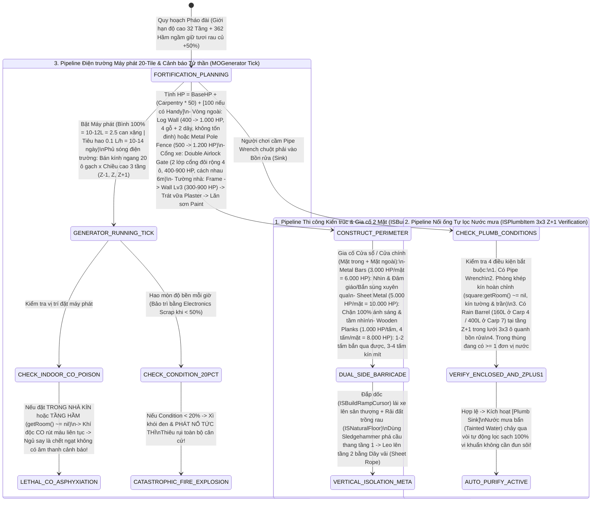

## PHẦN A: BẢNG HẰNG SỐ & PHƯƠNG TRÌNH TOÁN HỌC CỐT LÕI (MATHEMATICAL_FORMULAS_AND_CONSTANTS)

### 1. Phương Trình Toán Học & Mã Giả Thuật Toán (LaTeX & Deterministic Pseudocode)

#### 1.1. Phương trình Máu Công trình Kiến trúc (`ISBuildUtil.lua` & `IsoThumpable` Structural HP)


Máu tối đa ($\text{HP}_{\text{max}}$) của một cấu trúc gỗ hoặc kim loại khi hoàn tất xây dựng là tổng của Máu cơ bản theo loại công trình ($\text{BaseHP}$), điểm thưởng theo cấp độ Kỹ năng xây dựng ($\text{CarpentryLevel}$ hoặc $\text{MetalworkingLevel} \in [0, 10]$) và điểm thưởng từ đặc điểm `Handy` ($+100\text{ HP}$):

$$\text{WoodHealth} = (\text{CarpentryLevel} \times 50) + \left(100 \cdot \mathbb{I}_{\text{Handy}}\right)$$

$$\text{HP}_{\text{structure}}(S) = \text{BaseHP}(S) + \text{SkillBonus}(S) + \left(100 \cdot \mathbb{I}_{\text{Handy}}\right)$$

Cụ thể với các cấu trúc tiêu biểu:

* **Tường Gỗ Thường (Cấp 1 / Cấp 2 / Cấp 3)**: $\text{BaseHP} \in \{200, 250, 300\} \implies \text{HP}_{\text{WoodenWall\_Lv1}} = 200 + (\text{Carpentry} \times 50) + [100]$ (đạt $700\text{--}800\text{ HP}$ ở Cấp 10).


* **Tường Gỗ Tròn Nguyên Khối (`Log Wall`)**: $\text{BaseHP} = 400 \implies \text{HP}_{\text{LogWall}} = 400 + (\text{Carpentry} \times 50) + [100]$ (đạt $900\text{--}1000\text{ HP}$ ở Cấp 10, không tốn đinh).


* **Hàng Rào Chông Sắt (`Metal Pole Fence`)**: $\text{BaseHP} = 500$, đạt $1200\text{ HP}$ ở `Metalworking` Cấp 10 ($\text{Bonus} = 70\text{ HP/cấp}$).


#### 1.2. Phương trình Gia cố Cửa 2 Mặt (`ISBarricadeAction.lua` Dual-Sided Barricade Matrix)


Một khung cửa sổ hoặc cửa chính có 2 mặt độc lập $f \in \{\text{Interior}, \text{Exterior}\}$. Tổng lượng máu lá chắn gia cố $\text{HP}_{\text{barricade\_total}}$ và trạng thái truyền sáng/xuyên đạn đạo được xác định bởi loại vật liệu $m \in \{\text{Plank}, \text{SheetMetal}, \text{MetalBars}\}$ và số lớp $n_f$:

$$\text{HP}_{\text{barricade\_total}} = \sum_{f \in \{\text{Int}, \text{Ext}\}} n_f \times \text{HP}_{\text{unit}}(m) = \begin{cases} (n_{\text{Int}} + n_{\text{Ext}}) \times 1000 \le 8000\text{ HP} & \text{nếu } m = \text{Wooden Plank } (n_f \in [1, 4]) \\ (n_{\text{Int}} + n_{\text{Ext}}) \times 5000 \le 10000\text{ HP} & \text{nếu } m = \text{Sheet Metal } (n_f = 1) \\ (n_{\text{Int}} + n_{\text{Ext}}) \times 3000 \le 6000\text{ HP} & \text{nếu } m = \text{Metal Bars } (n_f = 1 \text{ bộ 3 thanh}) \end{cases}$$

$$\text{CanShootAndSpearThrough}(m, n_f) = \begin{cases} \text{TRUE} & \text{nếu } m = \text{Metal Bars} \lor (m = \text{Wooden Plank} \land n_f \in \{1, 2\}) \\ \text{FALSE} \ (\text{Chặn } 100\% \text{ tầm nhìn \& ánh sáng}) & \text{nếu } m = \text{Sheet Metal} \lor (m = \text{Wooden Plank} \land n_f \in \{3, 4\}) \end{cases}$$

#### 1.3. Thuật toán Đấu nối Đường ống Tự lọc Nước mưa (`ISPlumbItem.lua` 3x3 Z+1 Plumbing Logic)


Một thiết bị đầu cuối $S_{\text{sink}}$ tại tọa độ lưới 3D $(X_s, Y_s, Z_s)$ chuyển hóa nước mưa nhiễm khuẩn (`Tainted Water`) thành nước tinh khiết $100\%$ khi và chỉ khi thỏa mãn đồng thời 4 ràng buộc hình học và trạng thái:

$$\text{IsPlumbable}(S_{\text{sink}}) \iff \begin{cases} 1.\ \text{HasItem}(\text{Player}, \text{PipeWrench}) = \text{TRUE} \\ 2.\ \text{GetRoom}(X_s, Y_s, Z_s) \neq \text{nil} \quad (\text{Phòng kín } 100\% \text{ tường, sàn, trần}) \\ 3.\ \exists B_{\text{barrel}} \text{ tại } (X_b, Y_b, Z_b) \text{ sao cho } Z_b = Z_s + 1 \land \vert{}X_b - X_s\vert{} \le 1 \land \vert{}Y_b - Y_s\vert{} \le 1 \\ 4.\ \text{WaterAmount}(B_{\text{barrel}}) \ge 1\text{ đơn vị} \end{cases}$$

```text
FUNCTION Validate_And_Execute_Plumbing(player, sink_object):
    // 1. Kiểm tra công cụ Pipe Wrench
    IF NOT player.HasItem("PipeWrench") THEN RETURN PLUMB_FAILED_NO_TOOL END IF

    // 2. Kiểm tra phòng kín hoàn chỉnh (square:getRoom() ~= nil)
    sink_sq = sink_object.GetSquare()
    IF sink_sq.GetRoom() == NIL OR sink_sq.HasMissingRoofOrWall() THEN
        RETURN PLUMB_FAILED_NOT_ENCLOSED_ROOM
    END IF

    // 3. Quét ma trận 3x3 ở tầng ngay phía trên (Z + 1) tìm Rain Collector Barrel có >= 1 đơn vị nước
    valid_barrel = NIL
    FOR dx = -1 TO 1 DO
        FOR dy = -1 TO 1 DO
            upper_sq = GetWorldSquare(sink_sq.X + dx, sink_sq.Y + dy, sink_sq.Z + 1)
            barrel = upper_sq.GetRainCollectorBarrel()
            IF barrel != NIL AND barrel.WaterUnits >= 1 THEN
                valid_barrel = barrel
                BREAK
            END IF
        END FOR
    END FOR

    IF valid_barrel == NIL THEN RETURN PLUMB_FAILED_NO_BARREL_IN_3X3_ZPLUS1 END IF

    // 4. Kích hoạt tự động lọc sạch 100% vi khuẩn (Tainted -> Pure Water)
    sink_object.ConnectPlumbingTo(valid_barrel)
    sink_object.SetAutoFilterTaintedWater100Pct(TRUE)
    RETURN PLUMB_SUCCESS
END FUNCTION

```

#### 1.4. Phương trình Điện trường Máy phát, Cháy nổ $<20\%$ & Ngộ độc Khí CO (`MOGenerator.lua`)


Một máy phát năng lượng tại tọa độ $(X_g, Y_g, Z_g)$ phủ sóng một hình trụ không gian có bán kính ngang $R_{\text{horiz}} = 20\text{ tiles}$ và chiều cao $3\text{ tầng}$ ($Z \in \{Z_g - 1, Z_g, Z_g + 1\}$):

$$\text{InPowerGrid}(X, Y, Z) \iff \sqrt{(X - X_g)^2 + (Y - Y_g)^2} \le 20.0 \land \vert{}Z - Z_g\vert{} \le 1$$

* **Ngưỡng Phát nổ Tức thì**: Khi độ bền máy phát $C_{\text{gen}} < 20\%$, xác suất kích hoạt vụ nổ hỏa hoạn thiêu rụi căn cứ $P_{\text{explode}}(C_{\text{gen}}) > 0$ (khuyến nghị bảo trì bằng `Electronics Scrap` khi $C_{\text{gen}} < 50\%$).


* **Cơ chế Ngạt khí CO Tử vong (`Carbon Monoxide Poisoning`)**: Nếu đặt máy phát hoạt động trong phòng kín hoặc tầng hầm ($\text{GetRoom}(X_g, Y_g, Z_g) \neq \text{nil}$), toàn bộ sinh vật bên trong bị rút máu liên tục ($\Delta \text{HP}_{\text{CO}} < 0$) và tử vong không tiếng động nếu đang ngủ.


---

### 2. Bảng Hằng Số Kiến Trúc, Máu Công Trình, Gia Cố & Hạ Tầng (System Constants Table)

| Nhóm Hệ Thống | Tên Hằng Số / Biến Số Gốc | Giá Trị Chính Xác | Đơn Vị Đo | Ý Nghĩa Vật Lý & Cơ Học Hệ Thống |
| --- | --- | --- | --- | --- |
| **32-Floor Engine** | `Max_Vertical_Building_Floors` | `32` (tăng từ `7` tầng cũ) | `floors (tầng)` | Giới hạn chiều cao xây dựng tối đa của engine kiến trúc Build 42.

 |
| **Structure HP** | `Carpentry_HP_Per_Level` | `+50` (`+100` nếu có `Handy`) | `HP / level` | Lượng máu cộng thêm cho mỗi cấp kỹ năng Mộc và từ đặc điểm `Handy`.

 |
| **Structure HP** | `WoodenFrame_HP_And_Req` | `Lv2 | 2 Planks, 2 Nails | HP: 50 -> 550` | `lv / items / HP` | Thông số Khung tường gỗ cơ bản.

 |
| **Structure HP** | `WoodenWall_Lv1_2_3_HP` | `Lv1(C2):200-700 | Lv2(C4):250-750 | Lv3(C7):300-800` | `HP (2 Planks, 4 Nails)` | Máu từ Cấp 0 đến Cấp 10 của Tường gỗ Cấp 1, 2, 3 (Cấp 3 trát vữa & sơn được; cộng thêm $+100$ nếu có `Handy`).

 |
| **Structure HP** | `LogWall_HP_And_Inputs` | `Lv0 | 4 Logs, 2 Twine/Rope | HP: 400 -> 900-1000` | `lv / items / HP` | Tường gỗ tròn nguyên khối — trâu nhất hệ gỗ, không cần đinh và búa.

 |
| **Structure HP** | `Doors_Single_And_Double_HP` | `Single(C3): 200-700 | Double(C6, 4 tiles): 400-900` | `HP` | Máu của Cửa đơn ($4$ ván, $4$ đinh, $2$ bản lề, $1$ nắm đấm) và Cổng đôi xe tải rộng $4\text{ ô}$ ($12$ ván, $12$ đinh, $4$ bản lề, $2$ nắm đấm).

 |
| **Structure HP** | `WoodenFence_Stairs_Composter` | `Fence(C2): 100-600 HP | Stairs(C6) & Composter(C2): Invulnerable` | `HP / status` | Hàng rào thấp gây `Fence Slump`; Cầu thang gỗ ($15$ ván, $15$ đinh) và Thùng ủ phân ($5$ ván, $4$ đinh) bất tử.

 |
| **Structure HP** | `Metal_Structures_HP_Matrix` | `Frame(M3):150-850 | WireFence(M4):300-1000 | PoleFence(M6):500-1200` | `HP` | Máu từ Cấp 0 đến Cấp 10 của Khung thép, Hàng rào dây thép gai và Hàng rào chông sắt.

 |
| **Barricading** | `WoodenPlank_Barricade_Stats` | `1000 HP/plank | Max 4/side (8 total = 8000 HP)` | `HP / planks` | Chốt ván gỗ: $1\text{--}2$ tấm vẫn nhìn/bắn xuyên qua được; $3\text{--}4$ tấm bịt kín tầm nhìn và ánh sáng.

 |
| **Barricading** | `SheetMetal_Barricade_Stats` | `5000 HP/sheet | Max 1/side (2 total = 10000 HP)` | `HP / sheets` | Chốt tấm thép kín: chặn $100\%$ ánh sáng và tầm nhìn.

 |
| **Barricading** | `MetalBars_Barricade_Stats` | `3000 HP/set (3 bars) | Max 2 sides = 6000 HP` | `HP / bar_sets` | Chốt song sắt thưa: giữ nguyên tầm nhìn, cho phép đâm giáo và bắn súng xuyên qua từ trong nhà.

 |
| **Water & Plumb** | `RainBarrel_Capacities` | `Small (Carp 4): 160 L | Large (Carp 7): 400 L` | `Liters (lít)` | Dung tích 2 cấp Thùng hứng nước mưa ($4$ ván, $4$ đinh, $4$ túi rác).

 |
| **Water & Plumb** | `Plumbing_3x3_ZPlus1_Matrix` | `Layer: Z + 1 | Grid: 3x3 (9 tiles) | MinWater: >= 1` | `grid / units` | Điều kiện hình học đặt thùng nước mưa phía trên bồn rửa phòng kín để tự lọc sạch $100\%$ vi khuẩn.

 |
| **Generator Grid** | `Generator_Coverage_Cylinder` | `Horizontal Radius: 20 tiles | Vertical: 3 floors` | `tiles / floors` | Vùng phủ sóng điện trường của máy phát điện (tầng hiện tại $\pm 1$ tầng).

 |
| **Generator Grid** | `Generator_Tank_And_BurnRate` | `100% = 10-12 L (2.5 Gas Cans) | Burn: 0.1 L/h (10-14d)` | `Liters / days` | Dung tích bình nhiên liệu máy phát và thời gian vận hành liên tục.

 |
| **Generator Grid** | `Generator_Explosion_Threshold` | `< 20% Condition` (Repair at `< 50%` w/ `Electronics Scrap`) | `% durability` | Ngưỡng độ bền tử thần gây xì khói đen và phát nổ cháy rụi căn cứ.

 |
| **B42 Features** | `Basement_Cooling_And_Airlock` | `Basement Freshness: +50% | Double Airlock Gap: 6m` | `% / meters` | Tầng hầm giữ rau củ tươi lâu hơn $+50\%$; khoảng cách chuẩn giữa 2 lớp cổng an ninh Airlock là $6\text{ m}$.

 |

---

## PHẦN B: KHỐI JSON KHUÔN MẪU KỸ THUẬT & NGỮ NGHĨA (SEMANTIC_MATH_BLUEPRINTS_JSON)

```json
[
  {
    "blueprint_id": "tpl_bas:fortification_32floor_and_barricade_matrix_01",
    "source_pz_reference": "ISBuildUtil.lua, IsoThumpable, ISWoodenWall.lua, ISBarricadeAction.lua & MOBarricade.lua (Doc 12 - Section 1, 2, 3, 6 & 7)",
    "dnd_ontology_hooks": {
      "bastion_facility_mapping": ["BARRACKS", "ARMORY", "WAR_ROOM", "STOREHOUSE", "GARDEN"],
      "tech_ages_covered": ["AGE_0_PRIMITIVE_FLINT", "AGE_1_CRUDE_FORGE", "AGE_2_TEMPERED_STEEL"]
    },
    "pz_math_engine": {
      "max_vertical_building_floors": 32,
      "carpentry_hp_bonus_per_level": 50,
      "handy_trait_flat_hp_bonus": 100,
      "structural_elements_registry": [
        { "id": "WoodenFrame", "skill": "Carpentry", "req_lv": 2, "inputs": ["2_Planks", "2_Nails"], "base_hp": 50, "lv10_max_hp": 550 },
        { "id": "WoodenWall_Lv1", "skill": "Carpentry", "req_lv": 2, "inputs": ["2_Planks", "4_Nails"], "base_hp": 200, "lv10_max_hp": 700, "handy_lv10_hp": 800 },
        { "id": "WoodenWall_Lv2", "skill": "Carpentry", "req_lv": 4, "inputs": ["2_Planks", "4_Nails"], "base_hp": 250, "lv10_max_hp": 750, "handy_lv10_hp": 850 },
        { "id": "WoodenWall_Lv3", "skill": "Carpentry", "req_lv": 7, "inputs": ["2_Planks", "4_Nails"], "base_hp": 300, "lv10_max_hp": 800, "handy_lv10_hp": 900, "supports_plaster_and_paint": true },
        { "id": "LogWall", "skill": "Carpentry", "req_lv": 0, "inputs": ["4_Logs", "2_Twine_Or_Rope"], "base_hp": 400, "lv10_max_hp": 900, "handy_lv10_hp": 1000 },
        { "id": "WoodenDoor_Single", "skill": "Carpentry", "req_lv": 3, "inputs": ["4_Planks", "4_Nails", "2_Hinges", "1_Doorknob"], "base_hp": 200, "lv10_max_hp": 700 },
        { "id": "DoubleWoodenDoor_Gate", "skill": "Carpentry", "req_lv": 6, "inputs": ["12_Planks", "12_Nails", "4_Hinges", "2_Doorknobs"], "base_hp": 400, "lv10_max_hp": 900, "width_tiles": 4 },
        { "id": "WoodenFence_Low", "skill": "Carpentry", "req_lv": 2, "inputs": ["2_Planks", "3_Nails"], "base_hp": 100, "lv10_max_hp": 600, "triggers_fence_slump": true },
        { "id": "WoodenStairs", "skill": "Carpentry", "req_lv": 6, "inputs": ["15_Planks", "15_Nails"], "invulnerable_to_zombies": true },
        { "id": "Composter", "skill": "Carpentry", "req_lv": 2, "inputs": ["5_Planks", "4_Nails"], "invulnerable_to_zombies": true },
        { "id": "MetalFrame", "skill": "Metalworking", "req_lv": 3, "inputs": ["3_MetalBars", "Blowtorch"], "base_hp": 150, "lv10_max_hp": 850 },
        { "id": "WireFence", "skill": "Metalworking", "req_lv": 4, "inputs": ["2_MetalBars", "Wire", "Blowtorch"], "base_hp": 300, "lv10_max_hp": 1000, "transparent_and_shoot_through": true },
        { "id": "MetalPoleFence", "skill": "Metalworking", "req_lv": 6, "inputs": ["5_MetalBars", "Blowtorch"], "base_hp": 500, "lv10_max_hp": 1200, "transparent_and_shoot_through": true }
      ],
      "dual_sided_barricade_modes_3": {
        "WOODEN_PLANK": { "hp_per_unit": 1000, "max_per_side": 4, "max_total_2sides_hp": 8000, "vision_and_shooting_open_at_1_to_2_planks": true, "vision_blocked_at_3_to_4_planks": true },
        "SHEET_METAL": { "hp_per_unit": 5000, "max_per_side": 1, "max_total_2sides_hp": 10000, "blocks_100pct_light_and_vision": true },
        "METAL_BARS": { "hp_per_3bar_set": 3000, "max_per_side": 1, "max_total_2sides_hp": 6000, "allows_spear_thrust_and_gunfire_through": true }
      },
      "b42_advanced_architecture_features": {
        "multi_stage_wall_pipeline": ["1_WoodenFrame", "2_WoodenWall_Lv3", "3_PlasterPowder_Trowel", "4_PaintBrush_Color"],
        "vehicle_rooftop_ramp_cursor": "ISBuildRampCursor.lua",
        "rooftop_soil_farming_cursor": "ISNaturalFloor.lua",
        "basement_crop_freshness_extension_pct": 50.0,
        "double_airlock_gate_spacing_meters": 6.0,
        "sledgehammer_stairs_deletion_sheet_rope_meta": true
      }
    },
    "semantic_descriptors": {
      "physical_form_hint": "Hệ thống kiến trúc đa tầng (hỗ trợ chiều cao lên tới 32 tầng và tầng hầm ngầm giữ lạnh thực phẩm tươi lâu hơn +50%) với các kết cấu chịu lực từ Tường gỗ tròn nguyên khối (Log Wall 400-1.000 HP buộc bằng dây thừng), Tường gỗ trát thạch cao sơn màu (300-900 HP), Cổng đôi rộng 4 ô cho đoàn xe tải đi qua, cho đến Hàng rào chông sắt (500-1.200 HP) và hệ thống gia cố cửa 2 mặt trong/ngoài.",
      "tactical_behavior_hint": "Gia cố cửa sổ bằng Thanh sắt song thưa (Metal Bars: 3.000 HP/mặt, tổng 6.000 HP 2 mặt) hoặc Hàng rào chông sắt/thép gai cho phép người chơi đứng an toàn tuyệt đối bên trong để đâm giáo (Spear) hoặc bắn súng xuyên qua song sắt tiêu diệt bầy đàn bên ngoài. Nếu cần ẩn mình trong đêm, Tấm thép kín (Sheet Metal: 5.000 HP/mặt, tổng 10.000 HP) hoặc đóng 3-4 tấm ván gỗ (tối đa 8.000 HP 2 mặt) sẽ chặn 100% ánh sáng lọt ra ngoài. Chiến thuật tối thượng là thiết lập Cổng Airlock 2 lớp cách nhau 6 mét, đắp dốc thoải (Build Ramps) lái xe lên đỗ trên sân thượng, rải đất trồng rau trên nóc nhà, và dùng Búa tạ đập bỏ cầu thang tầng 1 để chỉ lên xuống tầng 2 bằng Dây vải (Sheet Rope).",
      "crafting_maintenance_hint": "Tường gỗ tròn (Log Wall) có thể dựng ngay ở Carpentry Cấp 0 chỉ bằng 4 khúc gỗ và 2 sợi dây bện mà không tốn bất kỳ cây đinh nào, nhưng lại bền gấp đôi tường ván gỗ cấp thấp."
    },
    "cross_module_foreign_keys": {
      "boosted_by_trait_doc04": "tpl_trait:handy",
      "schematics_unlocked_by_vhs_doc07": ["Adefope Fencing Special", "nof vid", "no 9"],
      "synergizes_with_spear_and_firearms_doc11": ["tpl_wpn:melee_6categories_and_maintenance_matrix_01", "tpl_wpn:ranged_22firearms_and_11attachments_matrix_01"]
    }
  },
  {
    "blueprint_id": "tpl_bas:plumbing_3x3_purifier_and_generator_grid_01",
    "source_pz_reference": "ISPlumbItem.lua & MOGenerator.lua (Doc 12 - Section 4 & Section 5)",
    "dnd_ontology_hooks": {
      "bastion_facility_mapping": ["WORKSHOP", "LABORATORY", "STOREHOUSE", "GARDEN"],
      "tech_age": "AGE_3_ALCHEMICAL_BLACKPOWDER",
      "hazard_damage_types": ["FIRE", "POISON"]
    },
    "pz_math_engine": {
      "rain_collector_barrel_tiers": {
        "small_barrel_carpentry_4": { "inputs": ["4_Planks", "4_Nails", "4_GarbageBags"], "capacity_liters": 160.0 },
        "large_barrel_carpentry_7": { "inputs": ["4_Planks", "4_Nails", "4_GarbageBags"], "capacity_liters": 400.0 }
      },
      "plumbing_purification_rules": {
        "required_tool": "PipeWrench",
        "requires_fully_enclosed_room_non_nil": true,
        "barrel_vertical_offset_z": 1,
        "barrel_horizontal_matrix_grid": "3x3_TILES_AROUND_SINK",
        "min_water_units_in_barrel_to_connect": 1,
        "purifies_tainted_rainwater_100pct_without_boiling": true
      },
      "generator_power_grid_and_hazards": {
        "horizontal_power_radius_tiles": 20,
        "vertical_power_span_floors": 3,
        "vertical_floor_offsets": [-1, 0, 1],
        "fuel_tank_max_pct": 100.0,
        "fuel_tank_liters_equivalent_range": [10.0, 12.0],
        "gas_cans_to_fill_tank": 2.5,
        "default_fuel_burn_rate_l_per_hr": 0.1,
        "single_fridge_continuous_runtime_days_range": [10.0, 14.0],
        "explosion_fire_hazard_condition_threshold_pct": 20.0,
        "recommended_maintenance_threshold_pct": 50.0,
        "repair_material": "Electronics_Scrap",
        "indoor_or_basement_carbon_monoxide_lethal_asphyxiation": true
      }
    },
    "semantic_descriptors": {
      "physical_form_hint": "Hệ thống hạ tầng kỹ thuật tự hành của căn cứ: (1) Mạng lưới thủy lực nối Thùng hứng nước mưa trên mái nhà (160L hoặc 400L) xuống Bồn rửa tầng dưới bằng Cờ lê ống nước; (2) Trạm phát năng lượng phát sóng điện trường hình trụ bán kính ngang 20 ô gạch xuyên qua 3 tầng lầu.",
      "tactical_behavior_hint": "Cơ chế lọc nước tự động (Plumbing) chỉ kích hoạt khi Bồn rửa nằm trong một căn phòng khép kín hoàn toàn (đủ 4 tường, sàn, trần) và Thùng nước mưa (có sẵn >= 1 đơn vị nước) nằm trong lưới 3x3 ô gạch ở tầng ngay phía trên (Z+1); khi kết nối thành công, nước mưa nhiễm khuẩn chảy qua ống xuống vòi sẽ tự động trở thành nước uống tinh khiết 100% không cần đun sôi. Đối với Máy phát năng lượng, người chơi đối mặt với 2 tử huyệt: nếu đặt máy trong phòng kín hoặc tầng hầm, khí độc CO sẽ giết chết nhân vật trong lúc ngủ mà không có cảnh báo; nếu để độ bền máy tụt xuống dưới 20%, máy sẽ xì khói đen và phát nổ thiêu rụi toàn bộ pháo đài.",
      "crafting_maintenance_hint": "Máy phát điện tiêu thụ mặc định 0.1 L/giờ (bình đầy 10-12L tương đương 2.5 can nhiên liệu, nuôi 1 tủ lạnh suốt 10-14 ngày) và phải được tắt máy bảo dưỡng bằng Linh kiện điện tử vụn (Electronics Scrap) ngay khi độ bền xuống dưới 50%."
    },
    "cross_module_foreign_keys": {
      "solves_day30_water_shutoff_doc03_doc10": "Water_Shutoff_Survival_Milestone",
      "requires_manual_magazine_doc05": "tpl_item:dynamo_operation_codex_01",
      "fuel_rate_configured_in_sandbox_doc10": "GeneratorFuelConsumption_Def"
    }
  }
]

```

---

## PHẦN C: SƠ ĐỒ MÁY TRẠNG THÁI & LUỒNG DỮ LIỆU (STATE_MACHINE_AND_TICK_PIPELINE)

### 1. Luồng Xây Dựng 32 Tầng, Gia Cố 2 Mặt, Lọc Nước $3\times 3$ ($Z+1$) & Giám Sát An Toàn Máy Phát (`Architecture, Plumbing & Generator Grid Pipeline`)



---

## PHẦN D: BẢNG KIỂM TRA KHÓA NGOẠI (FOREIGN_KEY_DEPENDENCY_CHECK)

### 1. Danh mục Khóa Ngoại & Khuôn Mẫu Đã Định Nghĩa Tại Document 12 (`DEFINED_IDS`)

* `sys_math:iso_thumpable_structural_hp_and_handy_formula` (Phương trình máu công trình kiến trúc $\text{HP} = \text{BaseHP} + 50\cdot\text{Carpentry} + 100\cdot\mathbb{I}_{\text{Handy}}$ cho toàn bộ 13 hạng mục gỗ/thép trong khung giới hạn $32\text{ tầng}$).


* `sys_math:dual_sided_barricade_hp_and_line_of_fire` (Phương trình máu gia cố 2 mặt cửa: Ván gỗ $8000\text{ HP}$, Tấm thép $10000\text{ HP}$ chặn $100\%$ ánh sáng, và Song sắt $6000\text{ HP}$ cho phép đâm giáo/bắn súng xuyên qua).


* `sys_math:plumbing_3x3_zplus1_auto_purification_constraint` (Thuật toán 4 điều kiện nối ống nước tự lọc sạch $100\%$ vi khuẩn từ thùng nước mưa $160\text{L}/400\text{L}$ ở ma trận $3\times 3$ tầng $Z+1$ xuống bồn rửa phòng kín).


* `sys_math:generator_20tile_3floor_grid_and_20pct_explosion_co_hazard` (Phương trình vùng phủ sóng điện trường $20\text{ tiles} \times 3\text{ tầng}$, định mức bình xăng $10\text{--}12\text{L}$ [$2.5$ can], ngưỡng phát nổ hỏa hoạn $<20\%$ độ bền và cơ chế chết ngạt khí CO trong phòng kín/tầng hầm).


* `tpl_bas:fortification_32floor_and_barricade_matrix_01` (Khuôn mẫu thông số vật liệu và HP của toàn bộ công trình gỗ/thép, 3 chế độ gia cố cửa, quy trình xây tường 4 bước `Frame -> Wall Lv3 -> Plaster -> Paint`, dốc xe lên nóc nhà `ISBuildRampCursor`, đất trồng rau sân thượng `ISNaturalFloor`, cổng `Double Airlock 6m` và chiến thuật phá cầu thang leo `Sheet Rope`).


* `tpl_bas:plumbing_3x3_purifier_and_generator_grid_01` (Khuôn mẫu hạ tầng lọc nước tự động và lưới điện máy phát kèm quy tắc an toàn chống nổ/chống ngạt CO).


### 2. Danh mục Khóa Ngoại Đang Chờ Các Tài Liệu Tiếp Theo Định Nghĩa (`PENDING_EXTERNAL_IDS`)

* **Đang chờ Doc 13 (`Medical, Surgery & Health`):**
* Cơ chế sát thương bỏng (`BURN`) khi căn cứ bốc cháy do nổ máy phát điện ($<20\%$ độ bền), chấn thương gãy xương (`FRACTURE`) khi ngã từ công trình cao tầng (lên tới $32\text{ tầng}$) hoặc tuột dây vải `Sheet Rope`, và tác hại sinh học khi uống phải nước mưa nhiễm khuẩn (`Tainted Water`) chưa qua hệ thống lọc `Plumbing`.


* **Đang chờ Doc 14 (`Meta Secrets & World Mysteries`):**
* Cơ chế chi tiết của thao tác cạy ván sàn nhà để lấy kho báu ẩn giấu (`StashSystem`) và các sự kiện ngẫu nhiên liên quan đến nhà cháy/nhà bỏ hoang.


---

**[READY FOR DOCUMENT #13]** — Vui lòng gửi lên **`Document 13: project_zomboid_v42_medical_surgery_and_health_bible.md`** (cùng các tài liệu quy tắc D&D đi kèm nếu có).