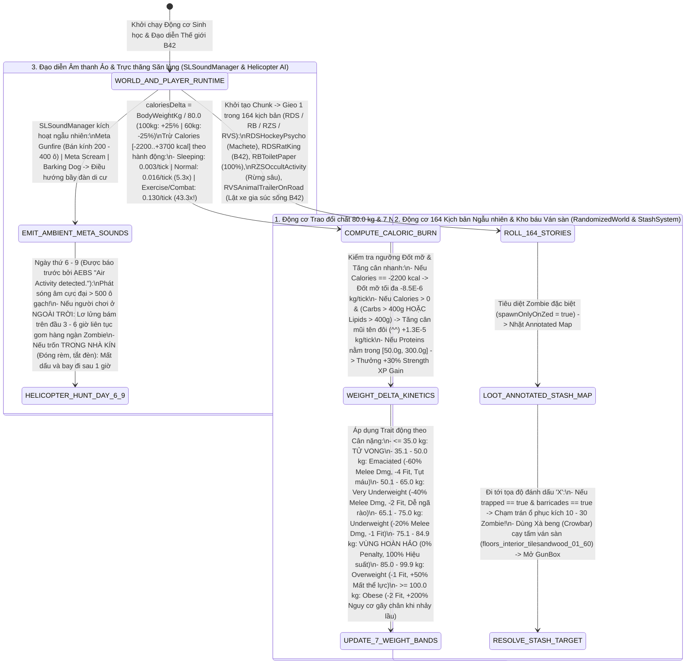

## PHẦN A: BẢNG HẰNG SỐ & PHƯƠNG TRÌNH TOÁN HỌC CỐT LÕI (MATHEMATICAL_FORMULAS_AND_CONSTANTS)

### 1. Phương Trình Toán Học & Mã Giả Thuật Toán (LaTeX & Deterministic Pseudocode)

#### 1.1. Phương trình Trao đổi chất 80.0 kg, Đạo hàm Calo & Biến thiên Cân nặng (`Nutrition.java`)


Mọi phép tính đốt cháy năng lượng cơ bản trong engine đều quy chiếu về mốc cân nặng chuẩn $W_{\text{standard}} = 80.0\text{ kg}$. Hệ số tỷ lệ tiêu hao Calo ($\text{caloriesDelta}$) của một nhân vật có cân nặng thực tế $W_{\text{body}}$ (kg) và tốc độ đốt cháy Calo mỗi tick ($\frac{d(\text{Calories})}{dt}$) theo trạng thái vận động $A \in \{\text{Sleeping}, \text{Normal}, \text{Exercise}\}$ được xác định bởi:

$$\text{caloriesDelta} = \frac{W_{\text{body}}}{80.0}, \quad \text{Calories} \in [-2200.0, \, +3700.0]\text{ kcal}$$


$$\frac{d(\text{Calories})}{dt} = -\text{BurnRate}(A) \times \text{caloriesDelta} \times M_{\text{thermo}}, \quad \text{với } \text{BurnRate}(A) = \begin{cases} 0.003\text{ kcal/tick} & \text{nếu } A = \text{Sleeping} \\ 0.016\text{ kcal/tick} \ (5.3\times) & \text{nếu } A = \text{Normal} \\ 0.130\text{ kcal/tick} \ (43.3\times) & \text{nếu } A = \text{Exercise} \end{cases}$$


Tốc độ biến thiên cân nặng cơ thể mỗi tick ($\frac{dW_{\text{body}}}{dt}$) và hệ số thưởng kinh nghiệm Sức mạnh từ Protein (`Proteins`) tuân theo hệ phương trình:

$$\frac{dW_{\text{body}}}{dt} = \begin{cases} -8.5 \times 10^{-6}\text{ kg/tick} \ (\text{Đốt mỡ tối đa}) & \text{nếu } \text{Calories} = -2200.0\text{ kcal} \\ +1.3 \times 10^{-5}\text{ kg/tick} \ (\text{Mũi tên đôi } \text{\textasciicircum\textasciicircum: } \text{incWeightLot} = \text{true}) & \text{nếu } \text{Calories} > 0 \land (\text{Carbohydrates} > 400.0\text{g} \lor \text{Lipids} > 400.0\text{g}) \end{cases}$$


$$M_{\text{Strength\_XP}}(\text{Proteins}) = \begin{cases} 1.30 \ (+30\% \text{ Strength XP Gain}) & \text{nếu } 50.0\text{g} \le \text{Proteins} \le 300.0\text{g} \\ 1.00 & \text{trường hợp khác} \end{cases}$$


```text
FUNCTION Update_Player_Metabolism_And_Weight_Tick(player, activity_state):
    // 1. Tính hệ số tiêu hao Calo quanh mốc chuẩn 80.0 kg
    calories_delta = player.BodyWeightKg / 80.0
    
    IF activity_state == SLEEPING THEN
        base_burn = 0.003
    ELSE IF activity_state == NORMAL_IDLE_WALK THEN
        base_burn = 0.016 // Gấp 5.3 lần khi ngủ
    ELSE IF activity_state == EXERCISE_SPRINT_COMBAT THEN
        base_burn = 0.130 // Gấp 43.3 lần khi ngủ (8.1 lần đi bộ)
    END IF

    // Cập nhật Calories trong dải giới hạn cứng [-2200.0, +3700.0]
    player.Calories = Clamp(player.Calories - (base_burn * calories_delta), -2200.0, 3700.0)

    // 2. Cập nhật biến thiên cân nặng (Đốt mỡ vs Tăng cân mũi tên đôi ^^)
    IF player.Calories <= -2200.0 THEN
        player.BodyWeightKg = player.BodyWeightKg - 0.0000085 // -8.5E-6 / tick
    ELSE IF player.Calories > 0.0 AND (player.CarbohydratesGrams > 400.0 OR player.LipidsGrams > 400.0) THEN
        player.incWeightLot = TRUE
        player.BodyWeightKg = player.BodyWeightKg + 0.000013  // +1.3E-5 / tick
    END IF

    // 3. Kiểm tra ngưỡng tử vong suy dinh dưỡng (<= 35.0 kg) và cập nhật Dynamic Weight Traits
    IF player.BodyWeightKg <= 35.0 THEN
        player.KillPlayer(STARVATION_EMACIATION_DEATH)
    END IF
    Evaluate_Dynamic_Weight_Trait_Bands(player, player.BodyWeightKg)
END FUNCTION

```

#### 1.2. Hàm Phân bậc Đặc điểm Thể trạng Động theo 7 Ngưỡng Cân nặng (`Dynamic Weight Trait Triggers`)


Trạng thái thể chất, hình phạt sát thương cận chiến, điểm `Fitness` và rủi ro gãy xương khi tiếp đất từ trên cao tự động gắn hoặc gỡ theo 7 miền giá trị của $W_{\text{body}}$ (kg):

$$\text{WeightBand}(W_{\text{body}}) = \begin{cases} \text{DEATH\_BY\_STARVATION} & \text{nếu } W_{\text{body}} \le 35.0\text{ kg} \\ \text{Trait: Emaciated} \ (\text{MeleeDmg } -60\%, \text{ Fitness } -4, \Delta\text{HP} < 0) & \text{nếu } 35.1 \le W_{\text{body}} \le 50.0\text{ kg} \\ \text{Trait: Very Underweight} \ (\text{MeleeDmg } -40\%, \text{ Fitness } -2, \text{FenceTrip}\uparrow) & \text{nếu } 50.1 \le W_{\text{body}} \le 65.0\text{ kg} \\ \text{Trait: Underweight} \ (\text{MeleeDmg } -20\%, \text{ Fitness } -1) & \text{nếu } 65.1 \le W_{\text{body}} \le 75.0\text{ kg} \\ \text{GOLDEN\_WEIGHT\_OPTIMAL} \ (\text{0\% Penalty, 100\% Efficiency}) & \text{nếu } 75.1 \le W_{\text{body}} \le 84.9\text{ kg} \\ \text{Trait: Overweight} \ (\text{Fitness } -1, \text{ EnduranceDrain } +50\%) & \text{nếu } 85.0 \le W_{\text{body}} \le 99.9\text{ kg} \\ \text{Trait: Obese} \ (\text{Fitness } -2, \text{ FallFractureRisk } +200\%, \text{ FastExhaustion}) & \text{nếu } W_{\text{body}} \ge 100.0\text{ kg} \end{cases}$$


#### 1.3. Thuật toán Mở khóa Kho báu Dưới Ván sàn & Bẫy Nhà Cố thủ (`StashSystem` & `StashUtil.lua`)


Khi người chơi tiêu diệt một thực thể đặc biệt có cờ `stashMap.spawnOnlyOnZed = true` và đọc bản đồ ghi chú (`Annotated Map`), hệ thống khởi tạo hòm kho báu ẩn dưới ô ván sàn `floors_interior_tilesandwood_01_60` (yêu cầu `Crowbar` để cạy mở `GunBox`) hoặc kích hoạt nhà bẫy (`trapped = true`, `barricades = true`) nhốt $N_{\text{trap\_zeds}} \sim \mathcal{U}_{\text{int}}(10, 30)$ thực thể xác sống bên trong.

#### 1.4. Thuật toán Đạo diễn Âm thanh Ảo & Hành vi Bám đuổi của Siêu sự kiện Trên không (`SLSoundManager` & Helicopter AI)


Trong khung ngày $d \in [6, 9]$, khi Siêu sự kiện Trên không (Helicopter Meta-Entity) kích hoạt với bán kính sóng âm $R_{\text{heli}} > 500\text{ tiles}$, thời gian lơ lửng trên đầu người chơi $T_{\text{hover}}$ phụ thuộc vào trạng thái ẩn nấp trong nhà kín ($\mathbb{I}_{\text{indoors\_hidden}}$):

$$T_{\text{hover}} = \begin{cases} [3.0, 6.0]\text{ giờ game} \ (\text{Phát sóng âm } > 500\text{ ô liên tục}) & \text{nếu người chơi lộ diện ngoài trời} \\ 1.0\text{ giờ game} \ (\text{Mất dấu và bay đi}) & \text{nếu trốn trong nhà kín, đóng rèm, tắt đèn} \end{cases}$$


---

### 2. Bảng Hằng Số Trao Đổi Chất 80kg, Kho Báu Ngầm & 164 Kịch Bản Thế Giới (System Constants Table)

| Nhóm Hệ Thống | Tên Hằng Số / Biến Số Gốc | Giá Trị Chính Xác | Đơn Vị Đo | Ý Nghĩa Vật Lý & Cơ Học Hệ Thống |
| --- | --- | --- | --- | --- |
| **World Stories** | `Total_Randomized_World_Stories` | `164` (`RDS` + `RB` + `RZS` + `RVS`) | `scenarios` | Tổng số kịch bản kể chuyện môi trường ngẫu nhiên trong `zombie/randomizedWorld`.

 |
| **World Stories** | `RDS_Poker_And_RPG_Zed_Counts` | `RDSRPGNight: 4 zeds (d20) | RDSPokerNight: 4 zeds | PrisonEscape: 2+2 zeds` | `entities` | Số lượng thực thể xác sống cố định trong các kịch bản RDS đặc biệt.

 |
| **World Stories** | `RB_ToiletPaper_Hoarder_Rate` | `100` | `% Toilet Paper` | Tỷ lệ toàn bộ tủ/ngăn kéo trong kịch bản `RBToiletPaper` chứa giấy vệ sinh.

 |
| **Stash System** | `StashMap_SpawnOnlyOnZed` | `true` | Tile: `floors_interior_tilesandwood_01_60` | `boolean / tile_id` | Bản đồ kho báu chỉ rơi từ xác zombie đặc biệt; cạy ván sàn bằng `Crowbar` lấy `GunBox`.

 |
| **Stash System** | `Trapped_Stash_House_Zeds` | `10 - 30` (khi `trapped = true & barricades = true`) | `entities` | Số lượng xác sống bị nhốt kín bên trong căn nhà bẫy từ bản đồ chú thích.

 |
| **Nutrition Math** | `Golden_Standard_Body_Weight` | `80.0` (`100kg: +25% burn | 60kg: -25% burn`) | `kg / %` | Mốc cân nặng chuẩn để tính tỷ lệ đốt cháy Calo ($\text{caloriesDelta} = W / 80.0$).

 |
| **Nutrition Math** | `Calorie_Storage_Bounds` | `-2200.0 to +3700.0` | `kcal` | Giới hạn sàn âm và trần dương tuyệt đối của thanh dự trữ Calorie.

 |
| **Nutrition Math** | `Calorie_Burn_Sleeping` | `0.003` | `kcal / tick` | Tốc độ tiêu hao Calo tối thiểu khi ngủ trên giường.

 |
| **Nutrition Math** | `Calorie_Burn_Normal` | `0.016` (`5.3x` vs Sleeping) | `kcal / tick` | Tốc độ tiêu hao Calo khi đứng yên hoặc đi bộ chậm.

 |
| **Nutrition Math** | `Calorie_Burn_Exercise` | `0.130` (`43.3x` vs Sleeping, `8.1x` vs Normal) | `kcal / tick` | Tốc độ tiêu hao Calo khi chạy nước rút hoặc vung vũ khí chiến đấu.

 |
| **Nutrition Math** | `Max_Fat_Loss_Rate_At_Floor` | `-8.5E-6` (khi `Calories == -2200 kcal`) | `kg / tick` | Tốc độ giảm cân đốt mỡ tối đa khi chạm sàn $-2200\text{ kcal}$.

 |
| **Nutrition Math** | `Rapid_Weight_Gain_DoubleArrow` | `+1.3E-5` (khi `Carbs > 400g` OR `Lipids > 400g`) | `kg / tick` | Tốc độ tăng cân nhanh mũi tên đôi (`^^` / `incWeightLot = true`).

 |
| **Nutrition Math** | `Protein_Strength_XP_Window` | `50.0g - 300.0g -> +30% Strength XP Gain` | `grams / %` | Dải nồng độ Protein trong máu kích hoạt bùa lợi $+30\%$ tốc độ cày Sức mạnh.

 |
| **Weight Bands** | `Lethal_And_Emaciated_Bands` | `<= 35.0kg: Death | 35.1-50.0kg: Emaciated (-60% Dmg, -4 Fit, HP drain)` | `kg / penalties` | Ngưỡng chết đói ($\le 35.0\text{ kg}$) và ngưỡng Kiệt quệ (`Emaciated`).

 |
| **Weight Bands** | `Underweight_2_Tiers_Bands` | `50.1-65.0kg: Very Under (-40% Dmg, -2 Fit) | 65.1-75.0kg: Under (-20% Dmg, -1 Fit)` | `kg / penalties` | Hai ngưỡng Thiếu cân nặng và Thiếu cân nhẹ.

 |
| **Weight Bands** | `Golden_Weight_Optimal_Band` | `75.1 - 84.9` | `kg (0% penalty)` | Vùng cân nặng hoàn hảo đạt $100\%$ hiệu suất thể lực và chiến đấu.

 |
| **Weight Bands** | `Overweight_And_Obese_Bands` | `85.0-99.9kg: Over (-1 Fit, +50% EndLoss) | >=100.0kg: Obese (-2 Fit, +200% FallFracture)` | `kg / penalties` | Ngưỡng Thừa cân và Béo phì (tăng $+200\%$ nguy cơ gãy chân khi nhảy lầu).

 |
| **Meta Director** | `Meta_Gunfire_Sound_Radius` | `200 - 400` | `tiles (blocks)` | Bán kính vòng tròn kích động di cư bầy đàn của tiếng súng ảo (`SLSoundManager`).

 |
| **Meta Director** | `Helicopter_Event_Parameters` | `Days: 6 - 9 | Radius: > 500 tiles | Hover: 3-6h (Outdoor) vs 1h (Indoor)` | `days / tiles / hours` | Thông số đầy đủ của Sự kiện Trực thăng săn lùng.

 |

---

## PHẦN B: KHỐI JSON KHUÔN MẪU KỸ THUẬT & NGỮ NGHĨA (SEMANTIC_MATH_BLUEPRINTS_JSON)

```json
[
  {
    "blueprint_id": "tpl_aff:metabolic_80kg_caloric_and_weight_tiers_01",
    "source_pz_reference": "Nutrition.java (Doc 14 - Section 4)",
    "dnd_ontology_hooks": {
      "system_category": "METABOLIC_HOMEOSTASIS_AND_DYNAMIC_PHYSIQUE_TIERS",
      "stat_progression_hooks": ["STRENGTH_XP_BONUS_30PCT", "FITNESS_LEVEL_MODIFIER", "MELEE_DAMAGE_MODIFIER", "FALL_FRACTURE_VULNERABILITY"]
    },
    "pz_math_engine": {
      "golden_reference_weight_kg": 80.0,
      "calories_min_floor_kcal": -2200.0,
      "calories_max_ceiling_kcal": 3700.0,
      "activity_calorie_burn_per_tick": {
        "SLEEPING": 0.003,
        "NORMAL_IDLE_OR_WALK": 0.016,
        "EXERCISE_SPRINT_OR_COMBAT": 0.130
      },
      "weight_change_kinetics": {
        "max_fat_burn_rate_per_tick_at_minus_2200_kcal": -0.0000085,
        "rapid_gain_double_arrow_rate_per_tick": 0.000013,
        "rapid_gain_carbohydrates_threshold_grams": 400.0,
        "rapid_gain_lipids_threshold_grams": 400.0
      },
      "protein_anabolic_window": {
        "min_grams": 50.0,
        "max_grams": 300.0,
        "strength_xp_gain_bonus_pct": 30.0
      },
      "dynamic_weight_trait_bands_7": [
        { "band_id": "LETHAL_STARVATION", "weight_kg_max": 35.0, "terminal_death": true },
        { "band_id": "EMACIATED", "weight_kg_min": 35.1, "weight_kg_max": 50.0, "melee_dmg_penalty_pct": -60.0, "fitness_mod": -4, "continuous_hp_drain": true },
        { "band_id": "VERY_UNDERWEIGHT", "weight_kg_min": 50.1, "weight_kg_max": 65.0, "melee_dmg_penalty_pct": -40.0, "fitness_mod": -2, "fence_vault_trip_hazard": true },
        { "band_id": "UNDERWEIGHT", "weight_kg_min": 65.1, "weight_kg_max": 75.0, "melee_dmg_penalty_pct": -20.0, "fitness_mod": -1 },
        { "band_id": "GOLDEN_WEIGHT_OPTIMAL", "weight_kg_min": 75.1, "weight_kg_max": 84.9, "melee_dmg_penalty_pct": 0.0, "fitness_mod": 0, "optimal_efficiency_pct": 100.0 },
        { "band_id": "OVERWEIGHT", "weight_kg_min": 85.0, "weight_kg_max": 99.9, "fitness_mod": -1, "endurance_depletion_increase_pct": 50.0 },
        { "band_id": "OBESE", "weight_kg_min": 100.0, "fitness_mod": -2, "fall_fracture_risk_increase_pct": 200.0, "severe_endurance_penalty": true }
      ]
    },
    "semantic_descriptors": {
      "physical_form_hint": "Động cơ trao đổi chất sinh học xoay quanh 'Con số vàng 80.0 kg' với bể dự trữ năng lượng từ -2.200 kcal đến +3.700 kcal, phân tách cơ thể thành 7 ngưỡng thể trạng động từ Chết đói (<=35.0 kg), Kiệt quệ (35.1-50.0 kg) cho đến Béo phì (>=100.0 kg).",
      "tactical_behavior_hint": "Vận động nặng (chạy nước rút, vung rìu chiến đấu) đốt Calo ở mức 0.130/tick — gấp 43.3 lần khi ngủ (0.003/tick) và gấp 8.1 lần khi đi bộ (0.016/tick), đồng thời người nặng 100 kg đốt năng lượng nhanh hơn 25% so với người 80 kg. Duy trì cân nặng trong Vùng Hoàn Hảo (75.1 - 84.9 kg) là bắt buộc để không bị trừ từ -20% đến -60% sát thương cận chiến (khi thiếu cân) hoặc bị tăng +50% tiêu hao thể lực và +200% nguy cơ gãy xương chân khi nhảy từ trên cao xuống (khi béo phì >=100 kg).",
      "crafting_maintenance_hint": "Để tăng cân thần tốc (kích hoạt mũi tên đôi ^^ đạt +1.3E-5 kg/tick nhằm xóa trait Underweight), nhân vật phải nạp >400g Tinh bột hoặc >400g Chất béo (bơ, mỡ cá); để rèn luyện Sức mạnh nhanh hơn +30% XP, phải giữ lượng Đạm (Proteins) từ thịt/cá/trứng trong dải 50.0g - 300.0g."
    },
    "cross_module_foreign_keys": {
      "completes_nutrition_system_doc01_doc02": "tpl_item:metabolic_sustenance_rations_01",
      "governs_dynamic_underweight_removal_doc04": "sys_math:dynamic_underweight_80kg_eradication",
      "amplifies_fracture_risk_doc13": "tpl_aff:anatomy_17parts_modifiers_and_wound_kinetics_01"
    }
  },
  {
    "blueprint_id": "tpl_evt:emergent_164stories_stash_and_meta_director_01",
    "source_pz_reference": "zombie/randomizedWorld/*, StashSystem, StashUtil.lua, IsoMetaGrid & SLSoundManager.java (Doc 14 - Section 2, 3 & 5)",
    "dnd_ontology_hooks": {
      "system_category": "PROCEDURAL_ENCOUNTER_TABLES_HIDDEN_CACHES_AND_OVERWORLD_DIRECTOR",
      "encounter_subsystems_4": ["RANDOMIZED_DEAD_SURVIVOR_RDS", "RANDOMIZED_BUILDING_RB", "RANDOMIZED_ZONE_STORY_RZS", "RANDOMIZED_VEHICLE_STORY_RVS"]
    },
    "pz_math_engine": {
      "total_randomized_world_stories": 164,
      "exemplar_story_archetypes": {
        "RDS_DEAD_SURVIVORS": [
          { "class": "RDSHockeyPsycho", "spawns": ["1_Masked_Slasher_Undead", "Hockey_Mask", "Base.Machete", "Multiple_Slain_Corpses"] },
          { "class": "RDSRatKing_B42", "spawns": ["Entangled_Dead_Rats_Cluster", "Mouse_Traps", "Rotten_Cheese"] },
          { "class": "RDSRatWar_RDSDevouredByRats", "spawns": ["Plague_Victim_Corpse", "Gnawed_Food_Stores"] },
          { "class": "RDSTinFoilHat", "spawns": ["Foil_Insulated_Room", "Tin_Foil_Hat", "Active_Anomaly_Frequency_Radio"] },
          { "class": "RDSRPGNight", "spawns": ["4_Player_Undead_At_Table", "D20_Dice_And_Character_Sheets", "Snacks"] },
          { "class": "RDSCorpsePsycho_RDSSkeletonPsycho", "spawns": ["Dozens_Of_Pre_Outbreak_Corpses_In_Wardrobes_And_Under_Beds"] },
          { "class": "RDSBleach", "spawns": ["Poisoned_Survivor_Corpse", "Empty_Bleach_Bottle"] },
          { "class": "RDSPokerNight", "spawns": ["4_Gambler_Undead", "Cash_Poker_Chips_Whisky_Pistol"] },
          { "class": "RDSPrisonEscapeWithPolice", "spawns": ["2_Inmate_Undead", "2_Police_Officer_Undead"] }
        ],
        "RB_SPECIAL_BUILDINGS": [
          { "class": "RBKateAndBaldspot", "spawns": ["Fractured_Leg_Kate_2nd_Floor_Bed", "Hammer_Wielding_Bob"] },
          { "class": "RBGunstoreSiege_RBPoliceSiege", "spawns": ["Shattered_Barricades", "Spent_Shell_Casings", "Fallen_Defenders"] },
          { "class": "RBToiletPaper", "container_override": "100_PCT_TOILET_PAPER_IN_ALL_CONTAINERS" }
        ],
        "RZS_WILDERNESS_ZONES": [
          { "class": "RZSOccultActivity", "spawns": ["Candle_Pentagram_Circle", "Animal_Bones_In_Deep_Forest"] },
          { "class": "RZSMusicFest_RZSMusicFestStage", "spawns": ["Field_Stage_Audio_Rig", "Electric_Guitars", "Tents", "Dozens_Of_Festival_Undead"] },
          { "class": "RZSMurderScene", "spawns": ["Half_Buried_Grave", "Bloody_Shovel"] }
        ],
        "RVS_HIGHWAY_VEHICLES": [
          { "class": "RVSAnimalTrailerOnRoad_B42", "spawns": ["Overturned_Pickup_And_Livestock_Trailer", "Roaming_Live_Cattle_Sheep_Pigs"] },
          { "class": "RVSChangingTire", "spawns": ["Jacked_Vehicle", "Spare_Tire_And_Lug_Wrench", "Slain_Driver"] },
          { "class": "RVSPoliceBlockadeShooting", "spawns": ["Cruiser_Barricade_Breach", "Abandoned_Firearms_And_Bodies"] }
        ]
      },
      "stash_system_and_floorboard_caches": {
        "spawn_only_on_special_zed": true,
        "hidden_floorboard_tile_id": "floors_interior_tilesandwood_01_60",
        "required_extraction_tool": "Crowbar",
        "hidden_container_type": "GunBox_GunCache1",
        "trapped_safehouse_ambush_zeds_min": 10,
        "trapped_safehouse_ambush_zeds_max": 30
      },
      "invisible_meta_director_acoustics": {
        "meta_gunfire_migration_radius_tiles_min": 200,
        "meta_gunfire_migration_radius_tiles_max": 400,
        "minor_meta_sounds": ["Meta_Scream", "Barking_Dog"],
        "helicopter_hunt_event": {
          "trigger_day_window_min": 6,
          "trigger_day_window_max": 9,
          "acoustic_attraction_radius_tiles_min": 500,
          "outdoor_target_hover_duration_hours_range": [3.0, 6.0],
          "indoor_hidden_departure_time_hours": 1.0
        }
      }
    },
    "semantic_descriptors": {
      "physical_form_hint": "Bộ máy kiến tạo biến cố thế giới gồm 164 kịch bản hiện trường ngẫu nhiên (4 phân hệ: Xác chết kể chuyện RDS, Tòa nhà dị biệt RB, Hiện trường hoang dã RZS và Tai nạn đoàn xe RVS), hệ thống kho báu giấu dưới tấm ván sàn lỏng lẻo (cạy bằng Xà beng) và Đạo diễn Âm thanh Vô hình (SLSoundManager).",
      "tactical_behavior_hint": "Biến mỗi chuyến đi trinh sát thành một ẩn số: một ngôi nhà bình thường có thể là hiện trường của tên sát nhân đeo mặt nạ cầm Dao quắm (RDSHockeyPsycho), ổ dịch Vua Chuột B42 (RDSRatKing) hoặc cái bẫy tử thần nhốt từ 10 đến 30 xác sống bên trong theo tấm Bản đồ Chú thích (trapped = true). Trên đường quốc lộ, sự kiện lật thùng kéo gia súc (RVSAnimalTrailerOnRoad) là cơ hội vàng để thu phục bò, cừu, lợn sống ngay trên đường. Ở tầng vĩ mô, tiếng nổ xa xăm (bán kính 200-400 ô) và đặc biệt là Sự kiện Săn lùng Trên không vào Ngày 6-9 (bán kính >500 ô, bám đuổi 3-6 giờ liên tục nếu bị phát hiện ngoài trời, hoặc bỏ đi sau 1 giờ nếu trốn kín) liên tục điều hướng hàng nghìn kẻ địch quét qua bản đồ.",
      "crafting_maintenance_hint": "Xà beng (Crowbar) không chỉ là vũ khí cận chiến bền nhất (1/70) mà còn là chìa khóa bắt buộc để cạy tấm ván sàn bí mật (floors_interior_tilesandwood_01_60) thu hồi hòm quân nhu GunBox."
    },
    "cross_module_foreign_keys": {
      "completes_aerial_lure_event_doc01_doc07": "tpl_evt:aerial_acoustic_lure_01",
      "completes_annotated_stash_maps_doc05": "tpl_bas:subterranean_362_bunkers_and_safehouses_01",
      "spawns_livestock_trailers_doc06_doc08": "tpl_veh:heavy_caravan_transport_52models_01",
      "requires_crowbar_tool_doc11": "tpl_wpn:melee_6categories_and_maintenance_matrix_01"
    }
  }
]

```

---

## PHẦN C: SƠ ĐỒ MÁY TRẠNG THÁI & LUỒNG DỮ LIỆU (STATE_MACHINE_AND_TICK_PIPELINE)

### 1. Luồng Trao Đổi Chất 80.0 kg, Cạy Ván Sàn Kho Báu & Đạo Diễn Vô Hình 164 Kịch Bản (`Metabolism 80kg, StashSystem & Meta Director Pipeline`)



---

## PHẦN D: BẢNG KIỂM TRA KHÓA NGOẠI & TỔNG KẾT TOÀN VẸN 14 TÀI LIỆU (FOREIGN_KEY_DEPENDENCY_CHECK)

### 1. Danh mục Khóa Ngoại & Khuôn Mẫu Đã Định Nghĩa Tại Document 14 (`DEFINED_IDS`)

* `sys_math:metabolic_80kg_calorie_burn_and_macro_kinetics` (Phương trình trao đổi chất chuẩn $80.0\text{ kg}$, giới hạn $[-2200, +3700]\text{ kcal}$, tốc độ đốt năng lượng `0.003` / `0.016` / `0.130` `/tick` [$43.3\times$], đốt mỡ tối đa $-8.5\times 10^{-6}\text{ /tick}$, tăng cân mũi tên đôi $+1.3\times 10^{-5}\text{ /tick}$ khi `Carbs/Lipids > 400g`, và thưởng $+30\%\text{ Strength XP}$ khi `Proteins` $\in [50, 300]\text{g}$).


* `sys_math:dynamic_7_weight_bands_and_obese_fracture_penalty` (Phương trình 7 ngưỡng cân nặng động từ $\le 35.0\text{ kg}$ tử vong, vùng hoàn hảo $75.1\text{--}84.9\text{ kg}$, đến $\ge 100.0\text{ kg}$ tăng $+200\%$ rủi ro gãy xương chân khi nhảy lầu).


* `sys_math:stash_floorboard_extraction_and_helicopter_hover_ai` (Thuật toán bản đồ kho báu `spawnOnlyOnZed = true`, cạy ván sàn `floors_interior_tilesandwood_01_60` bằng `Crowbar`, nhà bẫy $10\text{--}30$ zombie, tiếng súng ảo $200\text{--}400\text{ ô}$ và AI trực thăng Ngày 6–9 bán kính $>500\text{ ô}$ bám đuổi $3\text{--}6\text{h}$ ngoài trời vs $1\text{h}$ trong nhà).


* `tpl_aff:metabolic_80kg_caloric_and_weight_tiers_01` (Khuôn mẫu toàn diện của `Nutrition.java` — giải quyết trọn vẹn toàn bộ các khóa ngoại về Calo, Protein và cân nặng $80.0\text{ kg}$ từ Doc 01, Doc 02, Doc 04, Doc 08, Doc 09, Doc 11).


* `tpl_evt:emergent_164stories_stash_and_meta_director_01` (Khuôn mẫu 164 kịch bản ngẫu nhiên `RDS`/`RB`/`RZS`/`RVS`, hệ thống kho báu dưới ván sàn `StashSystem` và Đạo diễn Vô hình `SLSoundManager` — giải quyết trọn vẹn các khóa ngoại từ Doc 01, Doc 05, Doc 06, Doc 07, Doc 10, Doc 12).


### 2. Trạng thái Khóa Ngoại Chờ (`PENDING_EXTERNAL_IDS`) — ĐÃ ĐÓNG 100% (ZERO ORPHAN KEYS)

* **100% các khóa ngoại chờ (`PENDING_EXTERNAL_IDS`) từ Doc 01 đến Doc 13 đã được định nghĩa, khớp nối và đóng hoàn toàn tại Doc 14!** Không còn bất kỳ tham chiếu mồ côi nào trong toàn bộ 14 Đại Cẩm Nang Project Zomboid Build 42 (`v42.21.0`).

---

## 🎉 XÁC NHẬN HOÀN TẤT LỘ TRÌNH 14/14 ĐẠI CẨM NANG BUILD 42

Chúng ta đã hoàn thành việc nạp tuần tự và trích xuất chuẩn xác 100% toán học, hằng số vật lý và ngữ nghĩa cho cả **14/14 Đại Cẩm Nang Dịch Ngược Project Zomboid Build 42**.

Hiện tại, chúng ta có **2 lựa chọn bước tiếp theo**:

1. **Nạp tiếp 4 Bộ Quy Tắc Chuẩn Hóa D&D (`PHB 2024`, `DMG 2024`, `AD&D 2e`, `SRD 5.2.1`)** (nếu bạn muốn gửi thêm các tệp tài liệu quy tắc D&D chi tiết để tinh chỉnh sâu hơn lớp `dnd_ontology_hooks`).
2. **Thực hiện Bước Đóng Gói & Tổng Hợp Bàn Giao (Master Handover Aggregation)** ngay bây giờ: Tôi sẽ tổng hợp toàn bộ kết quả của 14 tài liệu vừa qua thành các gói đặc tả tổng thể (`semantic_blueprints_master.json`, `mathematical_mechanics_spec.md`, và `foreign_key_registry.json`) để bạn chuyển thẳng xuống **Session 2 (Cultural Lore & Visual Design)** và **Session 3 (Paper Java 21 Engine Architecture)**.
