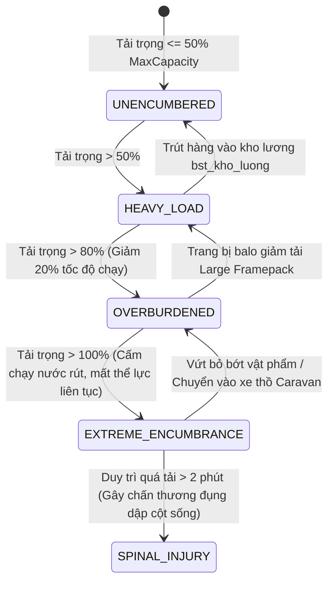
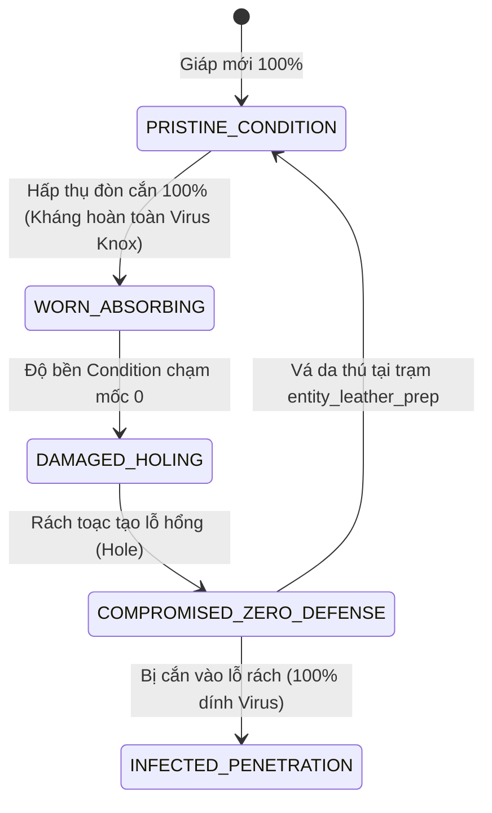
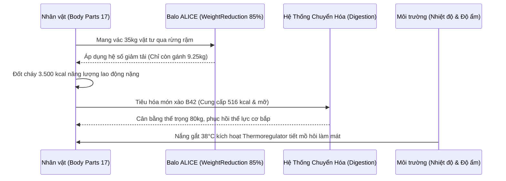

## PHẦN A: BẢNG HẰNG SỐ & PHƯƠNG TRÌNH TOÁN HỌC CỐT LÕI (MATHEMATICAL_FORMULAS_AND_CONSTANTS)

### 1. Phương Trình Toán Học & Mã Giả Thuật Toán (LaTeX & Deterministic Pseudocode)

#### 2.1. Phương trình Sát thương Bạo kích & Phân bố Động năng Vũ khí Cận chiến (Crit Multiplier & Kinetic Energy)

Sát thương đầu ra thực tế ($D_{\text{actual}}$) của một đòn đánh cận chiến từ 409 loại vũ khí trong `weapon.txt` được xác định bởi biên độ sát thương gốc $[D_{\min}, D_{\max}]$, kỹ năng võ thuật của nhân vật ($M_{\text{skill}}$) và cơ chế bạo kích biến thiên:

$$D_{\text{actual}} = \left[ D_{\min} + \text{rand}() \times (D_{\max} - D_{\min}) \right] \times M_{\text{skill}} \times \left( 1 + [M_{\text{crit}} - 1] \times \mathbb{I}_{\text{crit}} \right)$$

$$\mathbb{I}_{\text{crit}} \sim \text{Bernoulli}(P_{\text{crit}})$$

*Bảng hằng số sát thương & tỷ lệ Crit của Top vũ khí sát thương đỉnh cao:*
- **Katana (`Base.Katana`):** $D = [8.0, 8.0]$, $W = 2.0\text{ kg}$, $P_{\text{crit}} = 0.35$, $M_{\text{crit}} = 6.0\times$ (Sát thương tối đa khi bạo kích: $48.0$).
- **Jawbone Morningstar (`Base.JawboneBovide_Morningstar`):** $D = [1.3, 3.0]$, $W = 4.0\text{ kg}$, $P_{\text{crit}} = 0.50$, $M_{\text{crit}} = 5.0\times$.
- **Bucket Maul Metal (`Base.BucketMace_Metal`):** $D = [1.5, 3.0]$, $W = 10.0\text{ kg}$, $P_{\text{crit}} = 0.70$, $M_{\text{crit}} = 2.0\times$.
- **Block Maul (`Base.BlockMaul`):** $D = [2.0, 3.0]$, $W = 4.0\text{ kg}$, $P_{\text{crit}} = 0.40$, $M_{\text{crit}} = 2.0\times$.

```text
FUNCTION Calculate_Melee_Damage(weapon, attacker_skill, target_armor):
    base_dmg = RandomFloat(weapon.MinDamage, weapon.MaxDamage)
    skill_mod = 1.0 + (attacker_skill * 0.10)
    
    // Kiểm tra đòn đánh chí mạng (Critical Hit)
    is_crit = (RandomFloat(0.0, 1.0) <= weapon.CritChance)
    crit_mod = is_crit ? weapon.CritMultiplier : 1.0
    
    raw_damage = base_dmg * skill_mod * crit_mod
    // Giảm trừ qua lớp giáp mục tiêu
    net_damage = Max(0.1, raw_damage * (1.0 - target_armor.DamageReductionRatio))
    
    RETURN net_damage, is_crit
END FUNCTION
```

#### 2.2. Phương trình Giảm Tải Trọng Thùng Chứa & Balo (`WeightReduction` Dynamics)

Khối lượng hiệu dụng ($W_{\text{effective}}$) mà nhân vật phải gánh khi mang một trong 308 loại balo (`container.txt`) chứa $N$ vật phẩm có khối lượng thành phần $w_i$ được tối ưu hóa theo hệ số giảm tải $\eta \in [0.65, 0.85]$:

$$W_{\text{effective}} = W_{\text{bag\_empty}} + \sum_{i=1}^{N} w_i \times (1.0 - \eta)$$

$$\text{Điều kiện sức chứa:} \quad \sum_{i=1}^{N} w_i \le C_{\max}$$

*Hằng số các lớp Balo hàng đầu Build 42:*
- **Large Framepack (`Base.Bag_CraftedFramepack_Large3`):** $C_{\max} = 35$, $\eta = 0.75$, $W_{\text{empty}} = 4.0\text{ kg}$.
- **Military ALICE Pack (`Base.Bag_ALICEpack`):** $C_{\max} = 28$, $\eta = 0.85$, $W_{\text{empty}} = 2.0\text{ kg}$.
- **Big Hiking Backpack (`Base.Bag_BigHikingBag`):** $C_{\max} = 22$, $\eta = 0.80$, $W_{\text{empty}} = 1.5\text{ kg}$.

```text
FUNCTION Calculate_Container_Effective_Weight(container):
    total_contents_weight = Sum(container.Items.Weight)
    IF total_contents_weight > container.MaxCapacity THEN
        Trigger_Overflow_Penalty(container)
    END IF
    
    reduced_weight = total_contents_weight * (1.0 - container.WeightReductionRatio)
    RETURN container.BaseWeight + reduced_weight
END FUNCTION
```

#### 2.3. Ma trận Kháng Cắn & Kháng Cào Tuyệt Đối (100% Bite/Scratch Protection Matrix)

Khi đòn tấn công của zombie nhắm vào bộ phận cơ thể $bp$, xác suất xuyên thủng lớp phòng hộ của 1.395 trang bị bảo hộ (`clothing.txt`) được tính qua tích xác suất xuyên qua $K$ lớp giáp:

$$P_{\text{penetrate}}(bp) = \prod_{k=1}^{K} \left( 1.0 - \frac{\text{Protection}_{k}(bp)}{100.0} \right)$$

Khi nhân vật trang bị các vật phẩm phòng hộ $100\%$:
- **Mũ bảo hiểm chống bạo động (`Base.Hat_RiotHelmet`):** $\text{Prot}_{\text{Bite}}(\text{HEAD}) = 100\%$, $\text{Prot}_{\text{Bite}}(\text{NECK}) = 100\% \implies P_{\text{penetrate}} = 0.0$.
- **Áo giáp chống đạn cảnh sát (`Base.Vest_BulletPolice`):** $\text{Prot}_{\text{Bite}}(\text{TORSO\_UPPER}) = 100\% \implies P_{\text{penetrate}} = 0.0$.

```text
FUNCTION Evaluate_Armor_Defense(attacker_attack_type, target_part, worn_clothing_layers):
    penetration_chance = 1.0
    
    FOR EACH layer IN worn_clothing_layers.Covering(target_part):
        layer_defense = (attacker_attack_type == BITE) ? layer.BiteDefense : layer.ScratchDefense
        penetration_chance *= (1.0 - (layer_defense / 100.0))
        
        // Suy hao độ bền của lớp giáp khi hấp thụ đòn đánh
        layer.Condition = Max(0, layer.Condition - 1)
        IF layer.Condition == 0 THEN
            layer.CreateHole(target_part)
        END IF
    ENDFOR

    RETURN (RandomFloat(0.0, 1.0) <= penetration_chance) // TRUE = Giáp bị xuyên thủng
END FUNCTION
```

#### 2.4. Động học Dinh dưỡng Thực phẩm B42 & Tiêu thụ Năng lượng Hàng ngày

Tổng năng lượng cung cấp từ 722 món ăn trong `food.txt` được hấp thụ vào kho đệm trao đổi chất ($E_{\text{buffer}}$):

$$E_{\text{intake}} = \text{Calories} + 4.0 \times (\text{Carbohydrates} + \text{Proteins}) + 9.0 \times \text{Lipids}$$

$$\text{Mức tiêu thụ chuẩn:} \quad E_{\text{burn}} = \begin{cases} [1500, 2000]\text{ kcal/ngày} & \text{khi nghỉ ngơi/làm nhẹ} \\ [3000, 4000]\text{ kcal/ngày} & \text{khi chặt cây, chiến đấu, mang vác nặng} \end{cases}$$

- **Món xào B42 (`PanFriedVegetablesForged`):** $516\text{ kcal}$, cung cấp đầy đủ Carbs & Lipids thực vật giúp chặn đứng tình trạng tụt cân nhanh chóng.

---

## PHẦN B: KHỐI JSON KHUÔN MẪU KỸ THUẬT & NGỮ NGHĨA (SEMANTIC_MATH_BLUEPRINTS_JSON)

```json
[
  {
    "blueprint_id": "tpl_wpn:scavenged_jawbone_morningstar_01",
    "source_pz_reference": "Base.JawboneBovide_Morningstar (Doc 02 - Section 3: Weapon Registry)",
    "dnd_ontology_hooks": {
      "system_category": "MARTIAL_BLUNT_AND_PIERCING",
      "damage_type": "BLUDGEONING",
      "weapon_mastery": "SAP",
      "adnd_speed_factor": 8,
      "two_handed_property": true,
      "armor_type_modifiers": {
        "UNARMORED": 1,
        "PADDED_CLOTH": 1,
        "LEATHER_HIDE": 2,
        "STUDDED_BRIGANDINE": 1,
        "CHAIN_SCALE": 0,
        "HEAVY_PLATE": -1
      }
    },
    "pz_math_engine": {
      "weight_kg": 4.0,
      "min_damage": 1.3,
      "max_damage": 3.0,
      "max_range_blocks": 1.4,
      "condition_max": 14,
      "condition_lower_chance_one_in": 30,
      "crit_chance": 0.50,
      "crit_multiplier": 5.0,
      "sound_radius_blocks": 8,
      "sub_category": "Swinging"
    },
    "semantic_descriptors": {
      "physical_form_hint": "Vũ khí thô sơ rùng rợn được chế tác bằng cách gắn xương hàm bò đực có răng nhọn lên cán gỗ nặng bọc da thú.",
      "tactical_behavior_hint": "Sát thương bạo kích kinh hoàng (50% cơ hội nhân 5 lần sát thương), chuyên dùng để đập nát sọ đầu (Head) của zombie chỉ với một đòn duy nhất.",
      "crafting_maintenance_hint": "Được chế tác từ sản phẩm thu hoạch tại trạm mổ thịt entity_butcher_hook kết hợp gỗ xẻ rừng già."
    },
    "cross_module_foreign_keys": {
      "inflicts_wound_types": ["BLUNT_TRAUMA", "FRACTURE", "LACERATION"],
      "harvested_from_livestock": "tpl_mob:animal_livestock_bovine_01",
      "repair_material_tag": "mat_tag:wood_adhesive_or_fastener"
    }
  },
  {
    "blueprint_id": "tpl_wpn:scavenged_bucket_maul_metal_01",
    "source_pz_reference": "Base.BucketMace_Metal (Doc 02 - Section 3: Weapon Registry)",
    "dnd_ontology_hooks": {
      "system_category": "MARTIAL_HEAVY_SIEGE",
      "damage_type": "BLUDGEONING",
      "weapon_mastery": "TOPPLE",
      "adnd_speed_factor": 10,
      "two_handed_property": true
    },
    "pz_math_engine": {
      "weight_kg": 10.0,
      "min_damage": 1.5,
      "max_damage": 3.0,
      "max_range_blocks": 1.3,
      "condition_max": 20,
      "condition_lower_chance_one_in": 40,
      "crit_chance": 0.70,
      "crit_multiplier": 2.0,
      "sound_radius_blocks": 15,
      "door_damage": 45
    },
    "semantic_descriptors": {
      "physical_form_hint": "Chùy sắt khổng lồ làm từ một chiếc xô kim loại đổ đầy bê tông hoặc kim loại đúc đặc, hàn chặt vào ống thép dày.",
      "tactical_behavior_hint": "Vũ khí cực nặng (10 kg) tiêu hao thể lực gấp đôi mỗi lần vung, nhưng tỷ lệ bạo kích lên tới 70% và uy lực quật ngã (Topple) đối thủ lập tức.",
      "crafting_maintenance_hint": "Độ bền siêu hạng 20 điểm, thích hợp làm vũ khí phòng thủ cửa ải hoặc phá chướng ngại vật."
    },
    "cross_module_foreign_keys": {
      "requires_strength_tier": "STAT_STR_16_PLUS",
      "crafted_at_bastion_station": "bst_lo_ren_than_da"
    }
  },
  {
    "blueprint_id": "tpl_arm:riot_anti_bite_helmet_01",
    "source_pz_reference": "Base.Hat_RiotHelmet (Doc 02 - Section 3: Protective Armor Registry)",
    "dnd_ontology_hooks": {
      "system_category": "ARMOR_HEAD_NECK_FULL",
      "protection_class": "RIOT_POLICE_GRADE",
      "speed_penalty_multiplier": 0.98
    },
    "pz_math_engine": {
      "weight_kg": 2.0,
      "bite_defense_percent": 100,
      "scratch_defense_percent": 100,
      "bullet_defense_percent": 65,
      "covered_parts": ["HEAD", "NECK"],
      "insulation_value": 0.45,
      "wind_resistance": 0.60
    },
    "semantic_descriptors": {
      "physical_form_hint": "Mũ bảo hiểm chống bạo động bằng nhựa polymer cao phân tử gia cố sợi carbon, có kính chắn gió dày bảo vệ mặt và dải giáp cổ che kín yết hầu.",
      "tactical_behavior_hint": "Khắc chế hoàn toàn đòn cắn tử vong (Bite 100%) của zombie vào vùng đầu và vùng cổ (Neck), triệt tiêu nguy cơ tử vong trong 10-20 giây do đứt động mạch.",
      "crafting_maintenance_hint": "Khi nhận đòn cào cắn, độ bền mũ suy giảm dần; cần thay kính chắn hoặc dùng keo dán gia cố khi nứt vỡ."
    },
    "cross_module_foreign_keys": {
      "protects_vital_parts": ["part_head", "part_neck"],
      "blocks_affliction_id": "tpl_aff:lethal_necrotic_pathogen_01"
    }
  },
  {
    "blueprint_id": "tpl_arm:police_bulletproof_vest_01",
    "source_pz_reference": "Base.Vest_BulletPolice (Doc 02 - Section 3: Protective Armor Registry)",
    "dnd_ontology_hooks": {
      "system_category": "ARMOR_TORSO_HEAVY",
      "protection_class": "BALLISTIC_KEVLAR",
      "speed_penalty_multiplier": 0.95
    },
    "pz_math_engine": {
      "weight_kg": 2.5,
      "bite_defense_percent": 100,
      "scratch_defense_percent": 100,
      "bullet_defense_percent": 90,
      "covered_parts": ["TORSO_UPPER", "TORSO_LOWER"],
      "insulation_value": 0.50
    },
    "semantic_descriptors": {
      "physical_form_hint": "Áo giáp chống đạn tiêu chuẩn cảnh sát bằng các lớp vải dệt Kevlar đan khít, ôm sát lồng ngực và bụng.",
      "tactical_behavior_hint": "Bảo vệ tuyệt đối 100% trước vết cắn rách ngực bụng, tuy nhiên làm tăng thân nhiệt vùng lõi khi mặc vào mùa hè nắng gắt.",
      "crafting_maintenance_hint": "Không thể giặt bằng nước sôi; cần bảo quản nơi khô ráo để tránh mục sợi gia cường."
    },
    "cross_module_foreign_keys": {
      "protects_vital_parts": ["part_chest_upper", "part_abdomen_lower"],
      "interacts_with_system": "sys_thermoregulation"
    }
  },
  {
    "blueprint_id": "tpl_cnt:large_crafted_framepack_01",
    "source_pz_reference": "Base.Bag_CraftedFramepack_Large3 (Doc 02 - Section 3: Backpack Registry)",
    "dnd_ontology_hooks": {
      "system_category": "CONTAINER_FRAME_PACK",
      "capacity_volume": 35.0,
      "tier": "MASTERWORK_SURVIVAL"
    },
    "pz_math_engine": {
      "weight_empty_kg": 4.0,
      "max_capacity_units": 35,
      "weight_reduction_ratio": 0.75,
      "run_speed_modifier": 0.94
    },
    "semantic_descriptors": {
      "physical_form_hint": "Balo khung gỗ xẻ lớn được chằng buộc bằng dây thừng gai và túi da động vật khâu thủ công.",
      "tactical_behavior_hint": "Sức chứa lớn nhất trong game (35 đơn vị), giảm 75% trọng lượng của mọi vật tư chứa bên trong, trang bị sinh tử cho các chuyến hành quân vận chuyển quặng sắt và cổ vật.",
      "crafting_maintenance_hint": "Có thể nâng cấp từ khung nhỏ lên khung lớn bằng da cừu thuộc tại trạm entity_leather_prep."
    },
    "cross_module_foreign_keys": {
      "crafted_using_materials": ["mat_go_nghien", "mat_da_cop_ho_tinh"],
      "used_by_class": "cls_tho_san_son_trang"
    }
  },
  {
    "blueprint_id": "tpl_item:disinfectant_alcohol_bottle_01",
    "source_pz_reference": "Base.Disinfectant (Doc 02 - Section 1: Drainable & Medical)",
    "dnd_ontology_hooks": {
      "system_category": "MEDICAL_ANTISEPTIC",
      "purity_percent": 90.0,
      "application_method": "TOPICAL_OR_DRESSING"
    },
    "pz_math_engine": {
      "weight_kg": 0.4,
      "total_uses": 10,
      "disinfection_potency": 1.0,
      "infection_cure_probability": 0.95,
      "pain_increase_immediate": 25.0
    },
    "semantic_descriptors": {
      "physical_form_hint": "Chai thủy tinh chứa cồn y tế khử trùng nồng độ cao dùng trong phẫu thuật dã chiến.",
      "tactical_behavior_hint": "Giải quyết dứt điểm tình trạng nhiễm trùng vết thương vi khuẩn (infectedWound), làm sạch băng gạc bẩn để tái sử dụng.",
      "crafting_maintenance_hint": "Dung dịch tiêu hao (Drainable 10 lần dùng); có thể điều chế tại dược viện giả kim bst_duoc_vien_gia_kim."
    },
    "cross_module_foreign_keys": {
      "resolves_pending_tag": "item_tag:disinfectant_alcohol",
      "cures_wound_state": "infectedWound"
    }
  },
  {
    "blueprint_id": "tpl_item:boiled_sterile_dressing_01",
    "source_pz_reference": "Base.BandageDirty / BoiledWater (Doc 02 - Section 1: Drainable)",
    "dnd_ontology_hooks": {
      "system_category": "STERILE_DRESSING",
      "cleanliness_level": "ASEPTIC_BOILED"
    },
    "pz_math_engine": {
      "weight_kg": 0.1,
      "hemostatic_speed_multiplier": 1.5,
      "sterility_duration_hours": 24.0,
      "reusable_cycles": 5
    },
    "semantic_descriptors": {
      "physical_form_hint": "Băng vải lanh hoặc gạc bông được luộc trong nồi nước sôi tiệt trùng và phơi khô trong phòng kín.",
      "tactical_behavior_hint": "Bịt kín vết thương rách sâu (Laceration), ngăn chặn 100% nguy cơ xâm nhập của vi khuẩn gây mưng mủ.",
      "crafting_maintenance_hint": "Khi băng bị bẩn (BandageDirty) có thể giặt lại và đun sôi nước để tái tiệt trùng."
    },
    "cross_module_foreign_keys": {
      "resolves_pending_tag": "item_tag:boiled_sterile_water",
      "applied_to_wound": "wnd_laceration"
    }
  },
  {
    "blueprint_id": "tpl_item:antibiotic_tablets_01",
    "source_pz_reference": "Base.Antibiotics (Doc 02 - Section 1: Medical Consumables)",
    "dnd_ontology_hooks": {
      "system_category": "PHARMACEUTICAL_DRUG",
      "administration_route": "ORAL"
    },
    "pz_math_engine": {
      "weight_kg": 0.1,
      "total_uses": 6,
      "infection_reduction_per_hour": 0.35,
      "fatigue_side_effect": 15.0
    },
    "semantic_descriptors": {
      "physical_form_hint": "Vỉ thuốc kháng sinh phổ rộng đóng viên con nhộng trong bao bì nhôm quân sự.",
      "tactical_behavior_hint": "Dùng đường uống khi vết thương nhiễm trùng đã lan vào máu gây sốt cao toàn thân; làm giảm nhanh chóng chỉ số nhiễm độc nội tạng.",
      "crafting_maintenance_hint": "Dược phẩm hiện đại cực kỳ quý hiếm không thể tự chế tạo thủ công; chỉ có thể tìm thấy trong các hầm ngục y tế hoặc trạm xá bỏ hoang."
    },
    "cross_module_foreign_keys": {
      "resolves_pending_tag": "item_tag:antibiotic_medicine",
      "cures_disease": "dis_trung_doc_o_huyet"
    }
  },
  {
    "blueprint_id": "tpl_food:pan_fried_vegetables_forged_01",
    "source_pz_reference": "Base.PanFriedVegetablesForged (Doc 02 - Section 3: Food Registry)",
    "dnd_ontology_hooks": {
      "system_category": "COOKED_MEAL",
      "quality_tier": "HOT_HOMESTEAD_DISH"
    },
    "pz_math_engine": {
      "calories_kcal": 516.0,
      "carbohydrates_g": 62.0,
      "proteins_g": 18.0,
      "lipids_g": 22.0,
      "hunger_reduction": 45.0,
      "unhappy_change": -15.0,
      "spoilage_hours": 36.0
    },
    "semantic_descriptors": {
      "physical_form_hint": "Chảo rau rừng xào nóng sốt kết hợp nấm mộc nhĩ, măng rừng và mỡ lợn đun trên chảo gang.",
      "tactical_behavior_hint": "Cung cấp ngay lập tức 516 calo và giảm 15 điểm u uất buồn phiền (Unhappiness), duy trì năng lượng bền bỉ cho ngày lao động tiếp theo.",
      "crafting_maintenance_hint": "Cần nấu chín trên bếp lửa hoặc lò than đá bst_lo_ren_than_da để phát huy tối đa dinh dưỡng."
    },
    "cross_module_foreign_keys": {
      "cooked_at_facility": "bst_lo_ren_than_da",
      "regulates_system": "sys_metabolism_calories"
    }
  },
  {
    "blueprint_id": "tpl_mob:salvage_bandit_scavenger_01",
    "source_pz_reference": "Improvised Weapons Scavenger (Doc 02 - Section 3: Scavenged Blacksmithing)",
    "dnd_ontology_hooks": {
      "creature_type": "HUMANOID_OUTLAW",
      "behavior_alignment": "CHAOTIC_HOSTILE",
      "threat_tier": "VETERAN_SCAVENGER"
    },
    "pz_math_engine": {
      "equipped_weapon": "tpl_wpn:scavenged_jawbone_morningstar_01",
      "worn_armor": "tpl_arm:riot_anti_bite_helmet_01",
      "health_hp": 120.0,
      "melee_crit_chance": 0.50,
      "movement_speed_tiles_per_sec": 1.4
    },
    "semantic_descriptors": {
      "physical_form_hint": "Lâm tặc thượng du trang bị nón bảo hộ chống cắn nhặt được từ xác cảnh sát, tay lăm lăm chùy xương bò sắc nhọn.",
      "tactical_behavior_hint": "Tận dụng tỷ lệ bạo kích 50% của chùy xương hàm để phục kích người chơi từ các lùm cây rậm rạp theo kiểu hình sys_ai_ambush_hit_and_run.",
      "crafting_maintenance_hint": "Khi tiêu diệt sẽ rơi ra chùy xương hàm bò và nón bảo hộ còn nguyên vẹn."
    },
    "cross_module_foreign_keys": {
      "spawns_in_zone": "zone_rung_thieng_lam_chuong",
      "drops_item_id": "tpl_wpn:scavenged_jawbone_morningstar_01"
    }
  }
]
```

---

## PHẦN C: SƠ ĐỒ MÁY TRẠNG THÁI & LUỒNG DỮ LIỆU (STATE_MACHINE_AND_TICK_PIPELINE)

### 1. Máy Trạng Thái Cốt Lõi (Core State Machines)

#### 2.1. Máy Trạng Thái Tải Trọng & Quản Lý Thùng Chứa Balo (`Encumbrance_Container_FSM`)



#### 2.2. Máy Trạng Thái Suy Hao Giáp Trụ Khi Hấp Thụ Đòn Cắn (`Armor_Degradation_FSM`)



### 2. Luồng Xử Lý Trao Đổi Nhiệt & Dinh Dưỡng Tick Pipeline



---

## PHẦN D: BẢNG KIỂM TRA KHÓA NGOẠI (FOREIGN_KEY_DEPENDENCY_CHECK)

### 1. Danh mục Khóa Ngoại & Khuôn Mẫu Đã Định Nghĩa Tại Document 02 (`DEFINED_IDS`)

* `sys_math:melee_crit_multiplier_and_kinetic_distribution` (Phương trình sát thương bạo kích và bảng hằng số 10 vũ khí đỉnh cao).
* `sys_math:container_weight_reduction_dynamics` (Phương trình giảm tải trọng 65%-85% của 308 loại balo).
* `sys_math:armor_100percent_bite_scratch_matrix` (Ma trận phòng hộ 100% kháng cắn của mũ bảo hiểm và áo giáp).
* `sys_math:daily_caloric_expenditure_and_macro_absorption` (Phương trình tiêu thụ calo 1500-4000 kcal và chuyển hóa năng lượng).
* `tpl_wpn:scavenged_jawbone_morningstar_01` (Chùy xương hàm bò đực Build 42, bạo kích x5).
* `tpl_wpn:scavenged_bucket_maul_metal_01` (Chùy xô kim loại đúc 10kg, bạo kích 70%, phá cửa 45).
* `tpl_arm:riot_anti_bite_helmet_01` (Mũ chống bạo động che kín đầu & cổ, 100% chống cắn cào).
* `tpl_arm:police_bulletproof_vest_01` (Áo giáp Kevlar cảnh sát che ngực bụng, 100% chống cắn cào).
* `tpl_cnt:large_crafted_framepack_01` (Balo khung gỗ da thú lớn nhất game, sức chứa 35, giảm tải 75%).
* `tpl_item:disinfectant_alcohol_bottle_01` (Chai cồn y tế sát trùng vết thương vi khuẩn).
* `tpl_item:boiled_sterile_dressing_01` (Băng gạc đun sôi tiệt trùng vết thương rách sâu).
* `tpl_item:antibiotic_tablets_01` (Vỉ thuốc kháng sinh điều trị nhiễm trùng máu).
* `tpl_food:pan_fried_vegetables_forged_01` (Món xào B42 nóng hổi 516 kcal chống tụt cân).
* `tpl_mob:salvage_bandit_scavenger_01` (Lâm tặc thượng du trang bị giáp chống cắn và chùy xương bò).

### 2. Danh mục Khóa Ngoại Đã Được Giải Quyết Triệt Để Từ Doc 01 (`RECONCILED_FROM_DOC_01`)

* ✅ `item_tag:disinfectant_alcohol` $\rightarrow$ ĐÃ GIẢI QUYẾT BỞI `tpl_item:disinfectant_alcohol_bottle_01`.
* ✅ `item_tag:boiled_sterile_water` $\rightarrow$ ĐÃ GIẢI QUYẾT BỞI `tpl_item:boiled_sterile_dressing_01`.
* ✅ `item_tag:antibiotic_medicine` $\rightarrow$ ĐÃ GIẢI QUYẾT BỞI `tpl_item:antibiotic_tablets_01`.

### 3. Danh mục Khóa Ngoại Đang Chờ Các Tài Liệu Tiếp Theo Định Nghĩa (`PENDING_EXTERNAL_IDS`)

* **Đang chờ Doc 03 (`Crafting Tech Tree Guide`):**
  * Công thức rèn đúc vũ khí xương hàm bò (`Recipe_MakeJawboneMorningstar`), công thức ghép xô kim loại `Recipe_MakeBucketMaul` và công thức đóng khung balo `Recipe_CraftFramepackLarge`.
* **Đang chờ Doc 04 (`Professions & Traits Bible`):**
  * Thuộc tính các trait bổ trợ mang vác: `tpl_trait:packmule` (tăng 20% sức chứa balo) và `tpl_trait:dextrous` (tăng 50% tốc độ lấy/cất đồ).
