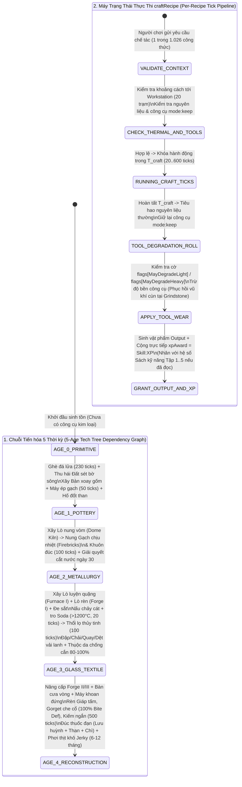

## PHẦN A: BẢNG HẰNG SỐ & PHƯƠNG TRÌNH TOÁN HỌC CỐT LÕI (MATHEMATICAL_FORMULAS_AND_CONSTANTS)

### 1. Phương Trình Toán Học & Mã Giả Thuật Toán (LaTeX & Deterministic Pseudocode)

#### 1.1. Phương trình Chuyển hóa Công thức, Tiêu hao Công cụ & Trao thưởng XP (`craftRecipe` Execution Engine)


Một công thức chế tác $R \in \text{Recipes}_{1026}$ tại trạm làm việc $W_{\text{station}}$ yêu cầu thời gian thực thi $T_{\text{craft}}$ (tính bằng ticks), tập nguyên liệu tiêu hao $\mathcal{I}_{\text{consume}}$ và tập công cụ $\mathcal{I}_{\text{keep}}$ (có gắn cờ `mode:keep` cùng cờ hao mòn $f \in \{\text{None}, \text{MayDegradeLight}, \text{MayDegradeHeavy}\}$):

$$\Delta \text{Condition}(i_{\text{tool}}) = \begin{cases} 0 & \text{nếu } f = \text{None} \\ -\delta_{\text{light}} & \text{với xác suất } P_{\text{deg}}(\text{MayDegradeLight}) \\ -\delta_{\text{heavy}} & \text{với xác suất } P_{\text{deg}}(\text{MayDegradeHeavy}) \end{cases} \quad \forall i_{\text{tool}} \in \mathcal{I}_{\text{keep}}$$

$$\Delta \text{XP}(\text{Skill}_k) = \text{xpAward}(R, \text{Skill}_k) \times M_{\text{book}}(\text{Skill}_k)$$

```text
FUNCTION Execute_Workstation_CraftRecipe(player, workstation_entity, recipe):
    // 1. Xác thực Trạm làm việc & Nhiệt độ (ví dụ: Dome Kiln > 1200°C cho Glassmaking)
    IF recipe.RequiresWorkstation == TRUE AND workstation_entity.Type != recipe.WorkstationType THEN
        RETURN CRAFT_ABORTED_INVALID_STATION
    END IF
    IF recipe.RequiresThermalThreshold == TRUE AND workstation_entity.TemperatureC <= recipe.MinTempC THEN
        RETURN CRAFT_ABORTED_INSUFFICIENT_HEAT
    END IF

    // 2. Chạy bộ đếm thời gian chế tác (Time Ticks: 20..600 ticks)
    WaitTicks(recipe.TimeTicks)

    // 3. Tiêu hao nguyên liệu đầu vào & Xử lý hao mòn công cụ mode:keep
    FOR EACH input_item IN recipe.Inputs DO
        IF input_item.Mode == "keep" THEN
            IF input_item.HasFlag("MayDegradeLight") THEN
                ApplyToolDegradation(input_item, DEGRADE_TIER_LIGHT)
            ELSE IF input_item.HasFlag("MayDegradeHeavy") THEN
                ApplyToolDegradation(input_item, DEGRADE_TIER_HEAVY)
            END IF
        ELSE
            ConsumeInventoryItem(player, input_item)
        END IF
    END FOR

    // 4. Xuất thành phẩm & Thưởng điểm kinh nghiệm trực tiếp (xpAward = Skill:XP)
    SpawnOutputItems(player, recipe.Outputs)
    FOR EACH (skill_id, base_xp) IN recipe.xpAward DO
        player.AddSkillXP(skill_id, base_xp)
    END FOR

    RETURN CRAFT_COMPLETED
END FUNCTION

```

#### 1.2. Phương trình Kéo dài Vòng đời Thực phẩm qua Chế biến Bảo quản (Food Spoilage Extension Factor)


Thịt tươi nguyên tảng sau khi mổ trên móc treo (`entity_butcher_hook`) có thời gian phân hủy tự nhiên ngoài trời $T_{\text{spoil\_raw}} \in [3, 5]\text{ ngày}$. Khi được xử lý qua giàn phơi khô (`entity_Drying_Rack`) thành thịt sấy khô (`Jerky`), thời gian bảo quản $T_{\text{spoil\_jerky}}$ được kéo dài lên $[6, 12]\text{ tháng}$:

$$\frac{T_{\text{spoil\_jerky}}}{T_{\text{spoil\_raw}}} = \frac{[180, 365]\text{ ngày}}{[3, 5]\text{ ngày}} \in [36.0, 121.67]\text{ lần}$$

```text
FUNCTION Process_Meat_Drying_Preservation(raw_meat_item, drying_rack_entity):
    // Thịt tươi ngoài trời hỏng sau 3 - 5 ngày
    ASSERT raw_meat_item.BaseSpoilDays >= 3.0 AND raw_meat_item.BaseSpoilDays <= 5.0
    
    jerky_output = TransformToJerky(raw_meat_item)
    // Thịt khô (Jerky) bảo quản được từ 6 đến 12 tháng
    jerky_output.PreservedShelfLifeMonths = RandomRange(6.0, 12.0)
    RETURN jerky_output
END FUNCTION

```

---

### 2. Bảng Hằng Số Vật Lý, Thời Gian Chế Tác & Kinh Nghiệm (System Constants Table)

| Nhóm Hệ Thống | Tên Hằng Số / Công Thức Gốc | Giá Trị Chính Xác | Đơn Vị Đo | Ý Nghĩa Vật Lý & Cơ Học Hệ Thống |
| --- | --- | --- | --- | --- |
| **Database Index** | `Total_Craft_Recipes` | `1026` | `recipes` | Tổng số công thức chế tác (`craftRecipe`) trong Build 42.21.0.

 |
| **Database Index** | `Total_Workstation_Archetypes` | `20` | `workstations` | Số lượng trạm máy móc/thực thể chế tác chuyên dụng độc lập.

 |
| **Database Index** | `Tech_Tree_Progression_Ages` | `5` | `ages (0..4)` | 5 Thời kỳ tiến hóa công nghệ (từ Đồ đá Age 0 đến Hậu kỳ Age 4).

 |
| **Blacksmithing** | `Forge_Crude_Blade` | `Time: 200 | XP: +25` | `ticks | XP` | Rèn lưỡi dao găm thô sơ tại Lò rèn + Đe sắt.

 |
| **Blacksmithing** | `Forge_Long_Crude_Blade` | `Time: 300 | XP: +45` | `ticks | XP` | Rèn lưỡi kiếm dài thô để lắp cán thành trường đao/Katana tự chế.

 |
| **Blacksmithing** | `Forge_Scrap_Shortsword` | `Time: 500 | XP: +50` | `ticks | XP` | Rèn đoản kiếm từ sắt phế liệu có sát thương chém cực mạnh.

 |
| **Blacksmithing** | `Forge_Gorget_And_Armored_Gloves` | `Time: 300 - 600` | `ticks` | Rèn giáp che cổ (Gorget) và găng tay sắt bảo vệ **100%** trước vết cắn.

 |
| **Knapping (Age 0)** | `MakeSharpFlintFlake` | `Time: 230 | XP: +10` | `ticks | XP` | Ghè đá lửa tách mảnh đá sắc làm dao cạo dã chiến.

 |
| **Knapping (Age 0)** | `MakeStoneBlade` | `Time: 230 | XP: +20` | `ticks | XP` | Ghè lưỡi dao đá dài dùng cắt thịt hoặc buộc làm giáo đá.

 |
| **Knapping (Age 0)** | `MakeStoneAwl` | `Time: 230 | XP: +10` | `ticks | XP` | Ghè dùi đá nhọn dùng đục lỗ trên da thú để khâu quần áo.

 |
| **Pottery (Age 1)** | `Water_Shutoff_Survival_Milestone` | `30` | `days (ngày)` | Mốc thời gian hệ thống cấp nước ngừng hoạt động, buộc phải có chum gốm hứng nước mưa.

 |
| **Pottery (Age 1)** | `PressClayBrick` | `Time: 50 | XP: +5` | `ticks | XP` | Ép đất sét thành gạch xây tường kiên cố hơn tường gỗ.

 |
| **Pottery (Age 1)** | `PressClayShingle` | `Time: 50 | XP: +5` | `ticks | XP` | Ép đất sét thành ngói lợp mái chống dột cho căn cứ.

 |
| **Pottery (Age 1)** | `PressBarMold` | `Time: 100 | XP: +5` | `ticks | XP` | Nặn khuôn đúc thỏi sắt/thép chịu nhiệt.

 |
| **Glassmaking** | `Dome_Kiln_Glass_Melting_Temp` | `> 1200` | `°C (Celsius)` | Ngưỡng nhiệt độ trong lò nung vòm (`Dome Kiln`) để nấu chảy cát và tro Soda thành thủy tinh.

 |
| **Glassmaking** | `MeltSand_And_MeltGlass` | `Time: 20` | `ticks` | Thời gian nấu chảy cát thạch anh/mảnh vỡ thành thủy tinh lỏng.

 |
| **Glassmaking** | `MakeGlassJar` | `Time: 100 | XP: +75` | `ticks | XP` | Thổi lọ thủy tinh có nắp kín dùng để muối chua (`Jarring`) rau củ qua mùa đông.

 |
| **Glassmaking** | `MakeGlassBottle` | `Time: 120 | XP: +60` | `ticks | XP` | Thổi chai thủy tinh đựng cồn y tế, nhiên liệu hoặc bom cháy.

 |
| **Leatherworking** | `Cured_Leather_Armor_Bite_Def` | `80 - 100` | `% (percentage)` | Tỷ lệ cản vết cắn của áo khoác da thuộc, găng tay da và giáp chân chế từ bàn thuộc da.

 |
| **Preservation** | `Raw_Meat_Outdoor_Spoil_Time` | `3 - 5` | `days (ngày)` | Thời gian thịt thú săn tươi bị ôi thiu nếu để ngoài trời không xử lý.

 |
| **Preservation** | `Dried_Jerky_Preservation_Time` | `6 - 12` | `months (tháng)` | Thời gian bảo quản thịt sấy khô (`Jerky`) sau khi phơi trên `entity_Drying_Rack`.

 |
| **Progression** | `Skill_Book_Volume_Tiers` | `1 - 5` | `volumes (Tập)` | 5 cấp độ sách kỹ năng cho các nghề Rèn, Gốm, Nông nghiệp, May mặc.

 |

---

## PHẦN B: KHỐI JSON KHUÔN MẪU KỸ THUẬT & NGỮ NGHĨA (SEMANTIC_MATH_BLUEPRINTS_JSON)

```json
[
  {
    "blueprint_id": "tpl_bas:workstation_20_tech_matrix_01",
    "source_pz_reference": "20 Workstation Entities & 5-Age Tech Tree (Doc 03 - Section 2 & Section 3)",
    "dnd_ontology_hooks": {
      "bastion_facility_mapping": [
        "SMITHY", "WORKSHOP", "LABORATORY", "GARDEN", "STOREHOUSE", "MENAGERIE", "ARMORY"
      ],
      "tech_ages_progression": [
        "AGE_0_PRIMITIVE_FLINT",
        "AGE_1_CRUDE_FORGE",
        "AGE_2_TEMPERED_STEEL",
        "AGE_3_ALCHEMICAL_BLACKPOWDER",
        "AGE_4_RELIC_ARTIFICERY"
      ]
    },
    "pz_math_engine": {
      "total_recipes_indexed": 1026,
      "workstation_registry_20": [
        { "station_id": "furnace_t1_t2_t3", "file": "entity_furnace_i/ii/iii.txt", "skill": "skill:blacksmithing", "bastion_type": "SMITHY", "tech_age": "AGE_1_CRUDE_FORGE" },
        { "station_id": "forge_t1_t2_t3", "file": "entity_forge_i/ii/iii.txt", "skill": "skill:blacksmithing", "bastion_type": "SMITHY", "tech_age": "AGE_1_CRUDE_FORGE" },
        { "station_id": "dome_kiln", "file": "entity_dome_kiln_craftRecipe.txt", "skill": "skill:pottery_and_glassmaking", "bastion_type": "WORKSHOP", "tech_age": "AGE_1_CRUDE_FORGE", "min_glass_temp_c": 1200.0 },
        { "station_id": "pottery_wheel", "file": "craftrecipe_potterywheel.txt", "skill": "skill:pottery", "bastion_type": "WORKSHOP", "tech_age": "AGE_1_CRUDE_FORGE" },
        { "station_id": "handpress", "file": "craftrecipe_handpress.txt", "skill": "skill:pottery_and_masonry", "bastion_type": "WORKSHOP", "tech_age": "AGE_1_CRUDE_FORGE" },
        { "station_id": "charcoal_pit", "file": "entity_charcoal_pit.txt", "skill": "skill:blacksmithing", "bastion_type": "SMITHY", "tech_age": "AGE_1_CRUDE_FORGE" },
        { "station_id": "metal_bandsaw", "file": "entity_metalbandsaw.txt", "skill": "skill:metalworking", "bastion_type": "SMITHY", "tech_age": "AGE_2_TEMPERED_STEEL" },
        { "station_id": "standing_drill", "file": "entity_standingdrill.txt", "skill": "skill:metalworking", "bastion_type": "SMITHY", "tech_age": "AGE_2_TEMPERED_STEEL" },
        { "station_id": "grindstone", "file": "entity_grindstone.txt", "skill": "skill:maintenance", "bastion_type": "ARMORY", "tech_age": "AGE_1_CRUDE_FORGE" },
        { "station_id": "leather_prep_table", "file": "entity_leather_prep.txt", "skill": "skill:tailoring", "bastion_type": "WORKSHOP", "tech_age": "AGE_2_TEMPERED_STEEL" },
        { "station_id": "simple_loom", "file": "entity_simple_loom_xuiSkin.txt", "skill": "skill:tailoring", "bastion_type": "WORKSHOP", "tech_age": "AGE_2_TEMPERED_STEEL" },
        { "station_id": "spinning_wheel", "file": "entity_spinning_wheel.txt", "skill": "skill:tailoring", "bastion_type": "WORKSHOP", "tech_age": "AGE_2_TEMPERED_STEEL" },
        { "station_id": "scutching_board", "file": "entity_scutching_board.txt", "skill": "skill:farming_and_tailoring", "bastion_type": "GARDEN", "tech_age": "AGE_1_CRUDE_FORGE" },
        { "station_id": "heckle_comb", "file": "entity_heckle_comb.txt", "skill": "skill:farming_and_tailoring", "bastion_type": "GARDEN", "tech_age": "AGE_1_CRUDE_FORGE" },
        { "station_id": "butcher_hook", "file": "entity_butcher_hook.txt", "skill": "skill:cooking_and_butchering", "bastion_type": "STOREHOUSE", "tech_age": "AGE_1_CRUDE_FORGE" },
        { "station_id": "butter_churn", "file": "entity_butter_churn.txt", "skill": "skill:cooking", "bastion_type": "STOREHOUSE", "tech_age": "AGE_1_CRUDE_FORGE" },
        { "station_id": "chicken_hutch", "file": "entity_chickenhutch.txt", "skill": "skill:farming", "bastion_type": "MENAGERIE", "tech_age": "AGE_1_CRUDE_FORGE" },
        { "station_id": "feeding_trough", "file": "entity_feedingtrough.txt", "skill": "skill:farming", "bastion_type": "MENAGERIE", "tech_age": "AGE_1_CRUDE_FORGE" },
        { "station_id": "drying_rack", "file": "entity_Drying_Rack.txt", "skill": "skill:cooking", "bastion_type": "STOREHOUSE", "tech_age": "AGE_0_PRIMITIVE_FLINT" },
        { "station_id": "herb_drying_rack", "file": "entity_Herb_Drying_Rack.txt", "skill": "skill:first_aid", "bastion_type": "LABORATORY", "tech_age": "AGE_0_PRIMITIVE_FLINT" }
      ]
    },
    "semantic_descriptors": {
      "physical_form_hint": "Hệ sinh thái 20 trạm công cụ và máy móc thủ công chia theo 5 thời kỳ kỹ thuật: từ hố đốt than yếm khí, bàn xoay gốm, lò nung vòm đất sét (>1.200°C), lò luyện quặng sắt cấp 1-3, lò rèn đe sắt, đá mài, bàn cưa/khoan cơ khí cho đến bộ khung đập-chải-kéo-dệt sợi lanh và giàn phơi thịt/thảo dược.",
      "tactical_behavior_hint": "Loại bỏ hoàn toàn lối chơi chế đồ tay không trong túi; bắt buộc người chơi phải quy hoạch không gian căn cứ (Bastion) theo dây chuyền công nghiệp khép kín: Đất sét -> Gạch chịu lửa -> Lò nung vòm -> Lò luyện sắt -> Lò rèn vũ khí/giáp tấm.",
      "crafting_maintenance_hint": "Các trạm cấp cao phụ thuộc chặt chẽ vào sản phẩm trung gian của trạm cấp thấp (ví dụ: Lò luyện sắt cần Gạch chịu lửa Firebrick từ Lò nung vòm và Than củi từ Hố đốt than)."
    },
    "cross_module_foreign_keys": {
      "maps_to_bastion_facilities": ["SMITHY", "WORKSHOP", "LABORATORY", "GARDEN", "STOREHOUSE", "MENAGERIE", "ARMORY"],
      "unlocks_recipe_groups": [
        "tpl_rcp:knapping_primitive_flint_01",
        "tpl_rcp:pottery_and_glass_kiln_01",
        "tpl_rcp:blacksmith_metallurgy_01",
        "tpl_rcp:flax_textile_and_leather_01",
        "tpl_rcp:alchemical_munitions_and_preservation_01"
      ]
    }
  },
  {
    "blueprint_id": "tpl_rcp:knapping_primitive_flint_01",
    "source_pz_reference": "Knapping & Primitive Tools Recipes (Doc 03 - Section 2 Age 0 & Section 4.2)",
    "dnd_ontology_hooks": {
      "crafting_discipline": "PRIMITIVE_SURVIVAL_KNAPPING",
      "tech_age": "AGE_0_PRIMITIVE_FLINT"
    },
    "pz_math_engine": {
      "tool_retention_mode": "mode:keep",
      "degradation_flags": ["MayDegradeLight", "MayDegradeHeavy"],
      "recipes": [
        {
          "recipe_id": "MakeSharpFlintFlake",
          "inputs": ["mat_tag:flint_or_chert_nodule", "tool_tag:hammerstone (mode:keep)"],
          "output": "tpl_item:sharp_flint_flake",
          "time_ticks": 230,
          "xp_award": { "skill:knapping": 10 }
        },
        {
          "recipe_id": "MakeStoneBlade",
          "inputs": ["mat_tag:flint_or_chert_nodule", "tool_tag:hammerstone (mode:keep)"],
          "output": "tpl_wpn:knapped_stone_blade",
          "time_ticks": 230,
          "xp_award": { "skill:knapping": 20 }
        },
        {
          "recipe_id": "MakeStoneAwl",
          "inputs": ["mat_tag:flint_or_chert_nodule", "tool_tag:hammerstone (mode:keep)"],
          "output": "tpl_item:knapped_stone_awl",
          "time_ticks": 230,
          "xp_award": { "skill:knapping": 10 }
        }
      ]
    },
    "semantic_descriptors": {
      "physical_form_hint": "Kỹ thuật thời kỳ Đồ đá (Age 0) dùng đá búa cứng (Hammerstone) ghè trực tiếp vào hạch đá lửa (Flint/Chert) để bóc tách các mảnh tước sắc lẹm, lưỡi dao đá dài và mũi dùi đá nhọn.",
      "tactical_behavior_hint": "Mỗi thao tác ghè đá tốn cố định 230 ticks; cung cấp bộ công cụ sinh tồn sơ khởi để xẻ thịt, gọt gỗ làm giáo/cung tên và đục lỗ khâu da thú khi người chơi chưa tiếp cận được kim loại.",
      "crafting_maintenance_hint": "Đá búa (Hammerstone) được giữ lại qua cơ chế mode:keep nhưng chịu xác suất hao mòn độ bền (MayDegradeLight/MayDegradeHeavy) sau mỗi chu kỳ ghè 230 ticks."
    },
    "cross_module_foreign_keys": {
      "awards_skill_id": "skill:knapping",
      "enables_downstream_crafts": ["tpl_rcp:flax_textile_and_leather_01"]
    }
  },
  {
    "blueprint_id": "tpl_rcp:pottery_and_glass_kiln_01",
    "source_pz_reference": "Pottery, Brickmaking & Glassmaking Recipes (Doc 03 - Section 2 Age 1/3 & Section 4.3, 4.4)",
    "dnd_ontology_hooks": {
      "crafting_discipline": "MASONRY_POTTERY_AND_GLASSBLOWING",
      "tech_age": "AGE_1_CRUDE_FORGE",
      "advanced_glass_tech_age": "AGE_3_ALCHEMICAL_BLACKPOWDER"
    },
    "pz_math_engine": {
      "water_shutoff_deadline_days": 30,
      "dome_kiln_glass_fusion_temp_c": 1200.0,
      "recipes": [
        {
          "recipe_id": "PressClayBrick",
          "workstation": "handpress",
          "inputs": ["mat_tag:river_clay"],
          "output": "tpl_item:unfired_clay_brick",
          "time_ticks": 50,
          "xp_award": { "skill:pottery": 5 }
        },
        {
          "recipe_id": "PressClayShingle",
          "workstation": "handpress",
          "inputs": ["mat_tag:river_clay"],
          "output": "tpl_item:unfired_clay_shingle",
          "time_ticks": 50,
          "xp_award": { "skill:pottery": 5 }
        },
        {
          "recipe_id": "PressBarMold",
          "workstation": "pottery_wheel",
          "inputs": ["mat_tag:river_clay"],
          "output": "tpl_item:refractory_ingot_bar_mold",
          "time_ticks": 100,
          "xp_award": { "skill:pottery": 5 }
        },
        {
          "recipe_id": "MeltSand_And_MeltGlass",
          "workstation": "dome_kiln",
          "min_temperature_c": 1200.0,
          "inputs": ["mat_tag:quartz_sand", "mat_tag:plant_soda_ash"],
          "output": "tpl_item:molten_glass_batch",
          "time_ticks": 20,
          "xp_award": {}
        },
        {
          "recipe_id": "MakeGlassJar",
          "workstation": "dome_kiln",
          "min_temperature_c": 1200.0,
          "inputs": ["tpl_item:molten_glass_batch", "tool_tag:glass_blowpipe (mode:keep)"],
          "output": "tpl_item:airtight_glass_jar",
          "time_ticks": 100,
          "xp_award": { "skill:glassmaking": 75 }
        },
        {
          "recipe_id": "MakeGlassBottle",
          "workstation": "dome_kiln",
          "min_temperature_c": 1200.0,
          "inputs": ["tpl_item:molten_glass_batch", "tool_tag:glass_blowpipe (mode:keep)"],
          "output": "tpl_item:alchemical_glass_bottle",
          "time_ticks": 120,
          "xp_award": { "skill:glassmaking": 60 }
        }
      ]
    },
    "semantic_descriptors": {
      "physical_form_hint": "Chuỗi công nghệ đất nung và silicat: dùng máy ép tay và bàn xoay gốm định hình đất sét bờ sông thành gạch xây, ngói lợp, gạch chịu nhiệt (Firebricks) và khuôn đúc thỏi kim loại; sau đó nung trong lò vòm (Dome Kiln) đốt than củi đạt ngưỡng >1.200°C để nấu chảy cát thạch anh trộn tro Soda thành thủy tinh lỏng thổi chai lọ.",
      "tactical_behavior_hint": "Giải pháp sống còn để vượt qua mốc cạn kiệt nguồn nước tự nhiên sau ngày thứ 30 (nhờ chum gốm hứng nước mưa vĩnh cửu) và bảo quản nông sản ngâm chua (Jarring) qua mùa đông bằng lọ thủy tinh kín khí.",
      "crafting_maintenance_hint": "Khuôn đúc thỏi (PressBarMold - 100 ticks) và Gạch chịu nhiệt (Firebricks) là điều kiện tiên quyết bắt buộc để xây dựng Lò luyện quặng (Furnace I) và Lò rèn (Forge I) của Thời kỳ 2."
    },
    "cross_module_foreign_keys": {
      "required_workstations": ["pottery_wheel", "handpress", "dome_kiln"],
      "unlocks_metallurgy_blueprint": "tpl_rcp:blacksmith_metallurgy_01"
    }
  },
  {
    "blueprint_id": "tpl_rcp:blacksmith_metallurgy_01",
    "source_pz_reference": "Blacksmithing & Metallurgy Recipes (Doc 03 - Section 2 Age 2/4 & Section 4.1)",
    "dnd_ontology_hooks": {
      "crafting_discipline": "BLACKSMITHING_ARMORER_WEAPONSMITH",
      "tech_age": "AGE_2_TEMPERED_STEEL",
      "masterwork_tech_age": "AGE_4_RELIC_ARTIFICERY",
      "bastion_facility": "SMITHY"
    },
    "pz_math_engine": {
      "core_inputs_required": ["mat_tag:wood_charcoal", "mat_tag:scrap_iron_or_ore", "tpl_item:refractory_ingot_bar_mold"],
      "core_tools_mode_keep": ["tool_tag:anvil", "tool_tag:blacksmith_hammer", "tool_tag:metal_tongs"],
      "recipes": [
        {
          "recipe_id": "Forge_Crude_Blade",
          "workstation": "forge_t1_t2_t3",
          "inputs": ["mat_tag:iron_bar", "mat_tag:wood_charcoal", "tool_tag:blacksmith_hammer (mode:keep)", "tool_tag:metal_tongs (mode:keep)"],
          "output": "tpl_wpn:forged_crude_dagger_blade",
          "time_ticks": 200,
          "xp_award": { "skill:blacksmithing": 25 }
        },
        {
          "recipe_id": "Forge_Long_Crude_Blade",
          "workstation": "forge_t1_t2_t3",
          "inputs": ["mat_tag:steel_or_iron_bar", "mat_tag:wood_charcoal", "tool_tag:blacksmith_hammer (mode:keep)", "tool_tag:metal_tongs (mode:keep)"],
          "output": "tpl_wpn:forged_longblade_katana_blank",
          "time_ticks": 300,
          "xp_award": { "skill:blacksmithing": 45 }
        },
        {
          "recipe_id": "Forge_Scrap_Shortsword",
          "workstation": "forge_t1_t2_t3",
          "inputs": ["mat_tag:iron_bar", "mat_tag:wood_charcoal", "tool_tag:blacksmith_hammer (mode:keep)", "tool_tag:metal_tongs (mode:keep)"],
          "output": "tpl_wpn:forged_scrap_shortsword",
          "time_ticks": 500,
          "xp_award": { "skill:blacksmithing": 50 }
        },
        {
          "recipe_id": "Forge_Gorget_And_Armored_Gloves",
          "workstation": "forge_t1_t2_t3",
          "inputs": ["mat_tag:steel_or_iron_bar", "mat_tag:wood_charcoal", "tool_tag:blacksmith_hammer (mode:keep)", "tool_tag:metal_tongs (mode:keep)"],
          "output": "tpl_arm:forged_gorget_and_gauntlets_100pct",
          "time_ticks_min": 300,
          "time_ticks_max": 600,
          "bite_defense_pct": 100.0
        }
      ]
    },
    "semantic_descriptors": {
      "physical_form_hint": "Dây chuyền luyện kim và rèn vũ khí/giáp trụ: đốt gỗ yếm khí trong hố than (Charcoal Pit) lấy than củi, nấu chảy quặng/phế liệu sắt trong Lò luyện (Furnace I-III) thành thỏi sắt/thép (Iron/Steel Bar), sau đó nung đỏ trên Lò rèn (Forge I-III) và dùng kìm kẹp, búa đập trên đe sắt.",
      "tactical_behavior_hint": "Cho phép tự rèn đoản kiếm (500 ticks, +50 XP), phôi trường đao/Katana (300 ticks, +45 XP) và đặc biệt là Giáp che cổ (Gorget) cùng Găng tay sắt (300-600 ticks) mang lại khả năng bảo vệ 100% trước vết cắn vào tử huyệt NECK và đôi bàn tay HAND_L/R.",
      "crafting_maintenance_hint": "Vũ khí rèn bị cùn trong quá trình chiến đấu có thể đưa lên Đá mài xoay (entity_grindstone) để mài sắc lại, phục hồi trực tiếp độ bền và gia tăng sát thương chém."
    },
    "cross_module_foreign_keys": {
      "protects_anatomy_parts": ["NECK", "HAND_L", "HAND_R"],
      "maintained_at_workstation": "grindstone",
      "supplies_weapons_to_doc02": ["tpl_wpn:masterwork_curved_longblade_01", "tpl_wpn:heavy_forged_maul_archetypes_01"]
    }
  },
  {
    "blueprint_id": "tpl_rcp:flax_textile_and_leather_01",
    "source_pz_reference": "Textiles & Leatherworking 5-Step Pipeline (Doc 03 - Section 2 Age 3 & Section 4.5)",
    "dnd_ontology_hooks": {
      "crafting_discipline": "WEAVING_AND_TANNERY",
      "tech_age": "AGE_2_TEMPERED_STEEL",
      "armor_class_output": "LEATHER_HIDE"
    },
    "pz_math_engine": {
      "flax_to_linen_5_stages": [
        { "stage": 1, "action": "Cultivate_And_Ret_Flax", "input": "crop:flax_plant", "output": "mat_tag:retted_flax_stalks" },
        { "stage": 2, "action": "ScutchFibre", "workstation": "scutching_board", "input": "mat_tag:retted_flax_stalks", "output": "mat_tag:crushed_flax_fibre" },
        { "stage": 3, "action": "RippleFlax_And_HeckleFlax", "workstation": "heckle_comb", "input": "mat_tag:crushed_flax_fibre", "output": "mat_tag:combed_pure_flax_tow" },
        { "stage": 4, "action": "Spin_Linen_Thread", "workstation": "spinning_wheel", "input": "mat_tag:combed_pure_flax_tow", "output": "mat_tag:strong_linen_thread" },
        { "stage": 5, "action": "Weave_Linen_Cloth", "workstation": "simple_loom", "input": "mat_tag:strong_linen_thread", "output": "tpl_item:woven_linen_fabric" }
      ],
      "leather_tanning_pipeline": {
        "workstation": "leather_prep_table",
        "stages": ["FLESH_AND_DEFAT_HIDE", "LIME_ASH_TANNING_SOAK", "TAILOR_PROTECTIVE_GARMENT"],
        "output_bite_defense_pct_min": 80.0,
        "output_bite_defense_pct_max": 100.0
      }
    },
    "semantic_descriptors": {
      "physical_form_hint": "Chuỗi dệt may 5 công đoạn từ cây lanh (ngâm nước -> đập dập vỏ trên bàn đập Scutching Board -> chải tách xơ bằng lược sắt Heckle Comb -> kéo chỉ trên bàn quay Spinning Wheel -> dệt vải trên khung cửi Simple Loom) kết hợp quy trình cạo mỡ, ngâm nước vôi/tro thuộc da thú trên bàn Leather Prep.",
      "tactical_behavior_hint": "Giáp da thuộc (áo khoác, găng tay, giáp ống chân) may từ da bò/hươu đã thuộc kết hợp chỉ lanh bền chắc cung cấp khả năng kháng vết cắn (Bite Defense) từ 80% đến 100% mà vẫn giữ được độ linh hoạt và giữ ấm mùa đông.",
      "crafting_maintenance_hint": "Hoàn toàn tự chủ nguyên liệu từ nông nghiệp (trồng cây lanh, nuôi cừu lấy lông) và săn bắn/chăn nuôi (lột da trên móc Butcher Hook)."
    },
    "cross_module_foreign_keys": {
      "requires_workstations": ["scutching_board", "heckle_comb", "spinning_wheel", "simple_loom", "leather_prep_table"],
      "supplies_leather_to_doc02": ["tpl_item:load_bearing_backpacks_matrix_01"]
    }
  },
  {
    "blueprint_id": "tpl_rcp:alchemical_munitions_and_preservation_01",
    "source_pz_reference": "Ammunition Reloading & Food Preservation (Doc 03 - Section 2 Age 4 & Section 4.6, 4.7)",
    "dnd_ontology_hooks": {
      "crafting_discipline": "ALCHEMICAL_MUNITIONS_AND_PROVISIONING",
      "tech_age": "AGE_3_ALCHEMICAL_BLACKPOWDER",
      "advanced_age": "AGE_4_RELIC_ARTIFICERY",
      "bastion_facility": "LABORATORY"
    },
    "pz_math_engine": {
      "ammunition_reloading_pipeline": {
        "propellant_formula": ["mat_tag:wood_charcoal", "mat_tag:mineral_sulfur"],
        "projectile_casting": "MELTED_SALVAGED_LEAD_TO_CAST_BULLETS",
        "casing_recovery": "SPENT_BRASS_SHELL_CASINGS",
        "supported_caliber_archetypes": ["caliber:9mm_parabellum", "caliber:45_heavy_pistol", "caliber:308_high_powered_rifle", "caliber:12g_scattershot"]
      },
      "food_preservation_math": {
        "untreated_meat_spoil_days_min": 3.0,
        "untreated_meat_spoil_days_max": 5.0,
        "drying_rack_jerky_shelf_life_months_min": 6.0,
        "drying_rack_jerky_shelf_life_months_max": 12.0,
        "dairy_fermentation_outputs": ["tpl_item:churned_butter_block", "tpl_item:aged_hard_cheese"]
      }
    },
    "semantic_descriptors": {
      "physical_form_hint": "Tổ hợp kỹ thuật hậu kỳ: (1) Nghiền than củi với lưu huỳnh trong cối giã làm thuốc nổ đen, nấu chảy chì phế liệu đúc đầu đạn và ép vào vỏ đạn đồng thu hồi sau giao tranh; (2) Phơi thịt thú săn trên giàn gỗ (Drying Rack) làm thịt khô (Jerky) và ủ sữa bò thành bơ khối/phô mai cứng.",
      "tactical_behavior_hint": "Giải quyết triệt để hai cuộc khủng hoảng hậu kỳ: cạn kiệt đạn dược tầm xa và thối rữa lương thực (biến thịt tươi chỉ để được 3-5 ngày thành lương khô dự trữ suốt 6-12 tháng và phô mai giàu calo vượt qua mùa đông).",
      "crafting_maintenance_hint": "Kết hợp cùng lọ thủy tinh (MakeGlassJar) từ lò nung vòm và giàn phơi thảo dược (Herb Drying Rack) để dự trữ cả rau củ muối chua lẫn bột thuốc trị thương."
    },
    "cross_module_foreign_keys": {
      "requires_workstations": ["drying_rack", "herb_drying_rack", "butter_churn"],
      "connects_to_ballistics_doc11": ["caliber:9mm_parabellum", "caliber:45_heavy_pistol", "caliber:308_high_powered_rifle", "caliber:12g_scattershot"]
    }
  }
]

```

---

## PHẦN C: SƠ ĐỒ MÁY TRẠNG THÁI & LUỒNG DỮ LIỆU (STATE_MACHINE_AND_TICK_PIPELINE)

### 1. Luồng Thực Thi Công Thức Chế Tác & Tiến Hóa 5 Thời Kỳ (Workstation CraftRecipe & 5-Age Progression Pipeline)



---

## PHẦN D: BẢNG KIỂM TRA KHÓA NGOẠI (FOREIGN_KEY_DEPENDENCY_CHECK)

### 1. Danh mục Khóa Ngoại & Khuôn Mẫu Đã Định Nghĩa Tại Document 03 (`DEFINED_IDS`)

* `sys_math:craft_recipe_tool_degradation_and_xp_award` (Phương trình thực thi `craftRecipe`, giữ công cụ `mode:keep`, xử lý cờ hao mòn `MayDegradeLight`/`MayDegradeHeavy` và thưởng `xpAward = Skill:XP`).


* `sys_math:food_preservation_shelf_life_multiplier` (Phương trình kéo dài hạn sử dụng từ thịt tươi $3\text{--}5\text{ ngày}$ lên thịt sấy khô `Jerky` $6\text{--}12\text{ tháng}$ tại `entity_Drying_Rack`).


* `tpl_bas:workstation_20_tech_matrix_01` (Danh mục chuẩn hóa toàn bộ 20 trạm làm việc thực thể ánh xạ vào `BASTION_FACILITY_TYPES` và `TECH_AGES_5`).


* `tpl_rcp:knapping_primitive_flint_01` (`MakeSharpFlintFlake`, `MakeStoneBlade`, `MakeStoneAwl` — $230\text{ ticks}$, $+10\text{--}20\text{ XP}$).


* `tpl_rcp:pottery_and_glass_kiln_01` (`PressClayBrick` $50\text{ ticks}$, `PressClayShingle` $50\text{ ticks}$, `PressBarMold` $100\text{ ticks}$, `MeltSand`/`MeltGlass` $20\text{ ticks}$ ở $>1200^\circ\text{C}$, `MakeGlassJar` $100\text{ ticks} / +75\text{ XP}$, `MakeGlassBottle` $120\text{ ticks} / +60\text{ XP}$, mốc cắt nước ngày 30).


* `tpl_rcp:blacksmith_metallurgy_01` (`Forge_Crude_Blade` $200\text{ ticks} / +25\text{ XP}$, `Forge_Long_Crude_Blade` $300\text{ ticks} / +45\text{ XP}$, `Forge_Scrap_Shortsword` $500\text{ ticks} / +50\text{ XP}$, `Forge_Gorget` & `Forge_Armored_Gloves` $300\text{--}600\text{ ticks}$ chống cắn $100\%$).


* `tpl_rcp:flax_textile_and_leather_01` (Quy trình 5 bước chế biến sợi lanh `ScutchFibre` $\rightarrow$ `RippleFlax`/`HeckleFlax` $\rightarrow$ `Spinning Wheel` $\rightarrow$ `Simple Loom` và thuộc da chống cắn $80\text{--}100\%$).


* `tpl_rcp:alchemical_munitions_and_preservation_01` (Quy trình tái chế thuốc nổ từ lưu huỳnh + than củi, đúc đầu đạn chì cho 4 cỡ đạn `9mm`, `.45`, `.308`, `12G` và bảo quản thực phẩm mùa đông).


### 2. Danh mục Khóa Ngoại Đang Chờ Các Tài Liệu Tiếp Theo Định Nghĩa (`PENDING_EXTERNAL_IDS`)

* **Đang chờ Doc 04 (`Professions & Traits Bible`):**
* Hệ số nhân XP chính xác của 5 tập Sách kỹ năng (`Skill Books` Tập 1–5) và danh sách đầy đủ các kỹ năng chế tác (`Blacksmithing`, `Pottery`, `Glassmaking`, `Knapping`, `Metalworking`, `Tailoring`, `Maintenance`, `Cooking`, `Butchering`, `Farming`, `First Aid`).


* **Đang chờ Doc 06 (`Vehicles & Mechanics Handbook`):**
* Quy tắc dùng cưa sắt tháo dỡ xác phương tiện/xe cổ để thu hồi sắt phế liệu (`Scrap Metal`), đĩa kim loại (`Brake Disc`) và chì từ bình điện hỏng.


* **Đang chờ Doc 08 (`Farming, Trapping, Fishing & Wilderness Survival`):**
* Chu kỳ sinh trưởng của cây lanh (`Flax plant`), thuật toán tìm kiếm đá lửa/đất sét bờ sông (`Foraging`: `Flint/Chert`, `Hammerstone`, `Clay`), và quy tắc bẫy sống gia súc đưa về chuồng.


* **Đang chờ Doc 10 (`Sandbox Customization & Rules Bible`):**
* Biến số cấu hình máy chủ điều chỉnh mốc thời gian cắt nguồn nước/điện (mặc định ngày 30).


* **Đang chờ Doc 11 (`Combat, Ballistics & Stealth`):**
* Thông số đường đạn, sát thương và độ giật của 4 cỡ đạn tái chế (`9mm`, `.45`, `.308`, `12G`) cùng công thức phục hồi độ bền vũ khí trên đá mài (`entity_grindstone`).


* **Đang chờ Doc 12 (`Base Building & Fortifications`):**
* Chỉ số máu công trình (`IsoThumpable`) của tường xây bằng gạch đất nung (`Clay Brick`) và mái lợp ngói (`Clay Shingle`) so với tường gỗ thông thường.


---

**[READY FOR DOCUMENT #04]** — Vui lòng gửi lên **`Document 04: project_zomboid_v42_professions_and_traits_bible.md`** (và `pz_b42_professions_traits_database.json` hoặc tài liệu D&D nếu có).