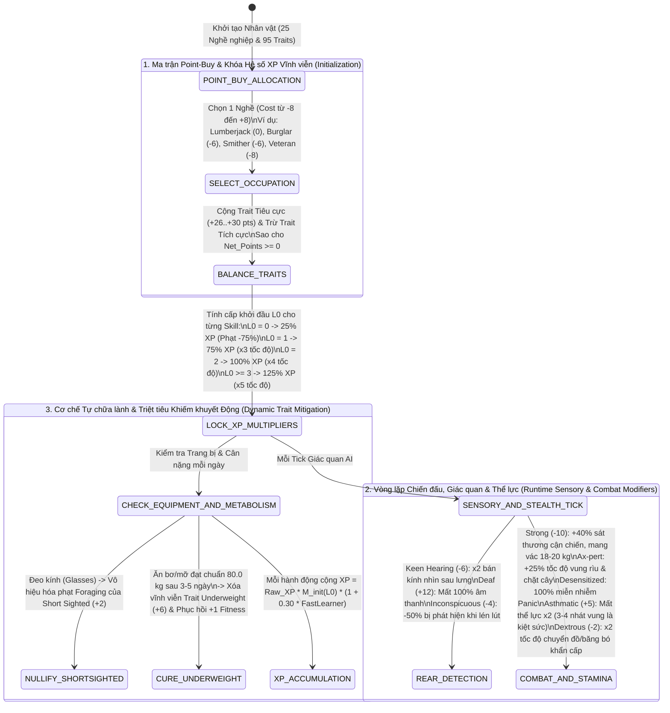

## PHẦN A: BẢNG HẰNG SỐ & PHƯƠNG TRÌNH TOÁN HỌC CỐT LÕI (MATHEMATICAL_FORMULAS_AND_CONSTANTS)

### 1. Phương Trình Toán Học & Mã Giả Thuật Toán (LaTeX & Deterministic Pseudocode)

#### 1.1. Phương trình Hệ số Nhân Kinh nghiệm Vĩnh viễn theo Cấp Kỹ năng Khởi đầu (Starting Skill Level XP Multiplier)


Với mỗi kỹ năng $k$ (trừ `Strength` và `Fitness`), tốc độ tích lũy kinh nghiệm thực tế $\Delta \text{XP}_{\text{final}}(k)$ trong suốt vòng đời nhân vật không phụ thuộc tuyến tính vào hành động mà bị chi phối bởi bậc thang hệ số nhân khởi đầu $M_{\text{init}}(L_0(k))$ dựa trên cấp độ ban đầu $L_0(k) \in \{0, 1, 2, \ge 3\}$ (tổng hợp từ Nghề nghiệp và Traits), kết hợp với hệ số `Fast Learner` ($+30\%$):

$$M_{\text{init}}(L_0(k)) = \begin{cases} 0.25 & \text{nếu } L_0(k) = 0 \quad (\text{Phạt } -75\% \text{ XP gốc}) \\ 0.75 & \text{nếu } L_0(k) = 1 \quad (\text{Nhanh gấp } 3\times \text{ so với } L_0 = 0) \\ 1.00 & \text{nếu } L_0(k) = 2 \quad (\text{Nhanh gấp } 4\times \text{ so với } L_0 = 0) \\ 1.25 & \text{nếu } L_0(k) \ge 3 \quad (\text{Nhanh gấp } 5\times \text{ so với } L_0 = 0) \end{cases}$$

$$\Delta \text{XP}_{\text{final}}(k) = \Delta \text{XP}_{\text{raw}}(k) \times M_{\text{init}}(L_0(k)) \times \left(1 + 0.30 \cdot \mathbb{I}_{\text{FastLearner}}\right) \times M_{\text{book}}(k)$$

```text
FUNCTION Calculate_Skill_XP_Gain(player, skill_id, raw_xp_amount):
    // 1. Xác định hệ số nhân vĩnh viễn từ cấp độ khởi đầu (L_0)
    L0 = player.GetStartingSkillLevel(skill_id)
    IF L0 == 0 THEN
        init_multiplier = 0.25
    ELSE IF L0 == 1 THEN
        init_multiplier = 0.75
    ELSE IF L0 == 2 THEN
        init_multiplier = 1.00
    ELSE // L0 >= 3
        init_multiplier = 1.25
    END IF

    final_xp = raw_xp_amount * init_multiplier

    // 2. Áp dụng Trait Fast Learner (+30% cho mọi kỹ năng trừ Strength & Fitness)
    IF player.HasTrait("base:fastlearner") AND skill_id NOT IN ["Strength", "Fitness"] THEN
        final_xp = final_xp * 1.30
    END IF

    // 3. Áp dụng Trait Crafty / Artisan cho nhóm kỹ năng chế tác B42
    IF player.HasTrait("base:crafty") AND IsB42CraftingSkill(skill_id) THEN
        final_xp = ApplyCraftyBonus(final_xp)
    END IF

    RETURN final_xp
END FUNCTION

```

#### 1.2. Phương trình Cân bằng Ngân sách Điểm Khởi tạo Nhân vật (Point-Buy Character Creation Constraint)


Một cấu hình nhân vật hợp lệ bao gồm 1 Nghề nghiệp $P \in \text{Professions}_{25}$ có chi phí điểm $\text{Cost}(P) \in [-8, +8]$ và một tập hợp các Đặc điểm tính cách $\mathcal{T} \subset \text{Traits}_{95}$ (gồm các Trait tích cực có $\text{Cost}(t^+) < 0$ và các Trait tiêu cực có $\text{Cost}(t^-) > 0$) sao cho tổng ngân sách điểm ròng không âm:

$$\text{Balance}_{\text{net}} = \text{Cost}(P) + \sum_{t^+ \in \mathcal{T}^+} \text{Cost}(t^+) + \sum_{t^- \in \mathcal{T}^-} \text{Cost}(t^-) \ge 0$$

```text
FUNCTION Validate_Character_Point_Buy(profession, selected_traits):
    net_points = profession.Cost // Từ -8 (Veteran) đến +8 (Unemployed)
    
    FOR EACH trait IN selected_traits DO
        IF HasMutualExclusionConflict(trait, selected_traits) THEN
            RETURN INVALID_BUILD_CONFLICT
        END IF
        net_points = net_points + trait.Cost
    END FOR

    IF net_points < 0 THEN
        RETURN INVALID_BUILD_NEGATIVE_POINTS
    END IF
    RETURN VALID_CHARACTER_BUILD
END FUNCTION

```

#### 1.3. Phương trình Xóa bỏ Động Đặc điểm Thể chất & Triệt tiêu Khiếm khuyết Giác quan (Dynamic Trait Eradication & Sensory Modifiers)


* **Cơ chế tự xóa Trait `Underweight` (`base:underweight`, $+6\text{ điểm}$)**: Nhân vật khởi đầu bị phạt $-1\text{ Fitness}$ và giảm sát thương cận chiến, nhưng khi nạp calo chất béo cao (bơ, mỡ động vật) trong $3\text{--}5\text{ ngày}$ đầu để đưa cân nặng $W_{\text{body}}$ chạm mốc chuẩn $80.0\text{ kg}$, trait này bị xóa bỏ vĩnh viễn:


$$\text{HasTrait}(\text{Underweight}, t) = \text{FALSE} \quad \forall t \ge t^* \text{ nếu } W_{\text{body}}(t^*) \ge 80.0\text{ kg}$$

* **Cơ chế Bán kính Nhận thức Hậu phương (`Keen Hearing` vs `Deaf`)** và **Tốc độ Thao tác Khẩn cấp (`Dextrous`)**:


$$R_{\text{rear\_perception}} = R_{\text{rear\_base}} \times \begin{cases} 2.0 & \text{nếu có } \text{Keen Hearing } (-6\text{ pts}) \\ 0.0 \text{ (Mất } 100\% \text{ âm thanh)} & \text{nếu có } \text{Deaf } (+12\text{ pts}) \end{cases}$$

$$T_{\text{inventory\_transfer}} = \frac{T_{\text{transfer\_base}}}{2.0} \quad (\text{khi có } \text{Dextrous } -2\text{ pts})$$

---

### 2. Bảng Hằng Số Vật Lý, Chi Phí Điểm & Hệ Số Nhân Kỹ Năng (System Constants Table)

| Nhóm Hệ Thống | Tên Hằng Số / Biến Số Gốc | Giá Trị Chính Xác | Đơn Vị Đo | Ý Nghĩa Vật Lý & Cơ Học Hệ Thống |
| --- | --- | --- | --- | --- |
| **Database Index** | `Total_Professions_Count` | `25` | `professions` | Tổng số nghề nghiệp trong `character_professions.txt` (Build 42.21.0).

 |
| **Database Index** | `Total_Character_Traits_Count` | `95` | `traits` | Tổng số đặc điểm tính cách trong `character_traits.txt` (Build 42.21.0).

 |
| **XP Multiplier** | `XP_Rate_Level_0` | `25` | `% (0.25x)` | Tỷ lệ nhận XP khi kỹ năng khởi đầu ở Cấp 0 (bị phạt $75\%$ XP).

 |
| **XP Multiplier** | `XP_Rate_Level_1` | `75` | `% (0.75x)` | Tỷ lệ nhận XP khi có $+1$ điểm khởi đầu (nhanh gấp $3\times$ so với Cấp 0).

 |
| **XP Multiplier** | `XP_Rate_Level_2` | `100` | `% (1.00x)` | Tỷ lệ nhận XP khi có $+2$ điểm khởi đầu (nhanh gấp $4\times$ so với Cấp 0).

 |
| **XP Multiplier** | `XP_Rate_Level_3_Plus` | `125` | `% (1.25x)` | Tỷ lệ nhận XP khi có $\ge +3$ điểm khởi đầu (nhanh gấp $5\times$ so với Cấp 0).

 |
| **Innate Perks** | `Ax_pert_Swing_And_Chop_Boost` | `+25` | `% (percentage)` | Tăng $25\%$ tốc độ vung rìu chiến đấu và chặt cây của nghề Tiều phu (`base:lumberjack`).

 |
| **Innate Perks** | `Desensitized_Panic_Immunity` | `100` | `% (percentage)` | Miễn nhiễm $100\%$ Hoảng loạn (Panic), giữ độ chính xác tầm xa $100\%$ của `base:veteran`.

 |
| **Positive Traits** | `KeenHearing_Rear_Radius_Mult` | `2.0` (`-6 pts`) | `multiplier` | Tăng gấp đôi bán kính vòng nhận diện phía sau lưng (`base:keenhearing`).

 |
| **Positive Traits** | `Strong_Combat_And_Carry_Mod` | `Lv 9-10 | +40% Dmg | 18-20 kg` | `level / % / kg` | Tăng Strength lên 9–10, $+40\%$ sát thương cận chiến, sức mang vác $18\text{--}20\text{ kg}$ (`base:strong`, $-10\text{ pts}$).

 |
| **Positive Traits** | `Dextrous_Transfer_Speed_Mult` | `2.0` (`-2 pts`) | `multiplier` | Tăng gấp đôi tốc độ chuyển đồ giữa túi và mặt đất (`base:dextrous`).

 |
| **Positive Traits** | `FastLearner_Global_XP_Boost` | `+30` (`-6 pts`) | `% (percentage)` | Tăng $+30\%$ XP cho toàn bộ kỹ năng trừ Thể lực và Sức mạnh (`base:fastlearner`).

 |
| **Positive Traits** | `Inconspicuous_Stealth_Mod` | `-50` (`-4 pts`) | `% (percentage)` | Giảm $50\%$ xác suất bị thực thể thù địch phát hiện khi đi lén.

 |
| **Negative Traits** | `HighThirst_Water_Consumption` | `2.0` (`+6 pts`) | `multiplier` | Tăng gấp đôi tần suất khát nước (`base:highthirst`).

 |
| **Negative Traits** | `Underweight_Cure_Threshold` | `80.0` (`+6 pts`) | `kg (3-5 days)` | Phạt $-1\text{ Fitness}$ & giảm sát thương nhẹ; tự biến mất vĩnh viễn khi ăn đạt mốc $80.0\text{ kg}$.

 |
| **Negative Traits** | `Deaf_Audio_Loss` | `100` (`+12 pts`) | `% (percentage)` | Mất $100\%$ âm thanh toàn cục.

 |
| **Negative Traits** | `SundayDriver_Speed_Cap` | `30` (`+1 pt`) | `mph` | Giới hạn tốc độ phương tiện tối đa ở $30\text{ mph}$ và giảm cực mạnh lực kéo.

 |
| **Negative Traits** | `Asthmatic_Endurance_Loss_Mult` | `2.0` (`+5 pts`) | `multiplier` | Mất thể lực nhanh gấp đôi khi vận động/vung vũ khí (chỉ 3–4 nhát đã kiệt sức).

 |

---

## PHẦN B: KHỐI JSON KHUÔN MẪU KỸ THUẬT & NGỮ NGHĨA (SEMANTIC_MATH_BLUEPRINTS_JSON)

```json
[
  {
    "blueprint_id": "tpl_prof:occupational_25_archetypes_matrix_01",
    "source_pz_reference": "character_professions.txt (Doc 04 - Section 1 & Section 2: All 25 Occupations)",
    "dnd_ontology_hooks": {
      "system_category": "CHARACTER_BACKGROUND_AND_CLASS_ORIGIN",
      "skill_proficiency_scaling": {
        "UNPROFICIENT_LV0": 0.25,
        "HALF_PROFICIENT_LV1": 0.75,
        "PROFICIENT_LV2": 1.00,
        "EXPERTISE_LV3_PLUS": 1.25
      }
    },
    "pz_math_engine": {
      "total_professions": 25,
      "professions_registry": [
        { "pz_id": "base:fireofficer", "cost": 0, "tier": "S", "skills": { "Sprinting": 1, "Strength": 1, "Fitness": 1, "Axe": 1 }, "innate_trait": null },
        { "pz_id": "base:burglar", "cost": -6, "tier": "S", "skills": { "Nimble": 2, "Sneak": 2, "Lightfoot": 2 }, "innate_trait": "Burglar" },
        { "pz_id": "base:lumberjack", "cost": 0, "tier": "S", "skills": { "Axe": 2, "Strength": 1, "Maintenance": 1 }, "innate_trait": "Ax-pert" },
        { "pz_id": "base:veteran", "cost": -8, "tier": "S", "skills": { "Aiming": 2, "Reloading": 2 }, "innate_trait": "Desensitized" },
        { "pz_id": "base:smither", "cost": -6, "tier": "A", "skills": { "Blacksmith": 4, "Maintenance": 1, "SmallBlunt": 1 }, "innate_trait": "Blacksmith Knowledge" },
        { "pz_id": "base:policeofficer", "cost": -4, "tier": "A", "skills": { "Aiming": 4, "Reloading": 1, "Nimble": 1 }, "innate_trait": null },
        { "pz_id": "base:repairman", "cost": -2, "tier": "A", "skills": { "Woodwork": 1, "Maintenance": 2, "SmallBlunt": 1, "Masonry": 1 }, "innate_trait": "Inventive" },
        { "pz_id": "base:constructionworker", "cost": -2, "tier": "A", "skills": { "SmallBlunt": 2, "Blunt": 1, "Masonry": 2, "Woodwork": 1, "Maintenance": 1 }, "innate_trait": null },
        { "pz_id": "base:unemployed", "cost": 8, "tier": "A", "skills": {}, "innate_trait": null },
        { "pz_id": "base:securityguard", "cost": -2, "tier": "B", "skills": { "Sprinting": 2, "Lightfoot": 1, "SmallBlunt": 1 }, "innate_trait": "Night Owl" },
        { "pz_id": "base:rancher", "cost": 0, "tier": "B", "skills": { "Husbandry": 4, "Butchering": 3, "Fitness": 1 }, "innate_trait": null },
        { "pz_id": "base:carpenter", "cost": -2, "tier": "B", "skills": { "Woodwork": 4, "Carving": 1, "SmallBlunt": 1, "Masonry": 1, "Maintenance": 1 }, "innate_trait": null },
        { "pz_id": "base:parkranger", "cost": -4, "tier": "B", "skills": { "Trapping": 1, "Doctor": 1, "PlantScavenging": 1, "FlintKnapping": 1, "Carving": 1 }, "innate_trait": "Herbalist" },
        { "pz_id": "base:mechanics", "cost": -4, "tier": "B", "skills": { "Mechanics": 4, "MetalWelding": 1 }, "innate_trait": "Vehicle Knowledge" },
        { "pz_id": "base:tailor", "cost": 2, "tier": "B", "skills": { "Tailoring": 4 }, "innate_trait": null },
        { "pz_id": "base:fitnessinstructor", "cost": -6, "tier": "B", "skills": { "Fitness": 3, "Sprinting": 2, "Strength": 1 }, "innate_trait": "Nutritionist" },
        { "pz_id": "base:metalworker", "cost": -4, "tier": "C", "skills": { "MetalWelding": 4 }, "innate_trait": null },
        { "pz_id": "base:chef", "cost": -2, "tier": "C", "skills": { "Cooking": 4, "Maintenance": 1, "SmallBlade": 1, "Butchering": 2 }, "innate_trait": "Keen Cook" },
        { "pz_id": "base:doctor", "cost": 0, "tier": "C", "skills": { "Doctor": 6, "SmallBlade": 1 }, "innate_trait": null },
        { "pz_id": "base:farmer", "cost": 0, "tier": "C", "skills": { "Farming": 4, "Husbandry": 1, "Strength": 1 }, "innate_trait": null },
        { "pz_id": "base:nurse", "cost": 0, "tier": "C", "skills": { "Doctor": 3, "Lightfoot": 1, "Fitness": 1 }, "innate_trait": "Night Owl" },
        { "pz_id": "base:fisherman", "cost": -2, "tier": "C", "skills": { "Fishing": 3, "PlantScavenging": 1, "Butchering": 1 }, "innate_trait": null },
        { "pz_id": "base:burgerflipper", "cost": 2, "tier": "C", "skills": { "Cooking": 2, "Maintenance": 1, "SmallBlade": 1 }, "innate_trait": "Keen Cook" },
        { "pz_id": "base:electrician", "cost": -2, "tier": "D", "skills": { "Electricity": 5 }, "innate_trait": null },
        { "pz_id": "base:engineer", "cost": -4, "tier": "D", "skills": { "Electricity": 1, "Woodwork": 1, "Masonry": 1 }, "innate_trait": null }
      ]
    },
    "semantic_descriptors": {
      "physical_form_hint": "Hệ thống 25 xuất thân nghề nghiệp định hình toàn bộ căn cơ thể chất, kỹ năng chiến đấu và tri thức chế tác của nhân vật ngay từ lúc khởi tạo, trải dài từ Chiến binh/Tiều phu/Đạo tặc cho tới Thợ rèn/Chủ trang trại/Thợ xây.",
      "tactical_behavior_hint": "Điểm kỹ năng khởi đầu không chỉ là cấp độ tĩnh mà mở khóa hệ số nhân XP vĩnh viễn: Cấp 0 bị kìm hãm ở mức 25% XP, trong khi chỉ cần +1 điểm khởi đầu sẽ nhảy vọt lên 75% XP (nhanh gấp 3 lần), +2 điểm đạt 100% (gấp 4 lần) và >= +3 điểm đạt 125% (gấp 5 lần).",
      "crafting_maintenance_hint": "Một số nghề sở hữu đặc quyền nội tại không thể học qua sách thông thường: Ax-pert (+25% tốc độ vung rìu/chặt cây), Desensitized (miễn nhiễm 100% hoảng loạn), Burglar (phá khóa cửa/kích hoạt cơ giới ngay ngày 1), và Blacksmith Knowledge (mở khóa đe sắt rèn kim loại B42)."
    },
    "cross_module_foreign_keys": {
      "unlocks_workstations_doc03": ["forge_t1_t2_t3", "furnace_t1_t2_t3", "butcher_hook"],
      "grants_innate_traits": [
        "tpl_trait:ax_pert", "tpl_trait:burglar", "tpl_trait:desensitized",
        "tpl_trait:blacksmith_knowledge", "tpl_trait:inventive", "tpl_trait:night_owl",
        "tpl_trait:herbalist", "tpl_trait:vehicle_knowledge", "tpl_trait:nutritionist", "tpl_trait:keen_cook"
      ]
    }
  },
  {
    "blueprint_id": "tpl_trait:positive_combat_and_artisan_perks_01",
    "source_pz_reference": "character_traits.txt / Top Positive Traits & Innate Perks (Doc 04 - Section 2, 4 & 5)",
    "dnd_ontology_hooks": {
      "system_category": "CHARACTER_FEATS_AND_BOONS",
      "stat_modifiers": ["PERCEPTION_REAR_RADIUS", "STRENGTH_CARRY_AND_DAMAGE", "CONSTITUTION_ENDURANCE", "SLEIGHT_OF_HAND_TRANSFER"]
    },
    "pz_math_engine": {
      "positive_traits_catalog": [
        {
          "trait_id": "tpl_trait:keen_hearing",
          "pz_id": "base:keenhearing",
          "point_cost": -6,
          "rear_vision_radius_multiplier": 2.0
        },
        {
          "trait_id": "tpl_trait:strong",
          "pz_id": "base:strong",
          "point_cost": -10,
          "Alternate_tier_stout_cost": -6,
          "target_strength_level_min": 9,
          "target_strength_level_max": 10,
          "melee_damage_bonus_pct": 40.0,
          "knockdown_push_bonus": true,
          "max_carry_weight_kg_min": 18.0,
          "max_carry_weight_kg_max": 20.0
        },
        {
          "trait_id": "tpl_trait:athletic",
          "pz_id": "base:athletic",
          "point_cost": -10,
          "alternate_tier_fit_cost": -6,
          "endurance_regeneration_boost": true,
          "continuous_sprint_and_swing_stamina": true
        },
        {
          "trait_id": "tpl_trait:dextrous",
          "pz_id": "base:dextrous",
          "point_cost": -2,
          "inventory_transfer_speed_multiplier": 2.0
        },
        {
          "trait_id": "tpl_trait:fast_learner",
          "pz_id": "base:fastlearner",
          "point_cost": -6,
          "global_xp_bonus_pct": 30.0,
          "excluded_skills": ["Strength", "Fitness"]
        },
        {
          "trait_id": "tpl_trait:inconspicuous",
          "pz_id": "base:inconspicuous",
          "point_cost": -4,
          "stealth_detection_chance_reduction_pct": 50.0
        },
        {
          "trait_id": "tpl_trait:graceful",
          "pz_id": "base:graceful",
          "point_cost": -4,
          "footstep_noise_suppression": true
        },
        {
          "trait_id": "tpl_trait:brave",
          "pz_id": "base:brave",
          "point_cost": -4,
          "panic_accumulation_reduction": true
        },
        {
          "trait_id": "tpl_trait:handy",
          "pz_id": "base:handy",
          "point_cost": -8,
          "structure_max_hp_and_build_speed_boost": true
        },
        {
          "trait_id": "tpl_trait:artisan_and_crafty",
          "pz_id": "base:artisan / base:crafty",
          "point_cost_artisan": -2,
          "point_cost_crafty": -3,
          "b42_pottery_glass_blacksmith_speed_and_xp_boost": true
        }
      ]
    },
    "semantic_descriptors": {
      "physical_form_hint": "Tập hợp các phẩm chất ưu việt về giác quan, cơ bắp, tim mạch và sự khéo léo của đôi bàn tay.",
      "tactical_behavior_hint": "Keen Hearing (-6) nhân đôi bán kính cảnh giới sau lưng để chống bị cắn trộm âm thầm; Strong (-10) cộng +40% sát thương cận chiến và nâng tải trọng mang vác lên 18-20 kg; Dextrous (-2) nhân đôi tốc độ rút vũ khí và lấy băng gạc cấp cứu khi đứt mạch máu cổ; Inconspicuous (-4) giảm 50% tỷ lệ bị phát hiện trong nón thị giác kẻ địch.",
      "crafting_maintenance_hint": "Kết hợp Fast Learner (+30% XP toàn cục) với Crafty (-3) và Artisan (-2) tạo thành bộ gia tốc tối đa cho việc lĩnh hội 1.026 công thức chế tác của Build 42."
    },
    "cross_module_foreign_keys": {
      "modifies_combat_equations_doc11": ["melee_damage_bonus_pct", "stealth_detection_chance_reduction_pct"],
      "modifies_fortification_hp_doc12": ["structure_max_hp_and_build_speed_boost"]
    }
  },
  {
    "blueprint_id": "tpl_trait:negative_flaws_and_dynamic_afflictions_01",
    "source_pz_reference": "character_traits.txt / Negative Traits: Free Points vs Lethal Traps (Doc 04 - Section 3)",
    "dnd_ontology_hooks": {
      "system_category": "CHARACTER_FLAWS_AND_DRAWBACKS",
      "point_buy_economy_role": "POINT_GENERATION_OFFSET"
    },
    "pz_math_engine": {
      "manageable_offset_traits": [
        {
          "trait_id": "tpl_trait:smoker",
          "pz_id": "base:smoker",
          "point_grant": 4,
          "passive_stress_accumulation": true,
          "instant_stress_and_unhappiness_clear_on_use": true
        },
        {
          "trait_id": "tpl_trait:high_thirst",
          "pz_id": "base:highthirst",
          "point_grant": 6,
          "water_consumption_rate_multiplier": 2.0
        },
        {
          "trait_id": "tpl_trait:prone_to_illness",
          "pz_id": "base:pronetoillness",
          "point_grant": 4,
          "cold_catch_speed_in_rain_boost": true,
          "zombification_progression_speed_boost": true,
          "bite_or_scratch_transmission_chance_increase": 0.0
        },
        {
          "trait_id": "tpl_trait:slow_reader",
          "pz_id": "base:slowreader",
          "point_grant": 2,
          "literature_reading_time_penalty": true
        },
        {
          "trait_id": "tpl_trait:weak_stomach",
          "pz_id": "base:weakstomach",
          "point_grant": 3,
          "rotten_or_raw_food_poisoning_multiplier": true
        },
        {
          "trait_id": "tpl_trait:short_sighted",
          "pz_id": "base:shortsighted",
          "point_grant": 2,
          "foraging_radius_penalty": true,
          "nullified_by_equipped_item_tag": "item_tag:corrective_eyeglasses"
        },
        {
          "trait_id": "tpl_trait:underweight",
          "pz_id": "base:underweight",
          "point_grant": 6,
          "fitness_level_penalty": -1,
          "minor_melee_damage_penalty": true,
          "permanent_removal_weight_threshold_kg": 80.0,
          "typical_recovery_window_days_min": 3,
          "typical_recovery_window_days_max": 5
        },
        {
          "trait_id": "tpl_trait:slow_healer",
          "pz_id": "base:slowhealer",
          "point_grant": 6,
          "wound_recovery_time_penalty": true
        },
        {
          "trait_id": "tpl_trait:disorganized",
          "pz_id": "base:disorganized",
          "point_grant": 4,
          "container_capacity_penalty": true
        }
      ],
      "high_risk_crippling_traits": [
        {
          "trait_id": "tpl_trait:deaf",
          "pz_id": "base:deaf",
          "point_grant": 12,
          "audio_perception_loss_pct": 100.0
        },
        {
          "trait_id": "tpl_trait:sunday_driver",
          "pz_id": "base:sundaydriver",
          "point_grant": 1,
          "max_vehicle_speed_cap_mph": 30.0,
          "severe_torque_traction_penalty": true
        },
        {
          "trait_id": "tpl_trait:asthmatic",
          "pz_id": "base:asthmatic",
          "point_grant": 5,
          "endurance_depletion_rate_multiplier": 2.0,
          "exhaustion_swing_threshold_hits_min": 3,
          "exhaustion_swing_threshold_hits_max": 4
        },
        {
          "trait_id": "tpl_trait:clumsy",
          "pz_id": "base:clumsy",
          "point_grant": 2,
          "running_sound_radius_penalty": true,
          "fence_vault_trip_fall_chance_boost": true
        }
      ]
    },
    "semantic_descriptors": {
      "physical_form_hint": "Hệ thống khiếm khuyết cơ thể và thói quen sinh hoạt chia làm 2 phân lớp rõ rệt: nhóm khiếm khuyết có thể khắc phục bằng kỷ luật sinh tồn/trang bị và nhóm tàn tật chí mạng làm tê liệt khả năng chiến đấu.",
      "tactical_behavior_hint": "Nhóm tối ưu điểm (+26 đến +30 điểm) tận dụng cơ chế xóa bỏ động: đeo kính mắt triệt tiêu Cận thị (+2), ăn chất béo lên 80.0 kg trong 3-5 ngày xóa vĩnh viễn Thiếu cân (+6), mang bình nước tự uống hóa giải Khát nước gấp đôi (+6), và không ăn đồ sống hóa giải Dạ dày yếu (+3). Ngược lại, Hen suyễn (+5) làm mất thể lực gấp đôi khiến nhân vật kiệt sức chỉ sau 3-4 cú vung vũ khí, còn Lái xe/Điều khiển chậm (+1) khóa tốc độ ở 30 mph và làm phương tiện chết máy ngay khi vướng địa hình hoặc bị 2-3 kẻ địch cản đầu.",
      "crafting_maintenance_hint": "Prone to Illness (+4) chỉ làm đẩy nhanh tốc độ phát bệnh nếu đã trúng độc hoặc dầm mưa lạnh chứ hoàn toàn không làm tăng xác suất nhiễm bệnh gốc (7% / 25% / 100%) khi bị cào hoặc cắn."
    },
    "cross_module_foreign_keys": {
      "interacts_with_pathogen_doc01": "tpl_aff:lethal_necrotic_pathogen_01",
      "interacts_with_nutrition_doc02": "tpl_item:metabolic_sustenance_rations_01",
      "interacts_with_caravan_vehicles_doc06": "max_vehicle_speed_cap_mph"
    }
  }
]

```

---

## PHẦN C: SƠ ĐỒ MÁY TRẠNG THÁI & LUỒNG DỮ LIỆU (STATE_MACHINE_AND_TICK_PIPELINE)

### 1. Luồng Khởi Tạo Point-Buy, Nhân Kinh Nghiệm Vĩnh Viễn & Xóa Bỏ Động Khiếm Khuyết (Character Creation & Trait Lifecycle Pipeline)



---

## PHẦN D: BẢNG KIỂM TRA KHÓA NGOẠI (FOREIGN_KEY_DEPENDENCY_CHECK)

### 1. Danh mục Khóa Ngoại & Khuôn Mẫu Đã Định Nghĩa Tại Document 04 (`DEFINED_IDS`)

* `sys_math:starting_skill_permanent_xp_multiplier` (Phương trình bậc thang XP vĩnh viễn: Cấp 0 = $25\%$, Cấp 1 = $75\%$, Cấp 2 = $100\%$, Cấp $\ge 3$ = $125\%$, nhân với `Fast Learner` $+30\%$).


* `sys_math:character_point_buy_zero_sum_constraint` (Phương trình cân bằng điểm khởi tạo giữa 25 Nghề nghiệp và 95 Traits).


* `sys_math:dynamic_underweight_80kg_eradication` (Phương trình tự xóa bỏ vĩnh viễn trait `Underweight` khi nạp calo đạt mốc $80.0\text{ kg}$).


* `tpl_prof:occupational_25_archetypes_matrix_01` (Ma trận chuẩn hóa toàn bộ 25 Nghề nghiệp kèm chi phí điểm, kỹ năng cộng thêm và đặc quyền nội tại).


* `tpl_trait:positive_combat_and_artisan_perks_01` (Chuẩn hóa các Trait tích cực chủ lực: `Keen Hearing` $\times 2$ tầm nhìn sau lưng, `Strong` $+40\%$ sát thương & $18\text{--}20\text{ kg}$ mang vác, `Dextrous` $\times 2$ tốc độ chuyển đồ, `Fast Learner` $+30\%$ XP, `Inconspicuous` $-50\%$ bị phát hiện, `Ax-pert` $+25\%$ tốc độ rìu, `Desensitized` $100\%$ miễn nhiễm Panic).


* `tpl_trait:negative_flaws_and_dynamic_afflictions_01` (Chuẩn hóa các Trait tiêu cực: `Smoker`, `High Thirst` $\times 2$ nước, `Prone to Illness`, `Slow Reader`, `Weak Stomach`, `Short Sighted`, `Underweight` mốc $80.0\text{ kg}$, `Deaf` mất $100\%$ âm thanh, `Sunday Driver` giới hạn $30\text{ mph}$, `Asthmatic` mất thể lực $\times 2$).


### 2. Danh mục Khóa Ngoại Đang Chờ Các Tài Liệu Tiếp Theo Định Nghĩa (`PENDING_EXTERNAL_IDS`)

* **Đang chờ Doc 06 (`Vehicles & Mechanics Handbook`):**
* Cơ chế câu dây nổ máy/chiếm quyền điều khiển phương tiện ngay Ngày 1 của đặc quyền `Burglar` (`base:burglar`), đặc quyền `Vehicle Knowledge` của `base:mechanics`, và phương trình mô-men xoắn/lực kéo bị suy giảm bởi trait `Sunday Driver` ($30\text{ mph}$ cap).


* **Đang chờ Doc 08 (`Farming, Trapping, Fishing & Wilderness Survival`):**
* Cơ chế nhận diện thảo dược/nấm độc của trait `Herbalist` (`base:parkranger`), bán kính tìm kiếm (`Foraging`) bị ảnh hưởng bởi `Short Sighted`, và chi tiết kỹ năng `Husbandry` ($+4$ ở nghề `base:rancher`).


* **Đang chờ Doc 11 (`Combat, Ballistics & Stealth`):**
* Phương trình chính xác của vòng tròn nhận diện sau lưng (`Rear Vision Radius`) khi nhân đôi bởi `Keen Hearing`, công thức tính xác suất ngã khi vượt rào của `Clumsy`, và cách `Desensitized` giữ nguyên $100\%$ độ chính xác đường đạn.


* **Đang chờ Doc 12 (`Base Building & Fortifications`):**
* Lượng máu công trình cộng thêm và tỷ lệ tăng tốc độ xây dựng cụ thể của trait `Handy` (`-8 điểm`).


* **Đang chờ Doc 13 (`Medical, Surgery & Health`):**
* Tốc độ tích lũy `Stress` theo giờ của `Smoker` (`base:smoker`), hệ số làm chậm lành vết thương của `Slow Healer` (`+6 điểm`), và tác động của `Prone to Illness` lên tốc độ nhiễm lạnh/biến đổi.


* **Đang chờ Doc 14 (`Meta Secrets & World Mysteries`):**
* Phương trình đạo hàm calo chi tiết giải thích quá trình tăng cân từ trạng thái `Underweight` lên đúng mốc $80.0\text{ kg}$ trong $3\text{--}5\text{ ngày}$.


---

**[READY FOR DOCUMENT #05]** — Vui lòng gửi lên **`Document 05: project_zomboid_v42_world_map_and_loot_distribution_guide.md`** (cùng các tài liệu quy tắc D&D đi kèm nếu có).