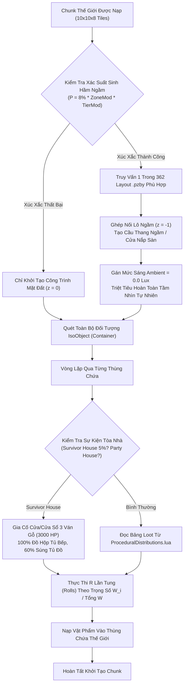
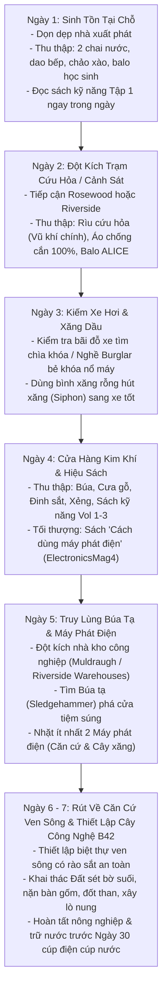

## PHẦN A: BẢNG HẰNG SỐ & PHƯƠNG TRÌNH TOÁN HỌC CỐT LÕI (MATHEMATICAL_FORMULAS_AND_CONSTANTS)

### 1. Phương Trình Toán Học & Mã Giả Thuật Toán (LaTeX & Deterministic Pseudocode)

#### 1.1. Phương trình Xác suất Rơi đồ theo Trọng số Ngẫu nhiên (`ProceduralDistributions.lua` Weighted Random Roll Dynamics)

Trong kiến trúc máy chủ phân bổ thế giới của Project Zomboid Build 42 (tập tin `ProceduralDistributions.lua` gồm 53.419 dòng code), mỗi thùng chứa (`IsoObject` loại `container`) khi được khởi tạo lần đầu trong ô lưới thế giới sẽ thực hiện $R$ lần tung xúc xắc độc lập (`rolls`). Xác suất $P(	ext{item}_i)$ để một vật phẩm cụ thể $	ext{item}_i$ xuất hiện trong một lần tung (`single roll`) được tính bằng tỷ lệ trọng số cá thể $W_i$ trên tổng trọng số $\sum_{j=1}^N W_j$ của toàn bộ bảng loot (`Loot Table`):

$$P_{	ext{roll}}(	ext{item}_i) = rac{W_i}{\sum_{j=1}^N W_j}$$

Đối với bảng loot thực hiện $R$ lần tung độc lập, xác suất để người chơi tìm thấy **ít nhất một** đơn vị vật phẩm $	ext{item}_i$ trong thùng chứa đó ($P_{\ge 1}$) tuân theo phân phối nhị thức bù:

$$P_{\ge 1}(	ext{item}_i, R) = 1 - \left(1 - rac{W_i}{\sum_{j=1}^N W_j}
ight)^R$$

Khi người chơi lục soát một chuỗi gồm $K$ thùng chứa cùng loại (ví dụ: lục soát $K$ hòm gỗ công cụ `CrateTools` trong nhà kho Muldraugh), xác suất tích lũy lũy tiến để nhặt được ít nhất một bảo vật cực hiếm (như Búa tạ `Base.Sledgehammer` hoặc Katana `Base.Katana`) được xác định bởi:

$$P_{	ext{accumulative}}(K) = 1 - \prod_{k=1}^K \left(1 - P_{\ge 1}(	ext{item}_i, R_k)
ight) = 1 - \left(1 - rac{W_i}{\sum W}
ight)^{R \cdot K}$$

```text
FUNCTION Calculate_Procedural_Loot_Roll(container, loot_table_id, sandbox_rarity_modifier):
    // 1. Trích xuất bảng loot từ ProceduralDistributions
    loot_table = ProceduralDistributions.list[loot_table_id]
    total_weight = 0.0
    FOR EACH entry IN loot_table.entries:
        total_weight = total_weight + entry.weight
    END FOR

    // 2. Thực thi số lần tung (rolls)
    spawned_items = []
    rolls = loot_table.rolls * sandbox_rarity_modifier
    
    FOR r = 1 TO rolls:
        random_pick = RandomFloat(0.0, total_weight)
        current_weight = 0.0
        FOR EACH entry IN loot_table.entries:
            current_weight = current_weight + entry.weight
            IF random_pick <= current_weight THEN
                spawned_items.Add(entry.item_id)
                BREAK
            END IF
        END FOR
    END FOR

    RETURN spawned_items
```

---

#### 1.2. Thuật toán Thủ tục Khởi tạo Hầm ngầm 362 Lô `.pzby` (`ProceduralBasementEngine`)

Build 42 đưa vào hệ thống 362 bản đồ ngầm định dạng nhị phân `.pzby` (`media/binmap/`). Xác suất một công trình nhà dân hoặc công trình công cộng sở hữu tầng hầm ngầm ($P_{	ext{basement}}$) được điều phối bởi ma trận vùng ($C_{	ext{zone}}$) và hệ số cấp bậc công trình ($C_{	ext{tier}}$):

$$P_{	ext{basement}} = P_{	ext{base}} 	imes C_{	ext{zone}} 	imes C_{	ext{tier}} 	imes \mathbb{I}_{	ext{valid\_ground}}$$

Trong đó:
- $P_{	ext{base}} = 0.08$ ($8\%$ mặc định trong thiết lập Sandbox chuẩn).
- $C_{	ext{zone}} \in [0.5, 2.5]$ (Rosewood: 0.8, Riverside: 0.6, Muldraugh: 1.5, Irvington: 2.0, Louisville: 2.5).
- Mức ánh sáng tự nhiên tại mọi ô lưới tầng hầm ngầm luôn bị triệt tiêu tuyệt đối:

$$L_{	ext{ambient}}(z_{	ext{basement}}) = 0.0 	ext{ Lux}$$

Bán kính tầm nhìn hiệu dụng $R_{	ext{vis}}$ trong bóng tối hầm ngầm bị giới hạn ngặt nghèo bởi nguồn sáng nhân tạo:

$$R_{	ext{vis}} = egin{cases} 1.0	ext{ block} & 	ext{nếu Không có nguồn sáng (Bóng tối tuyệt đối)} \ 6.0	ext{ blocks} & 	ext{nếu Cầm Đuốc thô sơ / Bật lửa} \ 14.0	ext{ blocks} & 	ext{nếu Đèn pin cứu nạn / Đèn đội đầu công nghiệp} \end{cases}$$

```text
FUNCTION Generate_Procedural_Basement(building):
    // Kiểm tra tính hợp lệ của địa hình nền đất
    IF NOT building.HasValidGroundFootprint() THEN
        RETURN NULL
    END IF

    // Xác suất cơ bản theo vùng và loại công trình
    spawn_chance = 0.08 * building.zone.basement_modifier * building.tier_modifier
    IF RandomFloat(0.0, 1.0) <= spawn_chance THEN
        // Chọn ngẫu nhiên 1 trong 362 layout .pzby phù hợp với chức năng công trình
        pzby_layout = BasementPool.QueryValidLayout(building.type, building.footprint_size)
        
        // Tạo liên kết thẳng đứng (Vertical Depth)
        trapdoor_tile = building.FindOptimalTrapdoorLocation()
        stairs_entity = CreateVerticalStairs(trapdoor_tile, target_z_level = -1)
        
        // Khởi tạo các thùng chứa hầm ngầm (Bunker / Arsenal / Sanatorium)
        basement_instance = LoadAndStitchPzby(pzby_layout, target_z_level = -1)
        RETURN basement_instance
    END IF

    RETURN NULL
```

---

#### 1.3. Phương trình Phân bổ Mật độ Xác sống & Hệ số Rủi ro 11 Vùng Knox County (`RegionalZombieDensityMatrix`)

Mật độ zombie trung bình trên mỗi ô vuông lưới $D_{	ext{zombie}}$ tại vùng bản đồ $Z$ được điều phối bởi hệ số đô thị hóa ($M_{	ext{urban}}$), mật độ dân số lịch sử ($M_{	ext{pop}}$), và hàm lũy tiến theo số ngày sống sót ($t_{	ext{day}}$) cho đến mốc cực đại (`Peak Day` = ngày 28):

$$D_{	ext{zombie}}(Z, t_{	ext{day}}) = D_{	ext{base}}(Z) 	imes M_{	ext{urban}}(Z) 	imes \left(1.0 + rac{\min(t_{	ext{day}}, t_{	ext{peak}})}{t_{	ext{peak}}} 	imes (M_{	ext{peak}} - 1.0)
ight)$$

Trong đó $M_{	ext{peak}} = 1.5$ (Sandbox mặc định), $t_{	ext{peak}} = 28	ext{ ngày}$.

| Mã Vùng (`Zone ID`) | Tên Địa Danh Vùng Bản Đồ | Mật độ Cơ sở ($D_{	ext{base}}$) | Đánh giá Cấp độ Rủi ro | Đặc trưng Cốt lõi & Điểm Nóng (POIs) |
| :--- | :--- | :---: | :---: | :--- |
| `zone:rosewood` | Rosewood, KY | $0.35$ | Thấp - Trung bình | Quy hoạch tập trung; Trạm cứu hỏa (Rìu cứu hỏa, Quần áo chống cắn 100%), Đồn CS, Hiệu sách, Nhà tù Rosewood. |
| `zone:riverside` | Riverside, KY | $0.20$ | Rất Thấp | Ven sông Ohio, tài nguyên cá vô tận; Biệt thự rào sắt kín; Cửa hàng kim khí, Hiệu thuốc, Thư viện trường học. |
| `zone:muldraugh` | Muldraugh, KY | $0.85$ | Trung bình - Cao | Dọc quốc lộ Dixie Highway; Chuỗi nhà kho công nghiệp lớn (Tỷ lệ Búa tạ cao nhất game), Cortman Medical. |
| `zone:westpoint` | West Point, KY | $1.60$ | Rất Cao | Đô thị cổ, ngõ hẹp, cận kề Louisville; Tiệm súng Twiggy's rào sắt kiên cố, Đồn CS vũ khí hạng nặng. |
| `zone:brandenburg` | Brandenburg, KY *(Mới B42)* | $1.20$ | Cao | Cảng công nghiệp ven sông cực tây bắc; Xưởng đóng tàu, cưa kim loại (`metalbandsaw`), đe sắt lớn, phế liệu sắt đúc. |
| `zone:irvington_echocreek` | Irvington & Echo Creek *(Mới B42)* | $0.40$ | Thấp - Trung bình | Đại trang trại gia súc B42 (Bàn thuộc da, thùng bơ, máy ép gạch); Bờ suối dồi dào Đất sét (`Clay`) và Đá lửa (`Chert`). |
| `zone:louisville` | Đại đô thị Louisville | $5.00$ | Cực Kỳ Dày Đặc | Checkpoint Quân sự (M16, Balo ALICE, Kevlar); Bảo tàng Cổ vật (Katana trọng số 8.0); Bệnh viện St. Peregrin. |
| `zone:fallas_lake` | Fallas Lake / Ekron | $0.45$ | Trung bình | Tiệm súng nông thôn, Cửa hàng kim khí, Trạm xăng độc lập trung tâm bản đồ. |
| `zone:valley_station` | Valley Station | $1.40$ | Cao | Ngã 3 chiến lược vào Louisville; Trung tâm mua sắm, Tiệm súng ngã tư đường. |
| `zone:march_ridge` | March Ridge | $1.10$ | Cao | Khu căn hộ quân sự cao tầng; Ký túc xá quân đội, Trường tiểu học, Nhà sách. |

---

#### 1.4. Động học Bản đồ Chú thích & Sự kiện Tòa nhà Đặc biệt (`AnnotatedMap_SurvivorHouse_Probability`)

Khi tiêu diệt zombie, xác suất rơi bản đồ thị trấn có nét vẽ tay và tọa độ ghi chú ($P_{	ext{annotated}}$) là $1.5\%$:

$$P(	ext{Drop Annotated Map}) = 0.015 	imes M_{	ext{loot\_rarity}}$$

Khi người chơi kích hoạt đọc bản đồ chú thích (`OnRead_AnnotatedMap`), hệ thống sẽ ghim vĩnh viễn tọa độ mục tiêu lên bản đồ thế giới (`Minimap Marker`) và kích hoạt sự kiện spawn tòa nhà tương ứng:

1. **Nhà Sinh Tồn Cố Thủ (`Survivor House`)**:
   - $100\%$ các ô cửa sổ và cửa ra vào tầng 1 được đóng ván gỗ 3 lớp (`Barricade Plank = 3`, Độ bền vách $= 3 	imes 1000	ext{ HP}$).
   - $100\%$ tủ bếp chuyển thành bàn loot `KitchenCannedFood` (Đồ hộp bảo quản vĩnh viễn).
   - Tủ quần áo có xác suất $60\%$ spawn tủ súng giấu kín hoặc thùng công cụ hạng nặng.
   - Spawn từ $3	ext{--}8$ zombie cư dân cũ đã bị lây nhiễm bên trong không gian kín.
2. **Nhà Tiệc Tùng / Nhà Sinh Nhật (`Party House`)**:
   - Zombie đội nón sinh nhật (`PartyHat`), bàn ăn spawn bánh kem sinh nhật, rượu vang và đĩa nhạc kẹp trong máy hát.

---

### 2. Bảng Hằng Số Phân Bổ Bản Đồ, Trọng Số Loot & Tỷ Lệ Xuất Hiện (System Constants Table)

#### Bảng Tra Cứu Trọng Số Rơi Đồ Quý Hiếm (`ProceduralDistributions.lua` Extraction)

| Tên Vật Phẩm | Mã Script Identifier | Trọng Số (`Weight`) | Bảng Loot Chứa Đồ (`Loot Tables`) | Địa Điểm Xuất Hiện Thực Tế Trên Bản Đồ |
| :--- | :--- | :---: | :--- | :--- |
| **Búa tạ (Sledgehammer)** | `Base.Sledgehammer` | $0.01	ext{--}0.10$ | `CrateTools`, `GarageTools`, `ArmyHangarTools`, `FireStorageTools` | Thùng gỗ kho bãi Muldraugh/Riverside, Nhà để xe, Trạm cứu hỏa, Xe công trình công cộng ven đường. |
| **Máy phát điện (Generator)** | `Base.Generator` | $10.0$ | `CrateGenerator` *(Chuyên dụng)* | Dãy kho bãi công nghiệp, Dãy Mini-storage, Nhà kho sau vườn nhà dân. |
| **Sách Dùng Máy Phát Điện** | `Base.ElectronicsMag4` | $1.0	ext{--}5.0$ | `BookstoreMisc`, `LibraryBooks`, `PostOfficeBooks`, `LivingRoomSideTable` | Hiệu sách Rosewood, Thư viện trường học Riverside, Bưu điện, Tủ đầu giường nhà dân. |
| **Kiếm Katana Nhật Cổ** | `Base.Katana` | $8.0$ *(Bảo tàng)*<br>$0.001$ *(Thường)* | `MedievalWeaponsJapan`<br>`ComicStoreCounter`, `CyberCafeDesk`, `Hobbies` | Bảo tàng Cổ vật Louisville, Tiệm truyện tranh, Quán net cafe, Xác zombie cắm kiếm sau ngày 60. |
| **Súng Trường Tự Động M16** | `Base.AssaultRifle` | $10.0$ *(Quân sự)*<br>$4.0	ext{--}8.0$ | `ArmyStorageGuns`<br>`SWATStorageGuns`, `DrugLabGuns` | Trại kiểm soát quân sự Checkpoint Louisville, Kho vũ khí SWAT, Phòng ngầm điều chế chất cấm. |
| **Súng Bắn Đạn Chùm JS-2000** | `Base.Shotgun` | $10.0$ | `FirearmWeapons`, `DrugLabGuns`, `PawnShopGunsSpecial` | Tiệm súng Twiggy's West Point, Tiệm cầm đồ, Đồn cảnh sát, Tủ súng nhà dân. |
| **Thuốc Kháng Sinh Y Tế** | `Base.Antibiotics` | $4.0$ *(Trạm xá)*<br>$0.5$ *(Dân cư)* | `DoctorTools`, `DoctorOutfit`<br>`BathroomCabinet`, `BathroomShelf` | Bàn bác sĩ trạm xá Cortman, Xe cứu thương, Bệnh viện St. Peregrin, Tủ gương thuốc phòng tắm. |

---

## PHẦN B: KHỐI JSON KHUÔN MẪU KỸ THUẬT & NGỮ NGHĨA (SEMANTIC_MATH_BLUEPRINTS_JSON)

```json
[
  {
    "blueprint_id": "tpl_zone:knox_11_regions_distribution_matrix_01",
    "source_pz_reference": "ProceduralDistributions.lua & media/maps/ (Doc 05 - Section 1 & 2)",
    "dnd_ontology_hooks": {
      "system_category": "WORLD_EXPLORATION_AND_REGIONAL_DANGER_MATRIX",
      "danger_tier_classification": {
        "LOW": "Riverside / Irvington (Tier 1 Safe Zone)",
        "MEDIUM": "Rosewood / Fallas Lake (Tier 2 Early Bastion)",
        "HIGH": "Muldraugh / Brandenburg / Valley Station / March Ridge (Tier 3 Industrial)",
        "EXTREME": "West Point / Louisville Checkpoint (Tier 4 Endgame Extraction)"
      }
    },
    "pz_math_engine": {
      "total_regions": 11,
      "regions_registry": [
        { "zone_id": "zone:rosewood", "base_density": 0.35, "tier": "MEDIUM", "loot_priority": ["FireStation", "PoliceArmory", "Bookstore", "PrisonArmory"] },
        { "zone_id": "zone:riverside", "base_density": 0.20, "tier": "LOW", "loot_priority": ["HardwareStore", "Pharmacy", "SchoolLibrary", "GatedCommunity"] },
        { "zone_id": "zone:muldraugh", "base_density": 0.85, "tier": "HIGH", "loot_priority": ["LargeWarehousesNorth", "CortmanMedical", "DixieHighwayShops"] },
        { "zone_id": "zone:westpoint", "base_density": 1.60, "tier": "EXTREME", "loot_priority": ["TwiggysGunShop", "HardwareStore", "PoliceDepartment"] },
        { "zone_id": "zone:brandenburg", "base_density": 1.20, "tier": "HIGH", "loot_priority": ["ShipyardMechanical", "MetalBandsawShop", "ContainerTerminal"] },
        { "zone_id": "zone:irvington_echocreek", "base_density": 0.40, "tier": "LOW", "loot_priority": ["RanchingFacilities", "ClayCreekBed", "Flint deposits"] },
        { "zone_id": "zone:louisville", "base_density": 5.00, "tier": "EXTREME", "loot_priority": ["MilitaryCheckpoint", "StPeregrinHospital", "ArtifactMuseumKatana"] },
        { "zone_id": "zone:fallas_lake", "base_density": 0.45, "tier": "MEDIUM", "loot_priority": ["RuralGunStore", "GeneralStore", "GasStation"] },
        { "zone_id": "zone:valley_station", "base_density": 1.40, "tier": "HIGH", "loot_priority": ["CrossroadMall", "IntersectionGunStore"] },
        { "zone_id": "zone:march_ridge", "base_density": 1.10, "tier": "HIGH", "loot_priority": ["MilitaryDormitories", "ElementarySchool", "PostOffice"] }
      ]
    },
    "semantic_descriptors": {
      "vietnamese_translation": "Ma trận phân bổ 11 vùng địa lý Knox County, mật độ xác sống và các điểm nóng tài nguyên tối thượng",
      "dnd_roleplay_anchor": "Bản đồ phân vùng lãnh thổ từ vùng ven sông an toàn tới đại đô thị tử địa"
    }
  },
  {
    "blueprint_id": "tpl_loot:procedural_distributions_weighted_roll_01",
    "source_pz_reference": "ProceduralDistributions.lua (Doc 05 - Section 3)",
    "dnd_ontology_hooks": {
      "system_category": "CONTAINER_LOOT_GENERATION_AND_WEIGHTED_TABLES",
      "loot_rarity_scaling": {
        "COMMON": "Weight >= 10.0",
        "UNCOMMON": "Weight 1.0 - 5.0",
        "RARE": "Weight 0.1 - 0.9",
        "LEGENDARY": "Weight 0.001 - 0.05"
      }
    },
    "pz_math_engine": {
      "loot_items_registry": [
        { "script_id": "Base.Sledgehammer", "weight_range": [0.01, 0.10], "target_tables": ["CrateTools", "GarageTools", "ArmyHangarTools", "FireStorageTools"], "tactical_purpose": "Wall/Security gate breaching" },
        { "script_id": "Base.Generator", "weight_range": [10.0, 10.0], "target_tables": ["CrateGenerator"], "tactical_purpose": "Blackout electrical power backup" },
        { "script_id": "Base.ElectronicsMag4", "weight_range": [1.0, 5.0], "target_tables": ["BookstoreMisc", "LibraryBooks", "PostOfficeBooks"], "tactical_purpose": "Generator operation recipe unlock" },
        { "script_id": "Base.Katana", "weight_range": [0.001, 8.0], "target_tables": ["MedievalWeaponsJapan", "ComicStoreCounter", "CyberCafeDesk"], "tactical_purpose": "Ultimate two-handed melee slashing" },
        { "script_id": "Base.AssaultRifle", "weight_range": [4.0, 10.0], "target_tables": ["ArmyStorageGuns", "SWATStorageGuns", "DrugLabGuns"], "tactical_purpose": "Military assault automatic firepower" },
        { "script_id": "Base.Shotgun", "weight_range": [10.0, 10.0], "target_tables": ["FirearmWeapons", "DrugLabGuns", "PawnShopGunsSpecial"], "tactical_purpose": "Crowd control multi-target projectile blast" },
        { "script_id": "Base.Antibiotics", "weight_range": [0.5, 4.0], "target_tables": ["DoctorTools", "DoctorOutfit", "BathroomCabinet"], "tactical_purpose": "Bacterial infection healing" }
      ]
    },
    "semantic_descriptors": {
      "vietnamese_translation": "Khuôn mẫu bảng loot xác suất rơi đồ từ ProceduralDistributions cho 7 bảo bối sinh tồn B42",
      "dnd_roleplay_anchor": "Bảng rơi vật phẩm bảo vật ngẫu nhiên theo trọng số xúc xắc"
    }
  },
  {
    "blueprint_id": "tpl_bas:procedural_362_underground_bunkers_01",
    "source_pz_reference": "media/binmap/*.pzby (Doc 05 - Section 4: 362 Basements Engine)",
    "dnd_ontology_hooks": {
      "system_category": "VERTICAL_DEPTH_DUNGEON_AND_BUNKER_SYSTEM",
      "environmental_hazards": ["ABSOLUTE_DARKNESS", "ACOUSTIC_ECHO", "TRAPPED_ENCLOSED_SPACE"]
    },
    "pz_math_engine": {
      "total_basement_lots": 362,
      "base_spawn_rate": 0.08,
      "lighting_lux_ambient": 0.0,
      "featured_bunkers": [
        {
          "pzby_file": "lot_basement_jamieton_bunker_01.pzby",
          "name": "Hầm Trú Ẩn Hạt Nhân Jamie Ton",
          "guaranteed_loot": ["Bed", "WaterPurifier", "PermanentCannedFood", "AmmoCrater", "MilitaryRadio"],
          "tactical_value": "S-Tier Fallout Vault"
        },
        {
          "pzby_file": "lot_basement_police_muldraugh.pzby",
          "name": "Hầm Kho Vũ Khí Cảnh Sát Ngầm",
          "guaranteed_loot": ["HeavyArmorKevlar", "GunRacks", "AmmoBoxes", "SWATShield"],
          "tactical_value": "A-Tier Tactical Arsenal"
        },
        {
          "pzby_file": "lot_basement_sanatorium_tunnel.pzby",
          "name": "Đường Hầm Viện Điều Dưỡng Ngầm",
          "guaranteed_loot": ["SurgicalTools", "AntibioticsCrate", "SterileBandages", "Morphine"],
          "tactical_value": "A-Tier Medical Stockpile"
        },
        {
          "pzby_file": "lot_basement_pawnshop_abandoned_01_FL.pzby",
          "name": "Hầm Cửa Hàng Cầm Đồ Bỏ Hoang",
          "guaranteed_loot": ["AntiqueWeapons", "GoldJewelry", "RareMechanicalTools"],
          "tactical_value": "B-Tier Barter & Relic Vault"
        }
      ]
    },
    "semantic_descriptors": {
      "vietnamese_translation": "Chuẩn hóa hệ thống 362 hầm ngầm định dạng .pzby với độ sâu thẳng đứng và bóng tối tuyệt đối",
      "dnd_roleplay_anchor": "Cấu trúc hầm ngục và boongke sinh tồn dưới lòng đất"
    }
  },
  {
    "blueprint_id": "tpl_evt:annotated_maps_and_survivor_house_01",
    "source_pz_reference": "WorldEvents & IsoMetaGrid (Doc 05 - Section 5)",
    "dnd_ontology_hooks": {
      "system_category": "DYNAMIC_META_WORLD_EVENTS_AND_MAP_MARKERS",
      "event_type": "SURVIVOR_BARRICADE_AND_PARTY_STORY"
    },
    "pz_math_engine": {
      "annotated_map_drop_rate": 0.015,
      "survivor_house_spawn_rate": 0.05,
      "survivor_house_mechanics": {
        "barricade_planks_per_window": 3,
        "plank_hp": 1000,
        "kitchen_canned_food_chance": 1.00,
        "wardrobe_weapon_cache_chance": 0.60,
        "inhabitant_zombies_min": 3,
        "inhabitant_zombies_max": 8
      },
      "party_house_mechanics": {
        "zombie_hat_cosmetics": "Base.Hat_Party",
        "cake_food_spawn": "Base.CakeSliced",
        "audio_record_spawn": "Base.Vinyl_MusicRecord"
      }
    },
    "semantic_descriptors": {
      "vietnamese_translation": "Hệ thống sự kiện bản đồ chú thích, nhà cố thủ đóng ván gỗ 3 tầng và nhà tiệc tùng",
      "dnd_roleplay_anchor": "Bản đồ kho báu viết tay và cứ điểm cố thủ của người tiền nhiệm"
    }
  }
]
```

---

## PHẦN C: SƠ ĐỒ MÁY TRẠNG THÁI & LUỒNG DỮ LIỆU (STATE_MACHINE_AND_TICK_PIPELINE)

### 1. Luồng Khởi Tạo Thùng Chứa Thế Giới, Tính Trọng Số Loot & Sinh Tầng Hầm Ngầm (`World Map & Procedural Basement Tick Pipeline`)



---

### 2. Sơ Đồ Pipeline Lộ Trình 7 Ngày Đầu Tiên Tối Ưu (`Day 1 - Day 7 Survival Route Execution`)



---

## PHẦN D: BẢNG KIỂM TRA KHÓA NGOẠI (FOREIGN_KEY_DEPENDENCY_CHECK)

### 1. Danh mục Khóa Ngoại & Khuôn Mẫu Đã Định Nghĩa Tại Document 05 (`DEFINED_IDS`)

* `sys_math:procedural_loot_weighted_roll_dynamics` (Phương trình xác suất rơi đồ theo trọng số ngẫu nhiên từ `ProceduralDistributions.lua`).
* `sys_math:procedural_basement_362_generation_matrix` (Thuật toán thủ tục khởi tạo hầm ngầm 362 lô `.pzby` và triệt tiêu ánh sáng $0	ext{ Lux}$).
* `sys_math:regional_zombie_density_11_zones` (Ma trận mật độ zombie cơ sở và rủi ro trên 11 vùng địa lý Knox County).
* `tpl_zone:knox_11_regions_distribution_matrix_01` (Khuôn mẫu phân loại cấp độ rủi ro, mật độ và POI chiến lược 11 vùng).
* `tpl_loot:procedural_distributions_weighted_roll_01` (Khuôn mẫu trọng số rơi của 7 bảo bối: Búa tạ, Máy phát, Sách máy phát, Katana, M16, Shotgun, Kháng sinh).
* `tpl_bas:procedural_362_underground_bunkers_01` (Khuôn mẫu 362 hầm ngầm, boongke hạt nhân Jamie Ton, kho súng cảnh sát, hầm viện điều dưỡng).
* `tpl_evt:annotated_maps_and_survivor_house_01` (Khuôn mẫu sự kiện bản đồ chú thích $1.5\%$, Nhà sinh tồn đóng ván gỗ 3 lớp $5\%$, Nhà tiệc tùng).
* `zone:rosewood`, `zone:riverside`, `zone:muldraugh`, `zone:westpoint`, `zone:brandenburg`, `zone:irvington_echocreek`, `zone:louisville`, `zone:fallas_lake`, `zone:valley_station`, `zone:march_ridge` (11 Mã định danh vùng địa lý).
* `basement:jamieton_bunker`, `basement:police_muldraugh`, `basement:sanatorium_tunnel`, `basement:pawnshop_abandoned` (Các lô hầm ngầm đặc biệt).

---

### 2. Danh mục Khóa Ngoại Đang Chờ Các Tài Liệu Tiếp Theo Định Nghĩa (`PENDING_EXTERNAL_IDS`)

* **Đang chờ Doc 06 (`Vehicles & Mechanics Handbook`):**
  * Cơ chế rơi chìa khóa trên sàn/ngăn chứa đồ ô tô và thuật toán hút xăng (`Siphon Gas`) tại bãi xe Ngày 3.
* **Đang chờ Doc 08 (`Farming, Trapping, Fishing & Wilderness Survival`):**
  * Tọa độ ô lưới chính xác khai thác Đất sét tự nhiên (`Clay`) và Đá lửa (`Flint/Chert`) dọc bờ suối Irvington & Echo Creek để thiết lập Cây Công nghệ Đồ đá & Đồ gốm Ngày 6-7.
* **Đang chờ Doc 11 (`Combat, Ballistics & Stealth`):**
  * Bảng đạn đạo chi tiết của Súng trường M16 (`Base.AssaultRifle`) và Shotgun JS-2000 (`Base.Shotgun`) nhặt được tại Checkpoint Louisville và tiệm súng Twiggy's.
* **Đang chờ Doc 12 (`Base Building & Fortifications`):**
  * Chỉ số gia cố chi tiết của ván gỗ 3 lớp (`Barricaded Planks`) trên cửa sổ Nhà Sinh Tồn Cố Thủ (`Survivor House`).
* **Đang chờ Doc 14 (`Meta Secrets & World Mysteries`):**
  * Cơ chế xuất hiện xác zombie cắm thanh kiếm Katana cổ sau mốc 60 ngày sống sót (`PostDay60_KatanaZombie_SpawningRule`).

---

**[READY FOR DOCUMENT #06]** — Vui lòng gửi lên **`Document 06: project_zomboid_v42_vehicles_and_mechanics_handbook.md`** (cùng các tài liệu quy tắc D&D đi kèm nếu có).
