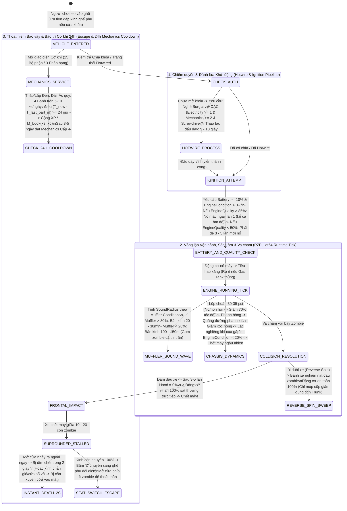

## PHẦN A: BẢNG HẰNG SỐ & PHƯƠNG TRÌNH TOÁN HỌC CỐT LÕI (MATHEMATICAL_FORMULAS_AND_CONSTANTS)

### 1. Phương Trình Toán Học & Mã Giả Thuật Toán (LaTeX & Deterministic Pseudocode)

#### 1.1. Phương trình Khởi động Động cơ & Xác suất Chết máy (Engine Ignition & Stall Probability Matrix)

Xác suất khởi động thành công của cỗ máy kéo/phương tiện ($P_{\text{start}}$) phụ thuộc vào 3 biến số độc lập: Điện lượng Ắc quy ($E_{\text{bat}} \in [0, 100]\%$), Chất lượng Động cơ bẩm sinh không thể sửa chữa ($Q_{\text{eng}} \in [0, 100]\%$), và Tình trạng Độ bền Động cơ ($C_{\text{eng}} \in [0, 100]\%$):

$$P_{\text{start}} = \begin{cases} 0 & \text{nếu } E_{\text{bat}} < 10\% \text{ hoặc } C_{\text{eng}} = 0\% \\ 1.00 \ (\text{Nổ ngay lần 1, bất chấp âm độ}) & \text{nếu } E_{\text{bat}} \ge 10\% \land Q_{\text{eng}} > 85\% \\ p_{\text{low}} \in \left[\frac{1}{5}, \frac{1}{3}\right] \ (\text{Đề 3--5 lần mới nổ}) & \text{nếu } E_{\text{bat}} \ge 10\% \land Q_{\text{eng}} < 50\% \end{cases}$$

Khi phương tiện đang di chuyển, xác suất chết máy ngẫu nhiên giữa đường ($P_{\text{stall}}$) và cơ chế truyền sát thương va chạm trực diện qua Nắp chắn trước (`Hood`) tuân theo phương trình:

$$P_{\text{stall}}(C_{\text{eng}}) > 0 \iff C_{\text{eng}} < 20\%$$

$$\Delta D_{\text{engine\_impact}} = \begin{cases} 0 & \text{nếu va chạm bằng Đuôi xe / Hông xe (Reverse Spin)} \\ 1.00 \times D_{\text{collision}} \ (100\%) & \text{nếu đâm trực diện đầu xe VÀ } C_{\text{hood}} = 0\% \ (\text{Nát sau 3--5 cú đâm}) \end{cases}$$

```text
FUNCTION Process_Caravan_Ignition_And_Collision(vehicle, is_frontal_impact, impact_damage):
    // 1. Kiểm tra điều kiện đánh lửa khởi động (Ignition Check)
    IF vehicle.BatteryChargePct < 10.0 OR vehicle.EngineConditionPct <= 0.0 THEN
        RETURN IGNITION_FAILED
    END IF

    IF vehicle.HasKey == FALSE AND vehicle.IsHotwired == FALSE THEN
        RETURN ACCESS_DENIED_LOCKED
    END IF

    // Engine Quality (>85% nổ ngay lần 1 kể cả mùa đông âm độ; <50% cần 3-5 lần đề)
    IF vehicle.EngineQualityPct > 85.0 THEN
        vehicle.IsRunning = TRUE
    ELSE IF vehicle.EngineQualityPct < 50.0 THEN
        attempts_needed = RandomInt(3, 5)
        IF vehicle.CurrentAttemptCount >= attempts_needed THEN
            vehicle.IsRunning = TRUE
        END IF
    END IF

    // 2. Kiểm tra chết máy ngẫu nhiên khi Engine Condition < 20%
    IF vehicle.IsRunning == TRUE AND vehicle.EngineConditionPct < 20.0 THEN
        IF RollRandomStall() == TRUE THEN
            vehicle.IsRunning = FALSE
        END IF
    END IF

    // 3. Phân bổ sát thương va chạm (Frontal Hood vs Reverse Spin)
    IF is_frontal_impact == TRUE THEN
        IF vehicle.HoodConditionPct > 0.0 THEN
            // Sau 3-5 cú đâm trực diện, nắp chắn (Hood) tụt về 0%
            vehicle.HoodConditionPct = Max(0.0, vehicle.HoodConditionPct - impact_damage)
        ELSE
            // Hood = 0% -> Động cơ nhận 100% sát thương trực tiếp
            vehicle.EngineConditionPct = Max(0.0, vehicle.EngineConditionPct - (1.00 * impact_damage))
        END IF
    ELSE
        // Đánh lái đuôi xe (Reverse Spin): chỉ móp cốp (giảm dung tích Trunk), động cơ an toàn 100%
        vehicle.TrunkConditionPct = Max(0.0, vehicle.TrunkConditionPct - impact_damage)
        RecalculateTrunkEffectiveCapacity(vehicle)
    END IF
END FUNCTION

```

#### 1.2. Phương trình Khuếch đại Bán kính Âm thanh theo Độ bền Bộ Giảm Thanh (`Muffler` Acoustic Radius)


Bán kính sóng âm ($R_{\text{sound}}$, tính bằng mét/blocks) phát ra từ động cơ đang hoạt động là hàm bậc thang phụ thuộc vào độ bền của Bộ giảm thanh/Ống xả ($C_{\text{muffler}} \in [0, 100]\%$):

$$R_{\text{sound}}(C_{\text{muffler}}) = \begin{cases} [20, 30]\text{ m} & \text{nếu } C_{\text{muffler}} > 80\% \ (\text{Nguyên vẹn}) \\ [20, 120]\text{ m} & \text{dải thu hút tiêu chuẩn của động cơ} \\ [100, 150]\text{ m} & \text{nếu } C_{\text{muffler}} < 20\% \ (\text{Hỏng/Rách nát}) \end{cases}$$

#### 1.3. Phương trình Động lực học Bánh xe, Quãng đường Phanh & Tương thích Phụ tùng (`PZBullet64` Physics)


* **Áp suất bánh/lốp ($P_{\text{tire}}$)** và **Tốc độ di chuyển ($V_{\text{current}}$)**: Áp suất chuẩn đạt $30\text{--}35\text{ psi}$; khi nổ hoặc non hơi, tốc độ bị phạt giảm $70\%$:


$$V_{\text{effective}} = V_{\text{base}} \times \begin{cases} 1.00 & \text{nếu } P_{\text{tire}} \in [30, 35]\text{ psi} \\ 0.30 \ (\text{Giảm } 70\%) & \text{nếu } P_{\text{tire}} \ll 30\text{ psi hoặc Nổ bánh} \end{cases}$$

* **Hệ số Quãng đường Phanh ($D_{\text{brake}}$)** và **Độ bền Phụ tùng Tải nặng (`Heavy-Duty`)**:


$$D_{\text{brake\_broken}} = 4.0 \times D_{\text{brake\_normal}}, \quad \text{Durability}_{\text{HeavyDuty}} = 1.50 \times \text{Durability}_{\text{Standard}} \ (+50\%)$$

#### 1.4. Phương trình Chiếm quyền Điều khiển (`Hotwiring`) & Giới hạn Nhận XP Cơ khí 24 Giờ


* **Điều kiện Bẻ khóa/Kích hoạt cưỡng bức (`Hotwire`)** trong thời gian $T_{\text{hotwire}} \in [5, 10]\text{ giây}$:


$$\text{CanHotwire}(p) = \text{HasTrait}(p, \text{Burglar}) \lor \left( L(\text{Electricity}) \ge 1 \land L(\text{Mechanics}) \ge 2 \land \text{HasItem}(\text{Screwdriver}) \right)$$

* **Quy tắc Chống cày XP trùng lặp trong 24 giờ (`24-Hour Part XP Cooldown`)**: Với mỗi bộ phận $part_j$ trên phương tiện $veh_i$, điểm XP tháo/lắp chỉ được cấp tối đa 1 lần mỗi $24\text{ giờ}$:


$$\Delta \text{XP}_{\text{mech}}(veh_i, part_j, t) = \begin{cases} \text{XP}_{\text{base}}(part_j) \times M_{\text{book}} & \text{nếu } t - t_{\text{last}}(veh_i, part_j) \ge 24.0\text{ hours} \\ 0 & \text{nếu } t - t_{\text{last}}(veh_i, part_j) < 24.0\text{ hours} \end{cases}$$

---

### 2. Bảng Hằng Số Vật Lý, Cơ Khí & Tải Trọng Phương Tiện (System Constants Table)

| Nhóm Hệ Thống | Tên Hằng Số / Biến Số Gốc | Giá Trị Chính Xác | Đơn Vị Đo | Ý Nghĩa Vật Lý & Cơ Học Hệ Thống |
| --- | --- | --- | --- | --- |
| **Vehicle Database** | `Total_Vehicle_Archetypes` | `52` | `vehicles` | Tổng số mẫu phương tiện trong `media/scripts/generated/vehicles/`.

 |
| **Vehicle Database** | `Vehicle_Class_Categories` | `3` (+ `Trailers` B42) | `classes` | 3 phân hạng cốt lõi (`Standard`, `Heavy-Duty`, `Sport`) + Rơ-moóc (`Trailers`).

 |
| **Parts Durability** | `HeavyDuty_Parts_Durability_Bonus` | `+50` | `% (1.5x)` | Phụ tùng phân hạng Tải nặng bền hơn $50\%$ so với tiêu chuẩn.

 |
| **Trunk & Seats** | `HeavyDuty_Trunk_And_Seats` | `Trunk: 100 - 160+ | Seats: 2 - 6` | `kg | seats` | Sức chứa cốp và số ghế của nhóm Tải nặng (`PickUpTruck`, `PickUpVan`, `VanAmbulance`, `StepVan`).

 |
| **Trunk & Seats** | `Standard_Trunk_And_Seats` | `Trunk: 40 - 80 | Seats: 4 - 6` | `kg | seats` | Sức chứa cốp và số ghế của nhóm Tiêu chuẩn (`CarNormal`, `CarLuxury`, `CarStationWagon`, `CarTaxi`, `SUV`).

 |
| **Trunk & Seats** | `Sport_Trunk_Seats_And_Speed` | `Trunk: 25 - 40 | Seats: 2 | >100 mph` | `kg | seats | mph` | Sức chứa, số ghế và tốc độ $>100\text{ mph}$ của nhóm Thể thao (`SportsCar`, `RaceCar`).

 |
| **Trunk & Seats** | `Trailers_B42_Trunk_And_Seats` | `Trunk: 100 - 250 | Seats: 0` | `kg | seats` | Sức chứa rơ-moóc và thùng kéo gia súc/ngựa sống (`Trailer`, `TrailerCover`, `Trailer_Horsebox`, `Trailer_Livestock`).

 |
| **Engine & Battery** | `Engine_Quality_Range` | `0 - 100` (Good `>85`, Bad `<50`) | `% (Fixed)` | Chất lượng động cơ bẩm sinh cố định vĩnh viễn; $<50\%$ phải đề $3\text{--}5$ lần.

 |
| **Engine & Battery** | `Engine_Condition_Stall_Threshold` | `< 20` (Range `0 - 100`) | `% (percentage)` | Ngưỡng độ bền động cơ bắt đầu gây chết máy ngẫu nhiên khi đang chạy.

 |
| **Engine & Battery** | `Battery_Min_Ignition_Charge` | `10` | `% (percentage)` | Điện lượng ắc quy tối thiểu để đề nổ động cơ.

 |
| **Acoustic Stealth** | `Muffler_Good_Sound_Radius` | `20 - 30` (khi Condition `> 80%`) | `meters (blocks)` | Bán kính âm thanh động cơ khi ống xả còn tốt ($>80\%$).

 |
| **Acoustic Stealth** | `Muffler_Broken_Sound_Radius` | `100 - 150` (khi Condition `< 20%`) | `meters (blocks)` | Bán kính âm thanh gầm rú khi ống xả hỏng/rách ($<20\%$).

 |
| **Acoustic Stealth** | `General_Engine_Attract_Range` | `20 - 120` | `meters (blocks)` | Dải cự ly thu hút thực thể thù địch tổng quát từ sơ đồ luồng âm thanh động cơ.

 |
| **Hotwiring** | `Hotwire_Skill_Requirements` | `Electricity 1 + Mechanics 2` | `skill_levels` | Yêu cầu kỹ năng + Tua vít (`Screwdriver`) để câu dây nếu không có trait `Burglar`.

 |
| **Hotwiring** | `Hotwire_Action_Duration` | `5 - 10` | `seconds (giây)` | Thời gian thực hiện thao tác đấu dây nổ máy.

 |
| **15 Vehicle Parts** | `Hood_Zero_Condition_Transfer` | `100` (Nát sau `3 - 5` cú đâm đầu) | `% damage` | Khi nắp chắn trước (`Hood`) hỏng $0\%$, động cơ chịu $100\%$ sát thương va chạm trực diện.

 |
| **15 Vehicle Parts** | `Tires_Standard_Pressure` | `30 - 35` | `psi` | Áp suất hơi chuẩn của lốp khi bơm bằng `Tire Pump`.

 |
| **15 Vehicle Parts** | `Tires_Flat_Speed_Reduction` | `-70` | `% (percentage)` | Mức suy giảm tốc độ và trượt bánh khi nổ lốp hoặc non hơi.

 |
| **15 Vehicle Parts** | `Brakes_Broken_Distance_Mult` | `4.0` | `multiplier (x4)` | Quãng đường phanh kéo dài gấp 4 lần khi hỏng phanh.

 |
| **Combat & Escape** | `Surrounded_Exit_Death_Time` | `2` (khi bị `10 - 20` zombie vây) | `seconds (giây)` | Thời gian bị dìm chết ngay lập tức nếu mở cửa nhảy ra khi bị $10\text{--}20$ xác sống vây kín.

 |
| **Mechanics XP** | `Part_XP_Cooldown_Window` | `24` | `hours (giờ)` | Thời gian hồi (cooldown) để nhận lại XP khi tháo/lắp cùng 1 bộ phận trên cùng 1 xe.

 |
| **Mechanics XP** | `Daily_Scraping_Progression` | `5 - 10` xe/ngày $\rightarrow$ `Lv 4 - 6` sau `3 - 5` ngày | `vehicles / days` | Lộ trình tháo 4 đèn, đài, ắc quy, 4 bánh trên $5\text{--}10$ xe mỗi ngày (kèm Sách Vol 1 $\times 3\text{--}\times 5$ XP).

 |

---

## PHẦN B: KHỐI JSON KHUÔN MẪU KỸ THUẬT & NGỮ NGHĨA (SEMANTIC_MATH_BLUEPRINTS_JSON)

```json
[
  {
    "blueprint_id": "tpl_veh:heavy_caravan_transport_52models_01",
    "source_pz_reference": "52 Vehicles in media/scripts/generated/vehicles/ & PZBullet64.dll (Doc 06 - Section 1 & Section 5)",
    "dnd_ontology_hooks": {
      "system_category": "MOUNT_AND_HEAVY_CARAVAN_TRANSPORT",
      "bastion_facility_hook": "STABLE",
      "tech_age": "AGE_3_ALCHEMICAL_BLACKPOWDER"
    },
    "pz_math_engine": {
      "total_vehicle_models": 52,
      "physics_engine_binding": "PZBullet64_RigidBody_Traction_And_CenterOfMass",
      "class_hierarchy_4": [
        {
          "class_id": "HEAVY_DUTY_TRANSPORT",
          "pz_models": ["PickUpTruck", "PickUpVan", "VanAmbulance", "StepVan"],
          "trunk_capacity_kg_min": 100.0,
          "trunk_capacity_kg_max": 160.0,
          "seat_count_min": 2,
          "seat_count_max": 6,
          "part_durability_bonus_pct": 50.0,
          "high_ground_clearance_offroad": true,
          "optimal_towing_tractor": true
        },
        {
          "class_id": "STANDARD_UTILITY_TRANSPORT",
          "pz_models": ["CarNormal", "CarLuxury", "CarStationWagon", "CarTaxi", "SUV"],
          "trunk_capacity_kg_min": 40.0,
          "trunk_capacity_kg_max": 80.0,
          "seat_count_min": 4,
          "seat_count_max": 6,
          "part_durability_bonus_pct": 0.0,
          "high_part_interchangeability": true
        },
        {
          "class_id": "HIGH_VELOCITY_SCOUT_TRANSPORT",
          "pz_models": ["SportsCar", "RaceCar"],
          "trunk_capacity_kg_min": 25.0,
          "trunk_capacity_kg_max": 40.0,
          "seat_count_fixed": 2,
          "max_speed_mph_threshold": 100.0,
          "low_clearance_offroad_bogging_penalty": true,
          "high_acoustic_profile": true
        },
        {
          "class_id": "TOWED_CARGO_AND_LIVESTOCK_TRAILERS_B42",
          "pz_models": ["Trailer", "TrailerCover", "Trailer_Horsebox", "Trailer_Livestock"],
          "trunk_capacity_kg_min": 100.0,
          "trunk_capacity_kg_max": 250.0,
          "seat_count_fixed": 0,
          "supports_live_bovine_equine_transport": true
        }
      ],
      "tactical_collision_and_escape_math": {
        "frontal_ram_hood_break_hits_min": 3,
        "frontal_ram_hood_break_hits_max": 5,
        "reverse_spin_tail_sweep_engine_damage": 0.0,
        "surrounded_horde_count_min": 10,
        "surrounded_horde_count_max": 20,
        "premature_door_exit_death_time_sec": 2.0,
        "towing_constraints": {
          "requires_rope_or_tow_cable": true,
          "tractor_must_exceed_towed_horsepower_and_mass": true,
          "requires_towed_parking_brake_release": true
        }
      }
    },
    "semantic_descriptors": {
      "physical_form_hint": "Hệ thống 52 cỗ xe vận tải và rơ-moóc (trừu tượng hóa thành Đoàn xe Cơ giới / Chiến xa / Thùng kéo Gia súc) chia làm 3 phân hạng phụ tùng không thể lắp lẫn (Tiêu chuẩn, Tải nặng bền hơn +50%, Tốc độ cao) cùng nhóm Thùng kéo Rơ-moóc sức chứa 100-250 kg chuyên chở hàng hóa hoặc ngựa/gia súc sống.",
      "tactical_behavior_hint": "Đóng vai trò pháo đài di động và vũ khí nghiền nát bầy đàn. Nếu đâm trực diện bằng đầu xe, lớp giáp mũi (Hood) sẽ vỡ nát chỉ sau 3-5 cú đâm và truyền 100% chấn động làm hỏng động cơ; chiến thuật chuẩn là đánh lái lùi (Reverse Spin) dùng đuôi/hông quét ngã mục tiêu mà không hại máy. Khi bị 10-20 kẻ địch bao vây chết máy, mở cửa nhảy ra sẽ bị xé xác trong 2 giây; người lái buộc phải giữ kính cửa nguyên vẹn, chuyển sang ghế phụ đối diện (Seat Switch) rồi thoát ra ở hướng trống.",
      "crafting_maintenance_hint": "Có thể nối dây thừng (Rope) hoặc cáp kéo (Tow Cable) giữa hai phương tiện nếu cỗ xe kéo phía trước có trọng lượng và mã lực lớn hơn xe phía sau (đã nhả phanh tay)."
    },
    "cross_module_foreign_keys": {
      "transports_livestock_doc01_doc08": ["tpl_mob:bovine_livestock", "tpl_mob:ovine_porcine_livestock"],
      "affected_by_trait_doc04": "tpl_trait:sunday_driver",
      "salvaged_for_weapons_doc02_doc03": "tpl_wpn:salvaged_metal_flanged_cudgels_01"
    }
  },
  {
    "blueprint_id": "tpl_veh:mechanical_15parts_anatomy_and_hotwire_01",
    "source_pz_reference": "ISVehicleMechanics.lua / 15 Vehicle Parts, Engine Quality & Hotwiring (Doc 06 - Section 2, 3, 4 & 6)",
    "dnd_ontology_hooks": {
      "system_category": "ARTIFICERY_VEHICLE_ANATOMY_AND_MAINTENANCE",
      "bastion_facility_hook": "WORKSHOP",
      "required_proficiencies": ["skill:mechanics", "skill:metalworking", "skill:electricity"]
    },
    "pz_math_engine": {
      "total_anatomical_vehicle_parts": 15,
      "engine_vs_condition_duality": {
        "engine_quality_min_pct": 0.0,
        "engine_quality_max_pct": 100.0,
        "engine_quality_is_immutable": true,
        "reliable_cold_start_quality_threshold_pct": 85.0,
        "poor_quality_threshold_pct": 50.0,
        "poor_quality_crank_attempts_min": 3,
        "poor_quality_crank_attempts_max": 5,
        "engine_condition_stall_threshold_pct": 20.0
      },
      "battery_and_ignition_math": {
        "min_battery_charge_for_ignition_pct": 10.0,
        "overnight_drain_sources": ["HEADLIGHTS_LEFT_ON", "TRANSCEIVER_RADIO_LEFT_ON", "ALARM_SIREN_TRIGGERED"],
        "hotwire_bypass_trait": "tpl_trait:burglar",
        "hotwire_skill_reqs": { "skill:electricity": 1, "skill:mechanics": 2, "required_tool": "tool_tag:screwdriver" },
        "hotwire_execution_time_sec_min": 5.0,
        "hotwire_execution_time_sec_max": 10.0
      },
      "part_failure_penalties_and_repairs": {
        "HOOD": { "zero_cond_engine_dmg_transfer_pct": 100.0, "repair_tools": ["Propane_Torch", "Welding_Mask", "Sheet_Metal"] },
        "ENGINE": { "below_20_pct_effect": "RANDOM_MID_DRIVE_STALL", "repair_tools": ["Wrench", "Spare_Engine_Parts"] },
        "GAS_TANK": { "damaged_effect": "CONTINUOUS_FUEL_LEAK_EMPTY_IN_MINUTES", "repair_tools": ["Sheet_Metal_Or_Adhesive_Weld"] },
        "WINDSHIELD_AND_WINDOWS": { "shattered_effect": "DIRECT_ANATOMICAL_BITE_TO_DRIVER_FACE_AND_ARMS", "repair_tools": ["Wrench_Same_Class_Glass_Swap"] },
        "TIRES_4": { "optimal_psi_min": 30.0, "optimal_psi_max": 35.0, "flat_speed_penalty_pct": 70.0, "repair_tools": ["Tire_Pump", "Car_Jack", "Lug_Wrench"] },
        "BRAKES_4": { "broken_stopping_distance_multiplier": 4.0, "repair_tools": ["Same_Class_Brake_Pads"] },
        "SUSPENSION_4": { "broken_effect": "SEVERE_CHASSIS_BOUNCE_AND_ROLLOVER_ON_TURN", "repair_tools": ["Car_Jack", "Replacement_Struts"] },
        "TRUNK": { "crushed_effect": "DYNAMIC_CARGO_CAPACITY_SHRINKAGE", "repair_tools": ["Propane_Torch_Weld"] },
        "MUFFLER": {
          "good_condition_threshold_pct": 80.0,
          "good_sound_radius_meters_min": 20.0,
          "good_sound_radius_meters_max": 30.0,
          "broken_condition_threshold_pct": 20.0,
          "broken_sound_radius_meters_min": 100.0,
          "broken_sound_radius_meters_max": 150.0
        }
      },
      "mechanics_xp_grinding_rules": {
        "per_part_per_vehicle_xp_cooldown_hours": 24.0,
        "daily_salvage_target_vehicles_min": 5,
        "daily_salvage_target_vehicles_max": 10,
        "recommended_daily_parts_to_cycle": ["4_HEADLIGHT_BULBS", "CABIN_RADIO", "CAR_BATTERY", "4_WHEELS_TIRES"],
        "days_to_reach_level_4_to_6_min": 3,
        "days_to_reach_level_4_to_6_max": 5
      }
    },
    "semantic_descriptors": {
      "physical_form_hint": "Cấu trúc giải phẫu cơ khí 15 bộ phận độc lập của một cỗ xe vận tải: Nắp giáp mũi, Trái tim động cơ, Bình chứa nhiên liệu, Kính chắn phía trước, Kính chắn hai bên hông, 4 Bánh xe chịu áp suất, Hệ thống hãm phanh, Khung nhíp giảm xóc, Khoang chứa hàng sau và Ống tiêu âm.",
      "tactical_behavior_hint": "Phân tách rạch ròi giữa Phẩm chất bẩm sinh (Engine Quality: cố định vĩnh viễn, >85% nổ máy tức thì, <50% đề 3-5 nhịp) và Độ bền hao mòn (Engine Condition: <20% gây chết máy giữa đường). Ống tiêu âm (Muffler) quyết định sự sống còn về âm học: khi tốt (>80%) chỉ phát tiếng động trong 20-30m, nhưng khi rách (<20%) sẽ gầm rú vang xa 100-150m gom toàn bộ xác sống trong thị trấn. Vỡ kính chắn gió hoặc kính bên ghế lái khiến người ngồi trong mất hoàn toàn lớp giáp bảo vệ, bị kẻ địch bên ngoài thò tay cắn trực tiếp vào mặt.",
      "crafting_maintenance_hint": "Cơ chế chống cày cấp ảo: mỗi bộ phận trên một chiếc xe chỉ trao XP tháo/lắp đúng 1 lần mỗi 24 giờ. Lộ trình tối ưu là đọc Sách Tập 1 (x3-x5 XP) rồi tháo lắp cụm đèn, đài, bình điện và 4 bánh xe trên 5-10 xác xe bỏ hoang mỗi ngày để đạt Cấp 4-6 chỉ sau 3-5 ngày."
    },
    "cross_module_foreign_keys": {
      "requires_occupation_or_trait_doc04": ["base:mechanics", "base:burglar", "tpl_trait:vehicle_knowledge"],
      "interacts_with_sound_wave_doc01": "sys_math:ai_sensory_perception_cone_and_sound_wave",
      "boosted_by_instructional_records_doc07": ["Carzone (Ep 1-3)", "Z-Squad", "OSCC '92", "stock cars"]
    }
  }
]

```

---

## PHẦN C: SƠ ĐỒ MÁY TRẠNG THÁI & LUỒNG DỮ LIỆU (STATE_MACHINE_AND_TICK_PIPELINE)

### 1. Luồng Khởi Động, Vật Lý Va Chạm, Phát Tán Âm Thanh Ống Xả & Bảo Trì 15 Bộ Phận (`Vehicle Physics & Mechanics Tick Pipeline`)



---

## PHẦN D: BẢNG KIỂM TRA KHÓA NGOẠI (FOREIGN_KEY_DEPENDENCY_CHECK)

### 1. Danh mục Khóa Ngoại & Khuôn Mẫu Đã Định Nghĩa Tại Document 06 (`DEFINED_IDS`)

* `sys_math:vehicle_ignition_quality_vs_condition_stall` (Phương trình tách biệt `Engine Quality` cố định vĩnh viễn $>85\%$ vs $<50\%$ đề $3\text{--}5$ lần, `Battery` $\ge 10\%$, `Engine Condition` $<20\%$ chết máy, và truyền $100\%$ sát thương vào máy khi `Hood` $= 0\%$ sau $3\text{--}5$ cú đâm đầu).


* `sys_math:muffler_degradation_acoustic_amplification` (Phương trình khuếch đại bán kính âm thanh từ $20\text{--}30\text{ m}$ khi `Muffler` $>80\%$ lên $100\text{--}150\text{ m}$ khi `Muffler` $<20\%$).


* `sys_math:tire_psi_drag_and_brake_distance_multiplier` (Phương trình áp suất lốp chuẩn $30\text{--}35\text{ psi}$, phạt $-70\%$ tốc độ khi nổ lốp, tăng $\times 4$ quãng đường phanh khi hỏng phanh, và độ bền phụ tùng `Heavy-Duty` $+50\%$).


* `sys_math:hotwire_access_and_24h_mechanics_xp_cooldown` (Phương trình điều kiện câu dây nổ máy $5\text{--}10\text{s}$ và khóa nhận XP tháo/lắp mỗi bộ phận 1 lần mỗi $24\text{ giờ}$).


* `tpl_veh:heavy_caravan_transport_52models_01` (Khuôn mẫu 52 phương tiện chia theo 3 phân hạng + Rơ-moóc chở hàng/gia súc sống `100-250 kg`, cơ chế kéo xe `Towing` và kỹ thuật `Reverse Spin`).


* `tpl_veh:mechanical_15parts_anatomy_and_hotwire_01` (Khuôn mẫu giải phẫu 15 bộ phận cơ khí, công cụ sửa chữa chuyên biệt và lộ trình cày cấp Mechanics lên Cấp 4–6 trong 3–5 ngày).


### 2. Danh mục Khóa Ngoại Đang Chờ Các Tài Liệu Tiếp Theo Định Nghĩa (`PENDING_EXTERNAL_IDS`)

* **Đang chờ Doc 08 (`Farming, Trapping, Fishing & Wilderness Survival`):**
* Cơ chế đưa gia súc sống (bò, cừu, lợn, ngựa) lên thùng kéo rơ-moóc (`Trailer_Horsebox`, `Trailer_Livestock` sức chứa $100\text{--}250\text{ kg}$) để vận chuyển về trang trại.


* **Đang chờ Doc 09 (`Climate, Seasons & World Erosion`):**
* Tác động của nhiệt độ mùa đông âm độ lên khả năng đề nổ động cơ (khi `Engine Quality` $\le 85\%$) và hệ thống sưởi/điều hòa nhiệt độ bên trong khoang xe.


* **Đang chờ Doc 10 (`Sandbox Customization & Rules Bible`):**
* Các biến số cấu hình máy chủ điều chỉnh tỷ lệ xe có sẵn chìa khóa, lượng xăng khởi đầu trong bình, và mức độ hao mòn phụ tùng mặc định trên toàn bản đồ.


* **Đang chờ Doc 11 (`Combat, Ballistics & Stealth`):**
* Cơ chế bắn súng từ cửa sổ xe đang mở và sát thương đạn đạo xuyên qua thân vỏ/kính chắn gió phương tiện.


* **Đang chờ Doc 13 (`Medical, Surgery & Health`):**
* Chấn thương giải phẫu (gãy xương, rách sâu, mảnh kính găm) khi xe đâm vào tường ở tốc độ cao ($>100\text{ mph}$ với dòng `Sport`) hoặc khi bị zombie cắn xuyên qua cửa kính vỡ.


* **Đang chờ Doc 14 (`Meta Secrets & World Mysteries`):**
* Các kịch bản sự kiện xe cộ ngẫu nhiên trên đường quốc lộ (`RVS - Randomized Vehicle Stories`: tai nạn giao thông, xe công trình chứa búa tạ, đoàn xe di tản bị bỏ hoang).


---

**[READY FOR DOCUMENT #08]** — Chúng ta đã hoàn tất toàn bộ **Doc 01 $\rightarrow$ Doc 07** (bao gồm cả Doc 06 và Doc 07). Vui lòng gửi lên **`Document 08: project_zomboid_v42_farming_trapping_fishing_and_wilderness_survival_handbook.md`** (và `pz_b42_survival_database.json` nếu cần).