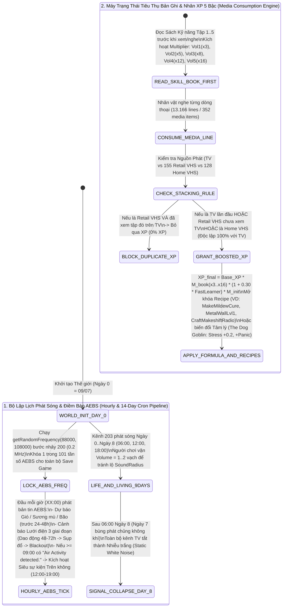

*(Ghi chú Hệ thống: Tài liệu bạn vừa gửi lên là **`project_zomboid_v42_media_broadcasts_and_knox_lore_bible.md`** — tương ứng với **Doc 07** trong Lộ trình 14 Đại Cẩm Nang, được gửi trước Doc 06 `Vehicles & Mechanics Handbook`. Hệ thống đã ghi nhận, xử lý đầy đủ theo đúng Giao thức 4 Phần và sẵn sàng nhận Doc 06 hoặc Doc 08 ở bước tiếp theo).*

---

## PHẦN A: BẢNG HẰNG SỐ & PHƯƠNG TRÌNH TOÁN HỌC CỐT LÕI (MATHEMATICAL_FORMULAS_AND_CONSTANTS)

### 1. Phương Trình Toán Học & Mã Giả Thuật Toán (LaTeX & Deterministic Pseudocode)

#### 1.1. Phương trình Cộng hưởng Kinh nghiệm Bản ghi Tri thức & Hệ số Sách Kỹ năng 5 Bậc (Instructional Record & Skill Book XP Multiplier)


Khi nhân vật lĩnh hội một dòng tri thức (Line Entry) có gắn cờ mã kỹ năng (như `COO+1`, `CRP+1`, `FIS+1`, `HUS+1`, `FKN+1`, `BLA+1`, `POT+1`) từ Tín hiệu Phát sóng Trực tiếp hoặc Bản ghi Lưu trữ (trừu tượng hóa từ TV / Retail-VHS / Home-VHS), lượng điểm kinh nghiệm thực nhận $\Delta \text{XP}_{\text{media}}$ cho kỹ năng $k$ ở cấp độ hiện tại $L(k) \in [0, 10]$ phụ thuộc vào bậc hệ số Sách Kỹ năng $M_{\text{book}}(L(k))$ đã đọc, hệ số cấp khởi đầu $M_{\text{init}}(L_0(k))$ (từ Doc 04) và đặc điểm `Fast Learner` ($+30\%$):

$$M_{\text{book}}(L(k)) = \begin{cases} 3.0 & \text{nếu } L(k) \in \{1, 2\} \text{ và đã đọc Sách Tập 1 (Vol 1)} \\ 5.0 & \text{nếu } L(k) \in \{3, 4\} \text{ và đã đọc Sách Tập 2 (Vol 2)} \\ 8.0 & \text{nếu } L(k) \in \{5, 6\} \text{ và đã đọc Sách Tập 3 (Vol 3)} \\ 12.0 & \text{nếu } L(k) \in \{7, 8\} \text{ và đã đọc Sách Tập 4 (Vol 4)} \\ 16.0 & \text{nếu } L(k) \in \{9, 10\} \text{ và đã đọc Sách Tập 5 (Vol 5)} \\ 1.0 & \text{nếu chưa đọc Sách Kỹ năng tương ứng với cấp hiện tại} \end{cases}$$

$$\Delta \text{XP}_{\text{media}}(k) = \Delta \text{XP}_{\text{line\_base}}(k) \times M_{\text{book}}(L(k)) \times \left(1 + 0.30 \cdot \mathbb{I}_{\text{FastLearner}}\right) \times M_{\text{init}}(L_0(k))$$

(Ví dụ kiểm chứng từ tài liệu: Khi kết hợp Sách Tập 1 ($\times 3$) với `Fast Learner` ($+30\%$), hệ số nhân gộp đạt $3.0 \times 1.30 = 3.9\times$, biến một chương trình Mộc cơ bản $75\text{ XP}$ thành $225\text{--}300\text{ XP}$).

#### 1.2. Phương trình Quy tắc Chồng XP Độc lập & Loại trừ Trùng lặp (`Live Broadcast` vs `Standard Archive` vs `Unique Field Record`)


Gọi $E_{\text{id}}$ là định danh của một phân đoạn nội dung tri thức. Quy tắc kiểm tra chống nhận trùng điểm kinh nghiệm (Idempotency & Stacking Rule) giữa 3 nguồn phát $\text{Source} \in \{\text{LIVE\_BROADCAST}, \text{RETAIL\_ARCHIVE}, \text{HOME\_FIELD\_RECORD}\}$ được xác định bởi hàm chỉ thị $\mathbb{I}_{\text{grant}}(p, E_{\text{id}}, \text{Source})$ cho người chơi $p$:

$$\mathbb{I}_{\text{grant}}(p, E_{\text{id}}, \text{Source}) = \begin{cases} 1 & \text{nếu } \text{Source} = \text{LIVE\_BROADCAST} \land E_{\text{id}} \notin \mathcal{H}_{\text{watched}}(p) \\ 1 & \text{nếu } \text{Source} = \text{RETAIL\_ARCHIVE} \land E_{\text{id}} \notin \mathcal{H}_{\text{watched}}(p) \\ 0 & \text{nếu } \text{Source} = \text{RETAIL\_ARCHIVE} \land E_{\text{id}} \in \mathcal{H}_{\text{watched}}(p) \ (\text{đã xem trên Live Broadcast}) \\ 1 & \text{nếu } \text{Source} = \text{HOME\_FIELD\_RECORD} \land E_{\text{id}} \notin \mathcal{H}_{\text{home\_watched}}(p) \ (\text{Độc lập 100\% với Live Broadcast}) \end{cases}$$

```text
FUNCTION Process_Instructional_Media_Line(player, media_item, line_entry):
    // 1. Kiểm tra quy tắc chồng XP (Stacking Rule: Live vs Retail vs Home)
    IF media_item.Category IN ["LIVE_BROADCAST", "RETAIL_ARCHIVE"] THEN
        // Retail VHS trùng nội dung với TV: nếu đã xem tập đó trên TV thì KHÔNG nhận thêm XP
        IF player.HasConsumedBroadcastLine(line_entry.SharedEpisodeLineID) == TRUE THEN
            RETURN XP_GRANT_BLOCKED_ALREADY_WATCHED
        END IF
        player.MarkBroadcastLineConsumed(line_entry.SharedEpisodeLineID)
    ELSE IF media_item.Category == "HOME_FIELD_RECORD" THEN
        // Home VHS luôn trao XP độc lập với TV, chỉ kiểm tra xem chính cuộn băng đó đã xem chưa
        IF player.HasConsumedHomeRecordLine(line_entry.UniqueHomeLineID) == TRUE THEN
            RETURN XP_GRANT_BLOCKED_ALREADY_WATCHED
        END IF
        player.MarkHomeRecordLineConsumed(line_entry.UniqueHomeLineID)
    END IF

    // 2. Mở khóa Công thức Chế tác Đặc biệt (nếu dòng thoại gắn Recipe Unlock)
    FOR EACH recipe_id IN line_entry.UnlockedRecipes DO
        player.UnlockRecipe(recipe_id)
    END FOR

    // 3. Tính toán XP với hệ số Sách Kỹ năng 5 bậc (x3, x5, x8, x12, x16)
    skill_id = line_entry.TargetSkill
    current_level = player.GetSkillLevel(skill_id)
    book_mult = player.GetActiveSkillBookMultiplier(skill_id, current_level) // 1.0, 3.0, 5.0, 8.0, 12.0, 16.0
    
    fast_learner_mult = 1.0
    IF player.HasTrait("base:fastlearner") THEN
        fast_learner_mult = 1.30
    END IF

    total_xp = line_entry.BaseXP * book_mult * fast_learner_mult
    player.AddSkillXP(skill_id, total_xp)
    RETURN XP_GRANT_SUCCESS
END FUNCTION

```

#### 1.3. Thuật toán Khởi tạo Tần số Điềm báo Khẩn cấp & Dự báo Siêu sự kiện (`ISDynamicRadio` / AEBS Oracle Engine)


Khi khởi tạo một thế giới mới, tần số của Hệ thống Tín hiệu Dự báo Khẩn cấp (`AEBS` $\rightarrow$ trừu tượng hóa thành `World_Event_Telemetry_Oracle`) được chọn ngẫu nhiên rời rạc trong dải $[88000, 108000]\text{ Hz}$ (tương đương $88.0\text{ MHz}$ đến $108.0\text{ MHz}$) với bước nhảy $\Delta f = 200\text{ Hz}$ ($0.2\text{ MHz}$), tổng cộng có $101$ tần số khả dĩ:

$$f_{\text{AEBS}} = 88000 + 200 \times k, \quad k \sim \mathcal{U}_{\text{int}}(0, 100) \quad (\text{Đơn vị hiển thị: } \frac{f_{\text{AEBS}}}{1000} \in [88.0, 108.0]\text{ MHz})$$

```text
FUNCTION Initialize_World_Telemetry_Oracle_Frequency():
    // Tương đương hàm radio:getRandomFrequency(88000, 108000) với bước nhảy 0.2 MHz (200 đơn vị)
    step_index = RandomInt(0, 100)
    aebs_frequency_khz = 88000 + (step_index * 200)
    RETURN aebs_frequency_khz
END FUNCTION

FUNCTION Broadcast_Hourly_Telemetry_Oracle(world_time_hour, world_day):
    // Phát định kỳ vào đầu mỗi giờ (XX:00)
    IF world_time_hour.Minutes != 00 THEN RETURN END IF

    EmitSignalHeader("<bzzt> Fiver Zero Two. <wzzt> Automated Broadcast System. <bzzt>")
    EmitWeatherForecast(window_hours_min = 24, window_hours_max = 48) // Gió, sương mù, bão trước 24-48h

    // Cảnh báo Siêu sự kiện Trên không (Helicopter / Aerial Acoustic Lure)
    IF IsAerialLureScheduledToday(world_day) AND world_time_hour.Hour >= 9 THEN
        EmitAlert("Air Activity detected.") // Sự kiện sẽ kích hoạt trong khung 12:00 - 19:00 cùng ngày
    END IF

    // Cảnh báo 3 giai đoạn sụp đổ lưới năng lượng (Power Grid Blackout)
    IF HoursUntilPowerShutoff() >= 48 AND HoursUntilPowerShutoff() <= 72 THEN
        EmitAlert("Knox Power Grid: Power fluctuations detected.")
    ELSE IF HoursUntilPowerShutoff() > 0 AND HoursUntilPowerShutoff() < 48 THEN
        EmitAlert("Knox Power Grid: Systems failing. Network compromised.")
    ELSE IF HoursUntilPowerShutoff() <= 0 THEN
        EmitAlert("Knox Power Grid: Blackout.")
    END IF
END FUNCTION

```

---

### 2. Bảng Hằng Số Truyền Thông, Hệ Số Sách Kỹ Năng & Lịch Trình Sự Kiện (System Constants Table)

| Nhóm Hệ Thống | Tên Hằng Số / Biến Số Gốc | Giá Trị Chính Xác | Đơn Vị Đo | Ý Nghĩa Vật Lý & Cơ Học Hệ Thống |
| --- | --- | --- | --- | --- |
| **Media Database** | `RadioData_Broadcast_Entries` | `> 1120` | `entries` | Tổng số phân đoạn phát sóng trong `RadioData.xml` / `RadioData.json`.

 |
| **Media Database** | `RadioData_Dialogue_Lines` | `13166` | `lines` | Tổng số câu thoại phát sóng trên toàn hệ thống.

 |
| **Media Database** | `Total_Broadcast_Channels` | `18` | `channels` | Tổng số kênh truyền hình, phát thanh thương mại, dân sự và quân sự.

 |
| **Media Database** | `Total_Recorded_Media_Items` | `352` | `items` | Tổng số bản ghi lưu trữ trong `recorded_media.lua` ($155 + 128 + 69$).

 |
| **Media Database** | `Retail_VHS_Count` | `155` | `tapes` | Số lượng bản ghi thương mại sản xuất hàng loạt (Retail-VHS).

 |
| **Media Database** | `Home_VHS_Count` | `128` | `tapes` | Số lượng bản ghi thực địa/gia đình độc bản (Home-VHS).

 |
| **Media Database** | `Audio_CD_Count` | `69` | `discs` | Số lượng đĩa âm thanh giải trí (CDs).

 |
| **Media Database** | `Skill_And_Recipe_VHS_Count` | `64` | `tapes` | Số lượng bản ghi VHS trao điểm XP kỹ năng và mở khóa công thức chế tạo.

 |
| **Skill Book Mult** | `SkillBook_Vol1_Multiplier` | `3.0` (`3.9` w/ Fast Learner) | `multiplier (Lv 1-2)` | Hệ số nhân XP cho Cấp 1–2 khi đọc xong Sách Tập 1.

 |
| **Skill Book Mult** | `SkillBook_Vol2_Multiplier` | `5.0` | `multiplier (Lv 3-4)` | Hệ số nhân XP cho Cấp 3–4 khi đọc xong Sách Tập 2.

 |
| **Skill Book Mult** | `SkillBook_Vol3_Multiplier` | `8.0` | `multiplier (Lv 5-6)` | Hệ số nhân XP cho Cấp 5–6 khi đọc xong Sách Tập 3.

 |
| **Skill Book Mult** | `SkillBook_Vol4_Multiplier` | `12.0` | `multiplier (Lv 7-8)` | Hệ số nhân XP cho Cấp 7–8 khi đọc xong Sách Tập 4.

 |
| **Skill Book Mult** | `SkillBook_Vol5_Multiplier` | `16.0` | `multiplier (Lv 9-10)` | Hệ số nhân XP cho Cấp 9–10 khi đọc xong Sách Tập 5.

 |
| **Broadcast Schedule** | `LifeAndLiving_Channel_ID` | `203` | `channel_id` | Kênh đào tạo kỹ năng sinh tồn chủ lực (phát từ Ngày 0 đến Ngày 8).

 |
| **Broadcast Schedule** | `LifeAndLiving_Daily_Slots` | `06:00 / 12:00 / 18:00` | `24h clock` | 3 khung giờ cố định mỗi ngày: `06:00` (Cooking), `12:00` (Carpentry), `18:00` (Exposure Survival).

 |
| **Broadcast Schedule** | `TV_Signal_Termination_Day` | `Day 8 (after 06:00)` | `world_day` | Thời điểm tín hiệu truyền hình trực tiếp tắt vĩnh viễn, chuyển sang nhiễu trắng (Static).

 |
| **Broadcast Schedule** | `Woodcraft_Single_Ep_XP` | `75` (`225 - 300` w/ Vol 1) | `XP` | Lượng XP gốc của 1 tập chương trình Mộc và lượng XP sau khi nhân Sách Tập 1.

 |
| **Broadcast Channels** | `Other_TV_Channel_IDs` | `200, 201, 204..210` | `channel_id` | Các kênh phụ trợ: `200` (Triple-N), `201` (WBLN), `204` (TURBO: Boredom `-1`), `205` (PawsTV), `206` (KPATV), `207` (Music), `208` (Sports), `209` (Brennan Movie), `210` (GBC).

 |
| **Broadcast Channels** | `Civilian_Radio_Frequency` | `91.2` | `MHz` | Tần số đài nghiệp dư dân sự phát tín hiệu cầu cứu sau khi sụp đổ.

 |
| **Special VHS Stats** | `TheDogGoblin_Horror_Effect` | `Stress: +0.2 (STS+0.2) | +Panic` | `stat_delta` | Biến đổi tâm lý khi xem bản ghi kinh dị *The Dog Goblin*.

 |
| **Special VHS Stats** | `BasicGunHandling_Skill_Grant` | `Aiming +3, Reloading +3` | `skill_levels` | Bản ghi thực địa quý nhất (`AIM+2, REL+2, AIM+1, REL+1`), nâng thẳng Bắn súng & Nạp đạn lên Cấp 3–4.

 |
| **AEBS Oracle** | `AEBS_Frequency_Range` | `88000 - 108000` (`88.0 - 108.0`) | `Hz / MHz` | Dải tần số ngẫu nhiên của Đài Khẩn cấp Tự động trong mỗi thế giới mới.

 |
| **AEBS Oracle** | `AEBS_Frequency_Step` | `0.2` (`200`) | `MHz (Hz)` | Bước nhảy chia lưới tần số của hàm `getRandomFrequency(88000, 108000)`.

 |
| **AEBS Oracle** | `AEBS_Broadcast_Interval` | `XX:00` (Mỗi giờ) | `hourly_tick` | Chu kỳ phát bản tin dự báo tự động vào đúng phút thứ 00 mỗi giờ.

 |
| **AEBS Oracle** | `AirActivity_Warning_Window` | `Alert >= 09:00 | Event: 12:00-19:00` | `24h clock` | Khung giờ phát cảnh báo `"Air Activity detected."` và khung giờ sự kiện bay qua thực tế.

 |
| **AEBS Oracle** | `Power_Fluctuation_Lead_Time` | `48 - 72` | `hours (giờ)` | Thời gian báo trước của cảnh báo giai đoạn 1 trước khi mất điện toàn cục.

 |
| **AEBS Oracle** | `Weather_Forecast_Lead_Time` | `24 - 48` | `hours (giờ)` | Thời gian dự báo trước về gió, sương mù và bão tuyết/bão nhiệt đới.

 |
| **World Collapse** | `World_Collapse_Timeline_Days` | `14` (`Day 0 = July 9, 1993`) | `days` | Chu kỳ 14 ngày sụp đổ hoàn toàn của hệ thống hạ tầng và phát sóng thế giới (Ngày 7 bùng phát chủng lây qua không khí).

 |
| **Stealth Tactic** | `Safe_TV_Volume_Level` | `1 - 2` | `volume_bars` | Mức âm lượng an toàn khi nghe/xem thiết bị phát để không thu hút thực thể thù địch bên ngoài.

 |

---

## PHẦN B: KHỐI JSON KHUÔN MẪU KỸ THUẬT & NGỮ NGHĨA (SEMANTIC_MATH_BLUEPRINTS_JSON)

```json
[
  {
    "blueprint_id": "tpl_evt:world_telemetry_oracle_aebs_01",
    "source_pz_reference": "ISDynamicRadio.lua / Automated Emergency Broadcast System (AEBS) (Doc 07 - Section 1.3 & Section 5)",
    "dnd_ontology_hooks": {
      "system_category": "DIVINATION_OMEN_AND_WORLD_TELEMETRY_ORACLE",
      "bastion_facility_hook": "OBSERVATORY",
      "tech_age": "AGE_4_RELIC_ARTIFICERY"
    },
    "pz_math_engine": {
      "frequency_min_khz": 88000,
      "frequency_max_khz": 108000,
      "frequency_step_khz": 200,
      "total_possible_frequencies": 101,
      "broadcast_cron_schedule": "0 * * * * (Top of every hour XX:00)",
      "weather_forecast_horizon_hours_min": 24,
      "weather_forecast_horizon_hours_max": 48,
      "aerial_lure_omen_parameters": {
        "warning_signal_key": "Air Activity detected.",
        "earliest_warning_hour": 9,
        "event_arrival_hour_min": 12,
        "event_arrival_hour_max": 19
      },
      "infrastructure_collapse_3_stages": [
        {
          "stage": 1,
          "signal_key": "Knox Power Grid: Power fluctuations detected.",
          "time_to_blackout_hours_min": 48,
          "time_to_blackout_hours_max": 72
        },
        {
          "stage": 2,
          "signal_key": "Knox Power Grid: Systems failing. Network compromised.",
          "time_to_blackout_hours_min": 1,
          "time_to_blackout_hours_max": 48
        },
        {
          "stage": 3,
          "signal_key": "Knox Power Grid: Blackout.",
          "permanent_grid_shutdown": true
        }
      ]
    },
    "semantic_descriptors": {
      "physical_form_hint": "Hệ thống tín hiệu dự báo tự động phát sóng định kỳ mỗi giờ trên một tần số bí ẩn duy nhất được khóa ngẫu nhiên khi khởi tạo thế giới (trong dải 88.0 - 108.0 với bước nhảy 0.2), chỉ có thể thu nhận qua các thiết bị thu tín hiệu/la bàn thấu thị chuyên dụng.",
      "tactical_behavior_hint": "Cơ chế cảnh báo sinh tử duy nhất giúp người chơi biết trước 24-48 giờ các đợt sương mù dày đặc hoặc bão tuyết, biết trước 48-72 giờ thời điểm sụp đổ mạng lưới năng lượng, và đặc biệt là cảnh báo từ 09:00 sáng về Siêu sự kiện Trên không (diễn ra lúc 12:00 - 19:00) để kịp thời rút vào nơi trú ẩn kín, che rèm và tắt mọi nguồn sáng.",
      "crafting_maintenance_hint": "Tần số phải được dò tìm từ các thiết bị thu tín hiệu quân sự/khẩn cấp có cài đặt sẵn hoặc lắp ráp thiết bị thu tự chế (CraftMakeshiftRadio)."
    },
    "cross_module_foreign_keys": {
      "predicts_world_event_doc01": "tpl_evt:aerial_acoustic_lure_01",
      "predicts_climate_system_doc09": "WEATHER_WIND_FOG_BLIZZARD_FORECAST",
      "crafted_via_home_record": "Muldraugh AV Club (CraftMakeshiftRadio)"
    }
  },
  {
    "blueprint_id": "tpl_evt:early_9day_live_instructional_schedule_01",
    "source_pz_reference": "RadioData.xml / Life and Living TV (Channel 203) 9-Day Schedule (Doc 07 - Section 3.1 & Section 7)",
    "dnd_ontology_hooks": {
      "system_category": "TIME_LIMITED_WORLD_LORE_AND_TUTORIAL_TRANSMISSION",
      "skill_progression_tier": "EARLY_GAME_ACCELERATOR"
    },
    "pz_math_engine": {
      "channel_id": 203,
      "active_day_start": 0,
      "active_day_end": 8,
      "safe_listening_volume_bars_min": 1,
      "safe_listening_volume_bars_max": 2,
      "base_episode_xp_reference": 75,
      "vol1_boosted_episode_xp_min": 225,
      "vol1_boosted_episode_xp_max": 300,
      "broadcast_slots_25": [
        { "day": 0, "hour": "06:00", "program": "The Cook Show", "skill_code": "COO+1", "recipe_unlock": null },
        { "day": 0, "hour": "12:00", "program": "Woodcraft", "skill_code": "CRP+1", "recipe_unlock": null },
        { "day": 0, "hour": "18:00", "program": "Exposure Survival", "skill_code": "FIS+1", "recipe_unlock": null },
        { "day": 1, "hour": "06:00", "program": "The Cook Show", "skill_code": "COO+1", "recipe_unlock": null },
        { "day": 1, "hour": "12:00", "program": "Woodcraft", "skill_code": "CRP+1", "recipe_unlock": null },
        { "day": 1, "hour": "18:00", "program": "Exposure Survival", "skill_code": "FRM+1", "recipe_unlock": null },
        { "day": 2, "hour": "06:00", "program": "The Cook Show", "skill_code": "COO+1", "recipe_unlock": null },
        { "day": 2, "hour": "12:00", "program": "Woodcraft", "skill_code": "CRP+1", "recipe_unlock": null },
        { "day": 2, "hour": "18:00", "program": "Exposure Survival", "skill_code": "FIS+1", "recipe_unlock": "Make Fishing Rod" },
        { "day": 3, "hour": "06:00", "program": "The Cook Show", "skill_code": "COO+1", "recipe_unlock": null },
        { "day": 3, "hour": "12:00", "program": "Woodcraft", "skill_code": "CRP+1", "recipe_unlock": null },
        { "day": 3, "hour": "18:00", "program": "Exposure Survival", "skill_code": null, "recipe_unlock": null },
        { "day": 4, "hour": "06:00", "program": "The Cook Show", "skill_code": "COO+1", "recipe_unlock": null },
        { "day": 4, "hour": "12:00", "program": "Woodcraft", "skill_code": "CRP+1", "recipe_unlock": null },
        { "day": 4, "hour": "18:00", "program": "Exposure Survival", "skill_code": "FOR+1", "recipe_unlock": null },
        { "day": 5, "hour": "06:00", "program": "The Cook Show", "skill_code": "COO+1", "recipe_unlock": "Make Pie Dough" },
        { "day": 5, "hour": "12:00", "program": "Woodcraft", "skill_code": "CRP+1", "recipe_unlock": null },
        { "day": 5, "hour": "18:00", "program": "Exposure Survival", "skill_code": "TRA+1", "recipe_unlock": "Make Crate Trap" },
        { "day": 6, "hour": "06:00", "program": "The Cook Show", "skill_code": "COO+1", "recipe_unlock": "Make Cake Batter" },
        { "day": 6, "hour": "12:00", "program": "Woodcraft", "skill_code": "CRP+1", "recipe_unlock": null },
        { "day": 6, "hour": "18:00", "program": "Exposure Survival", "skill_code": "FOR+1", "recipe_unlock": null },
        { "day": 7, "hour": "06:00", "program": "The Cook Show", "skill_code": "COO+1", "recipe_unlock": null },
        { "day": 7, "hour": "12:00", "program": "Woodcraft", "skill_code": null, "recipe_unlock": null },
        { "day": 7, "hour": "18:00", "program": "Exposure Survival", "skill_code": "CRP+1", "recipe_unlock": null },
        { "day": 8, "hour": "06:00", "program": "The Cook Show", "skill_code": "COO+1", "recipe_unlock": null }
      ]
    },
    "semantic_descriptors": {
      "physical_form_hint": "Chuỗi tín hiệu truyền đạt tri thức định kỳ phát đi vào 3 mốc giờ cố định mỗi ngày (06:00, 12:00, 18:00) trong đúng 9 ngày đầu tiên của thế giới trước khi toàn bộ mạng lưới truyền dẫn sụp đổ thành nhiễu trắng vào sau 06:00 sáng Ngày 8.",
      "tactical_behavior_hint": "Tạo ra áp lực quản lý thời gian cực lớn trong tuần đầu tiên: người chơi phải lùng sục Sách Kỹ năng Tập 1 để đọc xong trước giờ phát sóng (biến 75 XP gốc thành 225-300 XP), đồng thời phải vặn nhỏ âm lượng thiết bị xuống mức 1-2 vạch để sóng âm không lọt qua tường thu hút xác sống bên ngoài.",
      "crafting_maintenance_hint": "Trực tiếp mở khóa 4 công thức sinh tồn sơ khởi ngay khi theo dõi: Cần câu cá (Ngày 2 - 18:00), Vỏ bánh nướng (Ngày 5 - 06:00), Bẫy hộp gỗ (Ngày 5 - 18:00) và Bột bánh ngọt (Ngày 6 - 06:00)."
    },
    "cross_module_foreign_keys": {
      "interacts_with_sound_radius_doc01": "sys_math:ai_sensory_perception_cone_and_sound_wave",
      "amplified_by_fast_learner_doc04": "tpl_trait:fast_learner"
    }
  },
  {
    "blueprint_id": "tpl_item:instructional_records_64_vhs_matrix_01",
    "source_pz_reference": "recorded_media.lua & Recorded_Media.json (352 Total Media: 155 Retail-VHS, 128 Home-VHS, 69 CDs; 64 Skill/Recipe Tapes) (Doc 07 - Section 2 & Section 4)",
    "dnd_ontology_hooks": {
      "item_category": "ANCIENT_INSTRUCTIONAL_RECORD_AND_SCHEMATIC_TOMES",
      "skill_book_synergy_multipliers": {
        "VOL_1_LV_1_2": 3.0,
        "VOL_2_LV_3_4": 5.0,
        "VOL_3_LV_5_6": 8.0,
        "VOL_4_LV_7_8": 12.0,
        "VOL_5_LV_9_10": 16.0
      }
    },
    "pz_math_engine": {
      "total_media_items": 352,
      "retail_archive_count": 155,
      "home_field_record_count": 128,
      "audio_disc_count": 69,
      "skill_granting_record_count": 64,
      "b42_new_tech_tree_records_13": [
        { "title": "The Petting Zoo", "type": "RETAIL", "skill_code": "HUS+1", "recipes": [] },
        { "title": "A Day on the Farm", "type": "RETAIL", "skill_code": "HUS+1", "recipes": [] },
        { "title": "Knapping: The Ancient Art", "type": "RETAIL", "skill_code": "FKN+1", "recipes": [] },
        { "title": "From Ore to Store", "type": "RETAIL", "skill_code": "BLA+1", "recipes": [] },
        { "title": "Working Clay at Home", "type": "RETAIL", "skill_code": "POT+1", "recipes": [] },
        { "title": "Pottery for Anyone", "type": "RETAIL", "skill_code": "POT+1", "recipes": [] },
        { "title": "Making Sushi at Home", "type": "RETAIL", "skill_code": "COO+1", "recipes": ["MakeSushi", "MakeMaki", "MakeOnigiri", "MakeFriedShrimp", "MakeCabbageRolls"] },
        { "title": "Growing Herbs at Home", "type": "RETAIL", "skill_code": "FRM+1", "recipes": ["8_HERB_GROWING_SEASONS_BASIL_CHIVES_CILANTRO_OREGANO_PARSLEY_SAGE_ROSEMARY_THYME"] },
        { "title": "Growing Fruit and Veg 1", "type": "RETAIL", "skill_code": "FRM+1", "recipes": ["8_CROP_SEASONS_CABBAGE_POTATO_RADISH_CARROT_ONION_BROCCOLI_STRAWBERRY_TOMATO"] },
        { "title": "Growing Fruit and Veg 2", "type": "RETAIL", "skill_code": "FRM+1", "recipes": ["6_CROP_SEASONS_GREENPEA_SOYBEAN_KALE_GARLIC_SWEETPOTATO_CORN"] },
        { "title": "Controlling Crop Pests", "type": "RETAIL", "skill_code": "FRM+1", "recipes": ["MakeMildewCure", "MakeFliesCure", "MakeSlugTrap", "MakeAphidsCure"] },
        { "title": "Better Fishing With Jason Master", "type": "RETAIL", "skill_code": "FIS+1", "recipes": ["MakeFishingRod", "FixFishingRod"] },
        { "title": "Adefope Fencing Special", "type": "RETAIL", "skill_code": "MTL+1", "recipes": ["10_METAL_FENCE_AND_GATE_SCHEMATICS"] }
      ],
      "standard_retail_records": [
        { "title": "Dead Wrong", "skills": ["AIM+1", "REL+1"], "recipes": [] },
        { "title": "Mother's Boy", "skills": ["SBA+1"], "recipes": [] },
        { "title": "Z-Squad", "skills": ["MTL+1", "MEC+1"], "recipes": [] },
        { "title": "The Dog Goblin", "skills": [], "stat_effects": { "stress_delta": 0.2, "panic_spike": true } },
        { "title": "The Cook Show (Ep 1-7)", "skills": ["COO+1 per ep"], "recipes": ["MakePieDough (Ep 5)", "MakeCakeBatter (Ep 6)"] },
        { "title": "Woodcraft (Ep 1-7)", "skills": ["CRP+1 per ep"], "recipes": [] },
        { "title": "Exposure Survival (Ep 1-8)", "skills": ["FIS+1", "FRM+1", "CRP+1", "FOR+1", "TRA+1"], "recipes": ["MakeFishingRod (Ep 1)", "MakeWoodenBoxTrap (Ep 6)"] },
        { "title": "Carzone (Ep 1-3)", "skills": ["MEC+1 per ep"], "recipes": [] },
        { "title": "How Electricity Works", "skills": ["ELC+1"], "recipes": [] },
        { "title": "Combat Wound Management / Rosewood Medical / Emergency First Aid", "skills": ["DOC+1 each"], "recipes": [] },
        { "title": "Home Welding Guide", "skills": ["MTL+1"], "recipes": [] },
        { "title": "A Stitch in Time", "skills": ["TAI+1"], "recipes": [] }
      ],
      "secret_home_field_records_11": [
        { "title": "Basic Gun Handling (Officer Use Only)", "skills": ["AIM+2", "REL+2", "AIM+1", "REL+1"], "total_levels_granted": { "Aiming": 3, "Reloading": 3 }, "recipes": [] },
        { "title": "nof vid", "skills": ["MTL+1"], "recipes": ["MetalFloorLvl1", "MetalWallLvl1"] },
        { "title": "no 9", "skills": ["MTL+1"], "recipes": ["10_ADVANCED_METAL_GATE_AND_FENCE_SCHEMATICS"] },
        { "title": "Muldraugh AV Club", "skills": ["ELC+1"], "recipes": ["CraftMakeshiftRadio"] },
        { "title": "TV repair", "skills": ["ELC+1"], "recipes": [] },
        { "title": "OSCC '92", "skills": ["MEC+1"], "recipes": [] },
        { "title": "stock cars", "skills": ["MEC+1"], "recipes": [] },
        { "title": "Granny Nani", "skills": ["TAI+1"], "recipes": [] },
        { "title": "Tailoring 101", "skills": ["TAI+1"], "recipes": [] },
        { "title": "RMFA", "skills": ["DOC+1"], "recipes": [] },
        { "title": "Tree Planting Guide", "skills": ["FRM+1"], "recipes": [] }
      ]
    },
    "semantic_descriptors": {
      "physical_form_hint": "Kho tàng 352 bản ghi tri thức cổ xưa (trừu tượng hóa từ băng VHS/CD), chia thành 155 Bản ghi Phổ thông (Retail) và 128 Bản ghi Thực địa Độc bản (Home) có nhãn viết tay giấu trong các tầng hầm hoặc tủ đầu giường.",
      "tactical_behavior_hint": "Bản ghi Phổ thông chia sẻ chung cờ nhận XP với tín hiệu phát sóng trực tiếp (nếu đã nghe trực tiếp sẽ không nhận lại XP), trong khi 128 Bản ghi Thực địa Độc bản luôn luôn cộng dồn XP độc lập 100%. Đặc biệt, bản ghi 'Basic Gun Handling' cộng thẳng +3 Aiming và +3 Reloading mà không tiêu tốn bất kỳ viên đạn thực chiến nào.",
      "crafting_maintenance_hint": "13 bản ghi mới của Build 42 là chìa khóa mở toàn bộ công thức trị 4 bệnh cây trồng (Phấn trắng, Ruồi, Sên, Rệp), 22 lịch gieo trồng thảo mộc/nông sản, 10 bản vẽ tường/cổng kim loại và nâng cấp trực tiếp các nghề Chăn nuôi (HUS+1), Đẽo đá lửa (FKN+1), Rèn sắt (BLA+1) và Làm gốm (POT+1)."
    },
    "cross_module_foreign_keys": {
      "unlocks_crafting_recipes_doc03": [
        "MakeSushi", "MakeMaki", "MakeOnigiri", "MakeFriedShrimp", "MakeCabbageRolls",
        "MakeMildewCure", "MakeFliesCure", "MakeSlugTrap", "MakeAphidsCure",
        "MakeFishingRod", "FixFishingRod", "MetalFloorLvl1", "MetalWallLvl1", "CraftMakeshiftRadio"
      ],
      "connects_to_farming_husbandry_doc08": ["HUS+1", "FRM+1", "FIS+1", "TRA+1", "FOR+1"]
    }
  }
]

```

---

## PHẦN C: SƠ ĐỒ MÁY TRẠNG THÁI & LUỒNG DỮ LIỆU (STATE_MACHINE_AND_TICK_PIPELINE)

### 1. Luồng Phát Sóng 14 Ngày, Dự Báo AEBS Mỗi Giờ & Xử Lý Chồng XP Bản Ghi (`Media, AEBS Oracle & Skill Leveling Pipeline`)



---

## PHẦN D: BẢNG KIỂM TRA KHÓA NGOẠI (FOREIGN_KEY_DEPENDENCY_CHECK)

### 1. Danh mục Khóa Ngoại & Khuôn Mẫu Đã Định Nghĩa Tại Document 07 (`DEFINED_IDS`)

* `sys_math:skill_book_5tier_and_media_xp_multiplier` (Phương trình nhân XP 5 bậc Sách Kỹ năng: Tập 1 $\times 3$, Tập 2 $\times 5$, Tập 3 $\times 8$, Tập 4 $\times 12$, Tập 5 $\times 16$, kết hợp `Fast Learner` $\times 3.9$ ở Tập 1).


* `sys_math:media_xp_stacking_idempotency_rule` (Phương trình loại trừ trùng lặp giữa `Live Broadcast` và `155 Retail VHS`, đồng thời cho phép cộng dồn độc lập $100\%$ đối với `128 Home VHS`).


* `sys_math:aebs_random_frequency_and_omen_scheduler` (Phương trình chọn tần số ngẫu nhiên $88000\text{--}108000\text{ Hz}$ bước nhảy $200\text{ Hz}$, phát sóng đầu mỗi giờ `XX:00`, cảnh báo hoạt động trên không từ `09:00` cho khung `12:00–19:00`, và cảnh báo 3 giai đoạn sụp đổ lưới điện trước $48\text{--}72\text{ giờ}$).


* `tpl_evt:world_telemetry_oracle_aebs_01` (Khuôn mẫu Hệ thống Tín hiệu Dự báo Khẩn cấp AEBS trừu tượng hóa từ `ISDynamicRadio.lua`).


* `tpl_evt:early_9day_live_instructional_schedule_01` (Ma trận 25 khung giờ phát sóng của Kênh 203 từ Ngày 0 đến Ngày 8 cùng 9 kênh phụ trợ `200, 201, 204..210`).


* `tpl_item:instructional_records_64_vhs_matrix_01` (Danh mục chuẩn hóa 64 bản ghi kỹ năng/công thức trong tổng số 352 bản ghi, bao gồm 13 bản ghi Cây Công nghệ B42 mới và 11 bản ghi thực địa Home-VHS quý hiếm như `Basic Gun Handling` $+3\text{ Aiming/Reloading}$).


### 2. Danh mục Khóa Ngoại Đang Chờ Các Tài Liệu Tiếp Theo Định Nghĩa (`PENDING_EXTERNAL_IDS`)

* **Đang chờ Doc 06 (`Vehicles & Mechanics Handbook`):**
* Cơ chế tìm thiết bị thu tín hiệu cài sẵn tần số AEBS trên các phương tiện khẩn cấp/quân sự, và nội dung sửa chữa 15 bộ phận cơ khí được học từ bộ bản ghi `Carzone (Tập 1–3)`, `Z-Squad`, `OSCC '92`, `stock cars` (`MEC+1`).


* **Đang chờ Doc 08 (`Farming, Trapping, Fishing & Wilderness Survival`):**
* Thông số mùa vụ chi tiết của 22 loại thảo mộc/nông sản được mở khóa bởi `Growing Herbs at Home`, `Growing Fruit and Veg 1 & 2`; cơ chế 4 bệnh cây trồng (`MakeMildewCure`, `MakeFliesCure`, `MakeSlugTrap`, `MakeAphidsCure`); công thức `MakeFishingRod` / `FixFishingRod` và `MakeCrateTrap` / `MakeWoodenBoxTrap`; cùng kỹ năng `Husbandry` (`HUS+1`).


* **Đang chờ Doc 09 (`Climate, Seasons & World Erosion`):**
* Các biến số khí tượng thực tế (tốc độ gió, mật độ sương mù, bão nhiệt đới/bão tuyết) mà bản tin AEBS dự báo trước $24\text{--}48\text{ giờ}$.


* **Đang chờ Doc 10 (`Sandbox Customization & Rules Bible`):**
* Các quy tắc cấu hình máy chủ điều chỉnh ngày cắt lưới điện (`Knox Power Grid: Blackout`) và tần suất xuất hiện Sự kiện Trực thăng (`Air Activity detected`).


* **Đang chờ Doc 11 (`Combat, Ballistics & Stealth`):**
* Tác động của việc tăng thẳng $+3\text{ Aiming}$ và $+3\text{ Reloading}$ từ bản ghi `Basic Gun Handling` lên phương trình xác suất trúng đích tầm xa.


* **Đang chờ Doc 12 (`Base Building & Fortifications`):**
* Chỉ số máu và nguyên liệu xây dựng của 10 mẫu hàng rào/cổng kim loại (`Adefope Fencing Special`, `no 9`), sàn/tường thép (`nof vid`: `MetalFloorLvl1`, `MetalWallLvl1`) và thùng hứng nước mưa (`Rain Collector Barrel`).


* **Đang chờ Doc 13 (`Medical, Surgery & Health`):**
* Cơ chế biến thiên chỉ số `Boredom` (`-1` từ kênh `TURBO`), `Unhappiness` (giảm khi nêm 8 loại thảo mộc hoặc xem `PawsTV`), `Stress` (`+0.2` từ `The Dog Goblin`) và `Panic`.


---

**[READY FOR NEXT DOCUMENT (DOC #06 OR DOC #08)]** — Vui lòng gửi lên **`Document 06: project_zomboid_v42_vehicles_and_mechanics_handbook.md`** (hoặc **`Document 08`** theo thứ tự của bạn).