# TỔNG TẬP MÁY TRẠNG THÁI & LUỒNG DỮ LIỆU TICK PIPELINE (MASTER STATE MACHINES & PIPELINES)
> Dự án: Grimdark Historical Survival RPG (Đại Việt XIV-XV) & Project Zomboid B42 Architecture
> Tích lũy liên tục từ Doc 01 đến Doc 14

================================================================================
# DOCUMENT 01: ARCHITECTURE AND DESIGN BIBLE (100% HOÀN CHỈNH)
================================================================================

## PHẦN C: SƠ ĐỒ MÁY TRẠNG THÁI & LUỒNG DỮ LIỆU (STATE_MACHINE_AND_TICK_PIPELINE)

### 1. Máy Trạng Thái Cốt Lõi (Core State Machines)

#### 1.1. Máy Trạng Thái AI Xác Sống 3 Giác Quan (`IsoZombie_FSM`)

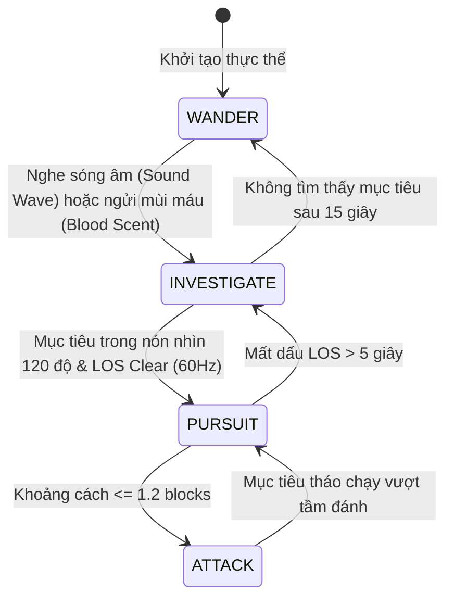

#### 1.2. Máy Trạng Thái Bệnh Lý 3 Cấp Độ (`Pathology_FSM`)

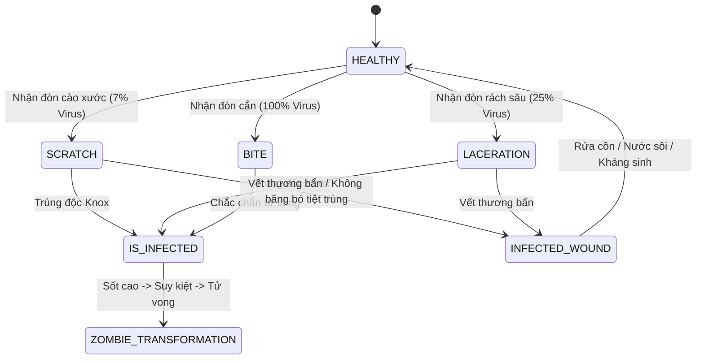

#### 1.3. Máy Trạng Thái Sinh Sản & Di Cư Động Vật (`Animal_Husbandry_FSM`)

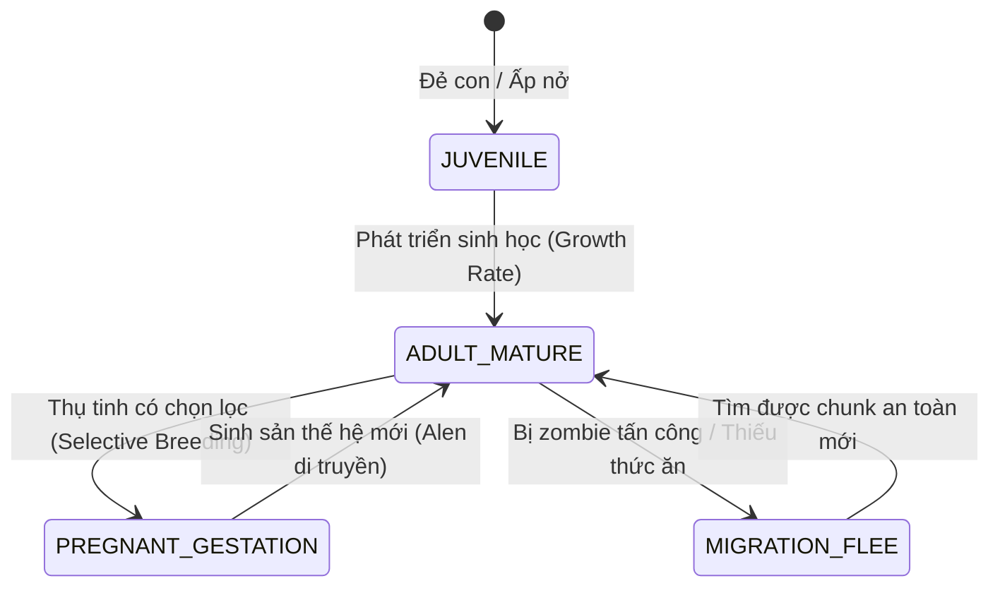

### 2. Luồng Dữ Liệu Tick Lưới Ô 60 Hz & Mạng UDP

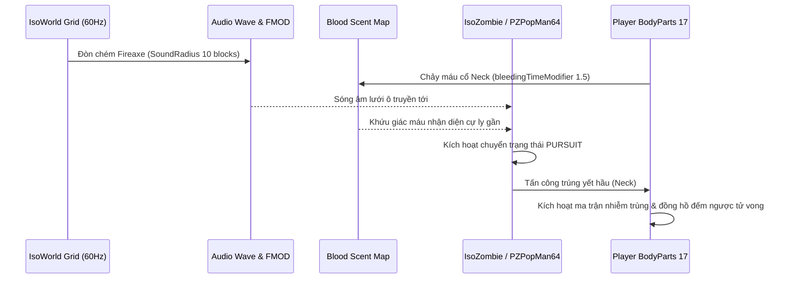

---


================================================================================
# DOCUMENT 02: COMPLETE ITEM ENCYCLOPEDIA & DATABASE GUIDE
================================================================================

## PHẦN C: SƠ ĐỒ MÁY TRẠNG THÁI & LUỒNG DỮ LIỆU (STATE_MACHINE_AND_TICK_PIPELINE)

### 1. Máy Trạng Thái Cốt Lõi (Core State Machines)

#### 2.1. Máy Trạng Thái Tải Trọng & Quản Lý Thùng Chứa Balo (`Encumbrance_Container_FSM`)

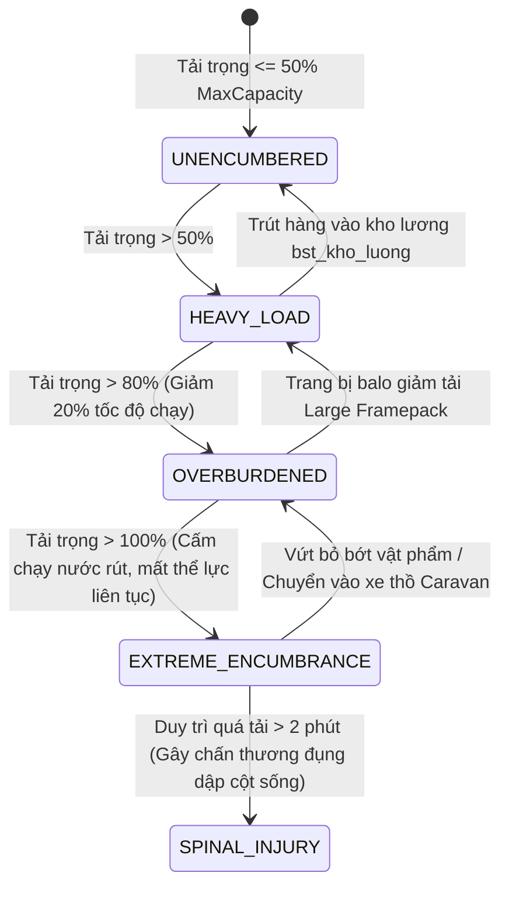

#### 2.2. Máy Trạng Thái Suy Hao Giáp Trụ Khi Hấp Thụ Đòn Cắn (`Armor_Degradation_FSM`)

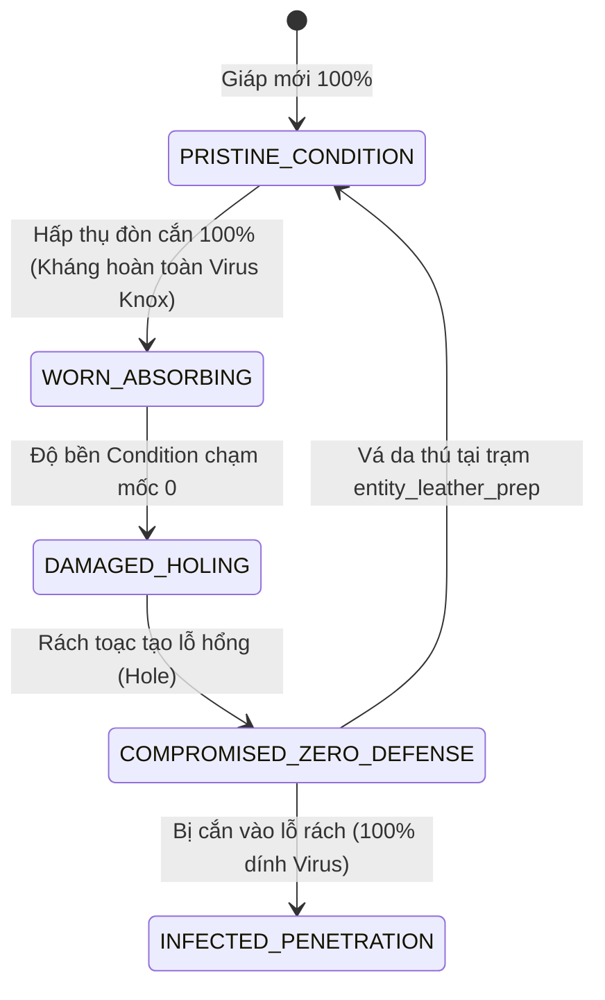

### 2. Luồng Xử Lý Trao Đổi Nhiệt & Dinh Dưỡng Tick Pipeline

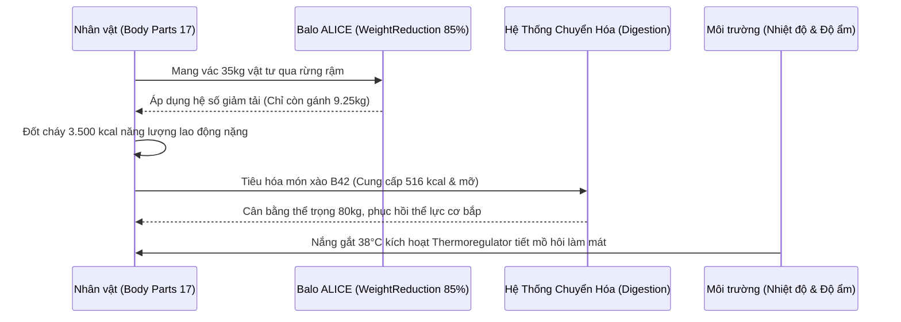

---


================================================================================
# DOCUMENT 03: CRAFTING & TECH TREE GUIDE (1,026 RECIPES & 20 WORKSTATIONS)
================================================================================

## PHẦN C: SƠ ĐỒ MÁY TRẠNG THÁI & LUỒNG DỮ LIỆU (STATE_MACHINE_AND_TICK_PIPELINE)

### 1. Luồng Thực Thi Công Thức Chế Tác & Tiến Hóa 5 Thời Kỳ (Workstation CraftRecipe & 5-Age Progression Pipeline)

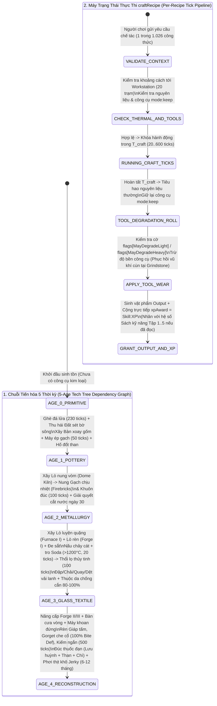

---


---

# DOCUMENT 04: PROFESSIONS & TRAITS BIBLE (25 OCCUPATIONS & 95 TRAITS)

## PHẦN C: SƠ ĐỒ MÁY TRẠNG THÁI & LUỒNG DỮ LIỆU (STATE_MACHINE_AND_TICK_PIPELINE)

### 1. Luồng Khởi Tạo Point-Buy, Nhân Kinh Nghiệm Vĩnh Viễn & Xóa Bỏ Động Khiếm Khuyết (Character Creation & Trait Lifecycle Pipeline)

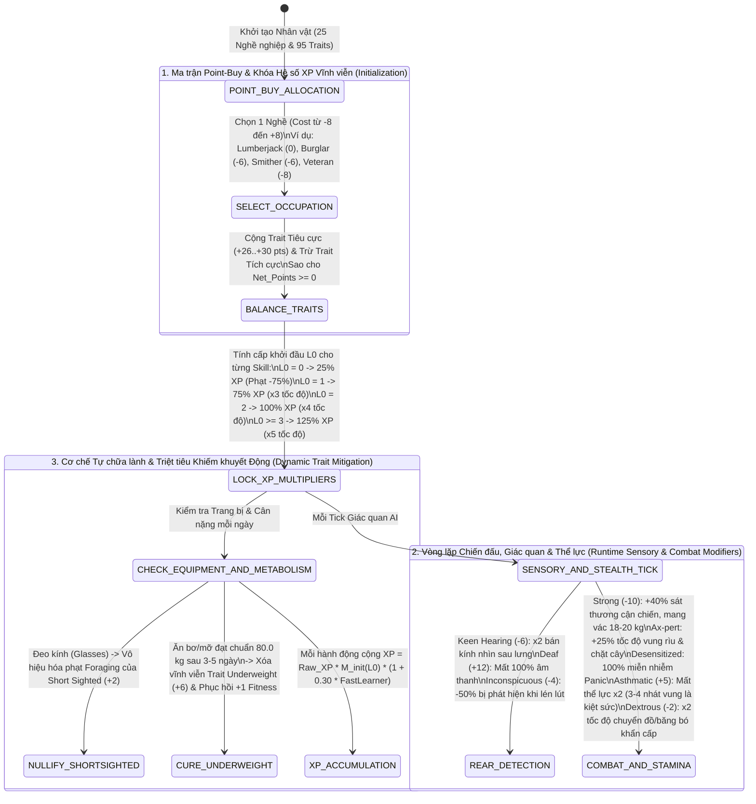

---


---

# DOCUMENT 05: WORLD MAP & LOOT DISTRIBUTION GUIDE (11 REGIONS, 362 BASEMENTS & PROCEDURAL DISTRIBUTIONS)

## PHẦN C: SƠ ĐỒ MÁY TRẠNG THÁI & LUỒNG DỮ LIỆU (STATE_MACHINE_AND_TICK_PIPELINE)

### 1. Luồng Khởi Tạo Thùng Chứa Thế Giới, Tính Trọng Số Loot & Sinh Tầng Hầm Ngầm (`World Map & Procedural Basement Tick Pipeline`)

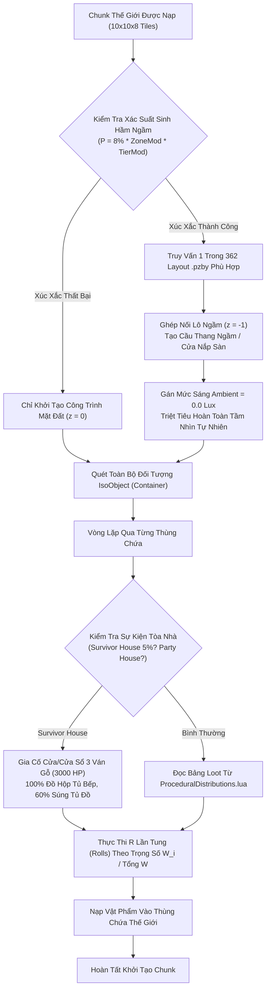

---

### 2. Sơ Đồ Pipeline Lộ Trình 7 Ngày Đầu Tiên Tối Ưu (`Day 1 - Day 7 Survival Route Execution`)

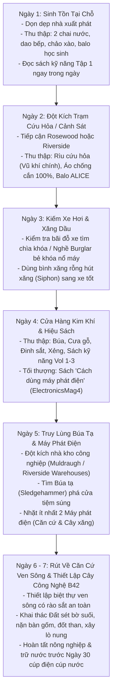

---


---

# DOCUMENT 06: VEHICLES & MECHANICS HANDBOOK (52 VEHICLE MODELS, 15 MECHANICAL PARTS & HOTWIRING DYNAMICS)

## PHẦN C: SƠ ĐỒ MÁY TRẠNG THÁI & LUỒNG DỮ LIỆU (STATE_MACHINE_AND_TICK_PIPELINE)

### 1. Luồng Khởi Động, Vật Lý Va Chạm, Phát Tán Âm Thanh Ống Xả & Bảo Trì 15 Bộ Phận (`Vehicle Physics & Mechanics Tick Pipeline`)

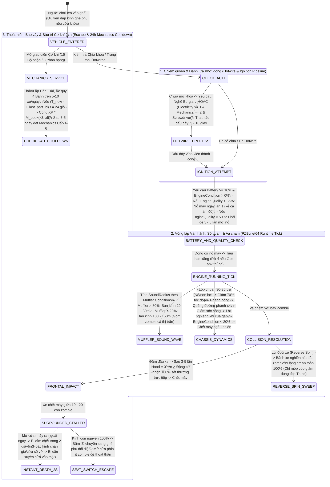

---


---


# DOCUMENT 07: MEDIA BROADCASTS, KNOX LORE & 64 SKILL VHS BIBLE (INSTRUCTIONAL MEDIA, XP MULTIPLIERS & AEBS ORACLE)

## PHẦN C: SƠ ĐỒ MÁY TRẠNG THÁI & LUỒNG DỮ LIỆU (STATE_MACHINE_AND_TICK_PIPELINE)

### 1. Luồng Phát Sóng 14 Ngày, Dự Báo AEBS Mỗi Giờ & Xử Lý Chồng XP Bản Ghi (`Media, AEBS Oracle & Skill Leveling Pipeline`)

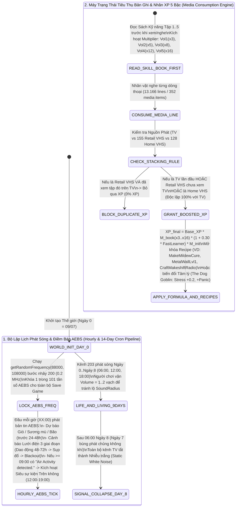

---

# DOCUMENT 08: FARMING, TRAPPING, FISHING & WILDERNESS SURVIVAL HANDBOOK (43 CROPS/HERBS, 6 TRAPS, 21 FISH, 18 GENES & 27 FORAGE CATEGORIES)

## PHẦN C: SƠ ĐỒ MÁY TRẠNG THÁI & LUỒNG DỮ LIỆU (STATE_MACHINE_AND_TICK_PIPELINE)

### 1. Chu Trình Sinh Tồn Hoang Dã 5 Trụ Cột Khép Kín (`5-Pillar Wilderness Survival & Genetics Tick Pipeline`)

```mermaid
stateDiagram-v2
    [*] --> INFRASTRUCTURE_COLLAPSE_DAY_14_30 : Cắt điện & nước vĩnh viễn (Ngày 14-30)\nKích hoạt Chu trình Sinh tồn Tự cung Tự cấp 365 Ngày

    state "1. Trụ cột Thu lượm Quang học (Foraging Search Mode Tick)" as ForagePhase {
        INFRASTRUCTURE_COLLAPSE_DAY_14_30 --> CALCULATE_SEARCH_RADIUS : R_eff = 3.0 * (1 + Lv*0.25) * M_light * M_weather * M_moodle * M_gear\n(Từ 3.0 tiles ở Lv0 -> 10.5 tiles ở Lv10; Đêm -60%, Sương -50%, Mũ kín -30%)
        CALCULATE_SEARCH_RADIUS --> HARVEST_27_CATEGORIES : Thu thập Đá lửa (Flint), Mồi câu (Trùn/Đỉa), Dấu vết thú (Tracks)\n& 5 Thảo dược (Comfrey liền xương x2; Nấm độc chết sau 24h nếu thiếu Herbalist)
    }

    state "2. Trụ cột Nông nghiệp 43 Cây & Cách ly Bàn cờ (Farming Tick)" as FarmPhase {
        INFRASTRUCTURE_COLLAPSE_DAY_14_30 --> SOW_CHECKERBOARD_PLOTS : Gieo 20 Nông sản + 23 Thảo mộc (Cách nhau 1 ô trống chống lây bệnh)\nBắp cải (144h), Cà rốt (168h, chết úng nếu Nước > 85), Khoai tây (288h, tươi 30 ngày), Ngô (480h)
        SOW_CHECKERBOARD_PLOTS --> PEST_AND_DISEASE_CHECK : Kiểm tra 4 bệnh cây trồng mỗi Tick:\n- Mildew (-50% sản lượng) -> Xịt 50ml Sữa + Nước\n- Aphids (Khô héo sau 48h) -> Xịt 5 Thuốc lá + Nước\n- Flies -> Xịt 1 Tỏi + Nước | Slugs -> Lon + 1 Ngụm Bia
    }

    state "3. Trụ cột Bẫy thú 75-Tile & Câu cá Lực căng (Trapping & Fishing Tick)" as TrapFishPhase {
        PEST_AND_DISEASE_CHECK --> TRAP_75TILE_EVALUATION : Dùng Cà rốt (45%) / Bắp cải (40%) làm bả bẫy Thỏ (19:00-05:00)\nBắt buộc khoảng cách Người chơi >= 75 Tiles (Nếu < 75 tiles: thú ăn mất bả & phá bẫy)\nBắt sống (canBeAlive = true): Thỏ, Gấu mèo, Chuột
        HARVEST_27_CATEGORIES --> FISHING_TENSION_LOOP : Câu 21 loài cá (Giờ vàng 04:00-07:00 & 18:00-21:00 -> +100% cắn câu; Đông <0°C -> -50..70%)\nNhấp nhả Tension UI (Xanh -> Vàng -> Đỏ) săn Thủy quái Aligator Gar (Trophy 243cm / 150kg)
    }

    state "4. Trụ cột Chăn nuôi 18 Gen & Móc mổ thịt 5 Bước (Husbandry & Butchering)" as HusbandryPhase {
        TRAP_75TILE_EVALUATION --> BREED_18_GENES : Lai tạo cặp Allele trội/lặn (maxSize 0.85-0.95, maxMilk 20-30L/ngày, eggClutch 6-8 trứng)\nKiểm soát Stress (ngừng đẻ/tắt sữa) & Aggressiveness (Bò/Lợn đực húc người)
        BREED_18_GENES --> BUTCHER_HOOK_5_STEPS : Treo xác lên Butcher Hook:\n1. Hứng tiết (Blood) -> 2. Lột da (Leather) -> 3. Cắt đầu (Head)\n-> 4. Xẻ thịt (Meat) -> 5. Lọc xương (Bones làm Keo, Kim khâu, Bột xương bón ruộng)
    }

```

---


---

# DOCUMENT 09: CLIMATE, SEASONS & WORLD EROSION BIBLE (12 MONTHS, SEVERE WEATHER, 37.0°C CORE EQUILIBRIUM & 100-DAY EROSION CURVE)

## PHẦN C: SƠ ĐỒ MÁY TRẠNG THÁI & LUỒNG DỮ LIỆU (STATE_MACHINE_AND_TICK_PIPELINE)

### 1. Luồng Khí Hậu 4 Mùa, Cân Bằng Thân Nhiệt $37.0^\circ\text{C}$ & Bào Mòn Thế Giới (`Climate, Thermoregulation & Erosion Tick Pipeline`)

```mermaid
stateDiagram-v2
    [*] --> CLIMATE_MANAGER_TICK : Khởi chạy từ Ngày 09/07/1993 (Vĩ độ 38° Bắc)

    state "1. Vòng lặp Khí quyển 12 Tháng & Thời tiết Cực đoan (Climate & WeatherPeriod)" as ClimatePhase {
        CLIMATE_MANAGER_TICK --> SEASONAL_TRANSITION : Hè (22..38°C) -> Thu (4..28°C, Sương muối T11 -2°C diệt cây)\n-> Đông (-15..17°C, Đêm T12 dài 14h) -> Xuân (1..28°C, Bùn lầy T3)
        SEASONAL_TRANSITION --> SEVERE_WEATHER_EVENT : Kích hoạt Khí tượng Cực đoan:
        SEVERE_WEATHER_EVENT --> TROPICAL_STORM : Bão nhiệt đới -> Tầm nhìn 3-5 ô | Tiếng mưa át bước chân\nSấm sét (Thunder) nổ 100-200 ô khuấy động bầy đàn
        SEVERE_WEATHER_EVENT --> ARCTIC_BLIZZARD : Bão tuyết (T12-T2) -> -15°C đến -25°C + Max Wind Chill\nTuyết dày phạt -50% tốc độ chạy & làm trượt bánh xe
        SEVERE_WEATHER_EVENT --> HEAVY_FOG : Sương mù (T9-T11) -> Giảm -70% tầm nhìn (Zombie cách 2-3 bước mới thấy)
    }

    state "2. Máy Trạng Thái Thân Nhiệt 17 Bộ phận & Cảm Lạnh (Thermoregulator Tick)" as ThermoPhase {
        CLIMATE_MANAGER_TICK --> EVALUATE_17_BODYPARTS : Tính Nhiệt độ Da & Lõi (Chuẩn 37.0°C / An toàn 36.5-37.5°C)\nQua 3 lớp chỉ số quần áo: Insulation, WindResistance, WaterResistance (Poncho = 100%)
        
        EVALUATE_17_BODYPARTS --> COLD_CASCADE : T_core < 36.5°C
        COLD_CASCADE --> SHIVERING_35_365 : 35.0 - 36.5°C: Rét run -> Đốt Calo & Năng lượng x3.0 - x5.0
        COLD_CASCADE --> FROSTBITE_30_35 : 30.0 - 35.0°C: Tê cóng -> Tốc độ chạy -50%, Vung vũ khí -50%, Thao tác -40%
        COLD_CASCADE --> LETHAL_HYPOTHERMIA : < 30.0°C: Rút máu liên tục đến chết (T1 ngoài trời chết sau 1 giờ)

        EVALUATE_17_BODYPARTS --> HEAT_CASCADE : T_core > 37.5°C
        HEAT_CASCADE --> SWEATING_375_39 : 37.5 - 39.0°C: Đổ mồ hôi -> Khát nước x4.0 & Ướt sũng áo lót trong\n(Ngừng vận động gặp gió -> Đảo chiều hạ nhiệt -> Cảm lạnh giữa mùa hè!)
        HEAT_CASCADE --> HYPERTHERMIA_39PLUS : > 39.0°C: Sốc nhiệt -> Choáng váng, Kiệt sức, Tụt máu

        EVALUATE_17_BODYPARTS --> CATCH_COLD_CHECK : Ướt (Wetness) + Lạnh -> CatchAColdDelta >= 100%\n-> Ho & Hắt hơi phát sóng âm 15-20 ô (Dùng Handkerchief/Tissue ở ô phụ để bịt miệng)
    }

    state "3. Tiến trình Bào mòn Tự nhiên 100 Ngày (ErosionMain Engine)" as ErosionPhase {
        CLIMATE_MANAGER_TICK --> EROSION_PROGRESSION : Tiến độ theo ErosionSpeed (20 / 50 / 100 / 200 / 500 ngày)\n- Ngày 0-20: Cỏ non & Rêu\n- Ngày 20-50: Cỏ cao ngang hông che khuất Crawlers (Cắt bằng Machete/Scythe)\n- Ngày 50-80: Dây leo phủ kín tường (Leo được lên tầng 2) & Nứt đường\n- Ngày 80-100+: Cây mọc giữa lòng đường (Xe đâm tốc độ cao -> Vỡ lốc máy, Nát két nước, Nổ lốp)
    }

```

---


---

# DOCUMENT 10: SANDBOX CUSTOMIZATION & RULES BIBLE (5 PRESETS, POPULATION DIRECTOR, 21 LOOT RARITY & 35-SKILL MULTIPLIERCONFIG)

## PHẦN C: SƠ ĐỒ MÁY TRẠNG THÁI & LUỒNG DỮ LIỆU (STATE_MACHINE_AND_TICK_PIPELINE)

### 1. Luồng Điều Phối Máy Chủ Sandbox, Tiến Hóa Quần Thể Voronoi & Nhân Hệ Số Toàn Cục (`Sandbox Director & Runtime Hot-Reload Pipeline`)

```mermaid
stateDiagram-v2
    [*] --> LOAD_SANDBOX_VARS : Khởi tạo Server / Đọc <ServerName>_SandboxVars.lua (Version = 6)

    state "1. Khởi tạo Tham số Thế giới & 5 Preset (World Rules Initialization)" as InitRules {
        LOAD_SANDBOX_VARS --> APPLY_TIME_AND_UTILITIES : Thiết lập DayLength (Def: 1h | Opt: 2h)\nKhóa mốc WaterShut & ElecShut (Def: 0-30 ngày, TB 14 ngày | SixMonthsLater: -1)\nGeneratorFuelConsumption = 0.1 L/h (Opt: 0.05 L/h chạy 10-14 ngày)
        APPLY_TIME_AND_UTILITIES --> APPLY_ZOMBIE_LORE : Thiết lập Speed (1:Sprinters, 2:FastShamblers, 3:Shamblers)\nTransmission (1:Blood+Saliva 7/25/100% | 2:Saliva Only 0/0/100%)\nCognition (1:Biết mở cửa), ActiveTime (2:Night Only), Mortality (6: 2-3 ngày)
    }

    state "2. Động cơ Tiến hóa Quần thể Voronoi & Hồi sinh 72h (Population Director Tick)" as PopDirector {
        APPLY_ZOMBIE_LORE --> DAILY_POP_CURVE : Mỗi ngày cập nhật M_day(d) từ Start(1.0x) -> Peak(1.5x) tại PeakDay(28)\nPhân bổ cụm theo ZombieVoronoiNoise = true & UrbanFocused = 1
        DAILY_POP_CURVE --> REDISTRIBUTE_12H : Mỗi 12.0 giờ (RedistributeHours): Dàn đều các bầy (RallyGroupSize = 20,\nTravel = 20 ô) lấp khoảng trống & Truy âm thanh FollowSoundDistance (100..1000 ô)
        REDISTRIBUTE_12H --> RESPAWN_72H_CHECK : Mỗi 72.0 giờ (RespawnHours): Kiểm tra ô bản đồ\nNếu HoursUnseenByPlayers >= 16.0 giờ -> Hồi sinh 10% (RespawnMultiplier = 0.1)\n(Nếu RespawnHours = 0 -> Khu vực được dọn sạch vĩnh viễn)
    }

    state "3. Bộ Nhân 21 Kênh Loot, 35 Kỹ Năng & Lệnh Admin Nóng (Economy & Hot-Reload)" as EconomyAdmin {
        LOAD_SANDBOX_VARS --> LOOT_21_MODIFIER : Khi mở thùng đồ (Doc 05) -> Nhân xác suất với 1 trong 21 biến Loot\n(Insane 0.05 | Extreme 0.2 | Rare 0.6 | Normal 1.0 | Common 2.0 | Abundant 3.0)
        LOAD_SANDBOX_VARS --> XP_35_MODIFIER : Khi nhận XP (Doc 03/04/07) -> Nhân với XPMultiplier * MultiplierConfig[Skill]\n(Strength/Fitness x5.0 để giảm thời gian cày 1 năm; Blacksmith/Pottery/FlintKnapping x3.0)
        XP_35_MODIFIER --> ADMIN_HOT_RELOAD : Admin gõ lệnh /reloadoptions hoặc /createhorde, /startrain\n-> Cập nhật nóng SandboxVars ngay trong Runtime không cần tắt Server
    }

```

---


---

# DOCUMENT 11: COMBAT, BALLISTICS & STEALTH BIBLE (6 MELEE CLASSES, 22 FIREARMS, BERNOULLI DECAY & JAW STAB DYNAMICS)

## PHẦN C: SƠ ĐỒ MÁY TRẠNG THÁI & LUỒNG DỮ LIỆU (STATE_MACHINE_AND_TICK_PIPELINE)

### 1. Luồng Máy Trạng Thái Tác Chiến Cận Chiến, Suy Giảm Độ Bền & Đòn Kết Liễu Dẫm Đầu (`Melee Combat & Durability Tick Pipeline`)

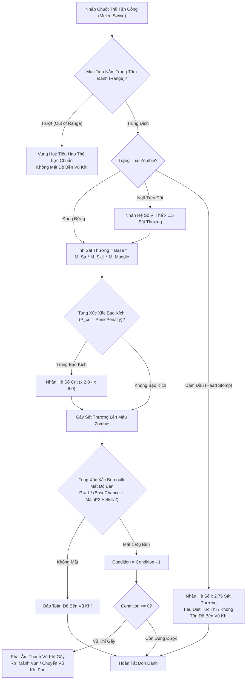

---

### 2. Luồng Xử Lý Đạn Đạo Súng Đạn, Kẹt Đạn & Phát Tán Sóng Âm 200 Ô (`Firearms Ballistics, Jamming & Acoustic Event Pipeline`)

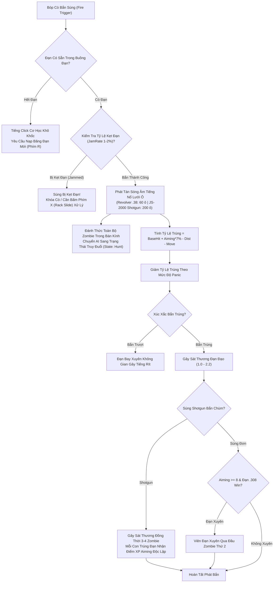

---


---

# DOCUMENT 12: BASE BUILDING, FORTIFICATIONS & ARCHITECTURE BIBLE (32-FLOOR DEPTH, DUAL BARRICADES, 3X3 PLUMBING & GENERATOR GRIDS)

## PHẦN C: SƠ ĐỒ MÁY TRẠNG THÁI & LUỒNG DỮ LIỆU (STATE_MACHINE_AND_TICK_PIPELINE)

### 1. Luồng Xây Dựng 32 Tầng, Gia Cố 2 Mặt, Lọc Nước $3\times 3$ ($Z+1$) & Giám Sát An Toàn Máy Phát (`Architecture, Plumbing & Generator Grid Pipeline`)

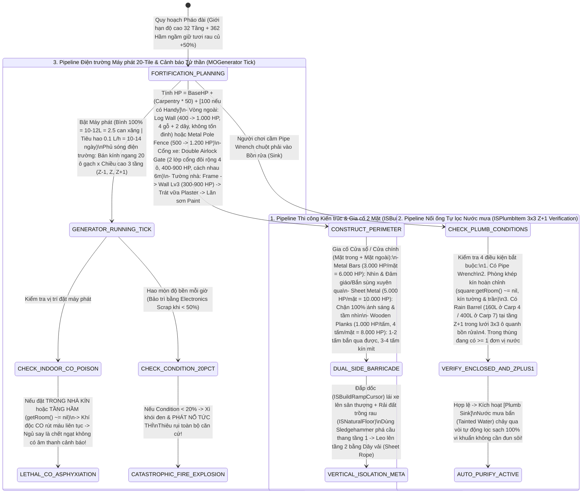

---


---

# DOCUMENT 13: MEDICAL, SURGERY & HEALTH BIBLE (17 BODY PARTS, 6 WOUND KINETICS, DUAL INFECTION & SURGERY EQUATIONS)

## PHẦN C: SƠ ĐỒ MÁY TRẠNG THÁI & LUỒNG DỮ LIỆU (STATE_MACHINE_AND_TICK_PIPELINE)

### 1. Luồng Giải Phẫu 17 Bộ Phận, Phẫu Thuật Ngoại Khoa, Nhiễm Khuẩn Kép & Độc Học (`Medical, Surgery & Toxicology Tick Pipeline`)

```mermaid
stateDiagram-v2
    [*] --> ANATOMICAL_TRAUMA_EVENT : Nhận sát thương vào 1 trong 17 Bộ phận (BodyPartType)

    state "1. Phân bổ Sát thương & Chảy máu Tử huyệt (17-Part Trauma & Exsanguination)" as TraumaPhase {
        ANATOMICAL_TRAUMA_EVENT --> APPLY_PART_MODIFIERS : Tính PainMod (0.50..0.80), DmgMod (0.10..0.70), BleedMod (0.20..1.50)\n- NECK (Cổ): BleedMod = 1.50, DmgMod = 0.70 -> Chết sau 12 - 18 giây!\n- HAND_L/R: MaxActionPenalty = 100% | FOOT_L/R: MaxMovementPenalty = 100%
        APPLY_PART_MODIFIERS --> CHECK_FOREIGN_OBJECT : Kiểm tra Dị vật găm trong thịt:
        CHECK_FOREIGN_OBJECT --> GLASS_LODGED : haveGlass == true -> Khóa cứng bleedingTime >= 3.0 (Máu chảy không ngừng!)\nGắp bằng Tweezers/Forceps (150 - 4*Lv ticks, Pain 30 - Lv) hoặc Tay không (300 ticks, xước tay)
        CHECK_FOREIGN_OBJECT --> BULLET_LODGED : haveBullet == true -> Mổ bằng SutureNeedleHolder/Forceps (250 - 6*Lv ticks, Pain 80 - Lv)\nMổ xong chuyển thành Deep Wound (deepWounded = true)
    }

    state "2. Phẫu thuật Khâu, Nẹp xương & Băng bó Thảo dược (Surgery & Poultice Engine)" as SurgeryPhase {
        BULLET_LODGED --> STITCH_PROCEDURE : Khâu Deep Wound (SutureNeedleHolder: 150-4*Lv ticks, Pain 5-Lv)\nRủi ro nhiễm trùng khi khâu = 1 / (5 + Lv*2.5) (20% ở Lv0 -> 3.3% ở Lv10)
        STITCH_PROCEDURE --> STITCH_MATURATION : Tích lũy stitchTime (0 -> 50.0)\n- Cắt chỉ khi < 30.0 -> Toác lại vết thương sâu & Chảy máu!\n- Cắt chỉ khi > 30.0 (Doctor Lv7+ báo 'Good' ở > 40.0, ~4-5 ngày) -> Lành hoàn toàn
        
        ANATOMICAL_TRAUMA_EVENT --> SPLINT_FRACTURE : Gãy xương (Fracture) -> Bó nẹp SplintFactor = (DocLv + 1) / 2 (0.5 -> 5.5 = x11 tốc độ)\n+ Đắp Cao Liên Mộc (ComfreyCataplasm: -5.0E-6/tick) -> Tăng tốc liền xương 10 - 55 lần
        
        GLASS_LODGED --> BANDAGE_AND_POULTICE : Băng bó (120 - 4*Lv ticks) + Đắp Cao Mã Đề (PlantainCataplasm):\n- Scratch: Băng bó 15x -> Đắp Mã Đề 25x (-2.5E-4/tick)\n- Cut (Rách sâu): Băng bó 50x -> Đắp Mã Đề 100x (-1.0E-4/tick)
    }

    state "3. Kiểm tra Nhiễm trùng Kép & Độc học Môi trường (Sepsis & Toxicology Tick)" as SepsisPhase {
        BANDAGE_AND_POULTICE --> ROLL_BACTERIAL_SEPSIS : Mỗi nhịp tính Chance = Max(5000, 40000 - Sum(Penalties))\n(Băng bẩn BandageLife==0 trừ -35.000 -> Tăng nguy cơ gấp 7x! DeepWound hút bẩn -0.005/tick)\nChữa isInfectedWound: AlcoholBandage (-6.0E-4/tick) | Antibiotics (50.0, -2.0E-4/tick) | Tỏi rừng (-2.0E-4/tick)
        
        ANATOMICAL_TRAUMA_EVENT --> KNOX_MORTALITY_TIMER : Nếu trúng isInfected (7% Scratch / 25% Cut / 100% Bite):\nỦ bệnh 48-72h * del (Resilient: 1.25 | ProneToIllness: 0.75) -> Tử vong -> Hóa Zombie sau 30-120s
        
        [*] --> ENVIRONMENTAL_TOXICOLOGY : Kiểm tra Môi trường & Dược phẩm mỗi Tick:\n- Đứng gần > 20 xác thối -> CorpseSickness (Queasy -> Fever -> Chết)\n- Máy phát trong nhà kín -> Ngạt khí CO chết sau 10 - 15 phút\n- Ăn nấm/đồ thiu -> Chữa bằng Sả Chanh (Lemongrass) | Thuốc ngủ/Giảm đau + Rượu -> Quá liều tử vong!
    }

```

---


---

# DOCUMENT 14: META SECRETS, EMERGENT STORYTELLING & WORLD MYSTERIES BIBLE (80KG METABOLISM, 7 WEIGHT TIERS, STASHSYSTEM & 164 STORIES)

## PHẦN C: SƠ ĐỒ MÁY TRẠNG THÁI & LUỒNG DỮ LIỆU (STATE_MACHINE_AND_TICK_PIPELINE)

### 1. Luồng Trao Đổi Chất 80.0 kg, Cạy Ván Sàn Kho Báu & Đạo Diễn Vô Hình 164 Kịch Bản (`Metabolism 80kg, StashSystem & Meta Director Pipeline`)

```mermaid
stateDiagram-v2
    [*] --> WORLD_AND_PLAYER_RUNTIME : Khởi chạy Động cơ Sinh học & Đạo diễn Thế giới B42

    state "1. Động cơ Trao đổi chất 80.0 kg & 7 Ngưỡng Cân nặng (Nutrition.java Tick)" as NutritionPhase {
        WORLD_AND_PLAYER_RUNTIME --> COMPUTE_CALORIC_BURN : caloriesDelta = BodyWeightKg / 80.0 (100kg: +25% | 60kg: -25%)\nTrừ Calories [-2200..+3700 kcal] theo hành động:\n- Sleeping: 0.003/tick | Normal: 0.016/tick (5.3x) | Exercise/Combat: 0.130/tick (43.3x!)
        
        COMPUTE_CALORIC_BURN --> WEIGHT_DELTA_KINETICS : Kiểm tra ngưỡng Đốt mỡ & Tăng cân nhanh:\n- Nếu Calories == -2200 kcal -> Đốt mỡ tối đa -8.5E-6 kg/tick\n- Nếu Calories > 0 & (Carbs > 400g HOẶC Lipids > 400g) -> Tăng cân mũi tên đôi (^^) +1.3E-5 kg/tick\n- Nếu Proteins nằm trong [50.0g, 300.0g] -> Thưởng +30% Strength XP Gain
        
        WEIGHT_DELTA_KINETICS --> UPDATE_7_WEIGHT_BANDS : Áp dụng Trait động theo Cân nặng:\n- <= 35.0 kg: TỬ VONG\n- 35.1 - 50.0 kg: Emaciated (-60% Melee Dmg, -4 Fit, Tụt máu)\n- 50.1 - 65.0 kg: Very Underweight (-40% Melee Dmg, -2 Fit, Dễ ngã rào)\n- 65.1 - 75.0 kg: Underweight (-20% Melee Dmg, -1 Fit)\n- 75.1 - 84.9 kg: VÙNG HOÀN HẢO (0% Penalty, 100% Hiệu suất)\n- 85.0 - 99.9 kg: Overweight (-1 Fit, +50% Mất thể lực)\n- >= 100.0 kg: Obese (-2 Fit, +200% Nguy cơ gãy chân khi nhảy lầu)
    }

    state "2. Động cơ 164 Kịch bản Ngẫu nhiên & Kho báu Ván sàn (RandomizedWorld & StashSystem)" as StashPhase {
        WORLD_AND_PLAYER_RUNTIME --> ROLL_164_STORIES : Khởi tạo Chunk -> Gieo 1 trong 164 kịch bản (RDS / RB / RZS / RVS):\nRDSHockeyPsycho (Machete), RDSRatKing (B42), RBToiletPaper (100%),\nRZSOccultActivity (Rừng sâu), RVSAnimalTrailerOnRoad (Lật xe gia súc sống B42)
        
        ROLL_164_STORIES --> LOOT_ANNOTATED_STASH_MAP : Tiêu diệt Zombie đặc biệt (spawnOnlyOnZed = true) -> Nhặt Annotated Map
        LOOT_ANNOTATED_STASH_MAP --> RESOLVE_STASH_TARGET : Đi tới tọa độ đánh dấu 'X':\n- Nếu trapped == true & barricades == true -> Chạm trán ổ phục kích 10 - 30 Zombie!\n- Dùng Xà beng (Crowbar) cạy tấm ván sàn (floors_interior_tilesandwood_01_60) -> Mở GunBox
    }

    state "3. Đạo diễn Âm thanh Ảo & Trực thăng Săn lùng (SLSoundManager & Helicopter AI)" as MetaDirectorPhase {
        WORLD_AND_PLAYER_RUNTIME --> EMIT_AMBIENT_META_SOUNDS : SLSoundManager kích hoạt ngẫu nhiên:\nMeta Gunfire (Bán kính 200 - 400 ô) | Meta Scream | Barking Dog -> Điều hướng bầy đàn di cư
        
        EMIT_AMBIENT_META_SOUNDS --> HELICOPTER_HUNT_DAY_6_9 : Ngày thứ 6 - 9 (Được báo trước bởi AEBS "Air Activity detected."):\nPhát sóng âm cực đại > 500 ô gạch!\n- Nếu người chơi ở NGOÀI TRỜI: Lơ lửng bám trên đầu 3 - 6 giờ liên tục gom hàng ngàn Zombie\n- Nếu trốn TRONG NHÀ KÍN (Đóng rèm, tắt đèn): Mất dấu và bay đi sau 1 giờ
    }

```

---


# DOCUMENT 15: AI PATHFINDING, DUAL-LAYER NAVMESH & HORDE SIMULATION BIBLE (64-LEVEL Z-AXIS, SSFA FUNNEL & 50,000 VIRTUAL HORDE)

## PHẦN C: SƠ ĐỒ MÁY TRẠNG THÁI & LUỒNG DỮ LIỆU (STATE_MACHINE_AND_TICK_PIPELINE)

### 1. Luồng Điều Hướng Đa Giác 64 Tầng, Phễu Tam Giác SSFA & Di Cư Đàn Ảo 50.000 Thực Thể (`Dual-Layer Pathfinding, Animal NavMesh & Virtual Horde Pipeline`)

```mermaid
stateDiagram-v2
    [*] --> ENTITY_NAVIGATION_REQUEST : Thực thể (Zombie / Animal) yêu cầu đường đi tới Target (X, Y, Z_game)

    state "1. Ánh xạ 64 Tầng & Tìm đường 2 Lớp (PolygonalMap2: HLAStar + VGAStar)" as ZombieNavPhase {
        ENTITY_NAVIGATION_REQUEST --> Z_AXIS_64_MAPPING : Chuyển đổi trục đứng: TargetZ_Internal = TargetZ_Game + 32.0f\n(LEVELS_PER_CHUNK = 64 | GROUND_LEVEL = 32 | Hầm -32 -> 0 | Tháp +31 -> 63)
        
        Z_AXIS_64_MAPPING --> MACRO_HLASTAR_CHECK : Nếu khoảng cách > 1 chunk (> 10..50 tiles) -> Chạy HLAStar.java\nTìm chuỗi HLChunkRegion & Điểm chuyển tầng HLLevelTransition (6 nút Stairs: NODE_FLAG_STAIR = 16)
        
        MACRO_HLASTAR_CHECK --> MICRO_VGASTAR_NATIVE : Đẩy xuống VisibilityGraph & PathfindNative (JNI C++ Đa luồng)\nCắt tia Liang-Barsky + Bám tường (CLOSE_TO_WALLS = true)\nĐệm viên nang RADIUS = 0.3f (Đường chéo RADIUS_DIAGONAL = 0.42426f)
        
        MICRO_VGASTAR_NATIVE --> OBSTACLE_AND_STUCK_FSM : Tương tác vật cản trên đường đi (PathFindBehavior2):\n- Gầm xe ô tô (PATHS_UNDER_VEHICLES = true): Bật NODE_FLAG_CRAWL = 1 bò qua gầm xe\n- Cửa khóa (!couldBeOpen): Bật CXN_FLAG_THUMP = 2 -> Vây đập sập cửa\n- Cửa sổ / Rào thấp: Trèo qua (Nếu còn kính vỡ !isGlassRemoved -> Cứa rách thịt; Nếu đông -> Fence Lunge)\n- Cảm biến chống kẹt (WalkingOnTheSpot): Đứng yên nhiều nhịp -> Hủy đường (isCancel = true) & Đập vật cản
    }

    state "2. Lưới Tam giác Động vật & Thuật toán Phễu Kéo Căng Dây (AnimalPathfind SSFA)" as AnimalNavPhase {
        ENTITY_NAVIGATION_REQUEST --> TRIANGULATED_MESH_A_STAR : Động vật trên đồng cỏ (Zone) -> Chia lưới tam giác (Mesh.java)\nChạy LowLevelAStar tìm chuỗi Cạnh Cổng (Portal Edges: portalLeft, portalRight)
        TRIANGULATED_MESH_A_STAR --> FUNNEL_STRING_PULLING : Chạy thuật toán Phễu (SSFA) với tích có hướng triarea2(Apex, Left, Right)\nKẹp góc phễu & Chốt điểm uốn -> Xuất quỹ đạo đường thẳng kéo căng mượt mà\nKết hợp OffMeshConnection (Hươu nhảy rào thấp, Thỏ nhảy mương, Bò qua cổng chuồng)
    }

    state "3. Ảo hóa Quần thể 50.000 Zombie & Ngưỡng Sóng âm 50-Tile (ZombiePopulationManager)" as PopManPhase {
        [*] --> CHUNK_DISTANCE_MONITOR : Giám sát khoảng cách giữa Người chơi và toàn bộ 50.000+ Zombie
        CHUNK_DISTANCE_MONITOR --> VIRTUALIZE_TO_CPP_32BIT : Nếu khoảng cách > 3 Chunks -> Xóa IsoZombie khỏi RAM Java (removeFromWorld)\nNén thành Struct nhị phân 32-bit trong C++ (Chỉ giữ 200 - 500 Real Zombies quanh người chơi)
        
        VIRTUALIZE_TO_CPP_32BIT --> WORLD_SOUND_FILTER_50 : Phát sinh âm thanh thế giới (addWorldSound):\n- Nếu sound.radius < 50 HOẶC sourceIsZombie HOẶC !stressZombies -> BỎ QUA (Đàn ảo đứng yên)\n- Nếu sound.radius >= 50 (VD: Súng .38 = 60 ô, Shotgun = 200 ô, Trực thăng > 500 ô)\n-> Gọi Native n_worldSound() -> Hàng ngàn Virtual Zombies di cư ngầm về nguồn âm!
    }

```

---
