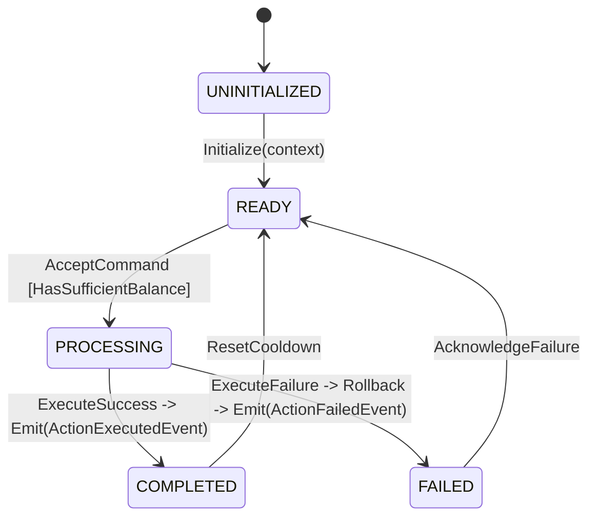

# Feature Spec: {{title}}

> **Chỉ dẫn cho AI Agent:** Tài liệu này được viết theo chuẩn **Spec-Driven Development (SDD)**. Mọi đoạn code sinh ra phải tuân thủ nghiêm ngặt các mục: Immutable Records, State Machine Invariants, thuật toán Deterministic, chống Exploit/Dupe và vượt qua toàn bộ Test Cases JUnit 5 ở Mục 6. **Tuyệt đối KHÔNG import bất kỳ class nào thuộc `org.bukkit.*` vào package Domain.**

---

## 1. Mục tiêu & Giới hạn Phạm vi (Scope & Boundaries)
- **Mục tiêu nghiệp vụ:** Mô tả hành vi mong muốn từ góc nhìn gameplay và logic máy chủ.
- **In-Scope (Phải làm trong Pure Java Domain):**
  - Thực thi State Machine và tính toán logic nghiệp vụ.
  - Kiểm tra điều kiện tiên quyết (Invariants validation).
  - Bắn ra Domain Events cho các Adapters bên ngoài tiêu thụ.
- **Out-of-Scope (Nằm ở Adapters - PaperMC / WebGL):**
  - Hiển thị hạt hiệu ứng (Particles), âm thanh (Sounds), Title/ActionBar trên Minecraft Client.
  - Lưu database I/O trực tiếp (phải ủy thác qua Outbound Port).
  - Packet protocol serialization (WebSocket / TCP).

---

## 2. Input Data Records & Contracts (Java 17+ Records)

Tất cả dữ liệu đi vào Domain phải là các `Record` bất biến (Immutable), không chứa getter/setter kiểu JavaBeans truyền thống, không chứa logic I/O.

### 2.1. Commands & Value Objects
```java
package com.game.engine.domain.feature.model;

import java.util.UUID;

// Value Object: Đảm bảo tính toàn vẹn ngay tại Constructor
public record CurrencyAmount(long value) {
    public CurrencyAmount {
        if (value < 0) {
            throw new IllegalArgumentException("Currency cannot be negative: " + value);
        }
    }
}

// Inbound Command: Đại diện cho yêu cầu từ Adapter gửi vào Domain
public record ExecuteActionCommand(
    UUID playerId,
    UUID targetEntityId,
    CurrencyAmount wagerAmount,
    long clientTickTimestamp
) {}
```

### 2.2. Domain Events (Outbound Payload)
```java
package com.game.engine.domain.feature.event;

import java.time.Instant;
import java.util.UUID;

public sealed interface DomainEvent permits ActionExecutedEvent, ActionFailedEvent {
    UUID eventId();
    Instant occurredAt();
}

public record ActionExecutedEvent(
    UUID eventId,
    UUID playerId,
    long resultDelta,
    Instant occurredAt
) implements DomainEvent {}

public record ActionFailedEvent(
    UUID eventId,
    UUID playerId,
    String failureReasonCode,
    Instant occurredAt
) implements DomainEvent {}
```

---

## 3. Finite State Machine (FSM) & Bất biến (Invariants)

### 3.1. Sơ đồ Trạng thái


### 3.2. Bảng Chuyển dịch Trạng thái (Transition Matrix)
| Trạng thái hiện tại | Trigger / Event | Điều kiện bảo vệ (Guard Condition) | Trạng thái tiếp theo | Side Effect / Domain Event |
|---|---|---|---|---|
| `READY` | `EXECUTE` | `wager <= currentBalance && !isStunned` | `PROCESSING` | Giữ tạm thời (Hold balance) |
| `PROCESSING` | `RESOLVE_WIN` | `rollResult >= difficultyTarget` | `COMPLETED` | Cộng thưởng, bắn `ActionExecutedEvent` |
| `PROCESSING` | `RESOLVE_FAIL` | `rollResult < difficultyTarget` | `FAILED` | Tịch thu hold, bắn `ActionFailedEvent` |

### 3.3. Các Bất biến Domain (Invariants)
1. **Invariant 1 (Balance Non-Negative):** Số dư tài nguyên của Entity không bao giờ rơi vào giá trị âm trong bất kỳ thời điểm nào của Tick.
2. **Invariant 2 (Idempotency):** Cùng 1 `commandId` / `clientTickTimestamp` không thể được xử lý 2 lần (chống Replay Attack).
3. **Invariant 3 (Atomic Resolution):** Việc trừ tài nguyên và kích hoạt hiệu ứng phải diễn ra trong cùng một transaction nội bộ của Domain.

---

## 4. Công thức Tính toán Chính xác (Deterministic Calculations)

### 4.1. Công thức Toán học
Mô tả chính xác thuật toán:
$$Payout = \lfloor BaseWager \times Multiplier \times (1.0 + LuckModifier) \rfloor$$

### 4.2. Quy tắc Làm tròn & Tràn số (Precision & Overflow Guard)
- Sử dụng kiểu dữ liệu `long` hoặc số nguyên định dạng fixed-point (ví dụ: nhân 10000) để tránh sai số dấu phẩy động của `double`/`float`.
- Bắt buộc kiểm tra chống tràn số với `Math.multiplyExact()` hoặc `Math.addExact()`.

---

## 5. Phòng thủ Exploit, Concurrency & Dupe (Anti-Exploit Design)

| Nguy cơ Exploit / Dupe | Kịch bản tấn công | Giải pháp phòng thủ bắt buộc trong Domain |
|---|---|---|
| **Inventory Desync / Double Click** | Người chơi gửi 2 packet tương tác trong cùng 1 tick hoặc cách nhau 1ms. | Sử dụng `Optimistic Locking` qua version counter hoặc xử lý tuần tự qua Single-Thread Actor / Tick-Queue. Từ chối command nếu version cũ. |
| **Integer Overflow** | Gửi số lượng giao dịch cực lớn ($2^{31} - 1$) gây tràn thành số âm. | Dùng `long` kết hợp `Math.addExact` / `Math.subtractExact`. Bắt `ArithmeticException` trả về lỗi domain. |
| **Drop/Disconnect Mid-Transaction** | Player ngắt kết nối đúng thời điểm Domain đang `PROCESSING`. | Trạng thái lưu theo mô hình Two-Phase State trong RAM: Nếu disconnected, Rollback trạng thái về snapshot tick trước. |
| **Tick Drift / Speed Hack** | Client gửi timestamp giả mạo nhằm né cooldown. | Domain chỉ tin cậy `currentServerTick` do Engine cấp, tuyệt đối không dùng timestamp từ client để quyết định cooldown. |

---

## 6. Danh mục Kịch bản Kiểm thử Bắt buộc (JUnit 5 Test Scenarios)

> **Yêu cầu:** Mọi class triển khai phải có test suite tương ứng đạt coverage 100% logic nhánh.

### 6.1. Happy Path Scenarios
- [ ] **TC-01: Thực thi thành công trong điều kiện bình thường.**
  - *Given:* Player có đủ 100 vàng, không bị cooldown.
  - *When:* Gửi `ExecuteActionCommand` với wager 50 vàng.
  - *Then:* Trạng thái chuyển thành `COMPLETED`, số dư còn 50 + phần thưởng, bắn `ActionExecutedEvent`.

### 6.2. Edge Cases & Anti-Exploit Tests
- [ ] **TC-02: Chặn số dư không đủ (Insufficient Funds).**
  - *Given:* Player chỉ có 10 vàng.
  - *When:* Gửi command 50 vàng.
  - *Then:* Ném ra domain exception hoặc trả về `Result.failure(INSUFFICIENT_FUNDS)`, số dư giữ nguyên 10 vàng.
- [ ] **TC-03: Chống Race Condition (Concurrent Double Execution).**
  - *Given:* Player gửi đồng thời 2 command cùng lúc từ 2 thread khác nhau vào Domain.
  - *When:* Domain xử lý song song.
  - *Then:* Chỉ 1 command thành công, command thứ 2 bị từ chối do xung đột version hoặc hết số dư.
- [ ] **TC-04: Chống tràn số (Arithmetic Overflow Protection).**
  - *Given:* Wager `Long.MAX_VALUE - 10`, hệ số nhân 2.
  - *When:* Thực thi tính toán.
  - *Then:* Bắt exception an toàn, không làm hỏng state hay tạo ra tiền âm.

### 6.3. Determinism & Performance Budget Tests
- [ ] **TC-05: Kiểm thử tính lặp lại (Deterministic Seed Replay).**
  - Cùng một seed giả lập và input phải sinh ra 100% kết quả giống hệt nhau trên 1,000,000 lần lặp.
- [ ] **TC-06: Ngân sách hiệu năng (Performance Budget < 0.1ms per execution).**
  - Thực thi 100,000 phép tính trong vòng lặp JUnit; thời gian trung bình mỗi operation không vượt quá `0.05ms` (50 microseconds) để bảo vệ ngân sách 50ms/tick của PaperMC.
