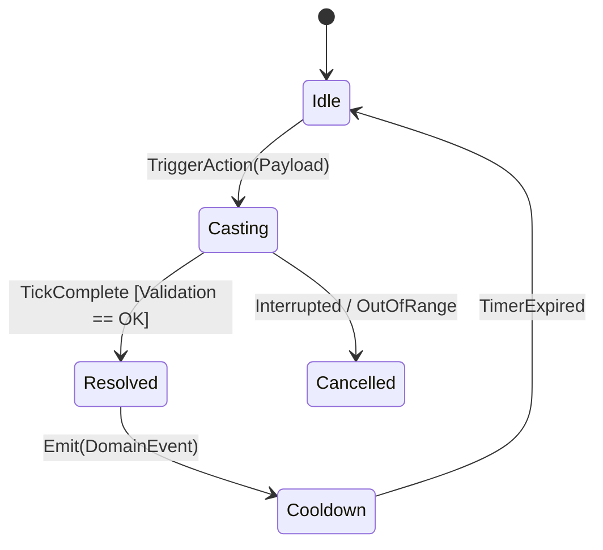

# {{title}}

> **Tóm tắt (TL;DR):** Mô tả 1-2 câu ngắn gọn về nguyên lý cốt lõi và giá trị mang lại cho hệ thống Game Server.

---

## 1. Bài toán Cốt lõi (Core Problem & Intent)
- **Vấn đề cần giải quyết:** (Ví dụ: Chống inflation kinh tế, giải quyết xung đột trạng thái giữa Server-Client, công thức tính Damage scaling phi tuyến, quản lý xác suất không bị lệch...)
- **Mục tiêu trải nghiệm / Kỹ thuật:** (Ví dụ: Đảm bảo tính công bằng, tăng cảm giác thăng tiến của người chơi, giữ throughput ổn định ở 20 TPS).
- **Phạm vi tác động:** `Domain Core` | `PaperMC Adapter` | `WebGL Client Sync`.

---

## 2. Cơ chế Gốc (Original Mechanism / Theoretical Rule)
- **Nguồn trích dẫn:** *{{source_book}}* - Chương / Mục: `...`
- **Mô tả cơ chế nguyên bản:** Tóm tắt cách sách hoặc game gốc hiện thực quy tắc này.
- **Các tham số đầu vào gốc:**
  - $Param_1$: Ý nghĩa, khoảng giá trị.
  - $Param_2$: Ý nghĩa, khoảng giá trị.

---

## 3. Công thức Toán học & Luồng Trạng thái (Math & State Flow)

### 3.1. Công thức Toán học (Deterministic Formula)
$$Result = f(Param_1, Param_2) = \lfloor \alpha \cdot \log_2(1 + \beta \cdot X) \rfloor$$

- **Giải thích biến & Hằng số cân bằng:**
  - $X$: Giá trị thuộc tính (ví dụ: Level, Stats).
  - $\alpha, \beta$: Hệ số điều chỉnh (Tuning Constants).
- **Đặc tính đồ thị:** Tuyến tính (Linear), Lũy thừa (Exponential), hay Tiệm cận bão hòa (Diminishing Returns).

### 3.2. Sơ đồ Trạng thái / Luồng Xử lý (Mermaid Diagram)


---

## 4. Cách Áp dụng vào Kiến trúc Game Server (Hexagonal Mapping)

### 4.1. Vị trí trong Pure Java Domain Core
- **Mô hình hóa:** Thuộc tính đặt trong `Value Object` (Immutable Record) hay hành vi nằm trong `Domain Service`?
- **Độ phức tạp thuật toán:** $\mathcal{O}(1)$ hay $\mathcal{O}(N)$? (Khống chế thời gian chạy trong mỗi Tick: `< 0.05ms` cho hàm này).
- **Ràng buộc Deterministic:** Không dùng `Math.random()` trực tiếp, phải truyền Seed hoặc inject Random Provider có thể replay.

```java
// Ví dụ phác thảo Domain Record / Service
public record DamageCalculationInput(int attackerPower, int defenderDefense, CriticalProfile critProfile) {}
```

### 4.2. Giao tiếp qua Ports & Adapters
- **Inbound Port (Use Case):** `ApplyDamageUseCase.execute(command)`
- **Outbound Port:** `PlayerStateRepositoryPort`, `EventPublisherPort`
- **Adapter PaperMC:** Lắng nghe EntityDamageEvent -> convert sang Domain Command -> gọi Inbound Port -> nhận Domain Event -> phản hồi hiệu ứng PaperMC.
- **Adapter WebGL Client:** Nhận Domain Event đồng bộ qua WebSocket / Binary Protocol.

---

## 5. Danh mục Tham chiếu (Wikilinks)
- Feature Spec áp dụng: `[[Tpl_Feature_Spec]]`
- Quyết định kiến trúc liên quan: `[[Tpl_ADR]]`
- Sách / Tài liệu ngoài:
