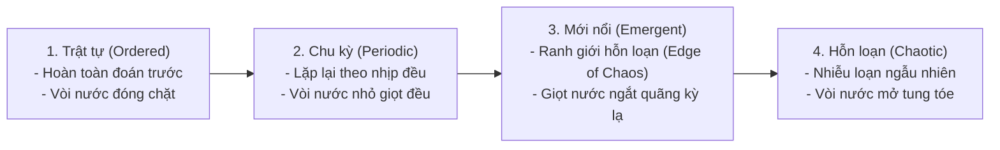
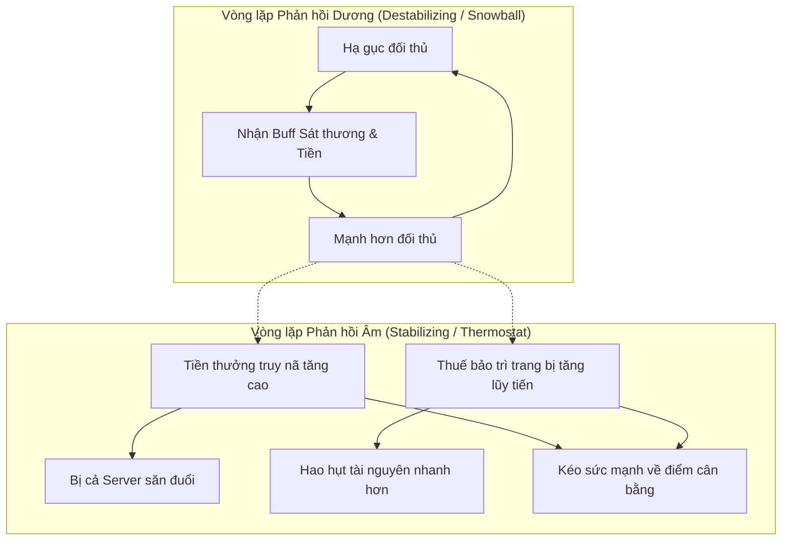

# Vùng Ranh giới Hỗn loạn và Động lực học Vòng lặp Phản hồi (Feedback Loops)

> **Tóm tắt (TL;DR):** Gameplay hấp dẫn nhất chỉ nảy sinh tại **Vùng Ranh giới Hỗn loạn (Edge of Chaos)** — điểm giao thoa giữa tính trật tự dễ đoán và sự hỗn loạn ngẫu nhiên. Trạng thái cân bằng động này được điều phối bởi sự đan xen giữa **Phản hồi Dương (Positive Feedback - khuếch đại, đột biến)** và **Phản hồi Âm (Negative Feedback - ổn định hóa, chống lạm phát)**. Trong Domain Core, các vòng lặp này được mô hình hóa bằng các thuật toán hãm tốc vi mô mà không làm ảnh hưởng đến tick rate 20 TPS.

---

## 1. Bài toán Cốt lõi (Core Problem & Intent)

- **Cái chết vì Quá trật tự (Death by Rigidity):** Game thuần kịch bản, mọi kết quả đều biết trước, không có biến số $\to$ Người chơi chán nản sau 1 lần chơi.
- **Cái chết vì Quá hỗn loạn (Death by Randomness):** Game phụ thuộc hoàn toàn vào tung xúc xắc và may rủi $\to$ Kỹ năng người chơi bị vô hiệu hóa, biến thành sòng bạc.
- **Hiệu ứng Lăn Cầu Tuyết (Snowball Effect):** Người chơi dẫn trước giành được nhiều tài nguyên hơn, đè bẹp đối thủ không thể lật kèo, làm hỏng trải nghiệm PvP/Guild War.
- **Mục tiêu Kiến trúc:** Thiết kế các bộ điều tốc (Governors) và van xả áp lực trong Pure Java Domain Core để giữ hệ sinh thái game luôn dao động trong vùng Emergence.

---

## 2. Bốn Trạng thái của Hệ thống Phức hợp (Four Behavioral States)



1. **Ordered (Trật tự):** Hệ thống Progression đóng kín, chuỗi câu đố 1 đáp án duy nhất.
2. **Periodic (Tuần hoàn):** Chu kỳ lượt đánh theo Tick ($50\text{ms}$), chu kỳ ngày/đêm, mùa giải D&D Rift mở định kỳ.
3. **Emergent (Ranh giới Hỗn loạn):** Nơi các quy tắc đơn giản tự tổ chức thành các hình mẫu chiến thuật biến ảo (Vùng đất vàng của Game Design).
4. **Chaotic (Hỗn loạn):** Các bộ sinh số ngẫu nhiên không kiểm soát, phá vỡ tính tất định.

---

## 3. Động lực học Vòng lặp Phản hồi: Dương vs. Âm



### 3.1. Phản hồi Dương (Positive Feedback Loop)
- **Bản chất:** Khuếch đại sự thay đổi ban đầu. Tăng dẫn đến tăng nhiều hơn, giảm dẫn đến sụp đổ nhanh hơn (Ví dụ: Hiệu ứng bắt quân trong Cờ vua, chuỗi hạ gục Killstreak trong FPS).
- **Vai trò:** Tạo cảm giác thăng hoa tột độ (Climax), đẩy nhanh tốc độ kết thúc trận đấu, tránh tình trạng giằng co hòa hoãn bất tận.
- **Nguy cơ:** Gây hiện tượng "Snowballing" không thể đảo ngược nếu thiếu kiểm soát.

### 3.2. Phản hồi Âm (Negative Feedback Loop)
- **Bản chất:** Triệt tiêu sự thay đổi, kéo hệ thống trở lại điểm cân bằng mong muốn (Ví dụ: Bộ điều nhiệt Thermostat, chu kỳ Con mồi - Thú săn mồi trong tự nhiên, chi phí Upkeep trong Civilization).
- **Vai trò:** Bảo vệ nền kinh tế khỏi siêu lạm phát, tạo cơ chế "Lội ngược dòng" (Comeback Mechanic) cho người chơi bị dẫn trước.

### 3.3. Công thức Vàng: Phản hồi Dương Ngắn hạn + Phản hồi Âm Dài hạn
Hệ thống game bền vững nhất luôn kết hợp:
$$\Delta S = \underbrace{\text{PositiveFeedback}_{\text{Combat}}}_{\text{Kích thích ngắn hạn trong ván}} - \underbrace{\text{NegativeFeedback}_{\text{Economy/World}}}_{\text{Điều hòa dài hạn qua các ngày}}$$

---

## 4. Hiện thực hóa trong Pure Java Domain Core

### 4.1. Thuật toán Dynamic Bounty & Upkeep Governor
Không dùng logic phân nhánh rườm rà; áp dụng trực tiếp công thức toán học hằng số rời rạc vào Domain Record:

```java
package com.game.engine.domain.economy.governor;

public record CombatantDynamicState(
        long baseBountyMicroUnits,
        int killStreakCounter,
        long currentArmorDurability
) {
    // Phản hồi Âm: Càng ăn nhiều mạng, tiền thưởng rơi ra khi chết càng tăng lũy thừa
    public long calculateDeathBounty() {
        long multiplier = 10_000L + (long) killStreakCounter * 2_500L; // +25% mỗi mạng
        return Math.multiplyExact(baseBountyMicroUnits, multiplier) / 10_000L;
    }

    // Phản hồi Âm: Càng chém nhiều, hao mòn trang bị càng tăng nhanh (Draining Mechanic)
    public long calculateDurabilityCost(long baseDegradation) {
        long streakPenalty = Math.max(1, killStreakCounter / 2);
        return Math.multiplyExact(baseDegradation, streakPenalty);
    }
}
```

### 4.2. Khống chế Ngân sách Hiệu năng (Tick Budget Assertion)
- Các phép tính Feedback diễn ra tức thì tại thời điểm phát sinh sự kiện (`EntityEliminatedEvent`).
- Không duy trì các luồng ngầm quét toàn bộ cơ sở dữ liệu để cân bằng; mọi phản hồi âm đều được kích hoạt theo cơ chế hướng sự kiện (**Event-Driven Dampers**).

---

## 5. Danh mục Tham chiếu (Wikilinks)
- Template áp dụng: `[[00_Templates/Tpl_Feature_Spec]]`
- Các hạt tri thức liên quan:
  - `[[01_Knowledge_Atoms/KA_Emergence_Local_Rules_and_Flocking_AI]]`
  - `[[01_Knowledge_Atoms/KA_Emergence_Taxonomy_and_Expressive_Consistency]]`
  - `[[01_Knowledge_Atoms/KA_Mechanics_Emergence_vs_Progression]]`
  - `[[01_Knowledge_Atoms/KA_Architecture_Hybrid_Emergence_Progression]]`
- Quyết định kiến trúc tương ứng:
  - `[[03_ADR_Architecture/ADR_002_Spatial_Temporal_Quantization_and_Stateless_RNG]]`
  - `[[03_ADR_Architecture/ADR_003_Topological_Dungeon_Bitmask_and_Tactical_Event_Queue]]`
