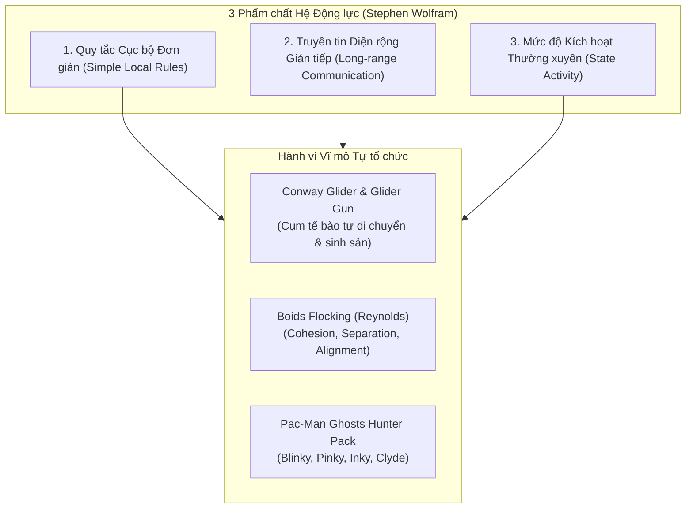
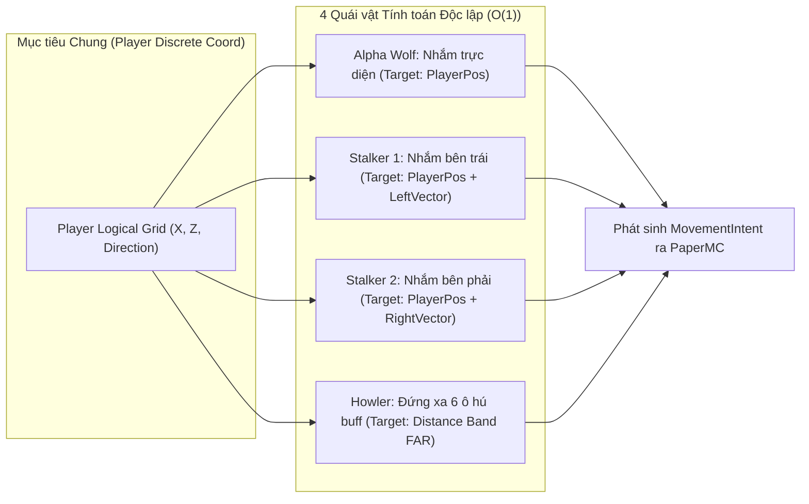

# Quy tắc Cục bộ, Tế bào Tự động và Trí tuệ Bầy đàn Phi tập trung

> **Tóm tắt (TL;DR):** Nghiên cứu về Tế bào Tự động (Wolfram, Conway's Game of Life) và Trí tuệ Bầy đàn (Flocking Birds, Pac-Man Ghosts) chỉ ra rằng: **Hành vi tập thể thông minh bậc cao có thể sinh ra từ các quy tắc cực kỳ đơn giản ở cấp độ cá thể mà không cần bất kỳ giao tiếp mạng nào giữa các thực thể.** Ứng dụng nguyên lý này vào Pure Java Core cho phép tạo ra AI quái vật D&D săn mồi phối hợp hoàn hảo với độ phức tạp $\mathcal{O}(1)$ mỗi tick.

---

## 1. Bài toán Cốt lõi (Core Problem & Intent)

- **Cái bẫy Hiệu năng của AI Game Server:** Nhiều server game cố gắng tạo ra quái vật "thông minh" bằng cách cho các entity liên tục gọi hàm giao tiếp, quét tìm nhau trong bán kính lớn và tính toán cây quyết định (Behavior Tree) cồng kềnh. Khi có 50–100 quái vật trong khu vực, vòng lặp Main Thread của PaperMC sẽ tụt dốc thảm hại vượt ngưỡng $50\text{ms}$/tick.
- **Mục tiêu Kiến trúc:** Đạt được ảo giác về sự phối hợp chiến thuật tinh vi (Emergent Collective Intelligence) nhưng với chi phí tính toán $\mathcal{O}(1)$ cho từng cá thể riêng biệt.

---

## 2. Nền tảng Lý thuyết: Từ Cellular Automata đến Pac-Man



### 2.1. Giải mã Ảo giác Phối hợp của Bóng ma Pac-Man
Nhiều thế hệ game thủ tin rằng 4 con ma trong Pac-Man phối hợp với nhau qua radio để giăng bẫy bắt người chơi. **Thực tế:** Chúng hoàn toàn câm điếc, không hề biết vị trí của nhau! Mỗi con chỉ tuân theo một quy tắc toán học cục bộ đơn giản:

| Bóng ma | Tên & Màu sắc | Quy tắc Cục bộ (Target Tile Logic) | Hiệu ứng Vĩ mô Hiển thị cho Người chơi |
|---|---|---|---|
| **Blinky** | Đỏ (Shadow) | Nhắm thẳng vào ô hiện tại của Pac-Man | Kẻ truy đuổi trực diện ráo riết từ phía sau |
| **Pinky** | Hồng (Speedy) | Nhắm vào vị trí **4 ô phía trước** hướng đi của Pac-Man | Kẻ đón đầu, phục kích ở khúc cua |
| **Inky** | Xanh (Bashful) | Lấy vector đối xứng giữa vị trí Blinky và 2 ô trước Pac-Man | Kẻ đánh gọng kìm (Flanker) từ bên hông |
| **Clyde** | Cam (Pokey) | Đuổi khi khoảng cách $> 8$ ô; tự bỏ chạy về góc khi $< 8$ ô | Kẻ gây nhiễu loạn, di chuyển khó đoán |

> **Đúc kết:** Sự kết hợp của 4 quy tắc bổ trợ lẫn nhau (Complementary Behaviors) tạo ra một đội săn mồi hoàn hảo mà không tốn bất kỳ chu kỳ CPU nào để đồng bộ giữa các entity.

---

## 3. Thiết kế Quái vật D&D "Pack Tactics" trong Pure Java Domain

Áp dụng cơ chế Pac-Man để hiện thực hóa quy tắc chiến thuật bầy đàn (Pack Tactics) của bầy Goblin hoặc Sói Underdark:



### 3.1. Triển khai Code Contract Pure Java (Không Giao tiếp Mạng)
```java
package com.game.engine.domain.ai.tactics;

public final class EmergentPackAI {
    public enum PackRole { ALPHA_CHASER, FLANKER_LEFT, FLANKER_RIGHT, DISTANT_HOWLER }

    public record TargetGridCoord(int x, int z) {}

    public static TargetGridCoord computeTarget(
            PackRole role,
            TargetGridCoord playerCoord,
            int playerFacingAngleDegree
    ) {
        // Hoàn toàn O(1) toán học thuần túy, không loop, không lock
        return switch (role) {
            case ALPHA_CHASER -> playerCoord; // Truy đuổi trực diện
            case FLANKER_LEFT -> new TargetGridCoord(playerCoord.x() - 3, playerCoord.z()); // Bọc sườn trái
            case FLANKER_RIGHT -> new TargetGridCoord(playerCoord.x() + 3, playerCoord.z()); // Bọc sườn phải
            case DISTANT_HOWLER -> new TargetGridCoord(playerCoord.x(), playerCoord.z() - 6); // Giữ khoảng cách
        };
    }
}
```

### 3.2. Ưu thế Vượt trội trong Kiến trúc Hexagonal
1. **Zero Garbage Collection Allocation:** Không khởi tạo object cây hành vi mỗi tick. Mọi phép tính tọa độ là hằng số nguyên.
2. **Tick Budget Thần tốc:** 100 quái vật tính toán đích đến trong chưa đầy $0.02\text{ms}$ (chỉ bằng $0.04\%$ ngân sách $50\text{ms}$ của PaperMC).
3. **Thẩm quyền Thuần túy:** Domain Core chỉ xuất ra `MovementIntent(entityId, targetX, targetZ)`. Việc raycast vượt địa hình được ủy thác cho Navigation Engine của PaperMC hoặc WebGL client.

---

## 4. Danh mục Tham chiếu (Wikilinks)
- Template áp dụng: `[[00_Templates/Tpl_Feature_Spec]]`
- Các hạt tri thức liên quan:
  - `[[01_Knowledge_Atoms/KA_Complexity_Edge_of_Chaos_and_Feedback_Loops]]`
  - `[[01_Knowledge_Atoms/KA_Emergence_Taxonomy_and_Expressive_Consistency]]`
  - `[[01_Knowledge_Atoms/KA_Mechanics_Five_Types_Classification]]`
- Quyết định kiến trúc tương ứng:
  - `[[03_ADR_Architecture/ADR_002_Spatial_Temporal_Quantization_and_Stateless_RNG]]`
  - `[[03_ADR_Architecture/ADR_003_Topological_Dungeon_Bitmask_and_Tactical_Event_Queue]]`
