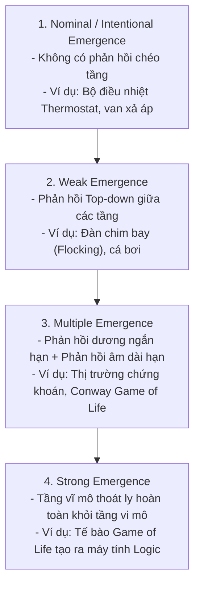

# Phân loại 4 Cấp độ Emergence và Nguyên lý "Nhất quán Thay vì Hiện thực"

> **Tóm tắt (TL;DR):** Jochen Fromm phân loại tính mới nổi (Emergence) thành 4 cấp độ: **Nominal $\to$ Weak $\to$ Multiple $\to$ Strong**. Đồng thời, Steven Poole và Harvey Smith chỉ ra nguyên lý sống còn của Game Design: **"Tính nhất quán quan trọng hơn Tính hiện thực" (Consistency over Realism)**. Trong Game Server, điều này đòi hỏi một hệ thống quy tắc biểu cảm trực giao (Orthogonal Expressive Mechanics) thay vì hàng trăm đoạn code xử lý tình huống riêng lẻ (Special-case patches).

---

## 1. Bài toán Cốt lõi (Core Problem & Intent)

- **Căn bệnh "Code Trường hợp Đặc biệt" (Special-Case Spaghetti):** Khi lập trình viên viết code theo kiểu: `if (player.hasRocket() && target.isWoodenDoor()) { door.break(); } else if (target.isBoss()) { ... }`. Cách viết này khiến hệ thống phình to, sinh bug kỳ quặc (tên lửa nổ bay được Boss nhưng không phá được cánh cửa gỗ mỏng) và triệt tiêu khả năng sáng tạo của người chơi.
- **Mục tiêu Kiến trúc:** Xây dựng một **Hệ thống Biểu cảm (Expressive System)** nhất quán. Khi một quy tắc vật lý/nguyên tố được định nghĩa, nó phải áp dụng bình đẳng cho mọi đối tượng trong thế giới game (bao gồm cả chính người chơi, như cơ chế Rocket Jumping).

---

## 2. Bốn Cấp độ Emergence của Jochen Fromm (2005)



| Cấp độ | Đặc điểm Cấu trúc | Ví dụ trong Tự nhiên / Đời sống | Ánh xạ vào Game Server Kiến trúc Hexagonal |
|---|---|---|---|
| **Nominal (Định danh)** | Cơ học, tất định, không có tính bất ngờ | Đồng hồ quả lắc, công tắc đèn | Các lệnh Inbound Port đơn giản: `DepositGoldCommand` |
| **Weak (Yếu)** | Cá thể nhận thức được trạng thái của bầy đàn | Đàn chim Boids, đàn cá | AI Quái vật D&D điều chỉnh mục tiêu theo vai trò bầy đàn (`EmergentPackAI`) |
| **Multiple (Đa tầng)** | Đan xen nhiều vòng lặp âm/dương | Thị trường chứng khoán, bong bóng tài sản | Hệ thống Chợ Đen D&D: Giá cả tự điều chỉnh theo cung - cầu và thuế hao mòn |
| **Strong (Mạnh)** | Hiện tượng cấp cao độc lập với cá thể cấp thấp | Ý thức sinh ra từ nơ-ron não bộ | Người chơi tự sáng tạo ra Meta chiến thuật phối hợp combo nguyên tố ngoài dự tính của Dev |

---

## 3. Nguyên lý "Consistency over Realism" (Steven Poole & Harvey Smith)

### 3.1. Người chơi không cần "Vật lý đời thực"
- Nếu làm game đua xe F1 với độ ma sát thực tế $100\%$, $99\%$ người chơi sẽ đâm vào tường ngay khúc cua đầu tiên và bỏ game.
- Người chơi muốn vũ khí Blaster trong Star Wars (đạn bay thấy được, phát sáng) chứ không phải tia Laser thực tế (vô hình và di chuyển bằng vận tốc ánh sáng).
- Cơ chế **Rocket Jumping** (Quake / Team Fortress) ban đầu là một hành vi phi thực tế ngoài ý muốn: Tên lửa nổ tạo ra lực đẩy lên mọi vật thể xung quanh $\to$ Người chơi bắn xuống đất để bay lên cao. Thay vì coi đó là bug và sửa lại, Harvey Smith coi đó là **đỉnh cao của tính biểu cảm (Expressive System)**.

### 3.2. Sự Ức chế sinh ra từ "Tính Bất Nhất" (Arbitrary Inconsistency)
- Người chơi tức giận khi: Một quả cầu lửa có thể thiêu rụi cả con Rồng, nhưng chạm vào mạng nhện ở góc tường lại không bén lửa.
- **Quy tắc vàng của Architect:** Nếu quy tắc $A$ áp dụng cho $Entity_1$, nó phải áp dụng nhất quán cho $Entity_2$ và Môi trường.

---

## 4. Hiện thực hóa Hệ thống Biểu cảm Trực giao (Orthogonal Mechanics)

Thay vì viết hàm kiểm tra theo danh tính đối tượng (`isPlayer`, `isDoor`, `isBoss`), Pure Java Domain Core định nghĩa các thuộc tính vật lý/nguyên tố trực giao:

```java
package com.game.engine.domain.mechanics.expressive;

public final class ForceInteractionResolver {
    
    public enum MaterialDensity { LIGHT_WOOD, REINFORCED_STONE, MYTHIC_IRON }
    public record ImpactForce(long forceMicroUnits, int blastRadiusBands) {}

    // Bất kỳ thực thể nào (Player, Quái, Cửa, Rương) đều xử lý qua chung 1 quy tắc nhất quán
    public static boolean resolveExplosionImpact(
            ImpactForce force,
            MaterialDensity density,
            long currentHpMicroUnits
    ) {
        long resistanceMultiplier = switch (density) {
            case LIGHT_WOOD -> 20_000L;       // Gỗ chịu áp lực kém, x2 sát thương nổ
            case REINFORCED_STONE -> 10_000L;  // Đá chịu áp lực chuẩn
            case MYTHIC_IRON -> 2_500L;        // Kim loại ma thuật cản 75% lực nổ
        };

        long effectiveDamage = Math.multiplyExact(force.forceMicroUnits(), resistanceMultiplier) / 10_000L;
        return effectiveDamage >= currentHpMicroUnits; // Trả về true nếu phá hủy hoàn toàn
    }
}
```

### Lợi thế Kiến trúc:
- **Zero Bug Phân biệt Đối xử:** Cửa gỗ bị tên lửa thổi bay, quái vật bị thổi bay, và người chơi đứng gần cũng bị đẩy lùi theo đúng công thức bảo toàn xung lực!
- **Tính Tất định $\mathcal{O}(1)$:** Giải quyết hoàn toàn bằng đại số số nguyên, loại bỏ các phép tính vi phân phức tạp của PaperMC ra khỏi Core.

---

## 5. Danh mục Tham chiếu (Wikilinks)
- Template áp dụng: `[[00_Templates/Tpl_Feature_Spec]]`
- Các hạt tri thức liên quan:
  - `[[01_Knowledge_Atoms/KA_Complexity_Edge_of_Chaos_and_Feedback_Loops]]`
  - `[[01_Knowledge_Atoms/KA_Emergence_Local_Rules_and_Flocking_AI]]`
  - `[[01_Knowledge_Atoms/KA_Mechanics_Discrete_vs_Continuous]]`
- Quyết định kiến trúc tương ứng:
  - `[[03_ADR_Architecture/ADR_002_Spatial_Temporal_Quantization_and_Stateless_RNG]]`
  - `[[03_ADR_Architecture/ADR_003_Topological_Dungeon_Bitmask_and_Tactical_Event_Queue]]`
