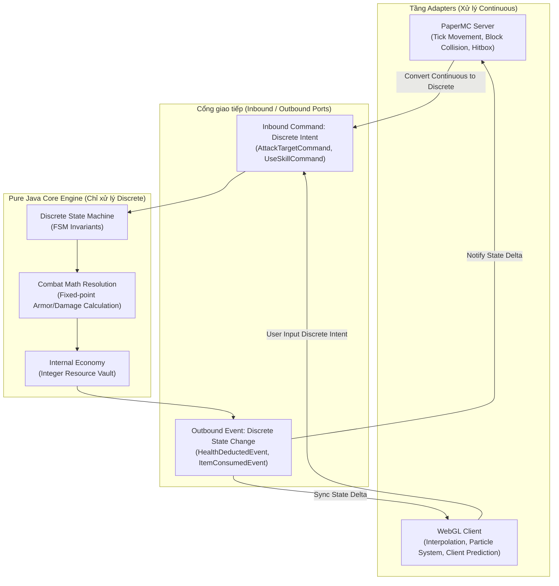

# Discrete Mechanics vs Continuous Mechanics trong Kiến trúc Game Server

> **Tóm tắt (TL;DR):** Cơ chế rời rạc (Discrete Mechanics) dựa trên số nguyên, hữu hạn trạng thái và quyết định chiến lược, độc lập với phương tiện; trong khi Cơ chế liên tục (Continuous Mechanics) dựa trên dấu phẩy động và vật lý thời gian thực. Đối với kiến trúc Game Server Hexagonal, **Pure Java Domain Core chỉ xử lý Discrete Mechanics** để đảm bảo tính tất định, ngân sách 50ms/tick và chống Desync.

---

## 1. Bài toán Cốt lõi (Core Problem & Intent)

Trong phát triển Game Server R&D đa nền tảng (kết hợp PaperMC và WebGL Client):
- **Xung đột tính toán:** Phép tính vật lý liên tục (Continuous) tiêu tốn chu kỳ CPU khổng lồ và dễ gây sai lệch dấu phẩy động (Floating-Point Non-Determinism) giữa các client hoặc giữa Server và Client.
- **Ràng buộc Tick Budget (50ms):** Nếu đưa toàn bộ tính toán va chạm, gia tốc, trajectory vào Domain Core, Game Server sẽ sụt TPS nhanh chóng khi lượng thực thể tăng.
- **Phân tách trách nhiệm:** Cần một ranh giới toán học rõ ràng để xác định: *Phần nào chạy trong Pure Java Core Engine? Phần nào ủy quyền cho PaperMC World Engine hoặc Client-side Rendering?*

---

## 2. Cơ chế Gốc (Original Mechanism / Theoretical Rule)

Theo Ernest Adams & Joris Dormans (*Game Mechanics*, Chapter 1):

1. **Continuous Mechanics (Cơ chế liên tục):**
   - Định nghĩa: Mô phỏng không gian, thời gian và động lực học (Physics, Collision, Movement trajectory, Timing/Rhythm).
   - Kiểu dữ liệu: Giá trị thực phân số (Fractional/Floating-point numbers), tọa độ pixel/sub-pixel liên tục.
   - Đặc tính: Phụ thuộc chặt chẽ vào phần cứng và môi trường chạy (Media-dependent); đòi hỏi năng lực tính toán tốc độ cao.
   - Trải nghiệm người chơi: Thử thách kỹ năng phản xạ (Dexterity), phối hợp tay-mắt (Hand-eye coordination).

2. **Discrete Mechanics (Cơ chế rời rạc):**
   - Định nghĩa: Các quy tắc chuyển đổi trạng thái hữu hạn, giao dịch tài nguyên kinh tế, lượt chơi, cấp độ, chỉ số.
   - Kiểu dữ liệu: Số nguyên rời rạc (Integers, Enums, Finite States). Trong game không thể nhặt "nửa bình máu" hay lên "0.3 level".
   - Đặc tính: Độc lập với phương tiện (Media-independent) — có thể hiện thực bằng bài giấy (Board game), code Java trên server, hoặc WebGL client mà quy tắc vẫn không đổi.
   - Trải nghiệm người chơi: Kích thích tư duy chiến lược, suy đoán dài hạn (Look-ahead planning).

---

## 3. Mô hình Toán học & Luồng Trạng thái (Math & State Flow)

### 3.1. Phân loại Toán học

| Tiêu chí | Continuous Mechanics | Discrete Mechanics |
|---|---|---|
| **Không gian trạng thái** | Vô hạn liên tục ($S \subseteq \mathbb{R}^n$) | Hữu hạn / Rời rạc đếm được ($S \subseteq \mathbb{Z}^n$) |
| **Hàm chuyển trạng thái** | Vi phân theo thời gian $\frac{ds}{dt} = v(t)$ | Ánh xạ rời rạc $S_{t+1} = f(S_t, Command)$ |
| **Sai số tính toán** | Sai số dấu phẩy động (IEEE 754 drift) | Không có sai số làm tròn (Exact Integer Arithmetic) |
| **Khả năng Replay/Audit** | Khó đạt 100% trên các nền tảng khác nhau | Tất định 100% với cùng Input Stream & Seed |

### 3.2. Sơ đồ Ranh giới Kiến trúc (Hexagonal Isolation)



---

## 4. Ứng dụng vào Kiến trúc Game Server của Dự án

### 4.1. Quy tắc Bất biến cho Domain Core
1. **Tuyệt đối không dùng `float` / `double` cho tài nguyên và trạng thái:** Sử dụng `long` hoặc mô hình Fixed-Point Arithmetic (nhân 1,000 hoặc 10,000) để đại diện cho xác suất và tỷ lệ phần trăm.
2. **Khống chế thời gian thực thi $\mathcal{O}(1)$:** Vì là Discrete Logic, mỗi giao dịch kinh tế hoặc giải quyết đòn đánh chỉ là biến đổi đại số rời rạc, hoàn tất trong $< 0.01\text{ms}$.
3. **Chống Desync Server-Client:** Client WebGL có thể chạy continuous animation và visual interpolation thoải mái, nhưng thẩm quyền chân lý (Server Authority) thuộc về trạng thái Discrete được chốt bởi Domain Core.

### 4.2. Phòng chống Lỗ hổng Cắt số dư (Integer Truncation Exploit)
> ⚠️ **Bẫy kỹ thuật (Exploit Hunter Warning):** Khi chia số nguyên (`/ 10_000L`), Java luôn làm tròn xuống 0 (`truncate towards zero`). Kẻ gian có thể chia nhỏ giao dịch (ví dụ bán lẻ từng đơn vị giá 19 vàng với thuế 5%) để triệt tiêu toàn bộ thuế: `(19 * 500) / 10_000 = 9500 / 10_000 = 0`.

**Hai giải pháp bắt buộc trong Domain Core:**
1. **Làm tròn Bất đối xứng (Asymmetric Rounding):** 
   - Mọi khoản **Thuế / Chi phí trừ** phải làm tròn lên bằng `Math.ceilDiv(dividend, divisor)`.
   - Mọi khoản **Phần thưởng / Sát thương cộng thêm** thì làm tròn xuống hoặc tích lũy phần dư.
2. **Đơn vị Tiền tệ Nội bộ (Internal Micro-Currency):** 
   - Trong RAM và Database: `1 Vàng (Display) = 10,000 Micro-Gold (Internal)`. Mọi phép tính phần trăm diễn ra nguyên vẹn, chỉ chia 10,000 khi đẩy ra Outbound Adapter để hiển thị trên UI.

```java
package com.game.engine.domain.mechanics.model;

public record DiscreteAttribute(long baseMicroUnits, long modifierBasisPoints) {
    // 1 Basis Point (bp) = 0.01% (10,000 bp = 100.00%)
    
    // Tính sát thương / buff (làm tròn xuống chuẩn)
    public long calculateEffectiveValue() {
        long delta = Math.multiplyExact(baseMicroUnits, modifierBasisPoints) / 10_000L;
        return Math.addExact(baseMicroUnits, delta);
    }

    // Tính thuế / chi phí trừ người chơi (bắt buộc thu tối thiểu 1 đơn vị bằng Math.ceilDiv)
    public static long calculateTax(long priceMicroUnits, long taxRateBasisPoints) {
        return Math.ceilDiv(Math.multiplyExact(priceMicroUnits, taxRateBasisPoints), 10_000L);
    }
}
```

---

## 5. Danh mục Tham chiếu (Wikilinks)
- Template áp dụng: `[[00_Templates/Tpl_Feature_Spec]]`
- Các hạt tri thức liên quan:
  - `[[01_Knowledge_Atoms/KA_Mechanics_Five_Types_Classification]]`
  - `[[01_Knowledge_Atoms/KA_Mechanics_Three_Sources_of_Unpredictability]]`
- Quyết định kiến trúc tương ứng: `[[03_ADR_Architecture/ADR_001_Hexagonal_Domain_Separation]]`
