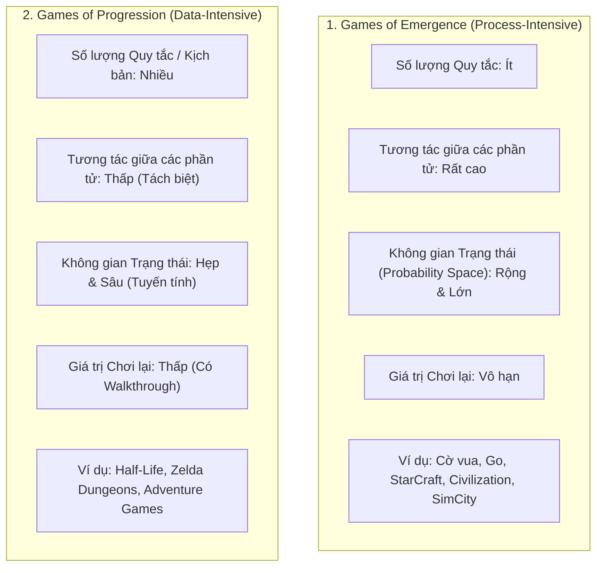
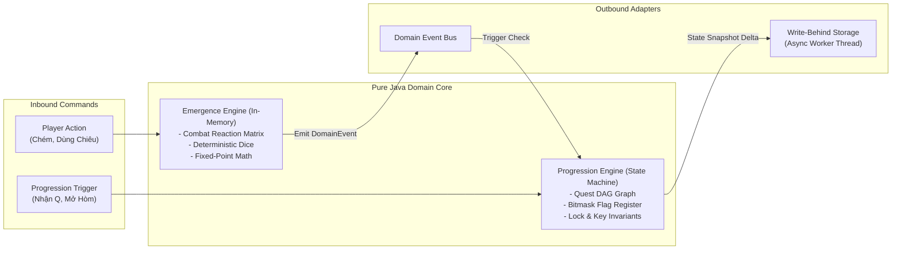

# Emergence vs Progression: Tính toán Chuyên sâu và Dữ liệu Chuyên sâu

> **Tóm tắt (TL;DR):** Jesper Juul và Chris Crawford phân chia game thành hai cấu trúc đối lập: **Games of Emergence** (Quy tắc ít, tương tác nhiều, xác suất rộng - *Process-Intensive*) và **Games of Progression** (Thử thách tuần tự, rào chắn khóa - chìa, cốt truyện tuyến tính - *Data-Intensive*). Trong Game Server, Emergence được xử lý bằng ma trận toán học $\mathcal{O}(1)$ trong RAM, còn Progression được quản lý bằng đồ thị trạng thái DAG kết hợp Bitmask lưu trữ bất đồng bộ.

---

## 1. Bài toán Cốt lõi (Core Problem & Intent)

Khi thiết kế Game Server MMO / RPG thời gian thực:
- **Nghịch lý Hiệu năng vs Nội dung:** Nếu xây dựng game thuần **Progression** (nhiệm vụ nối tiếp, hàng nghìn kịch bản scripted), server sẽ phình to dữ liệu (Data-Intensive), người chơi "phá đảo" trong vài tuần là chán, giá trị chơi lại (Replay Value) bằng $0$.
- Nếu xây dựng game thuần **Emergence** (như cờ vua, sandbox thuần túy), người chơi dễ mất phương hướng do thiếu mục tiêu dài hạn, khó dẫn dắt người chơi mới qua tutorial.
- **Mục tiêu Kiến trúc:** Phân tách rạch ròi 2 cỗ máy:
  1. *Emergence Engine:* Chịu trách nhiệm tạo chiều sâu chiến lược không giới hạn từ số lượng quy tắc tối giản.
  2. *Progression Engine:* Chịu trách nhiệm kiểm soát tốc độ tiếp cận nội dung (Content Pacing), rào chắn an toàn và lưu trữ trạng thái lâu dài.

---

## 2. Bản chất Lý thuyết: Emergence vs Progression

### 2.1. Khái niệm Rào cản Phức hợp (The Complexity Barrier)
Adams & Dormans chứng minh rằng: **Không phải cứ thêm nhiều quy tắc là game sẽ hay hơn.**
- So sánh giữa **Tic-Tac-Toe** và **Connect Four**: Connect Four chỉ thêm đúng 2 quy tắc (lưới $7 \times 6$ và trọng lực kéo quân cờ xuống đáy), nhưng không gian trạng thái bùng nổ vượt qua *Complexity Barrier*, biến một trò chơi trẻ con thành một môn đấu trí chiến lược cho người lớn.
- **Nguyên lý cho Server Core:** Thay vì viết 100 hàm `if-else` cho từng kỹ năng, hãy thiết kế một số lượng nhỏ các luật tương tác cơ bản (phản ứng nguyên tố, khắc chế vũ khí) để tính phức hợp tự sinh ra (*Emergent Depth*).

### 2.2. So sánh Toàn diện (Table 2.1)

| Tiêu chí | Mechanics of Emergence | Mechanics of Progression |
|---|---|---|
| **Bản chất tính toán** | **Process-Intensive** (Tính toán tức thời từ quy tắc) | **Data-Intensive** (Đọc nạp kịch bản, vị trí, hội thoại) |
| **Dung lượng lưu trữ** | Cực nhỏ ($< 1\text{KB}$ dữ liệu quy tắc) | Rất lớn (Hàng MB/GB cấu hình, lời thoại, map data) |
| **Kiểm soát của Designer**| Thấp (Không thể đoán trước mọi thế trận) | Rất cao (Kiểm soát chặt chẽ trải nghiệm từng bước) |
| **Đường cong học tập** | Dốc (Đòi hỏi người chơi tự khám phá) | Mềm mại (Có thể chia nhỏ làm Tutorial) |

---

## 3. Kiến trúc Phân tầng trong Pure Java Domain Core

Để tích hợp hoàn hảo cả hai trường phái mà không gây nghẽn vòng lặp $50\text{ms}$/tick:

### 3.1. Emergence Engine: Tối ưu Hóa Tuyệt đối cho CPU ($\mathcal{O}(1)$)
- Toàn bộ luật Emergence (Combat, Buff, Nguyên tố) nằm trong RAM dưới dạng mảng byte hoặc ma trận bitmask.
- Thời gian tính toán $< 0.005\text{ms}$ mỗi đòn đánh.
- Không bao giờ chạm vào đĩa cứng hoặc cơ sở dữ liệu.

### 3.2. Progression Engine: Tối ưu Hóa Dữ liệu bằng Bitmask Register
- Tiến trình của người chơi (đã mở cửa A, đã cứu NPC B, đã hoàn thành ải C) được mã hóa thành các chuỗi **Bitmask** (`long questBitmask`):
  - Kiểm tra mở khóa: `boolean isUnlocked = (playerFlags & REQUIRED_LOCK_MASK) == REQUIRED_LOCK_MASK;` $\rightarrow$ Độ phức tạp $\mathcal{O}(1)$, tiêu tốn $8\text{ bytes}$ RAM cho 64 nhiệm vụ.
- Khi trạng thái Progression thay đổi, bắn Domain Event và đẩy vào hàng đợi ghi bất đồng bộ (Write-Behind Queue) ra PostgreSQL / Redis. Không bao giờ chặn Tick Thread!

---

## 4. Danh mục Tham chiếu (Wikilinks)
- Template áp dụng: `[[00_Templates/Tpl_Feature_Spec]]`
- Các hạt tri thức liên quan:
  - `[[01_Knowledge_Atoms/KA_Mechanics_Discrete_vs_Continuous]]`
  - `[[01_Knowledge_Atoms/KA_Mechanics_Five_Types_Classification]]`
  - `[[01_Knowledge_Atoms/KA_Progression_Lock_Key_and_Hub_Spoke]]`
  - `[[01_Knowledge_Atoms/KA_Architecture_Hybrid_Emergence_Progression]]`
- Quyết định kiến trúc tương ứng:
  - `[[03_ADR_Architecture/ADR_001_Hexagonal_Domain_Separation]]`
  - `[[03_ADR_Architecture/ADR_002_Spatial_Temporal_Quantization_and_Stateless_RNG]]`
