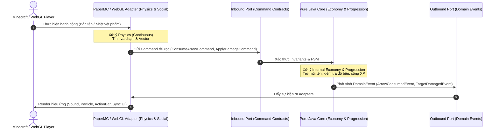

# Phân loại 5 Dạng Cơ chế Game và Ánh xạ Tầng Kiến trúc Hexagonal

> **Tóm tắt (TL;DR):** Ernest Adams & Joris Dormans phân loại toàn bộ cơ chế game thành 5 dạng: **Physics**, **Internal Economy**, **Progression Mechanisms**, **Tactical Maneuvering**, và **Social Interaction**. Trong kiến trúc Hexagonal, từng dạng cơ chế được phân công chính xác vào các tầng xử lý riêng biệt để tối ưu hóa hiệu năng $50\text{ms}$/tick và tái sử dụng mã nguồn.

---

## 1. Bài toán Cốt lõi (Core Problem & Intent)

Một Game Server phức tạp rất dễ rơi vào tình trạng "Spaghetti Code" (Coupling cao) khi trộn lẫn logic:
- Trộn lẫn logic trừ máu (Internal Economy) với kiểm tra va chạm hitbox (Physics).
- Trộn lẫn logic mở cổng/qua ải (Progression) với việc gửi gói tin chat liên minh (Social).
- **Mục tiêu kiến trúc:** Phân định rõ ràng trách nhiệm của từng dạng cơ chế vào đúng tầng Domain, Adapter PaperMC hoặc Network Adapter.

---

## 2. Bản chất 5 Dạng Cơ chế Game (The 5 Types of Mechanics)

### 2.1. Physics (Cơ chế Vật lý)
- **Định nghĩa:** Khoa học về chuyển động và lực trong thế giới game (vị trí, vận tốc, trọng lực, va chạm, timing, nhịp điệu).
- **Đặc trưng:** Tính toán liên tục, tốn kém tài nguyên CPU, thường sử dụng Cartoon Physics thay vì vật lý Newton thuần túy.

### 2.2. Internal Economy (Cơ chế Kinh tế Nội tại)
- **Định nghĩa:** Các giao dịch thu thập, tiêu thụ, chuyển đổi và trao đổi tài nguyên giữa các thực thể game.
- **Phân loại tài nguyên:**
  - *Hữu hình (Tangible):* Tiền vàng, ngọc, đạn dược, trang bị, vật liệu.
  - *Vô hình (Intangible):* Điểm máu (HP), năng lượng (Mana/Stamina), điểm kinh nghiệm (XP), điểm danh vọng, điểm kỹ năng.

### 2.3. Progression Mechanisms (Cơ chế Thăng tiến)
- **Định nghĩa:** Các cơ chế kiểm soát lộ trình vượt ải và mở khóa nội dung (Locks & Keys, công tắc, điều kiện nhiệm vụ, cây kỹ năng).
- **Đặc trưng:** Mô hình đồ thị có hướng (Directed Graph) hoặc State Machine xác định trạng thái mở/khóa.

### 2.4. Tactical Maneuvering (Cơ chế Điều động Chiến thuật)
- **Định nghĩa:** Bố trí vị trí các đơn vị trên bản đồ để giành lợi thế tấn công hoặc phòng thủ (tầm đánh, góc khuất tầm nhìn - Line of Sight, địa hình cao/thấp, grid tiles).
- **Đặc trưng:** Rời rạc hóa không gian thành các ô (Tiles/Hexes) để giảm độ phức tạp tính toán.

### 2.5. Social Interaction (Cơ chế Tương tác Xã hội)
- **Định nghĩa:** Các quy tắc điều phối hành vi giữa người chơi thật (Giao dịch P2P, thành lập bang hội, liên minh/phản bội, tặng quà, cơ chế chống thông đồng - Anti-collusion).

---

---

## 3. Ma trận Phân tầng Kiến trúc Hexagonal (Architecture Mapping Matrix)

| Dạng cơ chế | Trọng tâm dữ liệu | Tầng chịu trách nhiệm chính | Cổng giao tiếp (Ports) | Ghi chú hiệu năng |
|---|---|---|---|---|
| **Physics** | Continuous floats, Vectors, Bounding Boxes | **PaperMC / Client Adapter** | Outbound Event (Raycast, Movement validation) | Ủy thác cho engine nền; Domain chỉ nhận tọa độ rời rạc |
| **Internal Economy** | Discrete Integers, Balances, Inventory slots | **Pure Java Domain Core** | Inbound Port: `ExecuteTransactionUseCase` | $\mathcal{O}(1)$ xử lý giao dịch; Write-Behind Async Storage |
| **Progression** | Booleans, Bitmasks, Quest States | **Pure Java Domain Core** | Inbound Port: `AdvanceProgressionUseCase` | Bitwise operations tối ưu bộ nhớ |
| **Tactical Maneuvering** | Chunk coords, Discrete Grid Cells | **Phối hợp:** Domain (Grid rules) + PaperMC (Spatial index) | Inbound Port: `EvaluateTacticalBonusPort` | Tránh quét toàn bộ entity; dùng Spatial Hashing / Octree |
| **Social Interaction** | Session UUIDs, Channels, Friend graphs | **Phối hợp:** Domain (Trust/Rule) + WebSocket Netty (Chat/Broadcast) | Inbound Port: `FormAllianceCommand` | Tách biệt hoàn toàn khỏi Tick Thread chính |

### 3.1. Tầng Lượng tử hóa Không gian & Thời gian (Spatial-Temporal Quantizer)
Để không phá vỡ nguyên tắc "Pure Java Domain chỉ nhận giá trị rời rạc", tại các **Inbound Ports** bắt buộc phải có một bộ biến đổi (Quantizer):

1. **Lượng tử hóa Không gian (Spatial Quantization):**
   - Tọa độ `double x, y, z` và vector hướng của PaperMC/WebGL được lượng tử hóa thành Enums trước khi vào Domain:
     - Góc tấn công: `RelativeAngle { FRONT, FLANK, BACKSTAB }`.
     - Khoảng cách: `DistanceBand { MELEE, NEAR, FAR, OUT_OF_RANGE }`.
     - Chênh lệch độ cao: `Elevation { LOW_GROUND, LEVEL, HIGH_GROUND }`.
2. **Lượng tử hóa Thời gian (Temporal Quantization):**
   - **Cấm tuyệt đối `System.currentTimeMillis()` trong Domain Core** (vì biến liên tục phá hỏng tính Deterministic Replay).
   - Mọi Cooldown, Buff duration, Tick rate trong Domain chỉ được đo đếm bằng đơn vị số nguyên rời rạc: **`long logicalTick`** ($1\text{ tick} = 1\text{ đơn vị}$).

```java
package com.game.engine.domain.quantizer;

public final class SpatialQuantizer {
    public enum DistanceBand { MELEE, NEAR, FAR, OUT_OF_RANGE }
    public enum RelativeAngle { FRONT, FLANK, BACKSTAB }

    public static DistanceBand quantizeDistance(double euclideanDistance) {
        if (euclideanDistance <= 2.5) return DistanceBand.MELEE;
        if (euclideanDistance <= 8.0) return DistanceBand.NEAR;
        if (euclideanDistance <= 24.0) return DistanceBand.FAR;
        return DistanceBand.OUT_OF_RANGE;
    }
}
```

---

## 4. Sơ đồ Tương tác Đa Tầng (Mermaid Architecture Flow)



---

## 5. Danh mục Tham chiếu (Wikilinks)
- Template áp dụng: `[[00_Templates/Tpl_Feature_Spec]]`
- Các hạt tri thức liên quan:
  - `[[01_Knowledge_Atoms/KA_Mechanics_Discrete_vs_Continuous]]`
  - `[[01_Knowledge_Atoms/KA_Mechanics_Three_Sources_of_Unpredictability]]`
- Quyết định kiến trúc tương ứng: `[[03_ADR_Architecture/ADR_001_Hexagonal_Domain_Separation]]`
