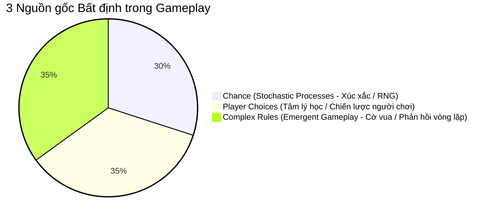
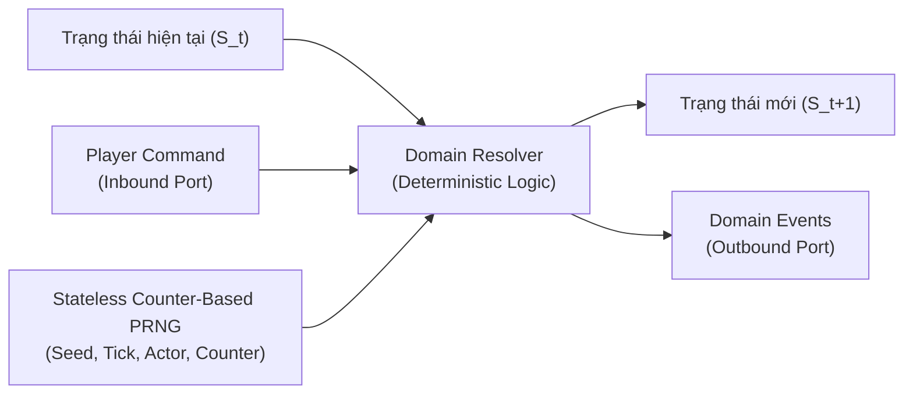

# 3 Nguồn gốc Bất định trong Game và Thiết kế Deterministic Domain Engine

> **Tóm tắt (TL;DR):** Sự hấp dẫn và bất định (Unpredictability) của một trò chơi đến từ 3 nguồn: **Chance (Xác suất ngẫu nhiên)**, **Player Choices (Quyết định của người chơi)**, và **Complex Rules (Quy tắc tương tác phức hợp/Emergence)**. Để xây dựng Game Server chống gian lận, có thể tái lập (Replayable) và kiểm thử $100\%$, tầng Domain Core phải được mô hình hóa thành một cỗ máy trạng thái tất định (Deterministic State Machine).

---

## 1. Bài toán Cốt lõi (Core Problem & Intent)

- **Bài toán chống gian lận & Tranh chấp:** Nếu server xử lý xác suất bằng các hàm ngẫu nhiên ngẫu nhiên không dấu vết (`Math.random()`), hệ thống không thể tái hiện lại trận đánh để điều tra bug, không thể verify trạng thái giữa Server và Client, và không thể viết Unit Test kiểm thử edge cases chính xác.
- **Bài toán cân bằng gameplay:** Game chỉ dựa vào Chance sẽ thành cờ bạc (Casino); game chỉ dựa vào Player Choices có thể rơi vào thế bế tắc (Stalemate); game dựa vào Complex Rules tạo ra chiều sâu chiến lược nhưng khó thiết kế và cân bằng.

---

## 2. Ba Nguồn gốc Bất định (The Three Sources of Unpredictability)



### 2.1. Chance (Yếu tố Ngẫu nhiên / Stochastic Processes)
- **Bản chất:** Sử dụng xác suất để tạo ra kết quả không thể đoán trước (Tung xúc xắc, quay số, critical hit, drop rate).
- **Ưu/Nhược điểm:** Cực kỳ dễ hiện thực trong mã nguồn, nhưng nếu lạm dụng, người chơi sẽ cảm thấy kỹ năng của mình vô nghĩa (Lack of agency).

### 2.2. Player Choices (Quyết định của Người chơi)
- **Bản chất:** Sự bất định đến từ tâm lý, đoán định đối phương (Ví dụ: Trò oẳn tù tì - Rock-Paper-Scissors, đi nước bí mật trong cờ Diplomacy).
- **Ứng dụng:** Thiết kế cơ chế khắc chế lẫn nhau (Rock-Paper-Scissors balance matrix) và các hành động đồng thời (Simultaneous turn resolution).

### 2.3. Complex Rules (Hệ quy tắc Phức hợp - Emergent Complexity)
- **Bản chất:** Từng luật riêng lẻ thì cực kỳ đơn giản, nhưng khi kết hợp hàng chục luật với nhau thì tạo ra hành vi phức tạp ngoài dự đoán (Ví dụ điển hình: Cờ vua - mỗi quân cờ có luật đi đơn giản, nhưng tổng thể có $10^{120}$ thế cờ).
- **Ưu điểm lớn nhất:** Tạo ra chiều sâu chiến lược cao nhất mà không cần dựa vào may rủi.

### 2.4. Tránh Bẫy "Casino D&D": Chuyển từ Pure Chance sang Complex Rules
- **Vấn đề với D&D truyền thống:** Trên bàn giấy, tung $d20$ để xem đòn đánh có trúng không ($AC - Armor Class$). Nhưng trong game hành động Minecraft/WebGL, nếu chém trúng quái trên màn hình mà đổ xúc xắc trượt dẫn đến $0$ sát thương, người chơi sẽ cực kỳ ức chế.
- **Giải pháp chuyển dịch:** 
  - Đòn đánh chạm hitbox $\rightarrow$ **Gây sát thương nền tất định $100\%$**.
  - Xúc xắc và chỉ số D&D $\rightarrow$ **Kích hoạt Hiệu ứng Trạng thái Phức hợp (Emergent Status Reactions)**. Ví dụ: Mục tiêu dính trạng thái `WET` gặp kiếm hệ `LIGHTNING` sẽ kích hoạt nổ diện rộng (AoE) theo luật tất định.

---

## 3. Chuyển hóa sang Kiến trúc Deterministic Pure Java Core

Để biến một trò chơi chứa xác suất và quyết định người chơi thành một hệ thống **Tất định (Deterministic)** trên Server:

### 3.1. Mô hình Games as State Machines (FSM)
Toàn bộ trò chơi là một cỗ máy trạng thái:
$$S_{t+1} = \mathcal{T}(S_t, \text{Command}_t, \text{RNG}_t)$$

Trong đó:
- $S_t$: Trạng thái hiện tại của thực thể / phòng chơi tại tick $t$.
- $\text{Command}_t$: Tập hợp các lệnh đã được validate từ Inbound Port.
- $\text{RNG}_t$: Giá trị ngẫu nhiên sinh ra từ một `Stateless Counter-Based PRNG` không mang biến trạng thái ngầm.



### 3.2. Bẫy Kỹ thuật: Tại sao Mutable RNG (SplittableRandom) phá vỡ Replay?
> ⚠️ **Bẫy kỹ thuật:** Các lớp sinh số như `java.util.Random` hay `SplittableRandom` chứa **trạng thái biến đổi ngầm (Internal Mutable State)**. Khi nhiều thực thể gọi `nextInt()` trong cùng một Tick, chỉ cần thứ tự lặp (Iteration order của HashMap) bị lệch, toàn bộ chuỗi ngẫu nhiên của cả trận đấu sẽ bị phá vỡ! Đồng thời, ta không thể trích xuất seed ở giữa trận đấu để lưu trữ vào Snapshot.

### 3.3. Giải pháp: Stateless Counter-Based RNG (Kỹ thuật SplitMix64)
Sử dụng hàm băm toán học thuần túy (Pure Function) không trạng thái. Cùng bộ tham số `(matchSeed, tick, actorId, rollIndex)` luôn cho ra chính xác 1 kết quả duy nhất trên mọi thread:

```java
package com.game.engine.domain.common.random;

public final class DeterministicDice {
    // Thuần túy không chứa bất kỳ mutable field nào -> 100% Thread-safe
    public static int roll(long matchSeed, long currentTick, long actorId, int rollIndex, int min, int max) {
        long z = matchSeed 
               + (currentTick * 0x9E3779B97F4A7C15L) 
               + (actorId * 0xBF58476D1CE4E5B9L) 
               + rollIndex;
        z = (z ^ (z >>> 30)) * 0xBF58476D1CE4E5B9L;
        z = (z ^ (z >>> 27)) * 0x94D049BB133111EBL;
        z = z ^ (z >>> 31);

        long range = (long) max - min + 1;
        return (int) (min + Long.remainderUnsigned(z, range));
    }
}
```

---

## 4. Ứng dụng trong Kiểm thử JUnit 5 & Chống Exploit

1. **Deterministic Unit Testing (TC Replay 100%):**
   - Khi viết JUnit 5 Test cho một công thức Combat có yếu tố chí mạng (Critical Hit), ta truyền một Mock/Seeded `RandomProvider` cố định. Test case sẽ chạy ra cùng một kết quả trên mọi máy build CI/CD.
2. **Replay Engine phục vụ Tố cáo / Hack Detection:**
   - Server chỉ cần lưu lại: `InitialStateSnapshot + InitialSeed + CommandList`. Khi có khiếu nại hack đồ, server chạy lại vòng lặp giả lập không tốn $1\text{ms}$ để kết luận kết quả.
3. **Phòng vệ Race Conditions:**
   - Nếu hai người chơi tung đòn cùng một tick, thuật toán phân xử sẽ dựa trên `PlayerId` hoặc `PriorityQueue` tất định, loại bỏ tranh chấp không xác định của luồng CPU.

---

## 5. Danh mục Tham chiếu (Wikilinks)
- Template áp dụng: `[[00_Templates/Tpl_Feature_Spec]]`
- Các hạt tri thức liên quan:
  - `[[01_Knowledge_Atoms/KA_Mechanics_Discrete_vs_Continuous]]`
  - `[[01_Knowledge_Atoms/KA_Mechanics_Five_Types_Classification]]`
- Quyết định kiến trúc tương ứng: `[[03_ADR_Architecture/ADR_001_Hexagonal_Domain_Separation]]`
