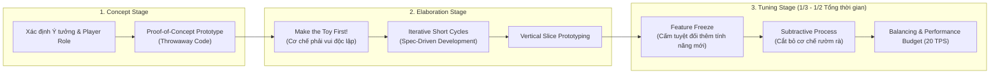

# Chiến lược Prototyping, Make the Toy First và Quy trình R&D Game Server

> **Tóm tắt (TL;DR):** Quy trình phát triển cơ chế game gồm 3 giai đoạn: **Concept** $\rightarrow$ **Elaboration** (với triết lý *Make the Toy First*) $\rightarrow$ **Tuning** (Giai đoạn trừ bớt - Subtractive & Feature Freeze). Việc lựa chọn đúng hình thức Prototype (Paper, Software, Vertical Slice) và mời các "Power Gamers" tìm kiếm lỗ hổng/dupe ngay từ giai đoạn đầu là chìa khóa để hoàn thiện Game Server trước khi đầu tư vào đồ họa.

---

## 1. Bài toán Cốt lõi (Core Problem & Intent)

- **Rủi ro lớn nhất trong R&D Game:** Dành hàng tháng trời dựng server PaperMC, viết plugin đồ họa, vẽ giao diện WebGL hoành tráng, chỉ để nhận ra: *Cơ chế cốt lõi chơi không vui, kinh tế game bị lạm phát không thể cứu vãn, hoặc xuất hiện lỗi nhân bản tài nguyên (Dupe) ở cấp độ kiến trúc.*
- **Mục tiêu:** Áp dụng phương pháp làm mẫu thử nghiệm (Prototyping) cực nhanh với chi phí thấp nhất, cô lập rủi ro và thẩm định tính cân bằng toán học trước khi viết code phức tạp.

---

## 2. Quy trình 3 Giai đoạn Thiết kế Cơ chế Game



### 2.1. Concept Stage (Giai đoạn Khái niệm)
- Chốt tầm nhìn cốt lõi và vai trò người chơi.
- Làm Prototype thử nghiệm chấp nhận "vứt bỏ" (Throwaway prototype) để kiểm chứng giả định nhanh nhất.

### 2.2. Elaboration Stage (Giai đoạn Mở rộng & Hiện thực hóa)
- Áp dụng nguyên lý của Kyle Gabler: **"Make the Toy First"** — Cơ chế phải tạo ra cảm giác thích thú ngay cả khi chưa có đồ họa, chưa có màn chơi, chưa có cốt truyện. Nếu một cơ chế rút bài, bấm chiêu hay giao dịch tự nó không thú vị thì việc đắp thêm hiệu ứng visual cũng không thể cứu vãn.
- Làm việc theo các chu kỳ lặp ngắn (Short Iterative Cycles) thông qua **Vertical Slice** (Cắt dọc một tính năng: Từ Domain Model $\rightarrow$ JUnit Test $\rightarrow$ Adapter PaperMC $\rightarrow$ WebGL demo).

### 2.3. Tuning Stage (Giai đoạn Tinh chỉnh & Cân bằng)
- **Feature Freeze:** Khi đã khóa tính năng, **tuyệt đối không thêm cơ chế mới**, vì một thay đổi nhỏ ở giai đoạn này có thể gây hiệu ứng bướm (butterfly effect) phá vỡ toàn bộ cân bằng kinh tế và độ trễ server.
- **Quy trình Trừ lùi (Subtractive Process):** Lọc bỏ những cơ chế thừa thãi, gây rối mắt hoặc làm tốn CPU.
- Thời gian cho Tuning chiếm từ **$33\%$ đến $50\%$** tổng thời hạn dự án.

---

## 3. Các Hình thức & Tiêu điểm Prototype (Prototype Focus)

### 3.1. Phân biệt Vertical Slice vs Horizontal Slice
- **Vertical Slice:** Đi xuyên qua mọi tầng kiến trúc (Domain, Port, Adapter, UI) của **đúng 1 tính năng nhỏ** (ví dụ: Tính năng Đánh boss - tính sát thương, trừ đồ, bắn event). Cực kỳ hữu ích để đo lường độ trễ thực tế ($50\text{ms}$/tick).
- **Horizontal Slice:** Hiện thực toàn bộ một tầng (ví dụ: Vẽ xong toàn bộ UI nhưng bên dưới không có logic chạy). Dễ gây ảo tưởng về tiến độ.

### 3.2. Tiêu điểm Kiểm thử Kinh tế Game (Game Economy Testing)
Theo Adams & Dormans, đối tượng kiểm thử tốt nhất cho nền kinh tế game không phải người chơi thông thường, mà là các **Power Gamers / Exploit Hunters**:
- Đặt câu hỏi: *Có chiến lược thống trị (Dominant Strategy) nào luôn thắng không?*
- Yêu cầu họ: *"Hãy tìm mọi cách phá nát nền kinh tế này, tìm mọi kẽ hở để gian lận hoặc farm vô hạn tài nguyên."*

---

## 4. Ứng dụng Thực chiến vào Dự án Game Server Hexagonal

```
┌────────────────────────────────────────────────────────────────────────┐
│ Giai đoạn 1: Paper / Headless CLI Prototype                           │
│ - Dùng Java Console App hoặc Test Suite mô phỏng Monte Carlo 100,000   │
│   lần tung xúc xắc / giao dịch kinh tế.                                │
│ - Chưa cần cài PaperMC server, chưa cần WebGL client.                  │
└──────────────────────────────────┬─────────────────────────────────────┘
                                   ▼
┌────────────────────────────────────────────────────────────────────────┐
│ Giai đoạn 2: Vertical Slice SDD (Pure Java Domain Core)               │
│ - Viết Spec trong docs-vault/02_GDD_Specs/.                            │
│ - Viết JUnit 5 Suite kiểm thử Invariants, Overflow, Concurrency.       │
│ - Triển khai Domain Service & Records hoàn tất.                        │
└──────────────────────────────────┬─────────────────────────────────────┘
                                   ▼
┌────────────────────────────────────────────────────────────────────────┐
│ Giai đoạn 3: Adapter Binding & Real-time Integration                   │
│ - Nối Inbound/Outbound Ports với PaperMC Event Listeners.              │
│ - Nối WebSocket Protocol với WebGL Client.                             │
│ - Đo lường MSPT (Milliseconds Per Tick) qua Spark Profiler.            │
└────────────────────────────────────────────────────────────────────────┘
```

1. **Config-Driven Tuning:** Lưu trữ toàn bộ hệ số kinh tế, cooldown, tỷ lệ rớt đồ trong các file cấu hình rời (JSON/YAML) để có thể chỉnh sửa và tải lại (Hot-reload) ngay trong quá trình playtest mà không cần recompile Java.
2. **Playtest Logs:** Mọi phát hiện từ Power Gamer hoặc giả lập toán học được lưu ngay vào `docs-vault/04_Playtest_Logs/` để làm cơ sở tinh chỉnh (Tuning).

---

## 5. Danh mục Tham chiếu (Wikilinks)
- Template áp dụng:
  - `[[00_Templates/Tpl_Knowledge_Atom]]`
  - `[[00_Templates/Tpl_Feature_Spec]]`
  - `[[00_Templates/Tpl_ADR]]`
- Các hạt tri thức liên quan:
  - `[[01_Knowledge_Atoms/KA_Mechanics_Discrete_vs_Continuous]]`
  - `[[01_Knowledge_Atoms/KA_Mechanics_Five_Types_Classification]]`
  - `[[01_Knowledge_Atoms/KA_Mechanics_Three_Sources_of_Unpredictability]]`
- Thư mục nhật ký kiểm thử: `[[04_Playtest_Logs/README]]`
