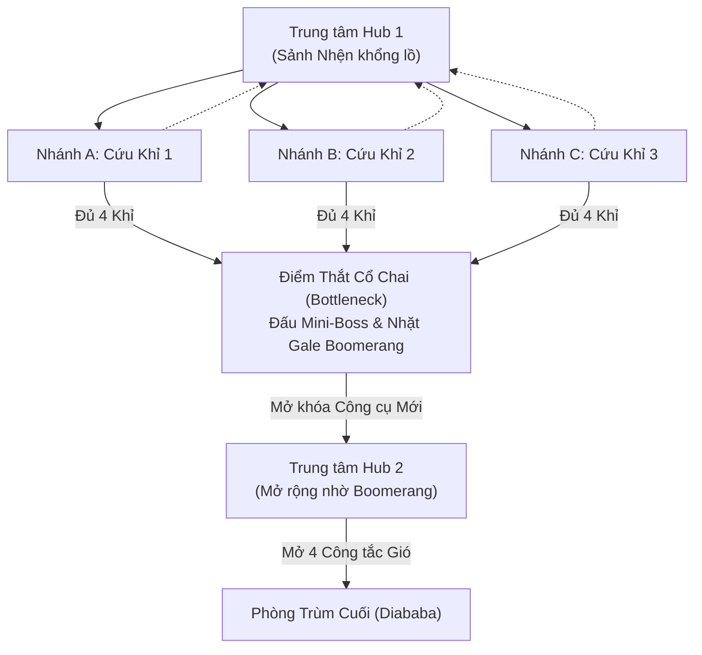
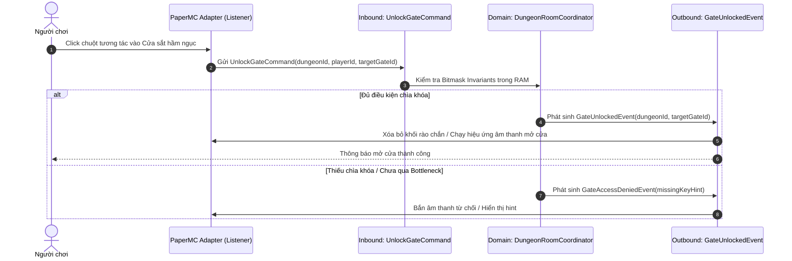

# Cơ chế Lock-and-Key, Bottlenecks và Mô hình Không gian Hub-and-Spoke

> **Tóm tắt (TL;DR):** Phân tích màn chơi Forest Temple trong *The Legend of Zelda: Twilight Princess* làm sáng tỏ 3 cơ chế thăng tiến cốt lõi: **Khóa & Chìa (Lock-and-Key)**, **Điểm thắt cổ chai (Bottlenecks)** và **Kiến trúc Không gian Trục bánh xe (Hub-and-Spoke Layout)**. Trong Pure Java Core, toàn bộ hầm ngục (Dungeon) được quản lý như một Đồ thị Trạng thái (Stateful DAG) kiểm tra quyền truy cập bằng Bitmask $\mathcal{O}(1)$, hoàn toàn không cần load chunk thế giới của Minecraft.

---

## 1. Bài toán Cốt lõi (Core Problem & Intent)

- **Vấn đề của Game Server truyền thống:** Logic vượt ải, mở cửa hầm ngục thường bị gắn chặt vào tọa độ khối (Blocks) hoặc Redstone của PaperMC. Khi server lag hoặc chunk bị unload, cửa có thể kẹt, người chơi mất chìa khóa, hoặc bypass qua tường bằng glitch dịch chuyển.
- **Mục tiêu Kiến trúc:** 
  1. Rời rạc hóa toàn bộ cấu trúc Dungeon thành một **Đồ thị Trạng thái Logic thuần túy (Logical Room Graph)** trong Domain Core.
  2. Áp dụng mô hình **Hub-and-Spoke** để giảm tải quãng đường di chuyển của người chơi (Backtracking) và cho phép người chơi tùy chọn thứ tự giải quyết các nhánh rẽ song song.

---

## 2. Các Khái niệm Thiết kế Cốt lõi (Zelda Case Study)



### 2.1. Cấu trúc Hub-and-Spoke (Trục và Nan hoa)
- **Cơ chế:** Một sảnh trung tâm (Hub) nối ra nhiều hành lang/phòng nhánh (Spokes). Người chơi sau khi giải quyết một thử thách ở nhánh rẽ sẽ quay lại sảnh chính để chọn nhánh tiếp theo.
- **Lợi ích thiết kế:**
  - *Tự do lựa chọn (Player Agency):* Người chơi tự quyết định thứ tự hoàn thành các nhánh. Nếu nhánh A quá khó, họ có thể lùi lại thử nhánh B trước.
  - *Tiết kiệm không gian & Giảm Backtracking:* Không bắt người chơi chạy một đường thẳng tắp rồi phải quay ngược từ đầu đến cuối map.
  - *Vị trí Checkpoint lý tưởng:* Hub là nơi đặt cổng hồi sinh, rương an toàn và điểm lưu game.

### 2.2. Điểm Thắt Cổ Chai (Bottlenecks)
- Sau một tập hợp các nhiệm vụ song song, màn chơi luôn hội tụ về một điểm kiểm soát bắt buộc (Choke Point - thường là một trận đấu Mini-Boss).
- **Mục đích:** Đảm bảo mọi người chơi khi bước sang nửa sau màn chơi đều đã đạt được một ngưỡng sức mạnh hoặc nhận được công cụ mới (New Capability / Verifying Competence).

### 2.3. Cơ chế Lock-and-Key đa năng
### 2.3. Cơ chế Chống Lạm phát Chỉ số (Anti-Power Creep) bằng Capability Keys
- Trong các server cày cuốc truyền thống, phần thưởng diệt Boss thường là tăng chỉ số tuyến tính ($+10 \to +50 \to +10,000$ damage), dẫn đến lạm phát chỉ số khủng khiếp khiến người mới không thể hòa nhập.
- **Triết lý Gale Boomerang của Zelda:** Thay vì tăng chỉ số thuần túy, trang bị hiếm là **Chìa khóa Năng lực Đa dụng (Capability Keys)**:
  - *Ví dụ:* "Áo Choàng Dệt Tơ Drow" rơi từ Boss Nhện không tăng máu hay giáp, nhưng mở khóa bitmask `CAPABILITY_WALL_CLIMB` hoặc `IMMUNE_WEB_SLOW`.
  - Nhờ chiếc áo này, người chơi mới vượt qua được hành lang tơ nhện ở Bottleneck để tiến vào Hub 2 khai thác tài nguyên hiếm.
  - **Giá trị kinh tế Chợ Đen:** Nằm ở *Quyền tiếp cận tài nguyên và tiến trình (Progression Access)* thay vì lấy chỉ số đè người trong PvP.

### 2.4. Thoát khỏi "Bẫy Data-Intensive" bằng Environmental Mutators
- Thay vì thức đêm dựng 10 tầng hầm ngục thủ công (Data-Intensive) mà người chơi cày nát trong 2 tiếng:
  - Xây dựng một cấu trúc **Hub-and-Spoke** chất lượng cao.
  - Mỗi khi D&D Rift mở ra, Domain gán ngẫu nhiên (theo Seed tất định) các **Biến số Môi trường (Environmental Mutators)**:
    - *Hôm nay:* Nhánh A bị dung nham dâng mỗi 200 tick (cần giày tốc chạy).
    - *Ngày mai:* Cùng nhánh A nhưng phủ Sương mù Underdark (cần đèn lồng ma thuật).
  - Tốn công sức dựng 1 map, nhưng sinh ra 50 trải nghiệm chiến thuật đa dạng!

---

## 3. Hiện thực hóa trong Pure Java Domain Core

### 3.1. Bẫy Kỹ thuật: "Nhảy cóc Đồ thị" (Topological Bypass) & Lẫn lộn Chìa khóa
> ⚠️ **Lỗ hổng Exploit:** Nếu chỉ kiểm tra `hasKey`, hacker đứng ở Hub 1 có thể gửi packet giả mạo `UnlockGateCommand(FINAL_BOSS_GATE)` để mở cửa Boss cuối dù chưa đi qua phòng trung gian! Đồng thời, nếu không phân tách bitmask, việc xóa bit khi mở cửa sẽ làm mất luôn công cụ vĩnh viễn (như Boomerang), hoặc ngược lại 1 chìa khóa sắt sẽ mở được toàn bộ cửa hầm ngục.

### 3.2. Mô hình Nâng cấp: Graph Adjacency + Dual Bitmask Engine
Toàn bộ việc kiểm tra chống hack dịch chuyển, kiểm tra chìa khóa và năng lực chỉ tốn đúng 6 phép toán Bitwise ($\mathcal{O}(1)$, $< 0.0005\text{ms}$):

```java
package com.game.engine.domain.dungeon.model;

public record DungeonProgress(
        int currentRoomId,                  // Vị trí phòng hiện tại của người chơi (0..63)
        long unlockedGatesBitmask,          // Các cổng đã được mở
        long consumableKeysBitmask,         // Chìa khóa dùng 1 lần (Xóa bit sau khi mở)
        long capabilitiesBitmask            // Năng lực vĩnh viễn kiểu Boomerang (Giữ nguyên bit)
) {
    public DungeonProgress unlockGate(
            long gateBit,
            long adjacentRoomsMask,         // Các phòng hợp lệ để tương tác với cổng này
            long requiredConsumableKeyMask,
            long requiredCapabilityMask
    ) {
        // 1. Chống Hack Teleport: Người chơi bắt buộc phải đứng ở phòng kề cạnh cổng
        long currentRoomBit = 1L << currentRoomId;
        if ((currentRoomBit & adjacentRoomsMask) == 0L) {
            throw new IllegalStateException("Topological violation: Cannot reach gate from room " + currentRoomId);
        }

        // 2. Kiểm tra cả Chìa khóa tiêu hao lẫn Công cụ đa năng
        boolean hasConsumables = (consumableKeysBitmask & requiredConsumableKeyMask) == requiredConsumableKeyMask;
        boolean hasCapabilities = (capabilitiesBitmask & requiredCapabilityMask) == requiredCapabilityMask;
        if (!hasConsumables || !hasCapabilities) {
            throw new IllegalStateException("Missing required keys or capabilities to unlock gate.");
        }

        // 3. Mở cổng (OR) và CHỈ xóa bit của chìa khóa tiêu hao (AND NOT)
        long nextGates = unlockedGatesBitmask | gateBit;
        long nextConsumables = consumableKeysBitmask & (~requiredConsumableKeyMask);

        return new DungeonProgress(currentRoomId, nextGates, nextConsumables, capabilitiesBitmask);
    }

    public DungeonProgress moveToRoom(int targetRoomId, long connectedRoomsMask) {
        long targetBit = 1L << targetRoomId;
        if ((targetBit & connectedRoomsMask) == 0L) {
            throw new IllegalStateException("Cannot move: Room " + targetRoomId + " not connected!");
        }
        return new DungeonProgress(targetRoomId, unlockedGatesBitmask, consumableKeysBitmask, capabilitiesBitmask);
    }
}
```

### 3.2. Sơ đồ Tách biệt với Tầng Adapter (PaperMC / WebGL)



---

## 4. Ưu thế Kỹ thuật của Phương pháp này
1. **Chống Bug Bypass & Wall Glitch:** Người chơi có thể dùng mod hack để teleport qua cánh cửa sắt trong Minecraft, nhưng khi họ bước vào phòng trong, Domain Core kiểm tra `unlockedGatesBitmask == 0` sẽ ngay lập tức kích hoạt Outbound Event kéo giật người chơi trở lại sảnh Hub (Server-Authoritative Anti-Cheat).
2. **Kiểm thử Tức thời (Headless Simulation):** Có thể viết một JUnit 5 Test mô phỏng toàn bộ luồng đi từ Hub 1 qua các Spokes đến phòng Boss chỉ trong $1\text{ms}$, đảm bảo không bao giờ có ngõ cụt logic (Logic Softlock) trước khi người chơi đặt chân vào game.

---

## 5. Danh mục Tham chiếu (Wikilinks)
- Template áp dụng: `[[00_Templates/Tpl_Feature_Spec]]`
- Các hạt tri thức liên quan:
  - `[[01_Knowledge_Atoms/KA_Mechanics_Emergence_vs_Progression]]`
  - `[[01_Knowledge_Atoms/KA_Architecture_Hybrid_Emergence_Progression]]`
  - `[[01_Knowledge_Atoms/KA_Mechanics_Five_Types_Classification]]`
- Quyết định kiến trúc tương ứng:
  - `[[03_ADR_Architecture/ADR_001_Hexagonal_Domain_Separation]]`
